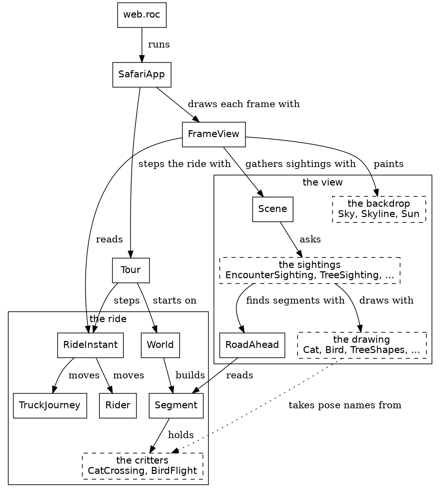
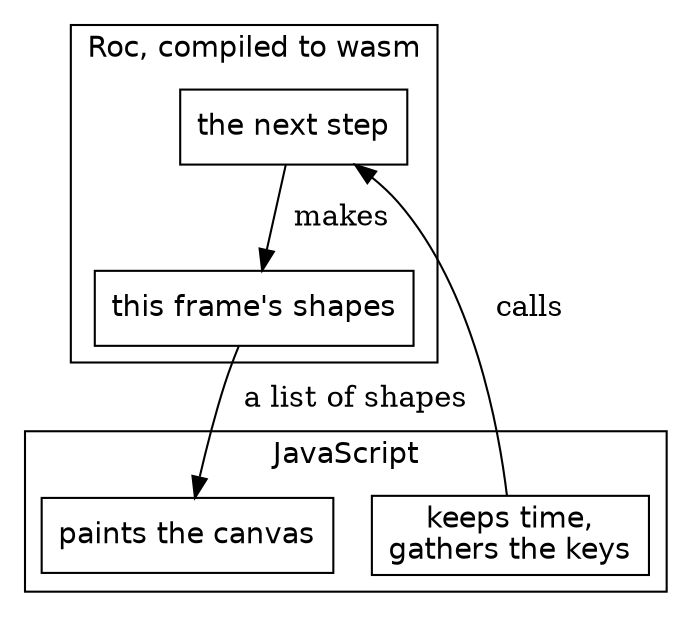
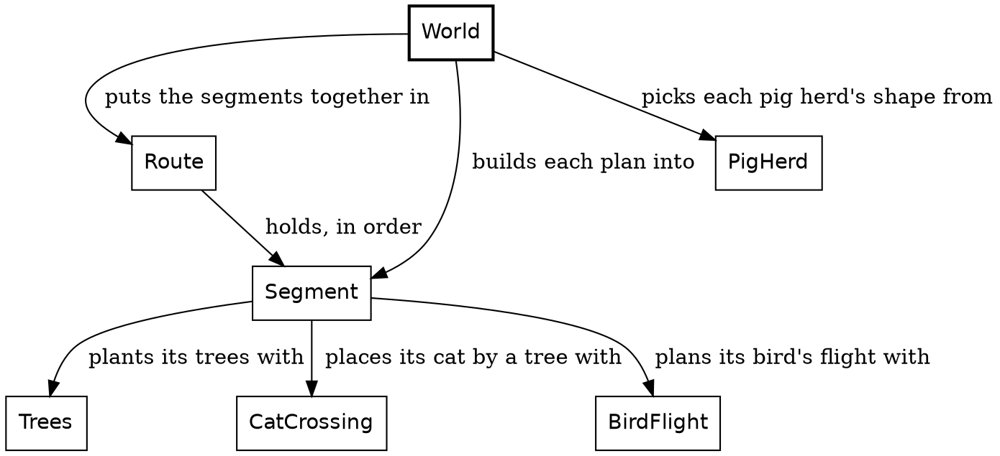

# Shapes, The modules and The world, clean drafts

The new order puts Shapes right after The problem: the reader learns to draw before anything is placed on the road. Shapes is now just the triangle and the rectangle. `SimpleTree` is gone, and the shapes picture calls `Polygon` directly. The modules and The world are clean drafts too. The world's diagram is rebuilt from the real imports, and the old one claimed `World` plans the cats' crossings. Reply on any paragraph.

---

## Shapes

Every frame of Safari Ride is a list of shapes, and nearly every shape is a polygon. Roc builds the list, and JavaScript on this page paints it, from the first shape to the last. In this chapter we draw the two polygons a tree is made of: a triangle and a rectangle.

New in this chapter:

- Roc: tags with payloads, a record taken apart in a parameter list, opaque types, static dispatch
- Modules: `Shapes`, `Screen`, `Pixels`, `Polygon`

### The polygon

A shape is one of a handful of tags:

```roc lib/Shapes.roc
## One thing in a frame. A later shape in the list paints over an earlier one.
Shape : [
	## A polygon, as x0, y0, x1, y1 and so on. It can be any polygon. A painter
	## that fills only convex ones has `ConvexCut` cut the rest into triangles.
	Poly({ coordinates : List(F64), fill : Brush.Fill }),

	Disc({ x : F64, y : F64, radius : F64, fill : Brush.Fill }),
	Rect({ x : F64, y : F64, width : F64, height : F64, fill : Brush.Fill }),

	## A mark, not a shape: how the shapes after it combine, until the next `Blend`.
	## A painter holds this as a mode, so a mark in the list says it directly.
	## `Shapes.added_light_shapes` writes the pair of marks around a run of shapes.
	Blend(Shapes.Mode),

	## A mark, not a shape: the space the shapes after it are in, until the next
	## `View`. It is a mark for the same reason `Blend` is. `Shapes.shapes_in_space`
	## writes the pair of marks around a run of shapes.
	View(Shapes.Space),

	## `cols` by `rows` pixels stretched over the box without smoothing. It carries
	## the pixels, not a handle, so there is no second copy of them to keep in step.
	Image({ x : F64, y : F64, width : F64, height : F64, cols : U64, rows : U64, pixels : List(Brush.Rgba) }),

	## A line of words in a real typeface. `Font.plotted_shapes` gives a painter that has
	## no typefaces the strokes of the same line.
	Text(Shapes.TextLine),
]
```

Each tag carries its data in parentheses. `Poly` is a polygon. Its `coordinates` list the corners as plain numbers, an `x` and then a `y` for each, and its `fill` colors the inside. A polygon can be any flat surface: a tier of a tree, a stretch of road, a side of the truck. So the ride draws nearly everything as a `Poly`. At step 1,529, 2,113 of the frame's 2,121 shapes are polygons.

### A triangle

Here is a triangle:

```widget shapes triangle
A green triangle on a plain background.
```

And here is the code that makes it:

```roc shapes_widget/ShapesWidgetApp.roc
## A green triangle.
green_triangle : Shapes.Shape
green_triangle = Polygon.triangle(
	{
		first_corner: Screen.point(180.0, 280.0),
		second_corner: Screen.point(420.0, 280.0),
		third_corner: Screen.point(300.0, 60.0),
	},
	RgbColor.of(0x2e8b57),
)
```

Each corner is a `Screen.Point`, an `x` and a `y` on the canvas. The canvas is measured from its top left, and `y` grows downward. `0x2e8b57` is the color, the same six hex digits a web page writes after its `#`.

`Polygon.triangle` builds the `Poly`:

```roc Polygon.roc
## Makes a triangle of one flat color.
triangle : {
	first_corner : Screen.Point,
	second_corner : Screen.Point,
	third_corner : Screen.Point,
},
RgbColor -> Shapes.Shape
triangle = |{ first_corner, second_corner, third_corner }, color|
	Poly({
		coordinates: [
			first_corner.x.to_f64(),
			first_corner.y.to_f64(),
			second_corner.x.to_f64(),
			second_corner.y.to_f64(),
			third_corner.x.to_f64(),
			third_corner.y.to_f64(),
		],
		fill: Brush.flat(color),
	})
```

The parameter `{ first_corner, second_corner, third_corner }` takes the record apart into three names. Every caller names all three corners, so every triangle has exactly three, by construction. The body lists the six numbers and fills the inside with one flat color.

`first_corner.x` is a `Pixels`, a length on the screen. `Pixels` is an opaque type: an `F64` underneath, but only its own module sees the number. Screen lengths and road lengths never mix. `first_corner.x.to_f64()` takes the number out, and it uses static dispatch: Roc finds `to_f64` from the type of `first_corner.x`, so the call needs no `Pixels.` in front.

`triangle` is a thin wrapper, and it earns its place. A `Poly` takes a bare list of numbers. `triangle` takes three named corners.

### A rectangle

Next, let's build a rectangle:

```widget shapes rectangle
A brown rectangle on a plain background.
```

```roc shapes_widget/ShapesWidgetApp.roc
## A brown rectangle.
brown_rectangle : Shapes.Shape
brown_rectangle = Polygon.rectangle(
	{ top_left: Screen.point(240.0, 100.0), bottom_right: Screen.point(360.0, 260.0) },
	RgbColor.of(0x8b5a2b),
)
```

A rectangle's sides run along the canvas's edges, so two opposite corners pin it down. `Polygon.rectangle` takes just those two:

```roc Polygon.roc
## Makes a rectangle of one flat color. Its sides run along the screen's edges.
rectangle : { top_left : Screen.Point, bottom_right : Screen.Point }, RgbColor -> Shapes.Shape
rectangle = |{ top_left, bottom_right }, color| {
	left = top_left.x.to_f64()
	top = top_left.y.to_f64()
	right = bottom_right.x.to_f64()
	bottom = bottom_right.y.to_f64()
	Poly({
		coordinates: [
			left,
			top,
			right,
			top,
			right,
			bottom,
			left,
			bottom,
		],
		fill: Brush.flat(color),
	})
}
```

It names the four edges, then lists the corners clockwise from the top left, each one an edge for its `x` and an edge for its `y`.

A far tree in the ride is one rectangle of trunk under eight of these triangles.

## The modules

Safari Ride splits cleanly in two: the ride, and the view of the ride. In this chapter we map the modules on both sides, look at the thin layer of JavaScript that runs them, and open up one sighting.

Here is the whole system, simplified. Each arrow points from a module to a module it imports, and its label says what for. A dashed box stands for a family of modules. Roc forbids import cycles, so no path of arrows loops back.

The whole system, simplified


New in this chapter:

- Roc: imports that can't form a cycle
- Modules: `SafariApp`, `Tour`, `FrameView`, `Scene`, `EncounterSighting`

### The ride and the view

The ride is what happens. `RideInstant` holds the four things a step carries, and moves them on: `Rider` moves the rider, and `TruckJourney` moves the truck. `World` lays out the route as a list of segments, and each segment holds its critters, such as the cat and the bird.

The view is what the rider sees. `FrameView` reads one instant of the ride and builds its frame. It paints the backdrop of sky, land and sun, and asks `Scene` for everything else. `Scene` gathers the sightings, and each kind of thing has a sighting module that finds it and a drawing module that draws it.

Every arrow between the two halves points the same way: the view reads the ride. The dotted arrow is the one place where drawing code reads a critter's module. `Cat` takes the cat's pose type and its height from `CatCrossing`, because the crossing decides the pose and the drawing only paints it.

`SafariApp` sits on top of both halves. It steps the ride with `Tour`, which can move the ride forward or back, and it draws each frame with `FrameView`.

### The part that isn't Roc

One tick across the line between JavaScript and Roc


Safari Ride runs in a browser. The Roc compiles to WebAssembly, or wasm, and a thin layer of JavaScript runs it. Each frame, the JavaScript keeps time, gathers the keys and calls into Roc. Roc answers with a list of shapes, and the JavaScript paints them on a canvas. Everything about the ride lives on the Roc side of that line. The JavaScript paints shapes and never hears of a cat. "The platform" comes back to this line.

### What's a sighting?

"The problem" said we need machinery to work out what the rider sees. A sighting is that machinery's answer for one thing, on one frame. Here is a real one. At step 1,529 of the ride, a cat is frozen in the road, and `EncounterSighting` sights it:

| Field | Value |
|---|---|
| `right` | 0.38 metres |
| `forward` | 23.63 metres |
| `pose` | `Frozen` |
| `lift` | 0 |

`right` and `forward` place the cat's foot in the rider's view, in metres from the camera. `lift` is its height off the ground. `pose` tells the drawing how the cat stands. In code, a sighting is a small record:

```roc Pipeline.roc
## An object in the rider's view, and what kind of object it is, for one
## frame.
Sighted(kind) : { spot : Spot, kind : kind }
```

The `spot` says where the thing stands in the rider's view, and the `kind` says what it is. It holds no drawing at all. Since a sighting is plain data, a test can check it with numbers. The gate checks this very cat's numbers without drawing a pixel.

`EncounterSighting` finds the cat in a few moves. It goes through the segments of road ahead. A segment is one stretch of road between two bends. It asks `EncounterPoses.cat_poses` where each cat is and how it stands. Then it works out where each cat lands in the rider's view, and keeps only the ones in front of the camera and tall enough on the screen to draw.

Each kind of thing pairs a sighting module with a drawing module. `EncounterSighting` pairs with `Cat` and `Bird`, `TreeSighting` with `TreeShapes`, `TowerSighting` with `Tower`, `TruckSighting` with `Truck`, and `BillboardSighting` with `Billboard`, which draws the farm animals, the safari animals at the bends and the ducks. `Scene.scene_in_view` gathers every sighting and turns each one into a `Rendered`: a picture from the thing's drawing module, plus its depth. `Scene.scene_renderings` then sorts the renderings far to near, so nearer things paint over farther ones.

A sighting also decides what doesn't get drawn. Here are more things from step 1,529, and what their sightings decide. A `forward` below zero is behind the camera.

| What it is | `right` | `forward` | What its sighting decides |
|---|---|---|---|
| The cat, frozen | 0.38 | 23.63 | drawn |
| The nearest tree, a big green one | 3.45 | 21.63 | drawn |
| The nearest tree behind the camera, a gold one | -8.09 | -8.36 | `BehindCamera` |
| The nearest tree the earth's curve hides, a small green one five segments on | -1,433.43 | 446.00 | `BelowHorizon` |
| A big green tree just past it | -1,446.07 | 473.21 | drawn |
| The radio tower past the end of the rider's segment | 20.40 | 355.61 | drawn |
| The truck | 92.19 | 489.15 | drawn |

The earth curves, so a small tree far away sinks below the horizon, while a taller one just past it still shows its top. Of the 214 trees on the segments in view, 136 are drawn, 30 are behind the camera, and 48 are below the horizon. None is too small. The other 78 never reach the screen.

All of this happens within one frame. The next frame sights everything again, from its own step's four carried things. Next, we hold one frame still and look at what's in it, starting with the parts that never change.

## The world

Safari Ride builds its whole world before the rider moves an inch, and from then on it only reads it. In this chapter we read that world: a route made of road segments, and the plan for each one. It's the easiest part of the program to read, because none of it changes.

```widget route
The whole route in one picture. The white stretch is segment 7, the longest, and the lines under the map read out its plan.
```

Each stretch of the map is one segment: the road from one bend to the next. The ride itself draws no map, and it never needs one. A place on the road is always measured within its own segment, as how far along and how far across. We drew this map for the book.

New in this chapter:

- Roc: tag unions in place of booleans, `match` covering every tag, void modules, `var`, record update, `crash`
- Modules: `World`, `Route`, `Segment`, `Trees`

### Get the types right

Each segment starts as a plan, and a plan is a record:

```roc World.roc
## One segment of the route as planned: its length and scenery, and what
## lives along it.
SegmentPlan : {
	length : Distance,
	scheme : Trees.Scheme,
	encounter : Segment.PlannedEncounter,
	pigs : World.PigPresence,
	bull : CowHerd.Bull,
}
```

The fields are small tag unions. `CowHerd.Bull` is `[WithBull, NoBull]`, so a plan says `bull: WithBull`, and the value names itself.

Here are the route's first six plans, from `World.bending_plans`. Each one also says how its segment turns into the next.

| Segment | Length | Turn at the end | Trees | Encounter | Herds |
|---|---|---|---|---|---|
| 1 | 500 metres | 50 degrees right | all green | a bird | cows |
| 2 | 320 metres | 70 degrees left | all green | quiet | cows |
| 3 | 400 metres | 20 degrees right | all green | a bird | cows and pigs |
| 4 | 300 metres | 20 degrees right | gold and green | a cat | cows |
| 5 | 300 metres | 70 degrees left | all green | quiet | cows, with a bull |
| 6 | 300 metres | 70 degrees left | all green | a bird | cows, with a bull |

`World.route` builds the route from these plans, once, before the first step. Each plan becomes a `Segment`, and the segment plants its trees, places its herds and plans its encounter.

The modules that build the world


Even the world keeps as little as it can. A segment keeps its herd of cows, not each cow: a cow's place is worked out from the herd whenever something asks for it. Radio towers aren't kept at all. One stands past the end of every segment, and one halfway along any segment longer than a kilometre, so the segment is all a tower needs.

### The functions

`Trees` plants a segment's trees. It's a void module: `Trees :: [].{ ... }` is a type with no values, because `[]` is a tag union with no tags. The type is only a home for the definitions in its block. Here is how it plants a segment:

```roc Trees.roc
## A segment's trees, in pairs from its start, each pair's left tree
## first.
roadside_trees : { scheme : Trees.Scheme, length : Distance } -> List(Trees.RoadsideTree)
roadside_trees = |{ scheme, length }| {
	last_along = Along.at(length.minus(tree_end_inset))
	var $along = Along.at(tree_start_inset)
	var $conifer = Conifer.Green
	var $trees = []
	while $along <= last_along {
		tree_distance = tree_line_distance($conifer)
		left_tree = {
			road_point: { along: $along, across: Across.left_of_middle(tree_distance) },
			lift: Distance.zero,
			kind: $conifer,
		}
		right_tree = {
			..left_tree,
			road_point: { along: $along, across: Across.right_of_middle(tree_distance) },
		}
		$trees = $trees.append(left_tree).append(right_tree)
		$along = $along.plus(tree_spacing)
		$conifer =
			match $conifer {
				Green => accent_conifer(scheme)
				SmallGreen | Red | Gold => Conifer.Green
			}
	}
	$trees
}
```

The trees stand in pairs, a left tree and a right tree, every few metres along the segment. Three Roc ideas show up here.

`$along`, `$conifer` and `$trees` are each a `var`, a name the loop gives a new value each time around. The `$` marks it. `roadside_trees` is still a pure function, because no code outside it sees a `var` change.

`{ ..left_tree, road_point: ... }` is a record update. It makes a copy of `left_tree` with a new `road_point`, so the right tree matches the left one in everything but its place.

The last `match` picks the next pair's conifer. A green pair is followed by the segment's accent, and any accent is followed by green. `accent_conifer` turns the segment's scheme into its accent:

```roc Trees.roc
## The conifer that sets off a scheme's green.
accent_conifer : Trees.Scheme -> Conifer
accent_conifer = |scheme|
	match scheme {
		GoldGreen => Conifer.Gold
		RedGreen => Conifer.Red
		AllGreen => Conifer.SmallGreen
	}
```

A `match` covers every tag of the union it matches on. Leave one out and the program doesn't compile, so a new scheme can't slip past this function unnoticed.

A segment's place in the route is a `Route.SegmentIndex`, an opaque type like `Pixels`, with a `U32` underneath. No other code can mistake an index for a count of trees. `Route.segment_at` looks a segment up:

```roc Route.roc
## The segment at `index`.
segment_at : Route, Route.SegmentIndex -> Segment
segment_at = |Route.(segments), index|
	segments.get(index.count_before())
		?? crash "Route.segment_at: the route has no segment there"
```

An index past the end of the route is a bug in Safari Ride, so `crash` stops the program and says so. `crash` is for bugs, never for a case the program should handle.

Nothing in this chapter moves, and nothing in the next few chapters does either. We hold one frame still and look at everything in it. First, what a picture is made of.


