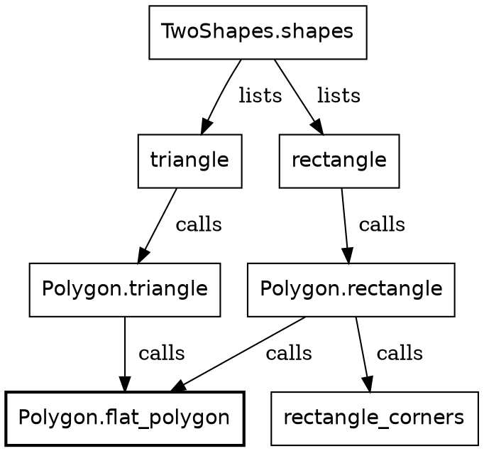
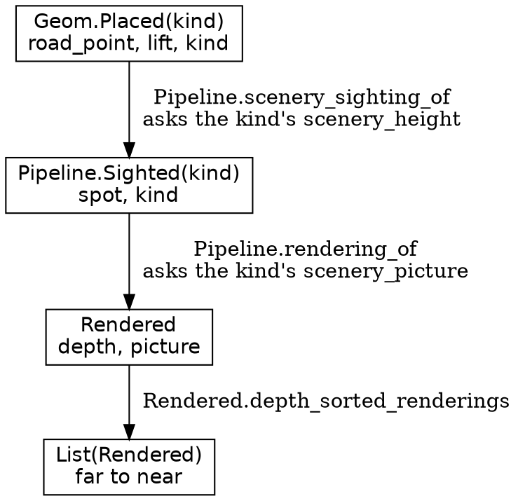
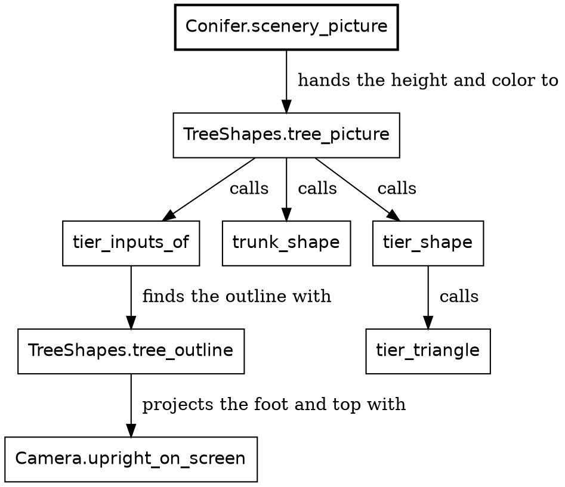
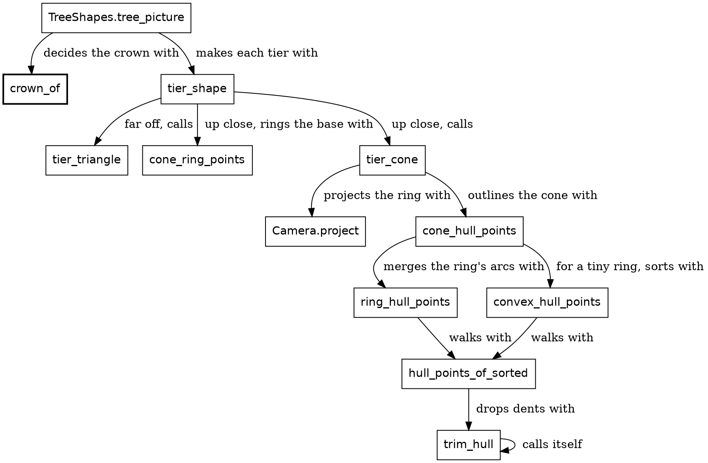
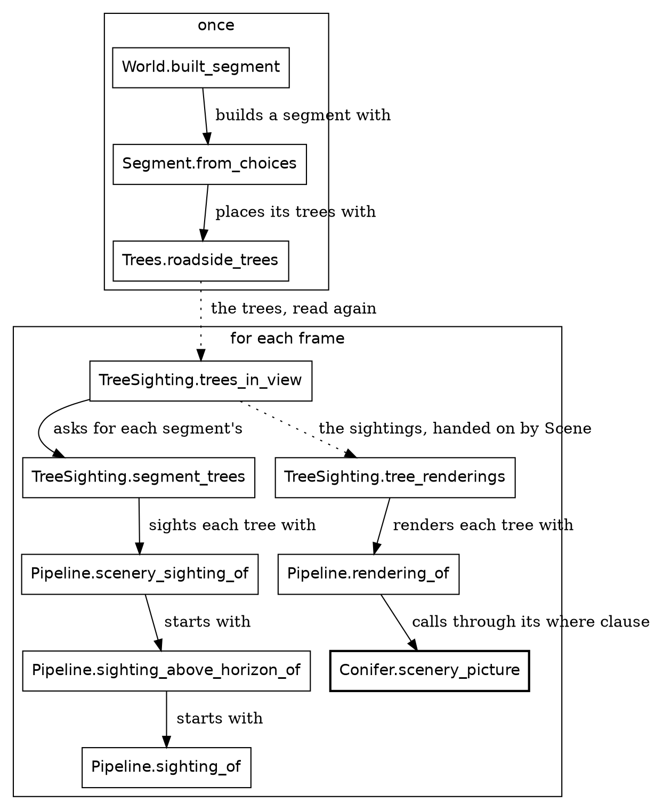

# Proofread: batch 2, Shapes through Grass

*For Steve's read, 2026-11-10. Six chapters, rewritten against MISSION.md: active voice, say what happens, the carried-and-derived wording, and the code as it stands after the standing design. A cold reader then checked truth and order: 12 findings, all fixed, among them three false sentences I had written (the grass paints over the bottom of the sky; a fifth kind of tree changes `Trees` too; the truck makes its own `Rendered`). Code is filled in. Comments welcome inline.*

---

## Shapes

Before we draw a tree, we need to know what drawing means here. For each frame, the Roc app answers with a list of shapes, and a painter puts them on a canvas. The painter on this page is JavaScript. It could as well be a wasm host, written in Odin or Zig, say, and the same Roc would serve it. A painter is a bit like a printer: it does exactly what the list says.

New in this chapter:

- Roc: a record taken apart in a parameter list, `Try`
- Modules: `TwoShapes`, `Shapes`, `Polygon`, `Screen`, `Pixels`, `Picture`, `GroundPatch`

### Get the types right

Three types carry everything a frame paints:

| Type | What it is |
|---|---|
| `Screen.Point` | A place on the canvas, as an `x` and a `y` in `Pixels` from its top left |
| `Shapes.Shape` | One item in a frame's list, such as a polygon |
| `Picture` | The shapes that paint one object, in the order they're painted |

Safari Ride's frames are for a canvas 960 pixels wide and 600 pixels tall, and `y` grows downward. `Pixels` is a length on the screen. It's opaque like `Clock`, and it's an `F64` underneath, because a corner can fall between two pixels. A `Screen.Point` is a record of two of them:

```roc Screen.roc
## A point on the screen, in pixels from its top left corner. Either can be
## negative, or past the far edge, for a point off the screen.
Point : { x : Pixels, y : Pixels }
```

`Screen.point(x, y)` makes one from two plain numbers.

A frame is a list of `Shapes.Shape`:

```roc lib/Shapes.roc
## One thing in a frame. A later shape in the list paints over an earlier one.
Shape : [
	## A polygon, as x0, y0, x1, y1 and so on. It can be any polygon. A painter
	## that fills only convex ones has `ConvexCut` cut the rest into triangles.
	Poly({ coordinates : List(F64), fill : Brush.Fill }),

	Disc({ x : F64, y : F64, radius : F64, fill : Brush.Fill }),
	Rect({ x : F64, y : F64, width : F64, height : F64, fill : Brush.Fill }),

	## A mark, not a shape: how the shapes after it combine, until the next `Blend`.
	## A painter holds this as a mode, so a mark in the list says it directly.
	## `Shapes.added_light_shapes` writes the pair of marks around a run of shapes.
	Blend(Shapes.Mode),

	## A mark, not a shape: the space the shapes after it are in, until the next
	## `View`. It is a mark for the same reason `Blend` is. `Shapes.shapes_in_space`
	## writes the pair of marks around a run of shapes.
	View(Shapes.Space),

	## `cols` by `rows` pixels stretched over the box without smoothing. It carries
	## the pixels, not a handle, so there is no second copy of them to keep in step.
	Image({ x : F64, y : F64, width : F64, height : F64, cols : U64, rows : U64, pixels : List(Brush.Rgba) }),

	## A line of words in a real typeface. `Font.plotted_shapes` gives a painter that has
	## no typefaces the strokes of the same line.
	Text(Shapes.TextLine),
]
```

Each tag here carries a value in parentheses, called its payload. A `Poly` carries a record of its coordinates and its fill, and a `Disc` carries its center, as an `x` and a `y`, its radius and its fill. The chapter A conifer comes back to payloads. A fill is a `Brush.Fill`, another tag union: `Flat` with one color, or one of several kinds of shading and gradient.

Every canvas app in this repository, under `canvas_apps`, shares `Shapes.Shape`. Two of its tags, `Blend` and `View`, are marks that change how the shapes after them are painted. A frame of Safari Ride often holds more than 2,000 shapes, and nearly all of them are `Poly`.

Here's a frame with a triangle and a rectangle in it:

```widget shapes
The list `TwoShapes.shapes`, painted over a plain background, on a smaller canvas than the ride's.
```

It's made like this:

The two shapes, from the top


A box is a definition, and an arrow points to a definition it uses. The top three are values, made once. The rest are functions in `Polygon`. The widget adds one more shape of its own, the plain background, at the front of the list.

### The functions

Here's the whole of `TwoShapes`:

```roc shapes_widget/TwoShapes.roc, the whole file
## A frame is a list of shapes, painted first to last. The rectangle comes second
## in the list, so where the two overlap it paints over the triangle.
import game.Polygon
import game.Screen
import lib.RgbColor
import lib.Shapes

TwoShapes :: [].{

	shapes : List(Shapes.Shape)
	shapes = [triangle, rectangle]
}

triangle : Shapes.Shape
triangle = Polygon.triangle(
	{
		first_corner: Screen.point(120.0, 300.0),
		second_corner: Screen.point(360.0, 300.0),
		third_corner: Screen.point(240.0, 60.0),
	},
	RgbColor.of(0x2e8b57),
)

rectangle : Shapes.Shape
rectangle = Polygon.rectangle(
	{ top_left: Screen.point(270.0, 120.0), bottom_right: Screen.point(520.0, 250.0) },
	RgbColor.of(0xe8a33d),
)

expect TwoShapes.shapes.last() == Ok(rectangle)
```

A color is a whole number in hex, with the six digits a web page writes after its `#`. `0x2e8b57` is a green, and `0xe8a33d` is an amber.

`Polygon.triangle` makes a value that describes a triangle, and the painter draws it later. Every maker in `Polygon` works this way. The triangle hands its three corners to `flat_polygon`:

```roc Polygon.roc
## Makes a triangle of one flat color.
triangle : {
	first_corner : Screen.Point,
	second_corner : Screen.Point,
	third_corner : Screen.Point,
},
RgbColor -> Shapes.Shape
triangle = |{ first_corner, second_corner, third_corner }, color|
	flat_polygon([first_corner, second_corner, third_corner], color)
```

`Polygon.triangle` takes two arguments: a record of three corners, and a color. Between the bars, `|…|`, which hold a function's parameters, `{ first_corner, second_corner, third_corner }` takes that record apart into three names. A caller gives all three by name, in any order, and the compiler checks that all three are there.

`Polygon.rectangle` takes two opposite corners, and `rectangle_corners` works out all four, clockwise from the top left. Either way, `flat_polygon` makes a `Poly` of one color from a list of corners:

```roc Polygon.roc
## Makes a polygon of one flat color.
flat_polygon : List(Screen.Point), RgbColor -> Shapes.Shape
flat_polygon = |corners, color|
	Poly({
		coordinates: polygon_coordinates("Polygon.flat_polygon", corners),
		fill: Brush.flat(color),
	})
```

`Brush.flat` turns a hex color into the color a painter wants, with no transparency, and wraps it in `Flat`, a fill of one color.

So our rectangle is a `Poly`. A rectangle is a polygon with four corners, so it goes through the same `flat_polygon` as a triangle, and every polygon reaches the painter the same way.

A polygon needs at least three corners, and `polygon_coordinates` checks:

```roc Polygon.roc
## The numbers of a polygon's corners. Fewer than three corners enclose nothing,
## so that crashes, naming the `maker` that was asked.
polygon_coordinates : Str, List(Screen.Point) -> List(F64)
polygon_coordinates = |maker, corners|
	if corners.len() < 3 {
		crash "${maker}: a polygon needs three corners"
	} else {
		flat_coordinates(corners)
	}
```

Fewer than three is a bug in Safari Ride, so it crashes, loudly. `maker` names the function that asked, so the crash says where the bug is.

Some things can rightly have nothing to show. A `GroundPatch` is a patch of ground: a list of corners on the ground, and a color. A patch wholly behind the camera shows nothing. So `GroundPatch.patch_shape` answers a `Try`:

```roc GroundPatch.roc
patch_shape : GroundPatch, Pixels -> Try(Shapes.Shape, [PastHorizon, BehindCamera])
```

Its second argument is the lens's focal length, in pixels, which turns corners on the ground into places on the screen. The chapter A simple tree puts the lens to work, projecting a tree's foot and top onto the screen. A `Try` is either `Ok` holding a shape, or `Err` holding a reason, here `BehindCamera` or `PastHorizon`. Both answers are in the type, so whoever calls `patch_shape` has to handle the ground behind the camera.

### Pictures

Something made of several shapes is a list of them. A tree is nine: a trunk and eight tiers of foliage. The shapes that paint one object, in order, make a `Picture`:

```roc Picture.roc
from_shapes : List(Shapes.Shape) -> Picture
to_shapes : Picture -> List(Shapes.Shape)
```

`Picture` is opaque, and a `List(Shapes.Shape)` underneath. Outside its module, a picture is one thing, handed along whole until something paints it.

The order of a list is the order of painting, so in our frame the rectangle covers part of the triangle. A frame paints the backdrop, the mountains and the ground first, then a series of pictures, far to near.

For the next few chapters, the work is choosing corners and choosing their order. Before the first tree, though, we need the few types that every object along the road goes through.

## Nature types

The objects along the road come in six kinds: trees, radio towers, billboards (the cows, the pigs, the ducks and the other animals by the road), the cat, the bird and the truck. Each kind is drawn its own way, and each kind's sighting module finds its own objects on the road. After that, nearly every object takes the same steps. The camera sees it, its kind draws it, and it gets a depth, so that it can be painted in order with all the others, far to near. Written once for each kind, those steps would be the same code six times over. Safari Ride writes them once, in `Pipeline`, and each kind says only how tall it is and how it looks.

New in this chapter:

- Roc: defining a type with a type variable, `where`
- Modules: `Pipeline`, `Spot`, `Rendered`, `Geom`, `Along`, `Across`, `Distance`

`Pipeline` and `Rendered` came up in The modules chapter, and here we look at them properly.

### Three forms and a kind

An object takes three forms on its way to the screen:

1. Placed: it stands at a place on the road, measured along and across a segment.
2. Sighted: the camera sees it some distance to the right and forward.
3. Rendered: it's a picture, with a depth that says how far ahead of the camera it stands.

A sighting and a rendering last one frame. How long a placing lasts depends on the object. A tree or a cow is placed on the road once, when the world is built, and stays there for the whole ride. A cat moves, so it's placed anew for each frame.

Each object has a kind, such as `Conifer` or `Billboard`. A kind says how the object looks, never where it is. The first two forms hold the kind, and the fields around it say where the object is. A kind is asked for its height, to see whether the object stands tall enough on the screen to draw, and for its picture, which goes into the rendering. A rendering keeps the picture and not the kind.

`Conifer` is one of four tags, `Green`, `SmallGreen`, `Red` or `Gold`, and the tag alone settles a tree's height and color. `Billboard` is a record with three fields: a still (an emoji drawn as polygons), a height, and which way it faces. A cow, a pig and a duck on the pond are all billboards. Where the object stands lives in the forms around the kind.

### Get the types right

A lowercase name in parentheses, like `(kind)`, is a type variable; this chapter comes to them below.

| Type | What it is |
|---|---|
| `Geom.Placed(kind)` | An object on the road: its `road_point` on its segment, its `lift` off the ground, and its `kind` |
| `Spot` | Where an object stands in one frame: its `lift` off the ground, its `foot` in the rider's view, and the `road_heading`, which way the road runs there |
| `Pipeline.Sighted(kind)` | An object in view: its `spot` and its `kind` |
| `Picture.Setting(context)` | What a kind draws from: its `spot`, the lens's `focal_length`, and a `context` for whatever else the kind needs |
| `Picture` | The object's shapes, in order, from the Shapes chapter |
| `Rendered` | The object's `picture`, and its `depth`: how far ahead of the camera it stands |

One object through one frame


A box is a type, and an arrow is a function that makes the next one. The kind goes in at the top and comes out of `Pipeline.rendering_of` as a picture. `Rendered` has no kind, so a tree's rendering and a cow's are the same type, and every rendering in the frame goes in one list for the depth sort. That sort is `DepthSort`, a stable merge sort that orders the list from far to near.

### A type with a type variable

We've used types that take an argument since the Shapes chapter. A `Picture` is a `List(Shapes.Shape)` underneath, and a `List` can hold any one type, named in its parentheses. `Geom.Placed` is a type of our own that works the same way:

```roc Geom.roc
## An object on one segment of the road, `lift` off the ground, and what
## kind of object it is. A tree or a cow is placed once for the whole ride;
## a cat, a tower or the truck is placed anew for each frame.
## `Pipeline.sighting_of` turns it into a `Pipeline.Sighted` for a frame.
Placed(kind) : {
	road_point : Geom.RoadPoint,
	lift : Distance,
	kind : kind,
}
```

The `kind` in its head, `Placed(kind)`, is lowercase, and that makes it a type variable: a name for whatever type goes in the parentheses. The fields use it like any other type. So `Geom.Placed(Conifer)` is a record of a `road_point`, a `lift`, and a `kind` that holds a `Conifer`, just as `List(Shapes.Shape)` is a list that holds shapes. A cow is a `Geom.Placed(Billboard)`.

A `Geom.Placed`'s `road_point` is made of two such types. `Along` is a place along a segment, and `Across` is a place across the road, measured from its middle. Both are opaque, like `Clock`, so passing one as the other is a compile-time error. One place minus another is a `Distance`, a length in metres, and a length is a different thing from a place, and Roc's `-` always gives back its left side's type, so that subtraction is a named method, `distance_from`, rather than `-`.

A type's head declares its variables. A function's annotation needs no head: a lowercase name in it is a type variable, and it means one type wherever it appears in that annotation. `Pipeline.sighting_of` takes a `Geom.Placed(kind)` and answers with a `Try` that holds a `Pipeline.Sighted(kind)` when the object stands in front of the camera. Both name the same `kind`, so a placed conifer can only come back as a sighted conifer, never as a sighted cow.

`Picture.Setting(context)` has a variable named `context`. A conifer's context is a `TreeShapes.Detail`. That's the record `{ nearer_tree_count : U64 }`: how many trees are nearer than this one. A billboard needs nothing more, so its context is `{}`, the empty record.

### Asking a kind by name

`Pipeline` imports neither `Conifer` nor `Billboard`, and neither of them imports `Pipeline`. Yet `Pipeline.rendering_of`, the one function this chapter shows in full, gets a picture out of either one:

```roc Pipeline.roc
## `sighting` drawn through a lens of `focal_length`, with `context`
## for whatever else its kind needs.
rendering_of : Pipeline.Sighted(kind), { focal_length : Pixels, context : context } -> Rendered
	where [kind.scenery_picture : kind, Picture.Setting(context) -> Picture]
rendering_of = |sighting, { focal_length, context }|
	Rendered.of(
		sighting.spot.foot().forward(),
		sighting.kind.scenery_picture({ spot: sighting.spot, focal_length, context }),
	)
```

It hands the sighting's whole `spot`, the lens and the context to the kind's own `scenery_picture`. It answers with a `Rendered`: the picture it gets back, and a depth. Its depth is how far forward the spot's foot is: `spot.foot().forward()`.

The second line of the annotation, indented under the first, is a `where` clause. Its square brackets hold a list of requirements on the annotation's type variables, here one. `kind.scenery_picture : kind, Picture.Setting(context) -> Picture` says that the type `kind` has a method named `scenery_picture`, of the type after the colon. A kind meets it by having a method of that name and that type. `Conifer` has one, and so does `Billboard`. Neither says it meets a requirement, and no interface names the two. The name and the type are the whole contract, and the compiler checks them wherever `rendering_of` is called.

`context` appears twice in the annotation, in the record and in the `where`, so the context a caller passes has to be the one its kind's `scenery_picture` wants. Pass `{}` as a conifer's context, and Safari Ride doesn't compile:

```roc conifer_without_context.roc (doesn't compile)
app [main!] { game: "../../game.roc", lib: "../../../lib/main.roc" }

import game.Conifer
import game.Pipeline
import game.Pixels
import game.Rendered

tree_rendering : Pipeline.Sighted(Conifer) -> Rendered
tree_rendering = |tree| Pipeline.rendering_of(tree, { focal_length: Pixels.of(500.0), context: {} })

main! = |_args| {
	trees : List(Pipeline.Sighted(Conifer))
	trees = []
	echo!("${trees.map(tree_rendering).len().to_str()} trees drawn")
	Ok({})
}
```

```text roc check on conifer_without_context.roc
── ✗ type mismatch ──────────────────────────── conifer_without_context.roc:9:25

The scenery_picture method on Conifer has an incompatible type.

tree_rendering = |tree| Pipeline.rendering_of(tree, { focal_length: Pixels.of(500.0), context: {} })
                        ^^^^^^^^^^^^^^^^^^^^^^^^^^^^^^^^^^^^^^^^^^^^^^^^^^^^^^^^^^^^^^^^^^^^^^^^^^^^

The method scenery_picture has the type:

    Conifer, Picture.Setting(TreeShapes.Detail) -> Picture

But I need it to have the type:

    Conifer, Picture.Setting({}) -> Picture

── 1 error and 0 warnings ────────────────────────── conifer_without_context.roc
```

`Pipeline.scenery_sighting_of` asks for a kind's height the same way, with `where [kind.scenery_height : kind -> Distance]`. It finds the sighting, then asks the kind for its `scenery_height`, to see whether the object stands tall enough on the screen to draw, and answers `TooSmall` when it stands shorter. The towers and the truck are drawn however small they look. A tower calls `Pipeline.sighting_above_horizon_of`, which asks for its height only to see whether the horizon hides it. The truck calls `Pipeline.sighting_of`, the plainest of the three, which needs no `where` at all.

Because a name and a type are the whole contract, the name has to say what it's for. A kind could well have a method called `height`, of type `kind -> Distance`, that measures something else, and a `where` clause that asked for `height` would take it without a word. The first word of `scenery_height` and `scenery_picture` says that the method is there for the objects along the road, so a kind meets the contract only on purpose.

Trees, towers and critters go through all three forms. The truck is sighted by `Pipeline.sighting_of`, then has a sighting type of its own, `Truck.SightedTruck`, and makes its `Rendered` by hand, as the rails do. The grass, the sky, the sun, the mountains and the road take simpler paths. The next three chapters are about trees.

## A simple tree

Let's draw a tree. Forget the road for now, and the rider, and the ride. All we know is what kind of tree it is, and where it stands from the camera.

Drawing a tree and placing trees along a road are two nearly separate problems. This chapter and the next draw one tree. The chapter after that, Roadside trees, puts trees in the world, relative to the road and the rider.

A tree is a trunk under eight tiers of foliage, and a far tree's tiers are flat triangles. Every tree a long way off is drawn exactly this way. The tree's kind decides how tall it is and what color.

New in this chapter:

- Roc: nominal types, one branch for two tags
- Modules: `Conifer`, `TreeShapes`, `Fraction`, `Camera`

### Get the types right

A tree passes through these types on its way to the screen:

| Type | What it is |
|---|---|
| `Conifer` | A tree's kind: `Green`, `SmallGreen`, `Red` or `Gold` |
| `Distance` | A length in metres, opaque like `Clock` and an `F64` underneath |
| `RiderView.RaisedPointAhead` | A point in front of the camera: `right` and `forward` of it, and `height` above the rider's level. `spot.base()` gives the middle of a tree's foot as one |
| `Camera.Upright` | Where an upright thing lands on the screen: its `foot`, and its `height_on_screen` in `Pixels` |
| `TreeShapes.Tier` | One layer of the crown, as fractions of the crown |

A conifer draws from a `Picture.Setting(TreeShapes.Detail)`, the setting from the Nature types chapter, with the count of nearer trees as its context.

Each step of the job is a signature:

| Job | Function | Its type |
|---|---|---|
| Draw a conifer | `scenery_picture` | `Conifer, Picture.Setting(TreeShapes.Detail) -> Picture` |
| Draw a tree of any height and color | `tree_picture` | `Picture.Setting(TreeShapes.Detail), { height : Distance, foliage_color : RgbColor, } -> Picture` |
| Find it on the screen | `tree_outline` | `RiderView.RaisedPointAhead, { height : Distance, focal_length : Pixels, } -> Camera.Upright` |
| Make one tier | `tier_triangle` | `Camera.Upright, { tier : Tier, foliage_color : RgbColor } -> Shapes.Shape` |

One tree, from the top


A box is a function, and an arrow is a call. `Conifer.scenery_picture` is the only box that knows the kind. It derives a height and a color from the kind, and everything below it works from those two. `Conifer` imports `TreeShapes`, and the import runs one way, so `TreeShapes` would draw a fifth kind of tree unchanged.

### The functions

Here's all of `Conifer`:

```roc Conifer.roc, the whole file
## Conifer is a kind of tree. It sets the tree's height, from the ground to the
## tip where a bird perches, and its color. TreeShapes draws it, and Trees places
## it beside the road.
import Distance
import Picture
import TreeShapes
import lib.RgbColor

Conifer := [Green, SmallGreen, Red, Gold].{

	## A red tree is twice a small one's height and a gold one three times,
	## sizes chosen by eye.
	scenery_height : Conifer -> Distance
	scenery_height = |conifer|
		match conifer {
			Green => green_height
			SmallGreen => small_height
			Red => small_height.times(2.0)
			Gold => small_height.times(3.0)
		}

	## How a conifer looks. How much detail it gets depends on how many trees
	## are nearer than it, which it can't know alone, so that is its context.
	scenery_picture : Conifer, Picture.Setting(TreeShapes.Detail) -> Picture
	scenery_picture = |conifer, setting|
		TreeShapes.tree_picture(
			setting,
			{ height: conifer.scenery_height(), foliage_color: foliage_color(conifer) },
		)

	is_eq : _
}

## A small green tree's height, chosen by eye.
small_height : Distance
small_height = Distance.metres(4.896)

## A green tree's height, 1.3 times a small one's, a size chosen by eye.
green_height : Distance
green_height = small_height.times(1.3)

green_color : RgbColor
green_color = RgbColor.of(0x1C5A22)

gold_color : RgbColor
gold_color = RgbColor.of(0xCF9A18)

red_color : RgbColor
red_color = RgbColor.of(0xB23A2A)

## A conifer's foliage color.
foliage_color : Conifer -> RgbColor
foliage_color = |conifer|
	match conifer {
		Green | SmallGreen => green_color
		Gold => gold_color
		Red => red_color
	}
```

`Conifer := [Green, SmallGreen, Red, Gold].{ ... }` is a nominal type. Like `Clock`, it carries a block of definitions. Unlike `Clock`, its insides are open to other modules. One symbol makes the difference: `:=` makes a nominal type, whose tags other modules can use, and `::` makes an opaque one. `Trees.accent_conifer`, back in The world chapter, picks `Gold` for a scheme of gold and green.

`scenery_height` derives a tree's height from its kind, so the kind is the one home for it. In `foliage_color`, `Green | SmallGreen =>` is one branch for two tags, because both greens share one color.

`scenery_picture` takes the kind and a setting, and hands the setting whole to `TreeShapes.tree_picture`, with the tree's height and color in the record that function wants.

`tree_picture` finds the tree on the screen, then makes a trunk and eight tiers. Its bars take the setting apart into `spot`, `focal_length` and `context`, as `Polygon.triangle` did with its corners.

```roc TreeShapes.roc
## The tree on the screen: its trunk, then its tiers top to bottom. The
## nearest trees have a shaded trunk. The crown is cones, shaded by how near
## they are, within cone_reach, and triangles beyond it.
tree_picture : Picture.Setting(TreeShapes.Detail),
{
	height : Distance,
	foliage_color : RgbColor,
} -> Picture
tree_picture = |{ spot, focal_length, context }, { height, foliage_color }| {
	inputs = tier_inputs_of(spot, { height, focal_length, foliage_color })
	crown = TreeShapes.crown_of(inputs.base.forward())
	trunk = trunk_shape(inputs.outline, trunk_finish_of(context.nearer_tree_count))
	Picture.from_shapes([trunk].concat(tiers.map(|tier| tier_shape(tier, { inputs, crown }))))
}
```

`tier_inputs_of` starts from `spot.base()`, the middle of the tree's foot as a point in front of the camera, and works out what every tier needs, among them the tree's `outline` on the screen. `trunk_shape` makes the trunk, a rectangle. `tier_shape` makes each tier. `tiers.map(...)` calls it for every tier and gives back the list of answers. `[trunk].concat(...)` puts the trunk first, so the tiers paint over it. For a far tree, `tier_shape` answers with `tier_triangle`, and the next chapter shows the rest of it.

What `trunk_finish_of` and the crown do for near trees can wait, but notice the tags of `TrunkFinish`, `[Shaded, Flat]`. This `Flat` is a different tag from the fill `Flat` in the Shapes chapter. Two tags with one name in two unrelated unions are two different tags.

The tree's outline is where it lands on the screen, and how tall it looks there:

```roc TreeShapes.roc
## Where the tree whose foot's middle is at `base` is on the screen,
## `height` tall, through a lens of `focal_length`.
tree_outline : RiderView.RaisedPointAhead,
{
	height : Distance,
	focal_length : Pixels,
} -> Camera.Upright
tree_outline = |base, { height, focal_length }|
	Camera.upright_on_screen(base, { height, focal_length })
```

`Camera.upright_on_screen` projects two points through the lens: the tree's foot, and its top, `height` above the foot. The difference between them on the screen is how tall the tree looks.

The trunk and the crown split the tree's height between them:

```roc TreeShapes.roc
## Of the tree's parts, 55 are trunk below the crown, chosen by eye.
trunk_height_share : Fraction
trunk_height_share = Fraction.of(55.0 / tree_parts.to_f64())
```

```roc TreeShapes.roc
## The crown is the rest of the tree, so its tip is the tree's height.
crown_height_share : Fraction
crown_height_share = trunk_height_share.complement()
```

A `Fraction` is a number from 0 to 1. `Fraction.of` makes one, and it crashes on a number outside that range, because a ratio out of range is a bug in the sum behind it. `complement` is one minus a fraction, so the two shares add up to 1 by construction.

### Triangles

A tier is three fractions:

```roc TreeShapes.roc
## One tier of the crown: where its top and its bottom are, as fractions of
## the crown's height down from its top, and how wide its bottom is, as a
## fraction of the crown's width.
Tier : {
	top : Fraction,
	bottom : Fraction,
	width : Fraction,
}
```

`tiers` is a list of eight of these, and each overlaps the next. A tier is one triangle, worked out in pixels, with its apex on the tree's middle line and its base across the tier's bottom:

```roc TreeShapes.roc
## A tier as a flat triangle: its apex at the tier's top, its base across its
## bottom.
tier_triangle : Camera.Upright, { tier : Tier, foliage_color : RgbColor } -> Shapes.Shape
tier_triangle = |outline, { tier, foliage_color }| {
	crown_top = crown_top_y(outline)
	bottom_y = crown_top.plus(crown_height(outline).scaled_by(tier.bottom))
	top_y = crown_top.plus(crown_height(outline).scaled_by(tier.top))
	half_base = crown_half_width(outline).scaled_by(tier.width)
	Polygon.triangle(
		{
			first_corner: { x: outline.foot.x, y: top_y },
			second_corner: { x: outline.foot.x.plus(half_base), y: bottom_y },
			third_corner: { x: outline.foot.x.minus(half_base), y: bottom_y },
		},
		foliage_color,
	)
}
```

That's a tree, and from a distance nobody can tell it's flat. Ride close to one, though, and it looks like cardboard.

## A conifer

A near tree needs to look round, and it has to fatten as you ride past it. So Safari Ride draws two styles of crown: flat triangles far off, and 3-D cones up close. The tree is still alone in front of the camera, and the road can wait one more chapter.

New in this chapter:

- Roc: a payload that exists only where it means something, a list pattern that takes from the end

### Get the types right

The whole decision is one type:

```roc TreeShapes.roc
## How a crown is drawn: cones, shaded by how near they are, or flat triangles.
Crown : [Cones({ shade : Fraction }), Triangles]
```

The square brackets list everything a `Crown` can be. This is a tag union, as in The world chapter, and `Cones` and `Triangles` are its tags. A tag is a capitalized name, and it needs no other declaration. So far a `Crown` is one of two names.

The parentheses go further. As in the Shapes chapter, a tag can carry a value, called its payload. The payload of `Cones` is a record with one field, `shade`, and `Triangles` has no payload at all. So a `Crown` is written one of two ways:

| Value | What it says |
|---|---|
| `Cones({ shade: Fraction.of(0.5) })` | Cones, half shaded |
| `Triangles` | Triangles, and nothing more to say |

A triangle has nowhere to put a shade, and a cone can't be missing one. The only way to reach a `shade` is a `match` branch for `Cones`, and we'll see one shortly.

Three functions carry the decision:

| Job | Function | Its type |
|---|---|---|
| Decide, once for the tree | `crown_of` | `Distance -> TreeShapes.Crown` |
| Act on it, for each tier | `tier_shape` | `Tier, { inputs : TierInputs, crown : TreeShapes.Crown } -> Shapes.Shape` |
| Outline a cone | `cone_hull_points` | `List(Screen.Point), Screen.Point -> List(Screen.Point)` |

A near tree's tiers


`tree_picture` asks `crown_of` once, and hands the answer to `tier_shape` for every tier. The arrow from `trim_hull` to itself is a function calling itself, and we'll see why.

### The functions

`crown_of` answers with a `Crown`:

```roc TreeShapes.roc
## How a tree's crown is drawn at distance `forward`.
crown_of : Distance -> TreeShapes.Crown
crown_of = |forward|
	if forward < cone_reach {
		Cones({ shade: crown_shade(forward) })
	} else {
		Triangles
	}
```

Two `TreeShapes` thresholds decide how much of a tree gets drawn: `cone_reach`, 200 metres, and `round_trunk_limit`, 4 nearer trees. Shade fades from full at the camera to none at 80 metres.

```widget tree
Three gold trees, each drawn by `Conifer.scenery_picture`. Under each are its distance and what `crown_of` said.
```

`tier_shape` acts on that decision. It takes the `crown`, beside a `TierInputs`, the record that `tree_picture` built as `inputs`. That record holds what every tier of one tree needs: the tree's base and height, the lens, its outline on the screen, and its color.

```roc TreeShapes.roc
## A tier, as a cone when the tree's `crown` is cones and the ring round the
## cone's base is at or past the near plane, else as a triangle.
tier_shape : Tier, { inputs : TierInputs, crown : TreeShapes.Crown } -> Shapes.Shape
tier_shape = |tier, { inputs, crown }| {
	colored_tier = { tier, foliage_color: inputs.foliage_color }
	match crown {
		Cones({ shade }) => {
			radius_share = crown_half_width_share.to_f64() * tier.width.to_f64()
			cone_radius = inputs.height.times(radius_share)
			match cone_ring_points(tier, { inputs, cone_radius }) {
				Ok(ring_points) => tier_cone(tier, { inputs, ring_points, shade })
				Err(BehindCamera) => tier_triangle(inputs.outline, colored_tier)
			}
		}
		Triangles => tier_triangle(inputs.outline, colored_tier)
	}
}
```

`Camera.project` only works on points in front of the camera. `RiderView` puts that limit at its near plane, 0.4 metres ahead of the camera. `cone_ring_points` builds a ring of 16 points around the tier's base. If any of them reaches back past the near plane, it answers `Err(BehindCamera)`, and the tier falls back to the flat triangle.

A frame holds only polygons, so we work out the polygon a cone would make. We leave pixels behind for a moment and work in metres. `height_down_crown` says how high a point stands, given how far down the crown it is. `top` and `bottom` count down from the crown's tip, so the ring stands at the tier's `bottom` and the apex at its `top`. `tier_cone` projects the ring and the apex onto the screen:

```roc TreeShapes.roc
## A tier as a cone: the hull of the ring round its base and its apex.
tier_cone : Tier,
{
	inputs : TierInputs,
	ring_points : List(RiderView.RaisedPointAhead),
	shade : Fraction,
} -> Shapes.Shape
tier_cone = |tier, { inputs, ring_points, shade }| {
	apex_height = height_down_crown(inputs, tier.top)
	apex = Camera.project(inputs.base.at_height(apex_height), inputs.focal_length)
	ring_on_screen = Camera.projected_points(ring_points, inputs.focal_length)
	Polygon.shaded_polygon(
		ConvexHull.cone_hull_points(ring_on_screen, apex),
		{ color: inputs.foliage_color, strength: shade },
	)
}
```

`shaded_polygon` makes a polygon whose fill is darker at its edges and lighter in its middle, and `strength` says how much, so a near cone looks rounder than a far one. The shade from `crown_of` goes in as that strength.

That leaves 17 points on the screen: the ring's 16, and the apex. A cone's outline is the shape that wraps around them all, with no dents. That's called a convex hull:

```roc ConvexHull.roc
## The convex hull of a cone's ring on the screen and its apex, as
## `convex_hull_points` gives it. The ring is convex on the screen and keeps
## its angle order there, so each of its two arcs from the leftmost point to
## the rightmost is already left to right, and merging the arcs and the apex
## puts the points in the hull's order without a sort. Where rounding leaves
## the merge out of that order, the points are sorted as usual.
cone_hull_points : List(Screen.Point), Screen.Point -> List(Screen.Point)
cone_hull_points = |ring_points, apex| {
	count = ring_points.len()
	if count < 2 {
		convex_hull_points(ring_points.append(apex))
	} else {
		ring_hull_points({ ring_points, apex })
	}
}
```

The method is Andrew's monotone chain, which A. M. Andrew published in 1979. Put the points in order from left to right. Walk along the top, then walk back along the bottom. Any points can be sorted into that order. `convex_hull_points` sorts them, for a ring too small to have two arcs:

```roc ConvexHull.roc
## The convex hull of `points`, clockwise on the screen from the leftmost:
## Andrew's monotone chain, along the hull's top and back along its bottom.
## Fewer than three points are their own hull.
convex_hull_points : List(Screen.Point) -> List(Screen.Point)
convex_hull_points = |points|
	if points.len() < 3 {
		points
	} else {
		hull_points_of_sorted(points.sort_with(left_to_right))
	}
```

`sort_with` sorts by a function that compares two points and answers `Before`, `Same` or `After`, and `left_to_right` is that function: left first, and the higher of two at one x. A cone's ring comes in order already. It's convex on the screen and keeps its order around the circle, so `ring_hull_points` merges its two arcs from the leftmost point to the rightmost, slots the apex in, and has the points in order already. If rounding leaves the merge out of order, it sorts after all. Either way, the walks are `hull_points_of_sorted`:

```roc ConvexHull.roc
## The hull of three or more points already in `left_to_right` order.
hull_points_of_sorted : List(Screen.Point) -> List(Screen.Point)
hull_points_of_sorted = |sorted| {
	room = sorted.len()
	add_point = |hull, point| trim_hull(hull, point).append(point)
	top_chain = sorted.fold(List.with_capacity(room), add_point)
	bottom_chain = sorted.fold_rev(List.with_capacity(room), |point, hull| add_point(hull, point))
	top_chain.drop_last(1).concat(bottom_chain.drop_last(1))
}
```

The top walk ends on the rightmost point, where the bottom walk starts, and the bottom walk ends on the leftmost, where the top walk started. So each walk drops its last point before the `concat`, and no corner appears twice. `fold` walks a list from the front, carrying an answer from item to item, and `fold_rev` is the same from the far end, with its arguments the other way around. `trim_hull` serves both walks: before a point goes on, it drops the last point of the hull while that point would make a dent, and it calls itself until none does. `[.., a, b]` is a list pattern that takes the last two items.

```roc ConvexHull.roc
## The hull with its last points taken off while they don't turn clockwise on
## the way to `point`. The screen's y grows downward, so a positive `turn` is
## clockwise as the eye sees it.
trim_hull : List(Screen.Point), Screen.Point -> List(Screen.Point)
trim_hull = |hull_corners, point|
	match hull_corners {
		[.., a, b] => {
			edge_x = b.x.minus(a.x).to_f64()
			edge_y = b.y.minus(a.y).to_f64()
			reach_x = point.x.minus(a.x).to_f64()
			reach_y = point.y.minus(a.y).to_f64()
			turn = edge_x * reach_y - edge_y * reach_x
			if turn <= 0.0 {
				trim_hull(hull_corners.drop_last(1), point)
			} else {
				hull_corners
			}
		}
		_ => hull_corners
	}
```

A whole cone comes out as one polygon. The ring gets wider on the screen as it gets nearer, so the tree fattens as you pass.

So much for one tree. The road has hundreds.

## Roadside trees

Here's the other tree problem. Safari Ride places 392 trees along its road, and only some of them are in view at any moment. For each frame, it has to find those, and say where each one stands from the camera. Once a tree is found, `Conifer.scenery_picture` from the chapter A simple tree draws it. The kind still matters here in two places: a gold tree is placed farther from the road, and a tree's height decides whether it's tall enough on the screen to draw.

```widget frame trees
Step 1,529 of the ride, with only the trees on.
```

This is step 1,529 again, the frame with the frozen cat, showing only its trees. There are 136 of them, out of 392. At nine shapes each, they make up 1,224 of the 2,121 shapes in that frame, more than everything else put together.

A tree goes through the three forms from the Nature types chapter, with a `Conifer` as its kind. It's placed once, for the whole ride, and sighted and rendered for each frame that can see it.

New in this chapter:

- Roc: `while` in a pure function
- Modules: `TreeSighting`, `RoadAhead`

### Get the types right

A placed tree has a name of its own: `Trees.RoadsideTree` is another name for `Geom.Placed(Conifer)`. A tree's sighting is a `Pipeline.Sighted(Conifer)`, and its rendering is a `Rendered` like any other.

| Job | Function | Its type |
|---|---|---|
| Place a segment's trees, once | `roadside_trees` | `{ scheme : Trees.Scheme, length : Distance } -> List(Trees.RoadsideTree)` |
| Find the trees in view, for each frame | `trees_in_view` | `RoadAhead.RoadView, Pipeline.SightingCamera -> List(Pipeline.Sighted(Conifer))` |
| Render them, for each frame | `tree_renderings` | `List(Pipeline.Sighted(Conifer)), Pixels -> List(Rendered)` |

A tree, once and for each frame


A box is a function, and a solid arrow is a call. A dotted arrow is a step's answer going on to the next step: the trees that `World` placed, read again for each frame, and then the sightings, which go on to be rendered. `Conifer.scenery_picture`, in bold, is where the chapter A simple tree began.

### Placing

Placing a segment's trees walks along the segment and keeps a list, and a loop says that best.

```roc Trees.roc
## A segment's trees, in pairs from its start, each pair's left tree
## first.
roadside_trees : { scheme : Trees.Scheme, length : Distance } -> List(Trees.RoadsideTree)
roadside_trees = |{ scheme, length }| {
	last_along = Along.at(length.minus(tree_end_inset))
	var $along = Along.at(tree_start_inset)
	var $conifer = Conifer.Green
	var $trees = []
	while $along <= last_along {
		tree_distance = tree_line_distance($conifer)
		left_tree = {
			road_point: { along: $along, across: Across.left_of_middle(tree_distance) },
			lift: Distance.zero,
			kind: $conifer,
		}
		right_tree = {
			..left_tree,
			road_point: { along: $along, across: Across.right_of_middle(tree_distance) },
		}
		$trees = $trees.append(left_tree).append(right_tree)
		$along = $along.plus(tree_spacing)
		$conifer =
			match $conifer {
				Green => accent_conifer(scheme)
				SmallGreen | Red | Gold => Conifer.Green
			}
	}
	$trees
}
```

Guess which Roc idea from The world chapter comes back? `var` makes a name that can change, and a `$` marks every use of one, so the names that change stand out. The `while` loop changes them, and the function is still pure, because the changes stay inside it.

Trees stand in pairs, one on each side of the road, every 30 metres. `{ ..left_tree, road_point: ... }` makes the right tree from the left one, with a new place across the road, by the record update from The world chapter. The pairs take turns: a big green pair, then a pair of the segment's accent, which is small green, red or gold, then big green again. A gold pair stands farther from the road, because it's so much taller:

```roc Trees.roc
## How far from the middle of the road a conifer stands, either side. The gold
## tree stands four times as far out from the road's edge as the others, a
## factor chosen by eye.
tree_line_distance : Conifer -> Distance
tree_line_distance = |conifer|
	match conifer {
		Gold => Geom.road_half_width.plus(tree_road_offset.times(4.0))
		Green | SmallGreen | Red => Trees.near_tree_line
	}
```

### Seeing the trees

For each frame, `trees_in_view` goes through the segments of the road ahead, the ones the rider can see. `join_map` is a `map` followed by a flatten:

```roc TreeSighting.roc
## The trees in view, segment by segment in the order of
## `RoadAhead.segments_in_view`, and each segment's in the order `Trees`
## places them.
trees_in_view : RoadAhead.RoadView, Pipeline.SightingCamera -> List(Pipeline.Sighted(Conifer))
trees_in_view = |road, camera|
	RoadAhead.segments_in_view(road).join_map(
		|in_view| segment_trees(road, { camera, in_view }),
	)
```

```roc TreeSighting.roc
## The trees in view on a segment in view.
segment_trees : RoadAhead.RoadView,
{
	camera : Pipeline.SightingCamera,
	in_view : RoadAhead.SegmentInView,
} -> List(Pipeline.Sighted(Conifer))
segment_trees = |road, { camera, in_view }|
	in_view.segment.trees.keep_oks(
		|tree| Pipeline.scenery_sighting_of(tree, { road, camera, from_rider: in_view.from_rider }),
	)
```

From here on, things are measured from the camera, which travels with the rider. We don't need to know much about the rider yet.

```roc Pipeline.roc
## The sighting of scenery `placed` on the segment at `from_rider`, if it shows
## over the horizon and stands at least `smallest_height_on_screen` tall
## through the camera's own lens, so that what is at the edge of sight
## comes and goes as the camera widens. Every kind with a size test takes
## it here.
scenery_sighting_of : Geom.Placed(kind),
{
	road : RoadAhead.RoadView,
	camera : Pipeline.SightingCamera,
	from_rider : SegmentFromRider,
} -> Try(Pipeline.Sighted(kind), [BehindCamera, BelowHorizon, TooSmall])
	where [kind.scenery_height : kind -> Distance]
scenery_sighting_of = |placed, { road, camera, from_rider }| {
	sighting = sighting_above_horizon_of(placed, { road, vantage: camera.vantage, from_rider })?
	height_on_screen = Camera.height_on_screen(
		{ height: placed.kind.scenery_height(), forward: sighting.spot.foot().forward() },
		camera.focal_length,
	)
	if height_on_screen < smallest_height_on_screen {
		Err(TooSmall)
	} else {
		Ok(sighting)
	}
}
```

`Pipeline.scenery_sighting_of`, from the Nature types chapter, puts each tree through three tests, one inside the next:

1. `Pipeline.sighting_of` asks `RoadAhead.rider_point_at` where the tree's place on the road lies from the rider. The math layer chapter shows how. A tree nearer than the near plane, from the chapter A conifer, is `BehindCamera`.
2. `Pipeline.sighting_above_horizon_of` asks whether the curve of the ground hides the whole tree. If it does, the tree is `BelowHorizon`.
3. `scenery_sighting_of` itself measures the tree on the screen, through the camera's focal length. A tree under 2 pixels tall is `TooSmall`.

`segment_trees` passes along `from_rider`, which says which segment of the road ahead the tree stands on, counted from the rider's. It's usually `Ahead(position)`: a segment so many ahead of the rider's.

So the answer is a `Try`: a sighting, or one of those three reasons. `keep_oks`, in `segment_trees`, keeps the sightings and drops the reasons.

### Spending the detail

Far trees are cheap. They get eight triangles and a plain trunk. A cone costs a ring of 16 points and a hull, so only trees within 200 metres get cones. A shaded trunk looks round, and the effect only shows on a trunk wide enough on the screen, so it goes to the nearest four trees and no others.

"The nearest few" is the one thing a tree alone can't tell us, because it depends on the other trees. So `tree_renderings` counts them, and the count goes in as the conifer's context, the `nearer_tree_count` from the Nature types chapter:

```roc TreeSighting.roc
## Each of `trees` rendered, told how many of the others are nearer, which is
## all a tree needs of them. It is public for FramePartsBench, which times
## the trees alone.
tree_renderings : List(Pipeline.Sighted(Conifer)), Pixels -> List(Rendered)
tree_renderings = |trees, focal_length| {
	forwards = trees.map(|tree| tree.spot.foot().forward())
	trees.map(
		|tree| {
			nearer_count = nearer_tree_count(forwards, tree.spot.foot().forward())
			detail : TreeShapes.Detail
			detail = { nearer_tree_count: nearer_count }
			Pipeline.rendering_of(tree, { focal_length, context: detail })
		},
	)
}
```

```roc TreeSighting.roc
## How many of the trees at `forwards` are nearer than `forward`.
nearer_tree_count : List(Distance), Distance -> U64
nearer_tree_count = |forwards, forward| forwards.count_if(|other| other < forward)
```

`count_if` answers a `U64`, and that's the type the context wants, so the count goes in as it is.

`Pipeline.rendering_of` hands that context to `Conifer.scenery_picture`, and the tree's `Rendered` joins the towers' and the critters' in the frame's one list.

So `World` holds every tree's place for the whole ride. Each frame derives its sightings fresh, from those places and the camera, and the next frame derives them all again.

Most things in a frame work this way: placed once, then sighted and rendered for each frame. The grass is simpler still.

## Grass

The grass is one rectangle. It paints over the bottom of the sky, and everything along the road paints over it.

New in this chapter:

- Modules: `Grass`

`Grass` has one color:

```roc Grass.roc
## The grass's colour, which the rolling land in front of the mountains
## takes too.
grass_color : RgbColor
grass_color = RgbColor.of(0x4A8F43)
```

The backdrop is what's behind the ride. `FrameView.backdrop_shapes` paints it as the sky, the sun and the grass, and this is the grass:

```roc Grass.roc
## The grass: a rectangle from `grass_top_y` down to `roll_margin` below
## the screen, and `roll_margin` past each side.
grass_shape : Shapes.Shape
grass_shape = Screen.margin_rect(
	{ top: grass_top_y, bottom: Screen.height.plus(Screen.roll_margin) },
	Brush.flat(grass_color),
)
```

It starts a pixel above the horizon, so the grass overlaps the sky by a pixel and the two meet cleanly:

```roc Grass.roc
## The grass starts a pixel above the horizon, so no seam shows between
## the two under the roll.
grass_top_y : Pixels
grass_top_y = Screen.horizon_y.minus(Pixels.of(1.0))
```

It's much wider than the screen because the whole picture tilts when the rider leans, and the corners have to stay filled.

That rectangle is all the grass there is. Everything along the road paints over it, so wherever the frame shows nothing else, the rider sees grass.

The other big thing in the backdrop is more interesting.

