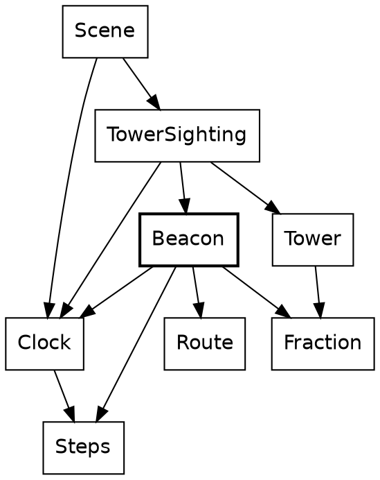

# Proofread: The beacons

*For Steve's read, 2026-11-08. This is the chapter as the book builds it, code filled in. The widget can't run here (the dev book is blocked by a Roc crash in the widget builds; a lane is on it), so the `widget beacon` block shows as a fence. It has had two accuracy rounds, a promote/demote/cut round, a clarity round and a shape-and-tone round. Comments welcome inline or in reply.*

---

## The beacons

Every radio tower has a beacon on top, and the beacons blink. A beacon is the simplest thing in Safari Ride that moves. How bright it is depends on two things: which beacon it is, and which step of the ride it is.

```widget beacon
Press play and watch the two towers blink out of step.
```

The widget stands two towers side by side, with beacons that blink opposite each other, and plays two whole blinks, from step 5,400 to step 5,640.

New in this chapter:

- Modules: `Beacon`, `Steps`

### Three rules

A beacon follows three rules:

1. A blink takes 120 steps, from dark up to full brightness and back down.
2. Neighboring towers start their blinks at different points, so the towers along a road don't blink together.
3. A segment longer than a kilometre has a second tower halfway along, and its beacon blinks exactly opposite the one at the segment's end. Only one segment on the route is that long.

None of those rules needs a memory. Ask a beacon about step 5,430 cold, and it can answer. So Safari Ride stores nothing about beacons at all. That's *worked out, not stored*, in its purest form.

### Get the types right

A beacon needs four types, all opaque, and you've met two of them:

| Type | What it is | Under it |
|---|---|---|
| `Clock` | Which step of the ride it is | A `U32` |
| `Steps` | How many steps something lasts | A `U32` |
| `Beacon` | Which beacon, by a key | A `U32` |
| `Fraction` | How bright, from 0 to 1 | An `F64` |

Three of the four are the same number underneath, so only the types tell them apart. A step of the ride, a length of time and a beacon's key are three different questions, and none can stand in for another.

Remember the line in the first chapter that tried to add 7 to the clock, and didn't compile? Here's what a clock can do instead:

```roc Clock.roc
steps_since : Clock, Clock -> Steps
plus : Clock, Steps -> Clock
minus : Clock, Steps -> Clock
```

A clock is a place in time, and `Steps` is a distance between two of them. Two clocks give the steps between them, and a clock and some steps give a later clock, or an earlier one. Adding two clocks means nothing, so there's no function for it. Adding two `Steps` does mean something, so `Steps` has a `plus`.

You've seen this shape before, with `Along`, a place along a segment, and `Distance`, a length. One opaque type says where something is, a second says how far apart two of them are, and only the sums that make sense get a function. This book calls it *places and distances*.

A `Beacon` is a key that nobody outside `Beacon` can read. You get one from a segment's index, which becomes its key. You can ask for the beacon opposite it, and you can ask how bright it is:

```roc Beacon.roc
of_segment : Route.SegmentIndex -> Beacon
opposite : Beacon -> Beacon
brightness_at : Beacon, Clock -> Fraction
```

`Beacon` has never heard of a tower. A beacon and a clock make a `Fraction`, and that's all.

### The functions

The modules behind a beacon


A box is a module, and an arrow is an import. Each frame, `Scene` hands the clock to `TowerSighting`, which finds the towers in view. Look at where the clock stops. `Tower` has no arrow to `Clock`: it holds its beacon's brightness as a `Fraction`, and draws the beacon as a magenta disc that's only as opaque as that, leaving it out when it's too dim to see. `TowerSighting` is the one module in the game that knows both the tower and the clock. Here's the line where the tower past the end of a segment asks for its beacon:

```roc TowerSighting.roc, in end_tower
# ...
beacon_brightness = Beacon.of_segment(in_view.index).brightness_at(clock)
# ...
```

That line is all the towers' sighting knows of beacons. Back in the radio towers chapter, `mid_tower` had the same line with `.opposite()` in the middle.

Now down into `Beacon`:

```roc Beacon.roc
## How bright `beacon` is at `clock`.
brightness_at : Beacon, Clock -> Fraction
brightness_at = |Beacon.(key), clock|
	beacon_brightness(clock.steps_since(Clock.start).plus(beacon_offset_for(key)))
```

`Beacon.(key)` unwraps a beacon, the way `Clock.(n)` unwraps a clock. `clock.steps_since(Clock.start)` is how a place becomes a distance, and it says which distance: the one from the start of the ride. Adding the beacon's own offset gives its phase, and a cosine turns that into a brightness:

```roc Beacon.roc
## How bright a beacon is `phase` steps into its blink.
beacon_brightness : Steps -> Fraction
beacon_brightness = |phase| {
	wrapped = phase.wrapped_to(Beacon.beacon_period).to_f64()
	angle = 2.0 * F64.pi * wrapped / Beacon.beacon_period.to_f64()
	Fraction.of((1.0 - angle.cos()) / 2.0)
}
```

`wrapped_to` is the only `%` that `Steps` offers, so a phase of 130 is a phase of 10. (The period is written `Beacon.beacon_period`, with its type's name, even here, because it's defined in the type's block.) `(1 - cos) / 2` runs from 0 up to 1 and back to 0 over one period, and it can't leave that range. So `Fraction.of`, which crashes on a ratio outside 0 to 1, is safe here.

Each beacon's offset comes from its key:

```roc Beacon.roc
## How far into its blink the beacon with key `n` is when the ride's clock is
## 0.
beacon_offset_for : U32 -> Steps
beacon_offset_for = |n| beacon_stagger.times(n).wrapped_to(Beacon.beacon_period)
```

This function is one line of method calls, and every call in it is on a `Steps`. The stagger is 37 steps, and 37 shares no factor with 120, so the first 120 keys all start their blinks at different points. Neighbors are 37 steps apart, close to a third of a blink.

The tower halfway along a segment blinks opposite the one at its end:

```roc Beacon.roc
## The beacon that blinks exactly opposite `beacon`. Its key is
## `opposite_key_offset` past this one's.
opposite : Beacon -> Beacon
opposite = |Beacon.(key)| Beacon.(key + opposite_key_offset)
```

That's a small piece of number theory hiding in a constant. `opposite_key_offset` is 60, and 60 staggers of 37 steps come to 2,220, which is 18 whole blinks and 60 steps left over, so the opposite beacon is always exactly half a blink away.

The widget's two beacons are the first segment's, key 0, and the one opposite it, key 60. Step 5,400 is 45 whole blinks in, so the first is dark there and the second is at full brightness. A quarter of a blink later, at step 5,430, they're equally bright, and by step 5,460 they've changed places.

There's no blink abstraction, because nothing else in the game blinks. A beacon goes round and round. The sun goes one way, and a lot more hangs on it.

