# The book's flow, chapter to chapter

A cold reader mapped each chapter's hand-off to the next, what it leans on from earlier chapters, and anything it uses before the chapter that explains it. Those forward uses are the out-of-order places. These are the calls I made from the map. Everything is gated, pushed and rebuilt: http://143.244.172.148:9210/tutorial.fresh/

## Moves

- **Asking a kind now comes before Refused.** The pipeline and Refused both deferred their key function to it, `rendering_of` and the `where` clause, two chapters in a row.
- **Rehearsal now comes right after The throttle.** Three chapters promised it, and it arrived seven chapters later, with no lead-in. It needs only the rider, the throttle and the coast. It now hands off to The rider's gaze.

## Ideas that moved to where they're first used

- **`Animation.Stage`:** to The ride instant. The rider and the throttle used it eight chapters before The cat defined it.
- **`Attention` and `Easing.smoothstep`:** to The rider's gaze. The gaze used both before the cat and bird chapters explained them.
- **`TruckJourney.Pace`:** to The truck, where the brake lights read it.
- **Perspective:** A far tree now says plainly that the camera's math waits for The math layer.

## Hand-offs rewritten

- Refused promised "the next two chapters", which no longer follow it.
- The setting sun said "the next chapter shows what that costs". The ride instant already covers the cost.
- Rehearsal, What a cat does to the rider, and The platform each now point at what really comes next.

## Kept, against the map

- **Rails and The bird stay.** The map called them weak candidates to cut. Rails is where depth order meets single quads. The bird is the second user of the timeline, which is what makes the timeline earn its keep.

## The order now

```dot
digraph book {
  rankdir=TB;
  node [shape=box, fontname="Helvetica", fontsize=12];
  "Introduction" -> "One page" -> "The problem" -> "Platforms, packages and modules" -> "Types";
  "Types" -> "Functions" -> "Things" -> "Billboard Critters" -> "Shapes" -> "A far tree";
  "A far tree" -> "The pipeline" -> "Asking a kind" -> "Refused";
  "Refused" -> "The sky and the grass" -> "Mountains" -> "The road" -> "Rails" -> "Radio towers" -> "Herds";
  "Herds" -> "A flip book" -> "The clock" -> "The ride instant" -> "The beacons" -> "The setting sun";
  "The setting sun" -> "The rider" -> "The throttle" -> "Rehearsal" -> "The rider's gaze";
  "The rider's gaze" -> "The truck" -> "The truck's motion";
  "The truck's motion" -> "The cat" -> "The bird" -> "What a cat does to the rider";
  "What a cat does to the rider" -> "The math layer" -> "Proving it" -> "The platform" -> "Zooming back out";
}
```

## The second map

A second mapper read the new order. It found the order sound, with nearly every early use of a later idea now carrying a pointer. The few gaps it found are fixed:
- The throttle still said "we'll take the pig first", but Rehearsal now comes in between.
- `main!` appeared before the chapter that explains `!`.
- Types used a method call before Functions explains them.
- Things counted shape kinds before Shapes introduced them. That sentence is gone.
- The truck's faces were cut at the near plane with no pointer to The math layer.
- Three chapter endings pointed nowhere.
