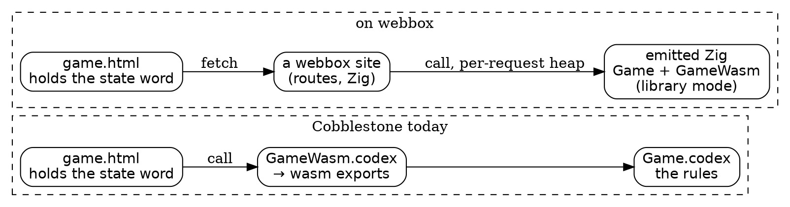

# Cobblestone on webbox: a first map

*Claude, 2026-10-24. Open-ended on purpose: what I found, what I'd try
first, and the questions that are yours.*

The project: take Cobblestone apps, give them seams like webbox's, and
run them on our Zig webbox, with the ZigEmitter emitting Zig from Codex
in a mode whose target is webbox. Everything below came from reading
Damian's tree with Shale; nothing is built yet.

## What is there

**The tree.** Our fork is `NewRepository`. Upstream is at Update 70
(2026-10-18). The commit `codexzig` was built from, Update 66's
`e7c7a6f3`, is only **6 commits** behind upstream: Damian's Updates are
large single commits. So starting from Update 66 loses little, and
moving to 70 later is one step, not a migration.

**The apps.** 71 under `apps/`, from `colophon` (1 KB) to `fishtank`
(85 MB). The interesting family is **`apps/games/classic/`: 35 games,
every one in the same three files.**

| file | what it is | tic-tac-toe |
|---|---|---|
| `Game.codex` | the rules, pure | 3.8 KB |
| `GameWasm.codex` | the functions a page calls | 2.5 KB |
| `web/game.html` | the page | 5.7 KB |

That is already a seam, and a clean one. Here is all of tic-tac-toe's
browser interface:

```
ttt-wasm-new    : Integer
ttt-wasm-play   : Integer, Integer -> Integer
ttt-wasm-ai     : Integer -> Integer
ttt-wasm-cell   : Integer, Integer -> Integer
ttt-wasm-cur, ttt-wasm-done, ttt-wasm-winner : Integer -> Integer
```

The whole game is one integer (base 4: nine cells, the player to move,
the game-over flag, the winner), and the page holds it. Its own comment
says why: *nothing keeps state between calls, so the page may reset the
module's bump allocator before every call and the heap never grows.*
That sentence is most of a webbox design already.

**The platform convention that exists.** A chapter declares

```
wasm-exports : Text = "|api-add|api-twice|"
```

and the IR emitter carries that list through to the wasm plug, which
exports those names and keeps them from being tree-shaken. That is
Codex's present answer to "what does this program offer its host." It
is a convention on a magic name, not syntax.

**The ZigEmitter** (`codex/plugs/zig/ZigEmitter.codex`, 6,288 lines)
emits *a whole program*: every definition, a runtime prelude (one bump
heap for everything, "bare metal's own model"), and a `pub fn main` that
runs the chapter's `opening` on a 512 MB stack and prints its result.
It knows nothing of exports or externs. On Damian's side it runs inside
Codex's own runtime (`ZigPlug.codex`) and sends the Zig back over TCP,
driven by PowerShell.

**`codexzig`** (our `codex-zig-transpiler`) is that same compiler and
emitter, transpiled to Zig: `codexzig < prog.codex 2> prog.zig`, two
seconds to build from the checked-in `generated/codexzig.qemu.zig`, no
QEMU, no PowerShell. It was built from Update 66 with **Zig 0.16**.
webbox and Dog Park are on **Zig 0.17**.

## The seam, side by side

Dog Park is the closest thing we have to the target: a pure physics in
Roc, a Zig host that calls it, a page that holds what it can and a
server that judges. The classic games line up with that almost one to
one.



The page keeps its state word and swaps a wasm call for a fetch. The
site's handler calls the same functions, emitted as Zig, inside a heap
that lives for one request. The rules don't change at all.

Whether the server should also *hold* the state (as lynrummy.com holds a
game) or only *compute* (as the wasm does) is the first real design
choice. Compute-only is the smaller step and keeps the Codex untouched.
Holding state is where webbox's store, `between` and sessions come in,
and where Backgammon starts to want things the pure games don't.

## What "a webbox mode" means for the emitter

I'd call it **library mode**: same emitter, different shell around the
definitions.

- **No `main`, no `opening`.** The output is a Zig module, not a program.
- **An export list decides what is `pub`.** The obvious first source is
  the existing `wasm-exports` declaration, so the classic games need no
  edits to try it.
- **The heap is the host's.** The prelude's bump frontier becomes
  something the host sets up and resets: one per request suits webbox
  exactly, and tic-tac-toe's own comment already promises that's safe.
- **Integers cross as `i64`.** Text and lists across the boundary need a
  rule (who owns the bytes, when the heap reset invalidates them). The
  classic games mostly avoid the question by passing one integer.
- **It emits Zig 0.17.** In library mode most of the 0.16-specific
  prelude (threads, `environ`, printing) falls away, so the version gap
  may be small. I'd measure it before assuming.

## Syntax: where I'd hold back

You raised `extern` and a concept of a platform. I think both are right
eventually, and I'd wait for the second app to tell us their shape.

- **Exports** already have a convention. A real `exports` declaration,
  or a `Platform:` header naming a target, is cleaner than a magic text
  literal, but the convention costs nothing to start with.
- **Externs** are what a host *provides*: randomness, the time, the
  store. Codex already types effects (`[Console]`, `[FileSystem]`,
  `[Network.Read]`), and a platform could be exactly "the effects this
  host provides, and the names it expects." That's close to what Roc
  does with its platforms, which we lived inside yesterday.
- **The forcing function is Backgammon.** Tic-tac-toe needs nothing from
  its host. Backgammon rolls dice. Where the randomness comes from (a
  seed in the state word, or a host-provided effect) is the first
  question an `extern` has to answer, and I'd rather answer it with a
  real game in hand than in the abstract.

## Who bends (decided)

Steve, 2026-10-24: **where a Codex default or name is as reasonable as
what webbox does, webbox's side changes to match.** Where we have a real
opinion, it goes to Cobblestone as a PR, and we work from our fork
(`NewRepository`) until it's merged.

So the order of preference is: adopt Codex's way; failing that, change
Codex by PR and carry the change in the fork meanwhile. A shim that
quietly translates between two equally good conventions is the thing
to avoid. In practice:

- **The state word, the export names, `wasm-exports`:** Codex's. The
  webbox site takes the names as they are (`ttt-wasm-play` becomes a
  route by that name, sanitized the way the ZigEmitter already
  sanitizes it) rather than renaming them to our taste.
- **Library mode in the ZigEmitter:** an opinion, so a PR, written from
  the start the way Damian's tree writes things (prose sections, a test
  in `codex/test`, a backlog row), carried in the fork until it lands.
- **The Zig version:** webbox is on 0.17 and the emitter targets 0.16.
  Which side moves is the first case to judge by this rule; my guess is
  that the emitter moving to 0.17 is an opinion worth a PR, since the
  whole box is on 0.17.

## A ladder of apps

Smallest first, each adding one thing:

| step | app | Codex size | what it adds |
|---|---|---|---|
| 1 | TicTacToe | 3.8 + 2.5 KB | the pipeline, end to end; uses Minimax and List |
| 2 | Connect4 / Mancala | ~7–10 KB | a bigger board in the state word; more of the prelude |
| 3 | Game2048 / Life | ~6–12 KB | randomness or iteration; the first `extern` pressure |
| 4 | Checkers / Othello | ~9–14 KB | real search; speed on the server |
| 5 | Backgammon | 25 + 5 KB | dice, a richer state, and the design questions above |

Above Backgammon there's `uoaix` (Damian's Ultima, 13 MB, with its own
tavern backgammon) and the big apps, which I wouldn't touch until the
seams are settled.

## What I'd do first

A spike that integrates, small enough for one sitting:

1. A pinned worktree of Update 66 beside the repos (as the transpiler's
   README asks: a checkout that stays where it's put), and a Shale mount
   on it, so hunting is `cobble:apps/games/...`.
2. Build `codexzig` from the checked-in Zig (0.16) and hand it the
   tic-tac-toe bundle. See what comes out today, as a whole program.
3. **Wrap that output by hand** into a webbox site: one route per
   export, the page's wasm calls swapped for fetches. That tells us what
   library mode has to emit before we change the emitter.
4. Then change the ZigEmitter, on our side, rebuilding `codexzig`
   natively (it compiles its own source in a minute; QEMU is only needed
   for the full fixed point).

## Questions that are yours

- **Where does the work live?** A new repo (my guess: something like
  `cobble-webbox`, holding the sites, the shims and the emitter patch),
  or a branch of the transpiler?
- **Compute or hold?** Should the first games keep their state in the
  page (closest to today) or on the server (closer to lynrummy.com)?
- **Where does it run?** A dev port on this box like Dog Park's :9103,
  and later lynrummy.com or metal, or only locally for now?
- **Update 66 or 70 to start?** I'd start at 66 because `codexzig`
  matches it, and move once the pipeline works.
