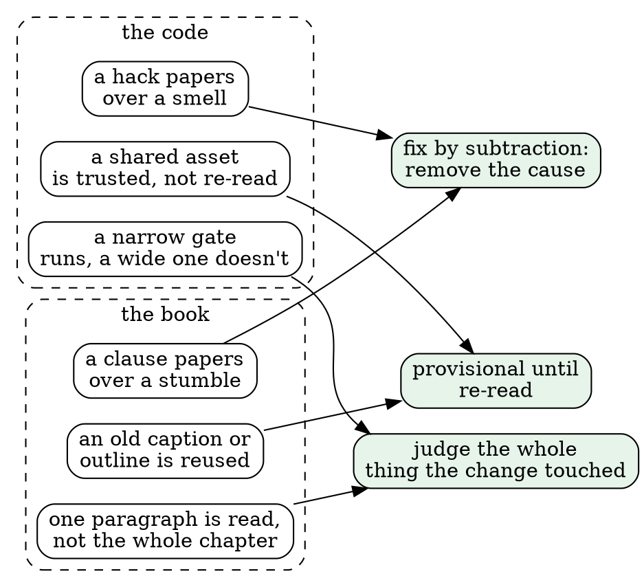

# Two kinds of quality: the code and the book

This week we held two things to a high standard at once: Safari Ride's Roc code, and the book that reads it. They're one project, and the book keeps pushing on the code. But the two standards differ in a way worth seeing clearly, because it explains why the nitpick agent earned its keep today, and why the gates alone never could.

## The short version

**Code quality is mostly checkable. Book quality is mostly not.**

A function is wrong in ways a machine can find: it fails a test, trips a lint, draws a pixel differently, or names a type that doesn't exist. A paragraph is wrong in ways only a reader can find. It names a bull before any bull is on the page. It says "calf or cow" when a calf is a cow. It promises a feature and never pays it off. It reads fine sentence by sentence and still leaves the reader lost.

So the code leans on judges, and the book leans on readers.

## Side by side

| | The code | The book |
|---|---|---|
| **What "correct" means** | It does what it says: the tests pass, and the pictures match pixel for pixel. | It's true to the code, and a reader who has read only what's above can follow it. |
| **Who judges** | Machines first: the compiler, 966 expects, 16 widgets, the pixel proofs and the lints. | Readers first: the author's read, cold readers, nitpickers, and you. |
| **How a failure shows** | Red, with a line number, before anything ships. | Silent. The page builds green and still confuses someone. |
| **What a judge can see** | Everything it's told to look at, every time. | Only what's on its mind. Three cold readers missed the bull. |
| **The unit of review** | A function, a module, a diff. | A path through a chapter, read in order. |
| **What "simple" means** | Fewer moving parts. One home for each rule. | Fewer ideas per paragraph. One idea per sentence of the spine. |
| **How it decays** | Drift: a comment outlives its code, or a lint is held at a stale count. | Orphans: a structure changes, and an old sentence survives the surgery. |
| **The worst habit** | Explaining a smell away instead of fixing it. | Fixing a stumble by adding a clause instead of removing the cause. |

## Where they meet

The table makes them sound like strangers, but they share a spine. Both have the same three failure modes, and the same cure for each.

1. **Papering over.** In code, that's a wrapper or a special case that hides a smell. In prose, it's a clause that explains a confusing name. Today's best example crossed the line between them. "A triangle is a polygon with three corners, so it's a `Poly`" was the book papering over the code. You said to fix the code, and the shapes redesign removed the cause. Now the book just says `Triangle`.
2. **Trusting old work.** A widget's readout, a caption, an outline from another purpose, `Polygon.triangle`: each looked durable and wasn't. Your "provisional until re-read" rule is the same rule in both worlds.
3. **Judging too narrowly.** In code, I once ran one widget's tests instead of all of them, and pushed a red master. In prose, I read the paragraph I touched instead of the chapter it sat in, and missed an orphan. MISSION now has the same fix for both: the widget gate for a widget change, and the author's read of the whole page for a prose change.

## What the book does to the code

The most useful thing I learned this week: **the book is the code's harshest reviewer.** Every time a sentence was hard to write, the code had a smell:

- "A triangle is a `Poly`" exposed `Shape`'s uneven tags, and `Polygon`'s overlap with `Shape`. That became the redesign.
- "The trunk is shaded if fewer than four trees are nearer" had no reason anyone could state. It's queued to follow distance.
- `is_calf`'s caller hid its `if` deep inside a long function. That became `cow_billboard`, a small function that reads well in the code and on the page.
- "From the second" in `is_calf`'s comment was ambiguous when counting starts at 0. The comment now says "starting with cow 1".

None of those would have tripped a gate. The code was correct. It just wasn't explainable, and explainability turned out to be a fair proxy for clarity. If a careful paragraph can't say what the code does simply, the code usually isn't simple.

## What the code does to the book

The traffic runs the other way too. The gates keep the book honest about facts:
- `book_names` refuses a stale name;
- includes refuse a missing function;
- the shape counts come from an expect, so "2,121" can't drift.

A book about a program can lie in ways a book about ideas can't, and the code's judges close that door. What they can't close is the door the nitpicker walked through: a true sentence that still trips the reader.

## Why the nitpick agent works

The cold readers I briefed on axes (truth, order, promises) found real errors. The plain nitpicker, asked only for "five things a careful reader would stumble on", found different and often better ones, because it had no axis to stay inside. The pattern so far:

- **It finds friction, not falsehood.** "Calf or cow", "the cow's body", "comes with". Each is small, true and grating.
- **It doesn't find what needs the world.** A bull isn't a cow. A bull appears before it's introduced. You caught both; three rounds of nitpickers didn't. Real-world sense and a picture in the head are still yours.
- **It drifts toward theory.** Round three wanted to explain static dispatch. That's where the human editor holds the line: `match` before dispatch, the dot call read plainly.

So the loop that works is: author → whole-page read → gates → nitpicker → you. Each finds what the others can't. The code's loop is shorter, because its judges see more of what matters. The book's loop is longer, because its most important judge is a person turning pages.

## One sentence to keep

Code is correct when the machine agrees, and a book is correct when the reader does. The best days this week were the ones where making the book clearer made the code clearer too.
