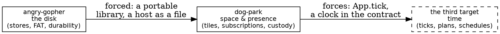

# Custody, not ownership

*2026-10-11, closing the day. Open-ended: what Dog Park taught, what the second
target did to the code, and a guess about the third.*

## The leash was hiding in our own dictionary

The morning's Dog Park was a world of **ownership**. A human owned exactly one
dog, by construction: `HumanId` keyed the population, a claim was a union,
"two dogs for one human" was unrepresentable, and CC's adversaries proved it.
It was good work, careful and correct. It was also the wrong world, and we found
that out in about four minutes of play: you wanted to pick up *any* dog you
could see. Ownership dissolved, and what replaced it was the **leash**: a
short-lived hold, taken on mousedown, given back on release or after five
seconds, refused only when someone else's hand is already on it.

Here's the part I keep turning over. We already had the word for this. In the
lexicon we built for TCP, we rejected "owner" for a fact's home because it
implies hierarchy, and we chose **custody** for the bookkeeping of who holds a
segment until it is acknowledged. A leash is custody. It isn't a property of
the dog or of the human. It's a short-lived *debt* between them that the server
keeps the books on, and it has to be discharged (by a release, or by the clock)
or someone else is stuck. Even the client's pacing has the same shape: at most
one move waiting for its ack is a send window of one.

So the same idea showed up three times today without our noticing:
- **TCP:** custody of bytes until they're acknowledged.
- **The kernel:** "the turn never waits on the network." Nobody holds the
  shared resource while waiting on someone slow.
- **Dog Park:** the leash, plus one move in flight.

When a design question feels new, it's worth asking which old answer it is
wearing a costume of. We'd have reached the leash faster by asking "what's the
custody model for a dog?" than by asking "who owns a dog?"

## Types fix the model; play finds it

Your instinct, types before code, is right, and today didn't refute it. It
refined where it applies. **Correct by construction protects you from bugs in
the model you have. It cannot protect you from having the wrong model.** For
a server protocol, a file format or a kernel, the model is mostly given (an RFC,
FAT, the hardware), so types first is the fast path. For a game the model *is*
the product, and you can only find it with your hands on it. The feel of the
tablecloth pan, edge scrolling that has to be slow enough to be leisurely, a
re-centre that sounded right and felt wrong: none of those was in any spec we
could have typed.

The order that worked: **play until the nouns stop moving, then freeze them in
types.** The leash, the tile and the subscription are now stable nouns. They're
ready for the careful treatment CC gave the first draft, and this time it would
be locking in something true.

There's a quieter lesson in the turnaround, too. CC is superb at a long
correct-by-construction run against a fixed target. The worst job for it is a
moving target where each round trip costs an hour of waking, branching and
merging. You saw that right away and pulled it, and the loop went from hours
to minutes. That's the same scheduling rule as the kernel again: don't put a
slow party in the hot loop.

## What the second target did

You're right that the second user is what makes code honest. Phase A and the
start of Phase B were nothing but dog-park asking angry-gopher "can I have
that?" and angry-gopher discovering it couldn't hand it over cleanly. The
library had to become a module, the host had to become a file, and the kernel
had to stop reaching into the router. None of it changed a single behaviour,
and all of it was overdue.

But here's what the reviews kept finding, and it's the take I'd most like you to
sit with: **the cleanup days are the dangerous days, not the feature days.**
Count today's near-misses:

- **The store-absence lint went green checking nothing:** the import rewrite
  changed the spelling it looked for, and 32 files fell out of its sight.
- **The properties sweep stopped compiling,** and `long.sh` filtered the error
  away, printing only "FAIL (sim)".
- **The judges read cookies by name:** a rename broke them without breaking
  anything that compiles.
- **The coverage scan "failed"** in a way three of us misread for a day.
- **The rename's blind replace** quietly changed a test's input from a
  browser's `cross-site` to `cross-uid_site`.

Every one of these is a check that went dark because of **plumbing**, not
logic. Feature work breaks things loudly, because a feature has a test that
fails. Rewiring breaks the *tests themselves*, silently, because nothing
tests that a test still looks where it used to. Our standing rule, "every
check is shown to fail", is exactly the defence, and today it earned its keep
mostly through the cold reviews. I'd make it mechanical for refactors: before
a rewiring commit, plant one violation per lint and one red test per judge
section, and require them all to fire after the change too. Five minutes. It
would have caught four of the five above.

## The third target: not another app, a new dimension

The obvious third target is another web app, and it would find more
cleanup. But I think each target so far has pushed the library along a
different *axis*, and the best third target is the one that pushes along the
axis we haven't touched:

**angry-gopher** taught webbox about durability. **Dog Park** is teaching it
about geography: who is near what, and who should hear about it. Neither has
**time** as a first-class input. Every handler today runs because a request
arrived. So the surprising suggestion: make the third target something that is
mostly *clock*, with a request only now and then. A few shapes, any of which
would do:
- **A room where things decay:** notes that fade after a day, a garden that
  grows while nobody's looking. Few requests, lots of scheduled change, and
  durability where "what time is it" is part of every record.
- **Turn-based play with clocks:** a chess clock for two of your four users.
  The deadline belongs to the *server*, and a timeout is a game event, not an
  error.
- **Dog Park's wandering dog,** built as a separate application that talks to
  the park through the same webbox contract a human's page uses. It's a third
  target that is also the second's first non-human player.

Whichever it is, it forces the thing both essays this evening ended on:
`App.tick`. That means a clock in the host contract, a deadline on the metal
loop's rest, and metal-vmm jumping time so a week of decay runs in a second
and every bug is a seed. The kernel already has the bones: `idle.zig` steps
in quiet moments, and metal-vmm already owns the clock. What's missing is
the sentence in `site.zig` that says "and the host will call you at this time."

My guess is that the third target's cleanup won't be in the library at all.
It'll be in the kernel's loop, which is still shaped like a server waiting for
mail, and would become shaped like a machine that also keeps appointments.

## Open questions I'd like to leave with you

- **Is custody the general model for Dog Park's multiplayer?** A dog in a
  pan, a tile someone is editing, a critter mid-plan: are those all leashes,
  with the server keeping one ledger of who holds what, until when?
- **When the nouns are stable, who freezes them?** CC, from a short brief
  written after we play? That seems like the right division: we discover,
  CC hardens.
- **Should "a refactor plants its own failures" become a rule,** as "red
  first" is for fixes?
- **And the one I can't answer:** with webbox now a real library with two
  users, when does it deserve its own repository? My lean is the day the
  third target arrives. Not before, because two users still fit in one
  person's head, and three don't.
