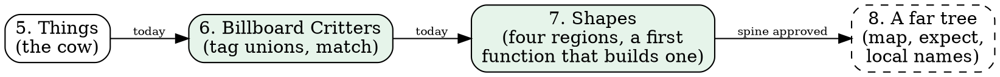

# The day so far: 2026-11-10

A long, productive day. The book went from five chapters to seven, the code under it got simpler twice, the ride learned to get dark, and the process grew two new tools. Here it is roughly in order, then what it taught us.

## The book

- **The order is settled:** Things, then Billboard Critters, then Shapes, then the far tree. MISSION says so now, and Shapes stays its own chapter.
- **Billboard Critters** went from three why questions to a finished chapter in one sitting. Your answers shaped it:
  - an animal has a face, so it faces somewhere;
  - a bend has room for one thing;
  - the elephants are the fixture, so the rare animal is a surprise.

  You called it "by far our best work". It's your favorite, and it gets the first stable URL.
- **Shapes** was redrafted on the new types. Your review gave it two small structural changes: the corners stacked so they read as one type, and a table comparing the rectangle with the triangle.
- **The problem** became a diagram and a table. It took three tries. The first table rewrote your problems as descriptions, and you caught it. The diagram went from too wide, to too tall, to two clean rows with no crossing edges.
- **The far tree's spine** is approved, with your idea in it: the book's first `expect`, freezing the tiers that a `map` works out.
- **The game tie-ins** got two rounds of pitches and twenty themes, and produced no winner. They did produce rules: nothing in the introduction, segments as levels later, and "we take the handlebars for you" in rider physics.

## The code

| Change | Why | What moved |
|---|---|---|
| Trunks shaded by distance (60 m) | "Fewer than four nearer trees" had no reason anyone could state | A few far trunks went flat |
| `Sprite.Setting` became a plain record | Once trunks went by distance, its type variable carried nothing | Nothing on screen |
| `Triangle`, `Quad`, `Disc`, `Polygon` | Your idea, ranked first by an adversarial agent over my "polygon and disc" proposal | No pixel; native boxes now draw at float precision |
| Dusk over everything, and a setting sun | The color audit: only the sky got dark | Everything at dusk. You: "It really feels like driving at night" |
| The tiers are a `map` | Your Why #2; a constant, worked out once | No pixel, and an `expect` proves it |

## The process

- **Nitpick rounds.** MISSION now runs up to three fresh nitpickers per chapter, after the promise check and the truth-and-order reader. They earned their place on both chapters. Three rounds in a row caught `Point.Point`, which is a code finding (queued), not a prose one.
- **The negative-words lint.** A Shale gate holds D2 for the new chapters. It found only four negatives in 337 sentences, because we'd been enforcing D2 by hand. From now on it guards each chapter as it joins.
- **An adversarial agent before a design lands.** It found that my two-region proposal would lose the corner counts in the type, add about a thousand allocations a frame, and make the book's G5 showcase false. Your Triangle-and-Quad idea won on its merits.
- **Rebuild speed** is now something I watch. A typical rebuild is about 33 seconds. The slow ones were another agent building on the same server.

## What it taught me

1. **Your questions are the best design tool we have.** "Why not just Triangle and Quad?" beat a proposal I'd thought through for an hour.
2. **The book keeps finding code smells.** Today: the trunk rule, `Rectangle` existing only for the painter, `Point.Point`, and a hand-written table that was really a `map`.
3. **I overstep when I'm editing for structure.** You asked for a table, and I rewrote the content. The fix is the one MISSION already states: change the form, keep the words, unless asked.
4. **Pitches don't converge without a chapter to land in.** The game tie-ins will find their places when we write the World and rider chapters.

## After compaction

- **You:** review the draft-deploy write-up (notes/book-draft-deploy.md). It has four small decisions; the folder name matters most, since it's in every URL.
- **Me:** draft the far tree from its spine, then run its readers.
