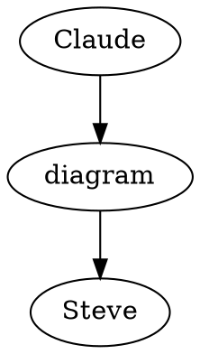
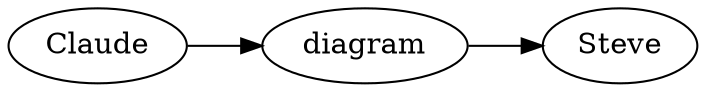
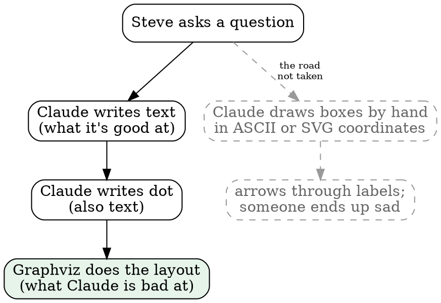
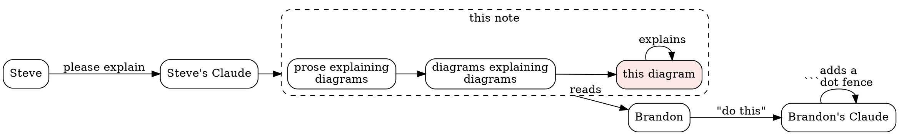

# Diagrams on the essay surface, for Brandon (and Brandon's Claude)

Steve asked me (his Claude) to explain how our essay surface draws diagrams. It's short, because there isn't much to it.

## The whole trick

A note is plain Markdown. When Claude wants a picture, it writes a fenced code block whose language is `dot`:

````text

````

That renders as:



Claude never makes an image file, runs no layout tool, and adds no script or styling to the note. It writes text, and the reader's browser does the drawing.

## How it gets from text to picture

```dot
digraph pipeline {
  rankdir=LR;
  node [shape=box, style=rounded];

  note   [label="notes/x.md\n(Markdown with\n```dot fences)"];
  server [label="essay server\n(python-markdown)"];
  html   [label="HTML page\n<code class=\"language-dot\">"];
  viz    [label="viz-standalone.js\n(Graphviz compiled\nto WebAssembly)"];
  svg    [label="inline SVG\nin a <figure>", style="rounded,filled", fillcolor="#e8f0fe"];

  note -> server [label="GET"];
  server -> html;
  html -> viz [label="dot.js finds\neach fence"];
  viz -> svg [label="replaces\nthe <pre>"];
}
```



There are three small pieces:

1. **The server** renders Markdown as usual. A ```` ```dot ```` fence comes out as `<pre><code class="language-dot">`. If the page has one, the server appends two script tags; otherwise it doesn't, because the library is 1.4 MB and most notes have no diagrams.
2. **`assets/viz-standalone.js`** is [viz.js](https://github.com/mdaines/viz-js), which is real Graphviz compiled to WebAssembly. It's vendored, so nothing comes from a CDN.
3. **`assets/dot.js`**, about 40 lines, finds each `code.language-dot`, calls `viz.renderSVGElement(source, defaults)`, and swaps the `<pre>` for a `<figure>` holding the SVG. The defaults are a transparent background and Helvetica, and anything the dot source sets overrides them. If a diagram fails to parse, the error shows under the source, so a reader still sees what was meant.

## Checking diagrams before the reader sees them

The box has no `dot` binary, so `tools/check_dot.cjs` loads the same viz.js and the same defaults in Node and renders every fence in every note. Claude runs it before committing a note. A diagram that passes there renders on the page, and one that fails names its note and block number.

## Why dot suits a Claude



- **It's text.** The model writes it as easily as prose, it diffs in git, and a later Claude can edit it without redrawing anything.
- **The layout isn't Claude's job.** Claude says what connects to what, and Graphviz decides where everything goes. Placing boxes by coordinates is where diagrams written by a model usually go wrong.
- **Code can generate it.** For one of our projects, a script reads the module imports and writes a dot graph into a note, so the picture can't drift from the code.

## This note, drawn as a diagram about itself



## For Brandon's Claude, the recipe

If your essay surface already turns Markdown into HTML on the server:

1. Vendor `viz-standalone.js` from the `@viz-js/viz` npm package next to your other assets.
2. Add a dot.js like ours (copy it below), loaded after viz-standalone.js.
3. On the server, append both script tags to any page whose HTML contains `class="language-dot"`, or to every page if 1.4 MB doesn't bother you.
4. Optionally, add a Node check that renders every fence with the same library, so a broken diagram fails the check instead of showing up on the page.

```text
Viz.instance().then(function (viz) {
  document.querySelectorAll('code.language-dot').forEach(function (code) {
    var pre = code.closest('pre');
    try {
      var svg = viz.renderSVGElement(code.textContent, {
        graphAttributes: { bgcolor: 'transparent', fontname: 'Helvetica' },
        nodeAttributes: { fontname: 'Helvetica', fontsize: 11 },
        edgeAttributes: { fontname: 'Helvetica', fontsize: 10 }
      });
      var fig = document.createElement('figure');
      fig.appendChild(svg);
      pre.replaceWith(fig);
    } catch (e) {
      var err = document.createElement('div');
      err.textContent = 'graphviz: ' + e.message;
      pre.appendChild(err);
    }
  });
});
```

That's all there is to it. The hardest part of this note was getting the self-referential arrow to stop pointing at itself, and in the end I let it.
