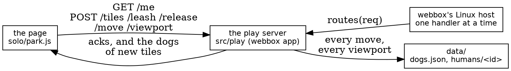
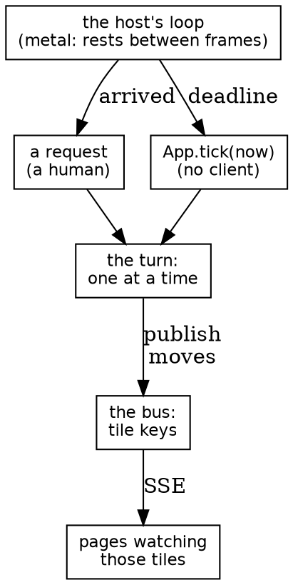

# Dog Park: where it stands, and the road to metal

*2026-10-11, evening. How the played Dog Park works today, what's missing
before it can run on its own cheap droplet under gopher-metal, and some
thinking about a dog with a mind of its own: SSE, the clock, and giving the
unikernel a scheduler.*

## Where it stands

We restarted Dog Park as a single-player toy and built it up by playing it.
CC's server-first version (QUEUE 161 to 168) is parked on its branch, to
salvage from. The live version is small and is all mine:

- **The page**, `dog-park/solo/park.js`: plain JavaScript, about 550 lines,
  one canvas.
- **The server**, `dog-park/src/play/`: a webbox application, about 600
  lines of Zig with unit tests, running as a Linux process on the box (port
  9103).

What it does:

- **A finite world:** 10 × 10 tiles of 500 px, a checkerboard, each tile
  labelled with its column and row. No dog leaves it. 250 dogs: three in
  every blue tile, two in every white one.
- **Any dog can be picked up.** Pressing one *leashes* it, optimistically:
  the dog moves at once, and the server acks. Pressing another dog lets the
  first go, and so does letting go of the mouse, after 5 s. The server holds
  leashes, and refuses a dog another human holds.
- **Moving:** a drag sends the dog's position with at most one move waiting
  for its ack. The server keeps every move (`data/dogs.json`).
- **Scrolling:**
  - A held dog in the band near the screen's edge carries the viewport with
    it.
  - Dragging the grass pans the park like a tablecloth, and keeps panning
    while the pointer is held near an edge.
- **Humans:** a signed cookie naming 128 random bits. The server keeps each
  human's viewport, so a reload shows the same place, and their leash, so a
  dog leashed just before a reload is still ringed.
- **Tiles as subscriptions:** the page subscribes to the tiles near its
  viewport, at most 25, sending the whole set each time with each tile
  marked new or held. The server answers with the dogs in the new tiles.
  The page remembers every dog it has seen; a subscription only says what
  the server keeps it told of.
- **"z", the overview:**
  - The whole world on one screen.
  - Subscribed tiles white and blue, the rest red.
  - Live dogs as dark dots, remembered ones pale, the last dog leashed
    ringed.
  - The view as a rectangle you drag.

**What's missing that matters:** the page only learns what *it* asked about.
Nothing tells it that someone else moved a dog. That is the next step for
two humans, and it's the same step a dog with a mind of its own needs.

## How close is metal?

gopher-metal serves lynrummy.com today. A second cheap droplet (1 CPU) for
Dog Park is plenty: metal serves the chat site in about 124 MB of 997, and
Dog Park's whole state is a few hundred KB. The machine isn't the problem.
These are, in the order I'd do them:

1. **gopher-metal builds only angry-gopher (Phase B).** The kernel imports
   angry-gopher's router, and `port.sh` copies angry-gopher's source. Phase
   B of the platform plan fixes exactly this: the kernel takes an `app` and
   `webbox`, and the port becomes a build step any application can run.
   webbox's Phase A (done) made the library portable. Phase B is the
   biggest item, and it's the one that makes Dog Park, or anyone's game, a
   metal application at all. A solid day or two of careful work.
2. **The page is read from disk, from the working folder.** That's handy
   for playing, but metal has no working folder. The answer is what
   angry-gopher does: the page and script are embedded, the script named
   by its hash.
3. **Every move rewrites `dogs.json`,** all 250 dogs, about 15 KB. On metal a
   small write costs tens of milliseconds of disk (a chat send is about 9
   disk requests and 25 to 50 ms). One move waiting at a time keeps that
   self-pacing, but a drag would mostly be writing. Better: write a dog when
   it's released (or once a second while held), and keep one small record
   per dog, as CC's version did. Worth doing before metal, and it's an
   hour.
4. **QUEUE 169, the turn never waits on the network,** matters here too. On
   metal, a slow client's body is read inside the turn. Dog Park's bodies
   are tiny, but the principle protects every game.
5. **The droplet itself:** your usual steps (image import, droplet, Caddy on
   prod proxying a subdomain over the private network). Your separate
   droplet with its own credentials fits that cleanly.

None of those needs the clock or SSE. **Single-player Dog Park could run on
metal after 1 to 3.**

## A second human: SSE, scoped by tiles

The tiles were built for this. Each human's subscribed tiles are known to
the server, so a broadcast has an address:

- **webbox's bus is keyed by name.** One key per tile (`tile:3,7`), and a
  page's stream subscribes to its tiles' keys.
- **A move publishes to the dog's old tile and its new one;** a leash and a
  release to the dog's tile. Only pages watching those tiles hear it.
- **Your own moves come back as acks, not over the stream,** so your console
  stays quiet unless something near you changes. That was the original
  point: less spam while debugging.
- **When the page's tiles change,** its stream's subscription changes with
  them, in the same request that answers `/tiles`.

Both hosts already keep streams: `sse.forward` and the host's kept-stream
serving, the same machinery chat uses on metal today. This is wiring, not
new machinery.

## A dog with its own agenda

This is where the interesting questions are.

**Who moves it?** The server, because only the server can be the one truth
that two humans both see. A wandering dog is a server-side actor, written
like any human's move: it takes a leash, moves, releases.

**When?** The server needs a heartbeat it doesn't have. Today every handler
runs because a request arrived. Nothing in webbox says "call me in 200 ms".
The two hosts differ:

- **Linux:** a timer task could take the turn every N ms and call the
  application.
- **Metal:** the kernel already has the right shape in `idle.zig`. It gives
  queued work one bounded step in quiet moments: no request waiting,
  nothing arrived for a while. It runs the volume checks today. What it
  lacks is *time-driven* work: "this task wants a step at time T".

So the first-class concept I'd add is small:

> **`App.tick(now)`: the host calls it at most every `tick_ms`, inside the
> turn, like a request with no client.**
>
> It returns what it published and when it next wants to run.

On metal that is a deadline on the main loop's rest. The loop already
rests "until the card's interrupt or `interrupts.slice_ns`". It would also
wake for the next tick. On Linux it's a timer. Either way it is one
function, and the app owns everything inside it.

**Using the quiet when humans are idle.** Your instinct to mutate the board
in idle windows fits metal's idle loop exactly, with one distinction worth
keeping:

- **Idle work** happens whenever there's slack (checks, tidying). It's
  fine for it to wait.
- **Scheduled work** must happen *at a time*: a dog's next step.

A critter belongs to the second kind. It can still be gentle: it can ask
for a coarse tick, say 250 ms, and the host can skip ticks under load.

## The clock

Three clocks are in play, and keeping them apart is the frames-of-reference
lesson again:

1. **The wall clock** (Unix seconds): cookies and records. Metal sets it from
   the hardware clock at boot and never corrects it. That's fine for a
   cookie's year, but wrong for animation.
2. **The monotonic clock** (`awakeNs` on metal): every deadline, every tick,
   every "how long since". metal-vmm controls this one, which is what makes
   the scheduler testable: **time is ours to jump** there. A critter's walk
   can be replayed exactly, tick by tick.
3. **The browser's clock:** for drawing only.

**Don't send a message every tick; send plans.** A wandering dog's next leg
is `{from, to, starts_at, speed}`, published once. Every page animates it
smoothly by itself. That's one message a leg, not ten a second, which is
better for the network and better for your console. It needs the page to
know the server's time. Each answer carries `now_ms`, and the page keeps an
offset, good to a round trip. That's ample for a dog trotting across a
tile.

**Seeded and replayable:** the agenda takes the tick count and a seed, never
`Math.random` and never the wall clock. Then metal-vmm can run a day of dog
life in a second, and a bug is a seed.

## A suggested order

1. **Per-dog records and writing on release** (an hour; it helps both hosts).
2. **SSE by tile:** two humans see each other. Test with two windows on the
   box.
3. **`App.tick` on the Linux host, and one wandering dog** sending plans.
   Play with the feel.
4. **Phase B:** gopher-metal builds any webbox app.
5. **`App.tick` on metal:** a deadline on the rest, and a metal-vmm scenario
   that jumps time and checks a critter's walk.
6. **Embed the page, rent the droplet, ship.**

Steps 1 to 3 are on the Linux box and quick to play with. Steps 4 and 5 are
where the real platform work is, and they're the same work any second game
would need.
