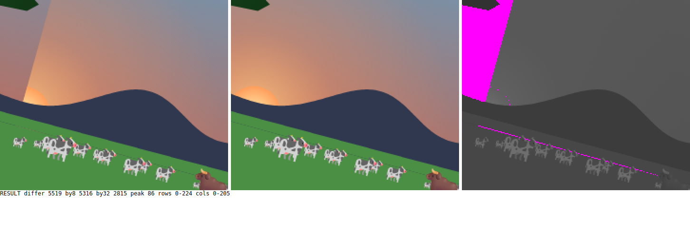
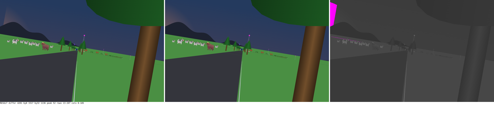
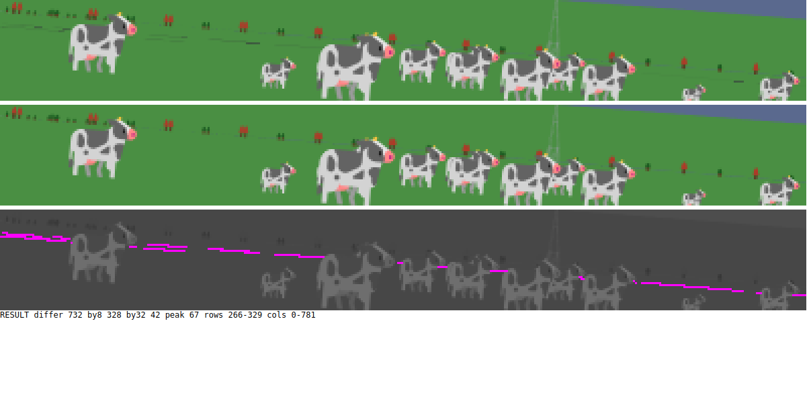

# The drawing half: findings

*2026-11-07. A cold agent's review of the substrate under the objects, with `docs/smells.md` and no book. Nothing has been changed. I haven't verified these findings, and those marked "by arithmetic" or "by reading" have never been seen on screen.*

Scope: Chain, Geom, Camera, Lens, RideFocal, ViewYaw, CanvasRoll, Backdrop, Mountains, Sky, Sun, Screen, Ground, GroundSighting, BendView, Pond, Scenery, RideInstant, Tour, SafariApp, Scene, Pixels, Angle, Along, Across, HexColor, Rendered, Picture, Attention, RiderState.

DESIGN means a call for you. MECHANICAL means an agent can just do it. Several fixes change floats and so move the proof hashes, and each of those says so.

## Rendered: both bugs are real

An agent rendered findings 3 and 4 on the real ride, using frames that reproduce the proof hash, and I looked at the first image myself. Neither frame is forced.

**The sun clip.** The sun is in view on 3,617 steps, and 1,560 of those are rolled. On 56 steps over 100 pixels change by 32 levels or more when the order is swapped, about two seconds of the ride: 2324-2331, 3019-3023, 3587-3612, 5549-5563, 6160-6171. A hard diagonal runs down from the top left, the glow stops dead on it, and it slices the sun's disc too, which the finding didn't predict. Left is as painted, middle is sky, sun, grass, right is the difference.

The same line at dusk, step 5555:

**The far road.** Real but faint. Dropping every patch past 490 m changes a median of 85 pixels a frame, and 732 at worst, at step 700. At 1x it's a faint dotted line you'd only find by looking. Top is as painted, middle is with the far road dropped, bottom is the difference.

**Not explained yet.** A thin dark line runs across the grass in rolled frames, visible in both the left and middle panels of the first image, so it isn't the far road. The swap changes part of it. Nobody has found what it is.

## The findings behind those

These three look like wrong pictures, not just wrong code.

**3. The sun is painted after the grass, so it needs a clip that breaks under roll.** DESIGN, moves hashes. `Backdrop.roc:117-144`.
The order is sky, grass, sun, so the glow is a rect bounded to the unrolled screen, and the disc takes `Within`. Those bounds are in scene coordinates. So in a rolled frame the glow should stop on a hard line at scene y=0 or x=0, in the corners the sky rect was oversized to fill. That's by reading, not rendered. `Within` has this one caller in all of canvas_apps, and the rest is plumbing in lib/Shapes, web/platform/Frame and native/CanvasAppRunner.
Without it: paint sky, sun, grass. The disc clip goes, and possibly `Shapes.Clip` itself. The grass starts a pixel above the horizon, so one row of sun changes, and SunPixels changes in the same commit.

**4. The road past the horizon is still painted.** DESIGN. `Geom.roc:79-82`, `Ground.roc:27-35`, `GroundSighting.roc:39-49`. New smell: a fact stated in a comment that no code keeps.
The doc says the curve puts the horizon 490 m out, and nothing acts on that. The chain reaches 2 km or more, and only the near plane cuts it. Past the horizon a dropped point projects lower on screen again: by arithmetic, right 1000, forward 2000 has a 25 m drop and lands at y≈309, on the grass. Far patches are painted after near ones, so a bent road beyond 490 m should show as thin dark slivers on the grass. A straight road hides this by overlapping itself.
Without it: a named horizon distance from the radius and eye height, and a far cut beside the near cut. Tower already models sinking properly.

**9, in part. Grass and land stay day-green under a dusk sky.** Your call whether that's intended. See 9 below.

## Design

**1. A road point has two frames, and road width is carried as data twice.** Moves hashes. `Geom.roc:53-56, 60-65, 70-74, 94-138`, `Chain.roc:162`.
Smells: wrong state can be written; the explanation needs an apology; the same step per kind.
The doc says a bend's arithmetic "works from that edge". But `centred_point_after` (:142) does the same bend from the middle, and it's the one Rider uses. The inverse pair isn't mirrored: `point_in_segment_before` is edge-based with two branches, and `point_in_segment_after` is a wrapper converting edge to centre and back. The JustBehind path converts across to from_left, to across, to from_left, then subtracts `rider_from_left`. A Vantage and a Bend can disagree on the road's width, and Geom's own test builds one with half_width 3. The Bend record is hand-built in three places.
Without it: one frame, centred. The inverse of `centred_point_after` is four lines. `EdgePoint`, `from_left`, `Chain.edge_point`, `Vantage.half_width` and ViewYaw's import of Scenery all go. Width lives once, in a home for road geometry rather than `Scenery` beside the animals.

**2. "In front of the camera" is kept by hand at about ten call sites, with mixed boundaries.** The type is DESIGN; one predicate is MECHANICAL. `Camera.roc:14-24`, `Geom.roc:44-46`, `TreeShapes.roc:303`.
`project` takes any `RaisedPoint`. Forward 0 gives infinities, and a negative forward flips the point silently. Only prose guards it. A point exactly on the near plane is in view at Geom:212, Tower:241 and Tower:430, and behind at Pipeline:32, CatSighting:61, BirdSighting:64, TowerSighting:172, TruckSighting:75 and TruckLights:52. `Tower.cut_at_near` copies Geom's private `near_plane_crossing`.
Without it: an opaque forward distance that only `near_points` and the sighting test can build, and `project` takes that. At minimum, one `Geom.is_past_near_plane` and a public crossing.

**5. A skyline height is a slope disguised as pixels, and its projection is written twice.** `Sun.roc:69-77`, `Mountains.roc:124-130, 223-227`, `Pixels.roc:2-4`.
Sun and Mountains both compute `horizon - height * (cam_focal / Lens.focal)`, and they must match or the sun won't set behind the ridge as the lens changes. "Pixels at rest" isn't a screen length, because that expression is `cam_focal * slope`. Changing the field of view silently changes how tall the mountains are.
Without it: Camera owns `sky_point` and `turn_at_x`. Heights are a unit of their own, such as elevation.

**6. The frame's camera is not a value, and five words circle it.** The words are DESIGN; the double computation is MECHANICAL. `RideInstant.roc:76-118`, `Mountains.roc:21`, `Chain.roc:26`, `Geom.roc:60`, `ViewYaw.roc:15-29`.
`ride_focal` and `heading_for` are each computed twice a frame. `Vantage` and `Viewpoint` are English synonyms for different things, and there are three `Viewpoint` types. `yaw` means turn from the road on Vantage and RiderState, but turn from the bike in `view_yaw_for` and `gaze_yaw`.
Without it: one record built once per instant (vantage, heading, focal), which Sun and Mountains read. One word per concept.

**10. `I64` means two color formats.** `Polygon.roc:3-4, 70-76`, `lib/Brush.roc:85-90`.
A flat polygon takes 0xRRGGBB and a gradient takes 0xAARRGGBB. Pass a plain color to a gradient and it gets alpha 0, silently invisible. The `_rgba` field names are the wrong order besides.
Without it: two nominal color types.

**11. Sunset's two constants stand for nothing a reader can name.** `Sun.roc:34-35`, `Sky.roc:18-22`.
`radius * 2 * 0.41616 / 625` has no reason in the code or its history. `dusk_at_set` is a ratio of unrelated lengths, about 0.594, and works by luck: a start height of 40 px would pass 1, and `Fraction.of` would crash.
Without it: the drop stated as the step the sun sets at, tied to the ride or named as a choice. `dusk_at_set` as a plain named fraction.

**12. The last segment holds a bend that doesn't exist.** `World.roc:79-98, 357-364`, `Chain.roc:111-116`, `Geom.roc:164-171`.
Segment 18 carries `exit_turn` 0 and a stand-in `commit_along`, beside `ending: Terminates`. A Bend from it gives an infinity or a NaN, and only `is_last_in` and a match keep that away. Throttle reads `commit_along` too, so check its last-segment behavior first.
Without it: `Continues({ next, exit_turn, commit_along })`, so `bend_out_of` can't be called on the last segment.

**13, the type. The chain is a bare list.** An empty chain can be written, and is in tests at BendView:81 and TowerSighting:348, though `rider_segment` crashes on one.
Later: a RoadView built only from a route, a rider's segment and a vantage, with a first segment that always exists.

**14. `Chain.max_length = 7` is a cap nobody owns.** `Chain.roc:81-83, 102-103`.
The doc says "as far as the rider can see", but 7 isn't derived from anything. In its defense, the shortest full chain is 2,200 m and towers fade by 1.8 km, so it may be right. But that compares road length with straight-line sight, and the road bends. BillboardSighting's reaches of 3 and 5 are the same question.
Without it: name that rule and test it, or stop the chain by distance.

## Mechanical

**7. One step written three times, with a return type wider than the truth.** "near_points, empty?, flat_polygon of projected_points" is in Ground, GuardRail and TruckShape. Ground and GuardRail answer a one-or-none `List`. `snow_shapes` is one-or-none too. One `Camera.clipped_polygon` answering a `Try`.

**8. How far past the screen a roll can show has two unrelated magic answers.** Backdrop's -1080/-1260/3120/1560/1561 and `roll_margin` 200. The rule of the world is the half diagonal, 566 px, a margin of 86 at any lean. `Screen.roll_reach`, used by both. Round the silhouette's margin to `column_step` so samples don't move.

**9. The grass color has two homes, and half of Sky is a color library.** `grass_color` and `Mountains.land` are the same 0x4A8F43, and nothing holds them equal. `color_at_dusk` is `HexColor.shade_color` written out again. `Sky.pack` duplicates `pack_rgb`. The expects at Mountains:307 and :310 test `color_at_dusk(land)`, which production never calls. Land doesn't darken at dusk, which is the open question above.

**13, the lookup.** `position.index_in(road.chain_indices).segment_in(road.route_segments)` is in four modules. `Chain.segment_at(road, position)`.

**15. Two smaller wrong states.** BendView holds `before` and `after`, but `before` decides `after`. `Pond.PondPt` is structurally a `Geom.RoadPoint` with `along` measured from the segment's end, so it can be passed as one and land in the wrong place. It wants a `past_end` field.

**16. Lens's rule sits in RideFocal, and `focal` has two meanings.** `Lens.cam_focal` should take an `Angle.Lean`, and the rest value becomes `resting_focal`.

**17. Small batch.** Mountains exposes about 25 names and two are used outside it. `ground_base`, `north_range` and `west_range` give heights, so name them that. `peak` is really a ceiling, and "highest in its middle" is false by arithmetic. Frequency 0.9 on a wrapped bearing leaves a 2.4 px step at due south. A bare `0.01` at :263. `Trig.wrap`'s `fuel` is 64 at every call and answers silently when it runs out. `near_points` reads backward. Geom:237-326 tests other modules. `eye_h` should be `eye_height`. Stale prose at Tour:78, SafariApp:36, Ground ("paints"), and Mountains' header.

## Clean, leave alone

Picture and Rendered; Pixels; the Bearing/Turn/Lean split and Along/Across; `Geom.Placed` and `Sighted` living in Geom; `Tower.sink_radius`; `Screen.width_px` and `SunFills.glow_radius`; `Sun.visible_turn_limit` 1.4, which deserves a comment.

## Decisions

*2026-11-07. Steve handed these to me as straightforward.*

- **2:** yes, an opaque type for a point past the near plane, which only the near-plane cut can build, and `Camera.project` takes it. After the predicate lands.
- **5:** yes, a skyline height is an elevation, a unit of its own, and Camera owns the one projection Sun and Mountains share.
- **10:** yes, two color types, one without alpha and one with, so a plain color can't go to a gradient as invisible.
- **11:** state the sun's drop as the step it sets at, and `dusk_at_set` as a plain named fraction, keeping today's values so no pixel moves.
- **12:** yes, `Continues({ next, exit_turn, commit_along })`, so the last segment holds no bend.
- **14:** keep 7, but as a named rule with a test that the shortest run of that many segments reaches past where towers fade.
- **Tower.sink_radius:** say what it is for, how far a tower stays in view, and derive the radius from that distance if no pixel moves; otherwise keep the number and name the rule in its doc.
- **"chain":** retire it in the vocabulary lint, after renaming its other senses: Throttle's chain of limits and the hull's walks.
