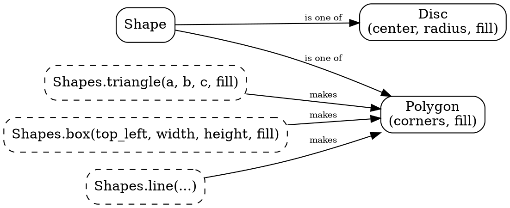

# The drawing layer and its color: what's there, and what I propose

*Two cold agents did the digging today: one took an inventory of the drawing layer, and one audited the color. Their facts are below, then my proposal, then three decisions for you.*

## What the painters actually need

Every painter (the web canvas, the native one, and the pixel proof) can paint everything with two things: **a straight-edged outline** and **a circle**.

- **`Triangle`** is traced as a three-corner polygon by all three painters. Safari also makes three-corner `Polygon`s, and the proof turns cut triangles back into `Triangle` tags.
- **`Rectangle`** is needed by no painter. The canvas could trace it as a path, and the proof already paints it as a polygon. Native uses raylib's rectangle call, which is a speed nicety.
- **`Disc`** is the one true curve. Every painter has its own circle call.
- **`Polygon`** is real and big: 1,113 of the 2,121 shapes at step 1,529. Most of those (591) are quads: tower legs, rail bars, truck faces. Another 518 have five or more corners: traced emoji up to 216 corners, mountains up to 683. And 113 are concave.

So we can't make `Polygon` disappear: towers, rails, the truck, the stills and the mountains all need it. What we can do is stop pretending the painter knows four kinds of region when it knows two.

## Proposal 1: two regions, and the rest are functions

`Shape`'s regions become `Polygon` and `Disc`. A triangle and a box become **functions that make polygons**: `Shapes.triangle(first, second, third, fill)` takes exactly three corners, so its three-ness lives in its type, and `Shapes.box` takes a corner, a width and a height. Tower's private `rod_quad` goes, and `Shapes.line` serves it.

**What the book gains.** The Shapes chapter says it in one sentence: "the platform paints two kinds of region, a polygon and a disc." Then it builds a triangle and a box with functions, which is exactly the lesson the far tree needs next. A reader never meets a `Rectangle` that exists for the painter's sake.

**What it reverses.** Last night we made `Triangle` a tag. Your objection then was that the book said "a triangle is a `Poly`" and explained it away. Under this proposal a triangle is plainly a shape: `Shapes.triangle` gives back a `Shape`. What it no longer has is a tag of its own. If you want the tag kept for its by-construction record, **Proposal 1b** keeps `Triangle` and folds only `Rectangle` into `Shapes.box`.

## Proposal 2: the cleanup that needs no decision

These are the committee's fingerprints. I'd fix them under "fix cruft, don't ask", one agent, in green steps:

1. **One fill type.** Stills carry their own `Still.Fill`, which duplicates `Brush.Fill` (Still's `Radial` even becomes Brush's `Ellipse`). Stills will use `Brush.Fill` directly.
2. **One color type.** Three are in play: `Brush.Rgba`, `RgbColor` and `ArgbColor`. Alpha is written four different ways.
3. **One point type.** The same `{ x : F64, y : F64 }` exists three times (ConvexCut, Still, ScreenRoll), and `Image` and `Text` still take bare `F64`s. They'll move to `Point` and `Pixels` like everything else.
4. **Makers used everywhere.** The sky and the sun build gradients as literals, skipping the makers' checks.
5. **Paired gradients.** `Span` is a three-stop `Linear`, and `Glow` is a three-stop `Radial`. Each pair becomes one fill with its stops.
6. **Stale references.** A stale `Shapes.squash_x` reference goes, and so does one hex color (9AA0A8) written in two modules.

The marks (`Blend`, `View`) stay in the list. That's your flat-list decision from this morning, and it's sound: a mark means "from here on".

## The color: the ride is pretty by day and skips the dusk

The audit agrees with you: the scheme is lovely. Gold and green conifers against slate mountains and a pale sky make a complementary pairing, and the near trees' shaded cones are the strongest effect in the ride. But it found one big gap: **only the sky, the rock and the snow get dark.** At night the grass is still bright green, and so are the road, the trees, the truck and the animals. The sun keeps its noon colors while the horizon reddens around it, and its glow paints orange over blue in `Over` mode, which mixes to a muddy beige ring.

Ranked by what shows best, with their cost:

| | Change | Cost | Teaches |
|---|---|---|---|
| 1 | **Dusk over everything:** one home for "dim this color by darkness", used by grass, road, trees, truck and rails | ~30 lines; frozen color expects move | `color_between`, one home for a rule |
| 2 | **A setting sun:** the disc and glow redden with the horizon, and the glow adds light (`Add`) instead of painting over | ~10 lines, plus `Add` in the pixel proof | the light's own math |
| 3 | **A glowing beacon:** a bright core fading out, instead of a flat magenta dot | ~10 lines | `glow` gets a second user |
| 4 | **Haze:** far things fade toward the horizon color | ~20 lines | distance as color |
| 5 | **Headlight pools** on the road ahead of the truck | ~30 lines | needs 1 first |

**The bull** is the one gradient-shaded animal. It's beautiful up close, and a few pixels tall in the ride. You named it as earning its keep, so I'd keep it. It's the book's natural example of a richer fill.

## Your decisions

1. **Regions:** Proposal 1 (`Polygon` and `Disc`, with triangle and box as functions), or 1b (keep the `Triangle` tag, fold only `Rectangle`)?
2. **Color:** which of the five, and in what order? I'd do 1 and 2 now, since they're the biggest visual win and both small.
3. **Timing:** the drawing-layer cleanup lands before the Shapes chapter's spine, and the far-tree chapter waits for it too, since it quotes the triangle and the trunk. Color can run in parallel, in its own lane.
