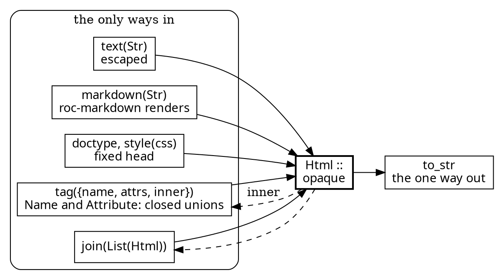
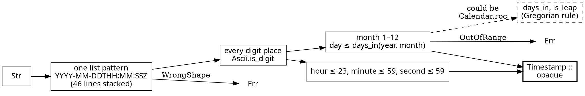
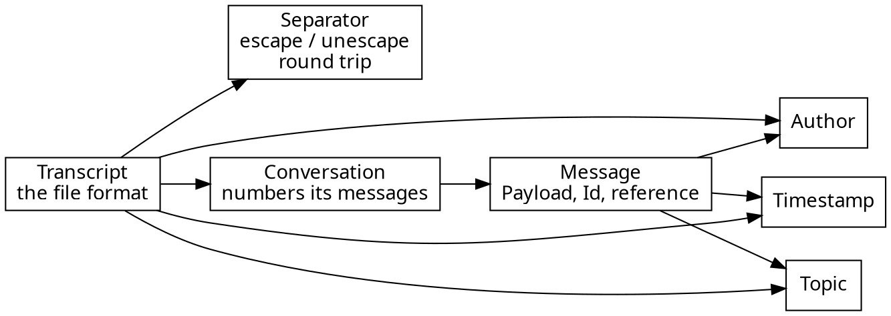

# gopher-roc: why the two largest modules are the size they are

You lean towards small Roc modules: pure ones that compose easily, with effects at the edges. So every large module owes a reason it isn't split.

The Roc is now 1,374 lines across 17 files. That's 1,041 lines of production modules (each with its own tests at the bottom) and 333 lines of test-only modules (`*Spec`, `Sample`). The largest is `Html` at 170 lines, then `Timestamp` at 140.

The third candidate was `Transcript`. It didn't hold up, and I split it while writing this; that's at the end.

## Html: 170 lines, 55 of them tests

**Why it stays one module:** Roc builds an opaque value only inside the module that declares it. `Html`'s promise is "safe by construction": nothing outside this module can turn a `Str` into `Html`. That makes each way in part of the type's definition, and each one has to live where `Html.(...)` can be written. Splitting it would cost something real:
- **Move `markdown` out**, say to a `Markdown` module: then it can't build an `Html`. It would need a public "trust this string" door, which is exactly the gap the reviewers closed (`rendered : Str -> Html`).
- **Move `Name` and `Attribute`'s spellings out**: then the closed unions and their spelling live in two places, two homes for one rule.

**What's left is small:** about 87 lines of code. That's the type, five ways in, two private spelling helpers (`name_of`, `attribute`) and `to_str`. The other 55 lines are tests that pin each way in.

**What could still go:** `doctype` and `style` exist only for `Page`'s head. If more page-level pieces turn up, a tiny `Html.head` constructor, or moving them into `Page` behind an `Html.trusted` used only there, is the next step. I'd wait until a second page needs it.

**Verdict:** keep it whole. Its size is the size of its promise.

## Timestamp: 140 lines, 55 of them tests

**Most of its length is layout and tests:**
- 46 lines are the one shape pattern: 20 bytes and 14 digit places, each on its own line, as the style's stacking rule requires.
- 55 lines are tests. Every field is tested at and just past each end of its range, every month's last day and the day after it, and February under all three parts of the leap-year rule.
- About 20 lines are logic.

**The real candidate to split is the calendar:** `days_in` and `is_leap` are the Gregorian rule, pure and independent of timestamps. They would make a fine little `Calendar` module, composable as you like.

**Why not yet:** your own doctrine is that an abstraction earns its keep on its second user, and only `Timestamp` asks a calendar anything today. The first second user will probably be Recent, saying how long ago something happened, or a day heading on the page. When it arrives, `Calendar.roc` comes out, and its leap-year tests move with it.

**Verdict:** keep it whole for now. Split `Calendar` the day a second module needs it.

## Transcript: split while writing this

`Transcript` was 141 lines. Arguing for its size didn't work. It held two subjects:
- **the file format:** `write`, `append`, `read`, the `MSG_`, `from:` and `date:` lines;
- **the separator-escaping rule:** a pure pair `escape`/`unescape`, with its own invariant, that `unescape(escape(md)) == md` and that no escaped line is the separator.

The escape rule is exactly the small, composable pure module you described, so it's now `Separator.roc` (54 lines). Its invariant is tested as a round trip over the hard cases, not just example by example. `Transcript` is down to 110 lines, a single subject.

## The pattern

- **Fine if large:** a module whose size comes from its opaque type's doors (`Html`) or from layout and tests (`Timestamp`).
- **Split it:** a module with two subjects (`Transcript` before today).
- **Split it when the second user arrives:** a pure rule inside a module that a second module will want (`Calendar`). The essay is the check.

The full module and type graphs, drawn from the code, are at [gopher-roc-pictures](gopher-roc-pictures.md).
