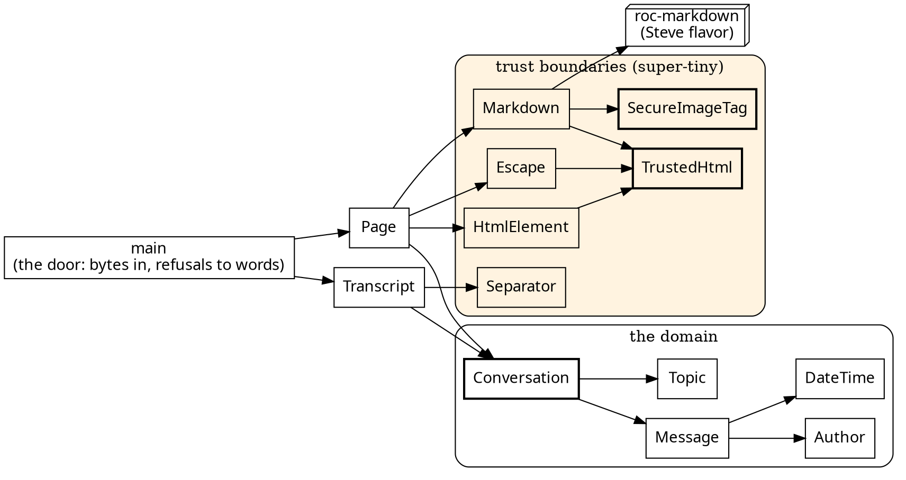

# gopher-roc: the first milestone

**What this is.** The first ~2,000 lines of gopher-roc, signed off by cold reviewers. Three of them signed off on the final state: design and code, a security inspector who started cold at `SecureImageTag.roc`, and tests and the gate. The gate runs in about 1 s warm and about 6.5 s cold. It checks the format and requires every `expect` in the source to pass exactly once (266 of them). It also requires every Spec to be wired in, holds the shale style hunts at zero, and compares the demo's page byte for byte.

## The shape



The full graphs, drawn from the code, are at [gopher-roc-pictures](gopher-roc-pictures.md).

## What sets the tone

- **Bad states can't be built.** A `Conversation` grows only by `append`, which numbers each message (`Message.Id`, a U16 never 0) and refuses `Full` and `Backdated`. `Author`, `Topic` and `DateTime` each have one checking door.
- **Trust boundaries are super-tiny and named so an inspector finds them.** `TrustedHtml` is an opaque string with one scary door, `dangerously_trust`, used in exactly six places. `SecureImageTag` refuses every image until uploads exist. `Markdown` is the only module that touches roc-markdown.
- **Errors are tags until the door.** Only `main` turns a refusal into words.
- **Tests are a specification.** Each module's own expects cover both sides of every boundary and every tag. Shared samples live only in `*Spec` modules.

## For you to decide, and follow-ups

Follow-ups from the sign-offs, none blocking:

1. **Dead references inside messages.** roc-markdown links `MSG_plans_3` to `#msg-plans_3`, but the page's anchor is `msg-3`. The anchor rule has two homes. Fix it before references matter.
2. **The security trail stops at HTML.** Headers should also lead to `MdSafety` (roc-markdown's link rules), `Separator` and `Transcript` (anti-forgery), and the input checks (`Author`, `Topic`, `DateTime`).
3. **Unicode format characters in author names** (bidirectional overrides, zero-width) allow display spoofing. Refuse them at `Author`'s door.
4. **Hostile markdown is shown, not refused.** Run roc-markdown's hostility check at the posting edge, once one exists.
5. **The host, before it becomes a server:** a cap on input size, and a real panic in place of `std.debug.assert`.
6. **Smaller items:** a `<video>` test, a gate check that only Specs import `Sample`, and `app/` subfolders unwatched by the gate and the build.

## Sizes

```
 2055 total
  228 app/TranscriptSpec.roc
  220 app/Page.roc
  199 app/DateTime.roc
  189 app/HtmlElement.roc
  156 app/main.roc
  150 app/ConversationSpec.roc
  138 app/Message.roc
   99 app/Sample.roc
   93 app/Transcript.roc
   76 app/Topic.roc
   67 app/Separator.roc
   64 app/Conversation.roc
   61 app/Ascii.roc
   57 app/Author.roc
   47 app/TrustedHtml.roc
   44 app/Escape.roc
   41 app/SecureImageTag.roc
   38 app/Markdown.roc
   36 app/PageSpec.roc
   24 app/SecureImageTagSpec.roc
   18 platform/main.roc
   10 app/Specs.roc
```

## The trust boundaries, in full

### `app/TrustedHtml.roc`

```roc
## **MARKUP SOME CODE HAS VOUCHED FOR**: a `TrustedHtml` is a string that
## code in this program has decided is ready to deliver as HTML. A `Str` is
## text, never markup. The type says which a value is, so text can't reach
## a page unescaped, and markup can't be escaped a second time.
##
## **THE ONE DOOR IS `dangerously_trust`, AND ITS CALLERS ARE THE AUDIT**,
## named to be seen at every call: each
## vouches only for HTML it built or escaped itself. They are few, and
## each is small: `Escape.text` (text, escaped), `HtmlElement.tag` (an
## element's tags, from closed sets and strict tokens), `Markdown.render`
## (roc-markdown's output, whose images `SecureImageTag` rules: the other
## trust boundary a security reader wants), and
## `Page`'s fixed head and style sheet. `join` builds only from what is
## already vouched for, so it vouches for nothing new.
##
## **THE WAY OUT IS BYTES**: `to_utf8`, for the host. There is no way back
## to a `Str`, so trusted markup can't be handed to `Escape.text` and
## escaped again without a deliberate, fallible `Str.from_utf8`.
TrustedHtml :: Str.{

	## **THE DOOR, AND IT IS DANGEROUS**: `html`, delivered as it is, with
	## nothing escaped. The caller promises that its own code built or
	## escaped every byte of `html`, so no text a person, an agent or a file
	## supplied is in it unescaped. A wrong promise is an injection.
	dangerously_trust : Str -> TrustedHtml
	dangerously_trust = |html| TrustedHtml.(html)

	## The pieces, in order, each as it is.
	join : List(TrustedHtml) -> TrustedHtml
	join = |pieces| TrustedHtml.(Str.join_with(pieces.map(|TrustedHtml.(html)| html), ""))

	## The page's bytes, for the host: the one way out.
	to_utf8 : TrustedHtml -> List(U8)
	to_utf8 = |TrustedHtml.(html)| html.to_utf8()
}

# ── tests
expect TrustedHtml.dangerously_trust("<p>é</p>").to_utf8() == "<p>é</p>".to_utf8()
# Joined in order, each piece as it is, with nothing between them.
expect
	TrustedHtml.join([
		TrustedHtml.dangerously_trust("<p>"),
		TrustedHtml.dangerously_trust("&amp;"),
		TrustedHtml.dangerously_trust("</p>"),
	]).to_utf8()
		== "<p>&amp;</p>".to_utf8()
expect TrustedHtml.join([]).to_utf8() == []
```

### `app/SecureImageTag.roc`

```roc
## **SECURE IMAGE TAGS: WHICH IMAGES A MESSAGE MAY SHOW**, the one home of
## that rule. A message's markdown may hold an image (`` or an
## ``, and a `<video>` too, which roc-markdown rules the same way);
## `Markdown.render` hands roc-markdown `is_conversation_upload` as its
## uploads rule, and roc-markdown shows as media only a source that passes
## it, after judging the source safe as a same-origin URL itself. A source
## that fails is left as text: an image becomes a plain link.
##
## **THE RULE** (`docs/design.md`, "Images"): an uploaded image belongs to
## one conversation, and exactly that conversation's readers can see it.
## So a message may show an image only from its own conversation's
## uploads, and every other source is refused.
##
## **WHAT ISN'T BUILT YET: UPLOADS.** No conversation has an upload, so
## today every source is refused, on purpose, not by oversight. When
## uploads exist, this rule asks the conversation for its own.
##
## What the renderer's output becomes on a page is vouched for at
## `TrustedHtml`'s one door; see its header for the others.
SecureImageTag :: [].{

	## Is `source` one of the message's conversation's uploads? No
	## conversation has any yet, so no source is.
	is_conversation_upload : List(U8) -> Bool
	is_conversation_upload = |_source| Bool.False
}

# ── tests
# Every kind of source refused: relative, absolute, another origin, `data:`
# and `javascript:`, and the empty one.
expect
	[
		"a.png",
		"/user_uploads/a.png",
		"https://evil.example/a.png",
		"data:image/png;base64,AAAA",
		"javascript:alert(1)",
		"",
	]
		.map(|source| SecureImageTag.is_conversation_upload(source.to_utf8()))
		== List.repeat(Bool.False, 6)
```

### `app/Markdown.roc`

```roc
## **A MESSAGE'S MARKDOWN, RENDERED**: the one entry to roc-markdown (the
## `md` package), and the only module that imports it. Its dialect is
## "Steve flavor" markdown, roc-markdown's own, held byte for byte to the
## Zig chat's renderer. roc-markdown takes and gives bytes; this module
## takes a `Str` and gives `TrustedHtml`, so the rest of the chat never
## handles the renderer's bytes.
##
## **WHY ITS OUTPUT IS VOUCHED FOR** (`TrustedHtml`): roc-markdown escapes
## every byte of a member's text through its one escape, lets through only
## the markup its own allowlist rebuilds, refuses a `javascript:` link, and
## shows media only from a source the uploads rule passes. That rule is
## `SecureImageTag.is_conversation_upload`, chosen here and nowhere else.
import md.Md
import SecureImageTag
import TrustedHtml

Markdown :: [].{

	## `markdown`, exactly as written, as markup a page can hold.
	render : Str -> TrustedHtml
	render = |markdown| {
		rendered = Md.render(markdown.to_utf8(), { uploads: SecureImageTag.is_conversation_upload })
		TrustedHtml.dangerously_trust(Str.from_utf8(rendered) ?? crash "Markdown.render: roc-markdown renders UTF-8 from UTF-8")
	}
}

# ── tests
# Its own markup kept, the text in it escaped.
expect Markdown.render("**hi** <b>").to_utf8() == "<p><strong>hi</strong> &lt;b&gt;</p>\n".to_utf8()
expect Markdown.render("a & <b>").to_utf8() == "<p>a &amp; &lt;b&gt;</p>\n".to_utf8()
# Rendered markup is trusted as it is: joined, its entities stay single.
expect
	TrustedHtml.join([TrustedHtml.dangerously_trust("&amp;"), Markdown.render("a & <b>")]).to_utf8()
		== "&amp;<p>a &amp; &lt;b&gt;</p>\n".to_utf8()
# No upload is known (SecureImageTag), so an image is its link; a
# `javascript:` link is text.
expect Markdown.render("").to_utf8() == "<p><a href=\"a.png\">x</a></p>\n".to_utf8()
expect Markdown.render("[x](javascript:alert(1))").to_utf8() == "<p>[x](javascript:alert(1))</p>\n".to_utf8()
```

### `app/Escape.roc`

```roc
## **TEXT, ESCAPED ONCE, ON ITS WAY IN**: the door for every `Str` a page
## shows, from a person, an agent or a file. It vouches (`TrustedHtml`)
## only for what it has just escaped, so no text it is given is ever
## markup, in an element or an attribute.
import TrustedHtml

Escape :: [].{

	## `s`, escaped, as markup a page can hold.
	text : Str -> TrustedHtml
	text = |s| TrustedHtml.dangerously_trust(escape(s))
}

## **THE ESCAPE**: `&`, `<`, `>`, `"` and `'` as entities. `&` goes first,
## so no entity this writes is escaped again.
escape : Str -> Str
escape = |s|
	s
		.replace_each("&", "&amp;")
		.replace_each("<", "&lt;")
		.replace_each(">", "&gt;")
		.replace_each("\"", "&quot;")
		.replace_each("'", "&#39;")

# ── tests
expect Escape.text("Bea <i>x</i> & \"co\" 'q'").to_utf8() == "Bea &lt;i&gt;x&lt;/i&gt; &amp; &quot;co&quot; &#39;q&#39;".to_utf8()
expect Escape.text("café 🎉").to_utf8() == "café 🎉".to_utf8()
expect Escape.text("").to_utf8() == []
# Text is escaped exactly once: `&amp;` as text is `&amp;amp;`, and that
# fragment, joined into another, comes out unchanged.
expect {
	once = Escape.text("&amp;")
	[
		once.to_utf8(),
		TrustedHtml.join([once]).to_utf8(),
		TrustedHtml.join([TrustedHtml.join([once]), once]).to_utf8(),
	]
		== [
			"&amp;amp;".to_utf8(),
			"&amp;amp;".to_utf8(),
			"&amp;amp;&amp;amp;".to_utf8(),
		]
}
expect TrustedHtml.join([Escape.text("a&b"), Escape.text("<")]).to_utf8() == "a&amp;b&lt;".to_utf8()
```

## The heart of the domain

### `app/Conversation.roc`

```roc
## **A CONVERSATION**: a topic and its messages, in id order. It stands
## alone: no channel, no DM, no reader, no file. Opaque, so it grows only
## by `append`, which numbers each message by `next_id` and refuses one
## dated before the latest, so a conversation whose ids skip, repeat or run
## backwards, or whose times run backwards, can't be built.
import Message
import Topic

Conversation :: {
	topic : Topic,
	messages : List(Message),
}.{

	## A conversation with no messages yet.
	empty : Topic -> Conversation
	empty = |topic| Conversation.({ topic, messages: [] })

	## The conversation with what arrived added as its next message, and
	## that message, numbered by `next_id`; unless it already holds as many
	## as an id can number (`Full`, asked first), or what arrived is dated
	## before its latest message (`Backdated`).
	##
	## **TIMES NEVER GO BACKWARDS**: a message's time is never earlier than
	## its conversation's latest. Equal is allowed: times are to the
	## second, and two messages can share one.
	append : Conversation, Message.Arrival -> Try({ conversation : Conversation, added : Message }, [Full, Backdated])
	append = |conversation, arrival| {
		id = Conversation.next_id(conversation)?
		Conversation.(c) = conversation
		match c.messages.last() {
			Ok(latest) if arrival.time.compare(latest.time()) == Before => Err(Backdated)
			_ => {
				added = Message.numbered({ id, arrival })
				Ok({ conversation: Conversation.({ ..c, messages: c.messages.append(added) }), added })
			}
		}
	}

	## **THE NEXT MESSAGE'S ID, ITS ONE HOME**: 1 for the first, else the
	## one after the latest's, unless the conversation is full. `append`
	## numbers by it, and a reader asks it first, to name the message it is
	## reading in a refusal.
	next_id : Conversation -> Try(Message.Id, [Full])
	next_id = |Conversation.(c)|
		match c.messages.last() {
			Ok(latest) => latest.id().next()
			Err(ListWasEmpty) => Ok(Message.Id.first)
		}

	## **THE ONE NAME OF A MESSAGE**, `MSG_<topic>_<n>`, as a transcript's
	## id line and a page's link write it.
	reference : Conversation, Message.Id -> Str
	reference = |Conversation.(c), id| "MSG_${c.topic.to_str()}_${id.to_str()}"

	## Its topic.
	topic : Conversation -> Topic
	topic = |Conversation.(c)| c.topic

	## Its messages, oldest first, each numbered by `append`.
	messages : Conversation -> List(Message)
	messages = |Conversation.(c)| c.messages

	is_eq : _
}
```

### `app/Message.roc`

```roc
## **A MESSAGE**: who wrote it, when, and what, with the id its
## conversation gives it. Immutable: an edit is a new message. A message
## knows nothing of who may write where; that is the conversation's.
##
## Opaque, so its parts are read, never changed. A message keeps no order
## of its own: `numbered` takes whatever id it is given. The order is
## kept by `Conversation`, which is opaque too, and whose `append` is the
## only way a message joins one, numbered by `Conversation.next_id`.
import Author
import DateTime

Message :: {
	id : Message.Id,
	author : Author,
	time : DateTime,
	markdown : Str,
}.{

	## **WHAT ARRIVES**: who wrote it and the markdown, exactly as written.
	## The message, with its id and time, is made from it as early as
	## possible.
	Payload : {
		author : Author,
		markdown : Str,
	}

	## **A PAYLOAD AND ITS TIME**: what a conversation appends, so the id and
	## the time are added in one place.
	Arrival : {
		payload : Message.Payload,
		time : DateTime,
	}

	## **A MESSAGE'S ID**: its number in its conversation, counting from 1,
	## so a conversation's order is its ids' order. At most U16's highest,
	## 65,535: a conversation that long is archived, never grown.
	Id :: U16.{

		## The first message's id.
		first : Message.Id
		first = Message.Id.(1)

		## The id after this one, unless this is the last a conversation
		## holds.
		next : Message.Id -> Try(Message.Id, [Full])
		next = |Message.Id.(n)| if (n == U16.highest) Err(Full) else Ok(Message.Id.(n + 1))

		## The number, as a page's anchors and a refusal write it.
		to_str : Message.Id -> Str
		to_str = |Message.Id.(n)| n.to_str()

		is_eq : _
	}

	## The message numbered `id`, from what arrived.
	numbered : { id : Message.Id, arrival : Message.Arrival } -> Message
	numbered = |{ id, arrival: { payload, time } }|
		Message.(
			{
				id,
				author: payload.author,
				time,
				markdown: payload.markdown,
			},
		)

	## Its id.
	id : Message -> Message.Id
	id = |Message.(m)| m.id

	## Who wrote it.
	author : Message -> Author
	author = |Message.(m)| m.author

	## When.
	time : Message -> DateTime
	time = |Message.(m)| m.time

	## Its markdown, exactly as written.
	markdown : Message -> Str
	markdown = |Message.(m)| m.markdown

	is_eq : _
}

# ── tests
steve : Author
steve = Author.from_str("Steve") ?? crash "Message's tests: an author's name"

noon : DateTime
noon = DateTime.from_str("2026-11-02T12:00:00Z") ?? crash "Message's tests: a time"

hello : Message.Arrival
hello = { payload: { author: steve, markdown: "hello" }, time: noon }

cc : Author
cc = Author.from_str("CC") ?? crash "Message's tests: an author's name"

later : DateTime
later = DateTime.from_str("2026-11-02T12:01:00Z") ?? crash "Message's tests: a time"

## A second arrival, every part unlike `hello`'s, so a message is seen to
## carry its own.
reply : Message.Arrival
reply = { payload: { author: cc, markdown: "hi" }, time: later }

## A message's parts, as a test compares them.
parts : Message -> {
	id : Str,
	author : Author,
	time : DateTime,
	markdown : Str,
}
parts = |m| {
	id: m.id().to_str(),
	author: m.author(),
	time: m.time(),
	markdown: m.markdown(),
}

expect Message.Id.first.to_str() == "1"
expect Message.Id.first.next().map_ok(Message.Id.to_str) == Ok("2")
# The last id at, under and over the highest.
expect Message.Id.(65534).next().map_ok(Message.Id.to_str) == Ok("65535")
expect Message.Id.(65535).next() == Err(Full)
# A message numbered with the id it is given, each part what arrived.
expect parts(Message.numbered({ id: Message.Id.first, arrival: hello })) == {
	id: "1",
	author: steve,
	time: noon,
	markdown: "hello",
}
expect parts(Message.numbered({ id: Message.Id.(65535), arrival: reply })) == {
	id: "65535",
	author: cc,
	time: later,
	markdown: "hi",
}
```

