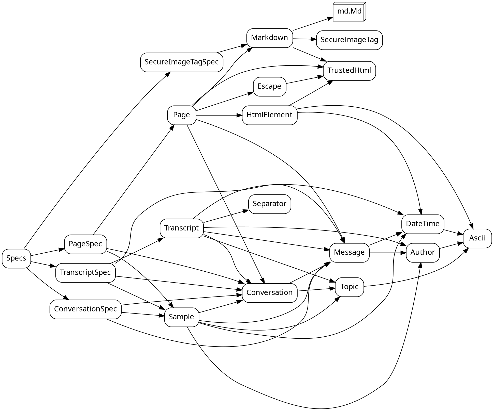

# gopher-roc: the design in pictures

Drawn from the code by `tools/diagram.shale`; never edited by hand.

## Modules and what they import

## Types, by module

A bold box is opaque (`::`); a plain one nominal (`:=`). An arrow: the type's definition names the other.

```dot
digraph types {
  rankdir=LR;
  compound=true;
  node [shape=box, fontname="sans-serif"];
  subgraph "cluster_Ascii" {
    label="Ascii.roc";
    style=rounded;
    "Ascii" [label="Ascii ::", shape=box, style=bold];
  }
  subgraph "cluster_Author" {
    label="Author.roc";
    style=rounded;
    "Author" [label="Author ::", shape=box, style=bold];
  }
  subgraph "cluster_Conversation" {
    label="Conversation.roc";
    style=rounded;
    "Conversation" [label="Conversation ::", shape=box, style=bold];
  }
  subgraph "cluster_ConversationSpec" {
    label="ConversationSpec.roc";
    style=rounded;
    "ConversationSpec" [label="ConversationSpec ::", shape=box, style=bold];
  }
  subgraph "cluster_DateTime" {
    label="DateTime.roc";
    style=rounded;
    "DateTime" [label="DateTime ::", shape=box, style=bold];
  }
  subgraph "cluster_Escape" {
    label="Escape.roc";
    style=rounded;
    "Escape" [label="Escape ::", shape=box, style=bold];
  }
  subgraph "cluster_HtmlElement" {
    label="HtmlElement.roc";
    style=rounded;
    "HtmlElement" [label="HtmlElement ::", shape=box, style=bold];
    "HtmlElement.Token" [label="Token ::", shape=box, style=bold];
  }
  subgraph "cluster_Markdown" {
    label="Markdown.roc";
    style=rounded;
    "Markdown" [label="Markdown ::", shape=box, style=bold];
  }
  subgraph "cluster_Message" {
    label="Message.roc";
    style=rounded;
    "Message" [label="Message ::", shape=box, style=bold];
    "Message.Id" [label="Id ::", shape=box, style=bold];
  }
  subgraph "cluster_Page" {
    label="Page.roc";
    style=rounded;
    "Page" [label="Page ::", shape=box, style=bold];
  }
  subgraph "cluster_PageSpec" {
    label="PageSpec.roc";
    style=rounded;
    "PageSpec" [label="PageSpec ::", shape=box, style=bold];
  }
  subgraph "cluster_Sample" {
    label="Sample.roc";
    style=rounded;
    "Sample" [label="Sample ::", shape=box, style=bold];
  }
  subgraph "cluster_SecureImageTag" {
    label="SecureImageTag.roc";
    style=rounded;
    "SecureImageTag" [label="SecureImageTag ::", shape=box, style=bold];
  }
  subgraph "cluster_SecureImageTagSpec" {
    label="SecureImageTagSpec.roc";
    style=rounded;
    "SecureImageTagSpec" [label="SecureImageTagSpec ::", shape=box, style=bold];
  }
  subgraph "cluster_Separator" {
    label="Separator.roc";
    style=rounded;
    "Separator" [label="Separator ::", shape=box, style=bold];
  }
  subgraph "cluster_Specs" {
    label="Specs.roc";
    style=rounded;
    "Specs" [label="Specs ::", shape=box, style=bold];
  }
  subgraph "cluster_Topic" {
    label="Topic.roc";
    style=rounded;
    "Topic" [label="Topic ::", shape=box, style=bold];
  }
  subgraph "cluster_Transcript" {
    label="Transcript.roc";
    style=rounded;
    "Transcript" [label="Transcript ::", shape=box, style=bold];
  }
  subgraph "cluster_TranscriptSpec" {
    label="TranscriptSpec.roc";
    style=rounded;
    "TranscriptSpec" [label="TranscriptSpec ::", shape=box, style=bold];
  }
  subgraph "cluster_TrustedHtml" {
    label="TrustedHtml.roc";
    style=rounded;
    "TrustedHtml" [label="TrustedHtml ::", shape=box, style=bold];
  }
  "Conversation" -> "Message";
  "Conversation" -> "Topic";
  "Message" -> "Author";
  "Message" -> "DateTime";
  "Message" -> "Message.Id";
}
```

