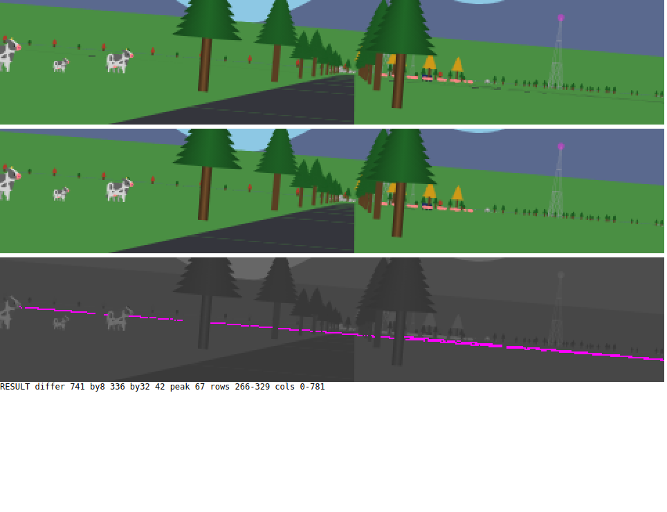
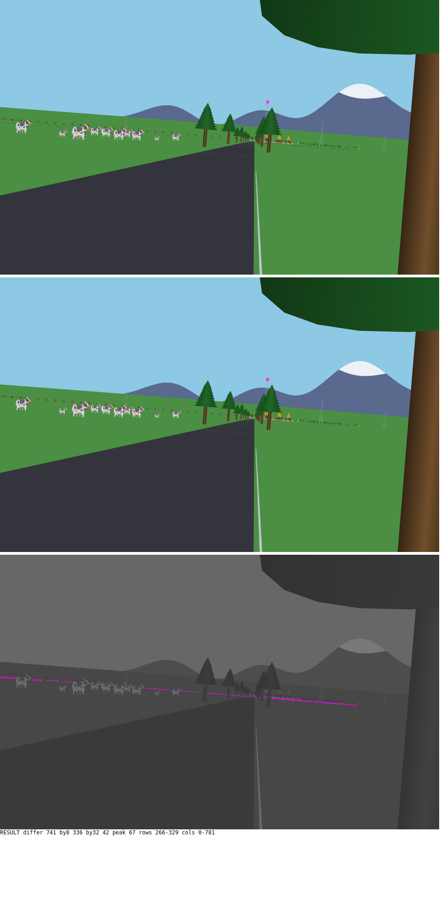
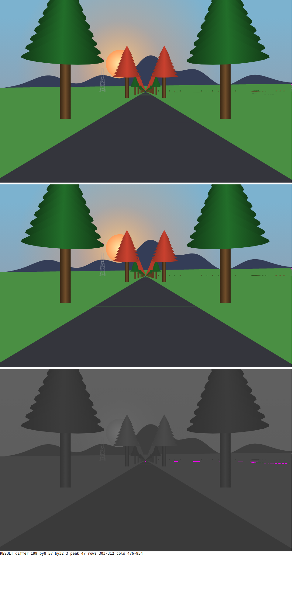

# The horizon cut: eye test

*2026-11-07. Branch `road-frame`, not merged yet. The ground now stops at the horizon, `Ground.horizon_distance`, which is the square root of twice the earth's curve radius times the eye height: 489.9 m. Before, road past it was painted, and because a point past the horizon projects lower on screen again, it lay on the grass as faint dashes.*

Each image stacks the frame before, the frame after, and the difference in magenta. I looked at step 700 myself: the dashed line across the grass under the cows, and on the right past the tower, is gone, and the near road is unchanged.

## Step 700, at twice the size

## Step 700

## Step 2511

## The same branch

The other half of this branch is invisible by design. A road point now has one frame, measured from the middle of the road, and the road's width lives once, in `Geom`. No hash moved for that half.

Seven proof hashes moved for the horizon, and the page hash too. Step 3000 also carries the sun fix, so it has a hash of its own.
