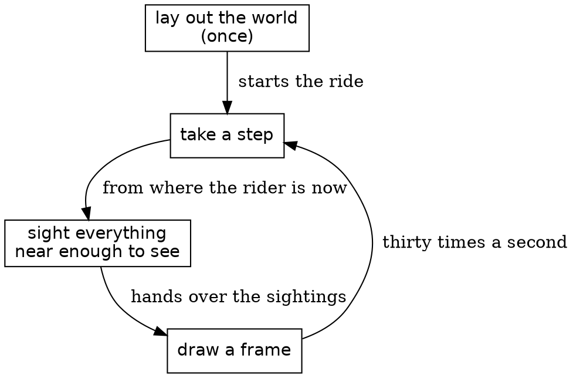

# Introduction and The problem, clean drafts

The first sentence is new, written to hook the reader and to carry the book's theme: a whole world drawn from four small things. The direction promise is gone. The design paragraph now names the types' part. You flagged only the opening, so the scene, the route and the prerequisite paragraphs are unchanged. "The problem" is a new clean draft. Writing it caught one false claim: the rider doesn't slow for a cat. A cat keeps the rider off the throttle, without braking. Reply on any paragraph.

---

# Safari Ride: a tour of a real Roc program

Thirty times a second, Safari Ride draws a whole world from four small things. This book reads the program with you, and shows how Roc keeps a program this busy simple.

## Introduction

The program is Safari Ride, and it's running in the page below. Give it a moment to load, and the ride starts by itself.

*[the ride widget] The ride, running as you read. Click it to give it the keyboard: Space pauses it, and the arrow keys step it.*

A rider on a motorcycle follows a long road through open country. Trees line the road. Cows and pigs graze beside it. A truck drives on ahead. Radio towers blink on the horizon. A bird takes off as the rider comes near, and a cat crosses the road. The sun sets behind the mountains, the truck turns on its headlights, and night falls. At the end of the road the rider stops, and the ride starts over.

Nobody steers and nothing keeps score, so Safari Ride isn't a game. It has a game's hard parts, though: terrain, a camera, physics, and things that react to the rider.

Safari Ride stays simple because of one design. Each step of the ride carries four things: the rider, the truck, the clock and the plan for the encounter ahead. Everything else is derived from those four. The sky's color, the sun's height, the trees in view and the cat's pose are all calculated fresh, every frame. The same four things always give the same picture. The types hold the design together: each one describes only the values that make sense.

Most of the code is plain Roc: records, tags and functions. That's a feature.

A safari is a guided tour, so this book is a tour of a tour. We start with the whole program. Then we hold one frame still and build everything in it, from a single triangle up to a herd of cows. Then we let the clock run, and the rider, the truck and the cat start to move. At the end we zoom back out.

You should be able to read a little Roc. If you can't yet, start with the official Roc tutorial. This book explains each Roc idea where it first comes up.

## The problem

Safari Ride has one job. Thirty times a second, it draws the world as the rider sees it. That job comes with four needs.

We need a world. The road and everything along it are laid out once, before the ride starts.

We need motion. At every step the rider rides on, the truck drives on, and the clock ticks.

We need to know what the rider sees. The screen shows the world from the rider's seat, so for every tree, cow, cat and tower we have to work out three things: whether the rider can see it, where it stands in the rider's view, and how big it looks. We need machinery for that. Its answer for one thing is called a sighting.

We need to draw. Each frame paints the sky, and then everything the rider sees.

The problem, as a loop

A turn of this loop is a step. While the ride plays, the program draws a frame for each step, and it draws every frame whole, from nothing.

### Carried and derived

We carry a small state from one step to the next. It holds four things:

| What we carry | What it holds |
|---|---|
| The rider | where the motorcycle is on the road, which way it points, its speed and its lean, and where the rider is looking |
| The truck | how far along the road it is, its speed, and whether its last step slowed it |
| The clock | how many steps the ride has taken |
| The encounter plan | when the cat or the bird ahead starts to move |

During each step, we derive everything else from those four. The color of the sky comes from the clock. The trees in view come from where the rider is. The cat's pose comes from the clock and the encounter plan. A derived value comes straight from this step's state, so it always matches it. Every value in the program is one or the other, and the book keeps asking which: is it carried, or derived?

### The rider and the world change each other

The four things depend on each other. A cat in the road keeps the rider off the throttle. The cat plans its crossing from how far away the rider is, and how fast the rider is coming. The truck aims for a point ahead of the rider. So a step runs in a fixed order. First the rider reads the world: where the encounter ahead has got to. Then the rider moves, and the clock ticks. Then the world answers the rider who has just moved. The truck aims from the rider's new place, and the encounter plan is made from the rider's new place and speed. The rider never reads the truck. "Stepping through the ride: RideInstant" shows this order in its code.

### Three sorts of thing

Everything on the screen is one of three sorts: a solid, a card or far scenery. Each sort is placed its own way, with as little work as still looks right.

| Sort | Examples | How it's placed |
|---|---|---|
| Solid | the road, its guard rails, the ponds, the radio towers, the truck, a tree up close | every corner at its own place along, across and above the road |
| Card | the cat, the bird, the cows and pigs, the ducks, a far tree | by its foot on the road, standing upright and facing the rider |
| Far scenery | the sun, the mountains, the rolling land | by a direction and a height above the horizon |

A solid costs the most, because every corner is placed on its own. A card is flat, so one point, its foot, places all of it. Far scenery is so far away that it never comes nearer, however far the rider goes, so it needs no distance at all. The rest of the book keeps to these three sorts.

Next, one piece of that loop in Roc: the clock.
