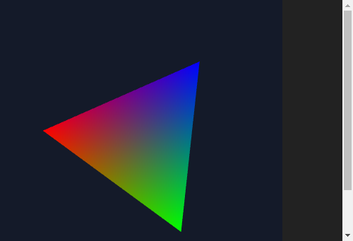

# Odin on wasm, under Roc

*2026-11-06. A hands-on trial with Odin dev-2026-11a (9a69916), Roc nightly-2026-11-03-34bd006, and headless Chromium with software GL. Sources are in `~/showell_repos/odin-wasm-trial/`.*

## Verdict

**Yes. Odin targets wasm well enough, and Roc sits on top of it in one wasm module.**

Odin compiled to a wasm object, Roc's own linker took that object as `host.wasm`, and the result ran. A small Roc app drove Odin's WebGL in Chromium. Then Odin replaced `host.zig` under the real Snake and the real Safari, and both drew exactly the same frames as the Zig host did.

**Sokol is the one open decision.** Rocco's sentence that sokol and Odin have no shared web path is out of date: the path exists, and it is Emscripten. I confirmed its parts but did not run it end to end. An engine that skips sokol and calls Odin's WebGL binding needs no Emscripten, and that is the path I ran here.

## What ran

| Test | Result |
|---|---|
| 1. Basics on both wasm targets | Passed, with correct output under node |
| 2. Rotating WebGL2 triangle | Passed, GLSL 300 shaders, in Chromium on SwiftShader |
| 3a. Odin host and Roc app in one wasm, under node | Passed, 1M ticks at about 1 µs each, no leak |
| 3b. The same in Chromium, Odin drawing Roc's vertices | Passed, about 35 fps on software GL with the box shared |
| 3c. Odin host under the real Snake and Safari | Passed, frames identical to the Zig host's |
| 3d. Roc as a wasm archive, linked with the Odin object by plain `wasm-ld` | Passed, same answers |
| 4. Odin plus sokol on the web | Odin's half compiled here; the rest I read and did not run |

The two-module page was never needed, so I did not try it. One wasm worked.

The triangle above is the 3b build. Roc holds the angle in a boxed model and answers a `List(F32)` of vertices each tick. Odin uploads them and draws. Two samples 1.5 seconds apart in one browser session showed 25 and then 77 frames, with 2 live Roc blocks and 130 memory pages both times.

## The numbers

Sizes and wall times for `odin build`, with `nice`, on this 2-core box:

| Program | Target | `-o:none` | `-o:speed` | `-o:size` |
|---|---|---|---|---|
| Hello | js_wasm32 | 567 KB, 1.2 s | 212 KB, 6.1 s | 182 KB, 4.7 s |
| Struct, slices, arena, `core:math` | js_wasm32 | 613 KB, 1.5 s | 229 KB, 7.4 s | 193 KB, 5.3 s |
| WebGL2 triangle | js_wasm32 | 575 KB, 1.9 s | 216 KB, 9.3 s | 187 KB, 5.6 s |
| Hello, host print | freestanding_wasm32 | 453 B, 0.3 s | 362 B, 0.4 s | 361 B, 0.4 s |
| Same program, no `core:fmt` | freestanding_wasm32 | 41 KB, 0.4 s | 9.4 KB, 1.2 s | 9.4 KB, 1.1 s |

Almost all of the js_wasm32 size looks like `core:fmt`, which `vendor:wasm/WebGL`'s shader helper also pulls in. That is an inference from the freestanding sizes, not a measurement. A release build costs 5 to 10 seconds, so day-to-day work would use `-o:none`.

Roc's link step took 0.4 s for the small app and 1.0 s for the WebGL host. The linked sizes were 16.8 KB for the freestanding host and 192 KB for the WebGL one.

Odin against Zig as the host of the real apps, with `--opt=speed` and `canvas_apps/web/page_check.mjs`:

| | Zig host | Odin host |
|---|---|---|
| Snake wasm | 61,568 B | 54,159 B |
| Snake drawn hash, canvas calls | 2438734771, 77,292 | 2438734771, 77,292 |
| Safari wasm | 746,056 B | 738,297 B |
| Safari drawn hash, canvas calls | 3671023915, 780,476 | 3671023915, 780,476 |
| Safari screenshot SHA-1 | 3d4818eeb5bc65df… | 3d4818eeb5bc65df… |
| Safari, time per tick under node | 8.5 to 10.3 ms | 4.9 to 5.1 ms |
| Safari, memory pages over 1500 ticks | 175 to 231 | 181 to 197 |

`page_check` runs each page against a stand-in canvas, not a browser's, so these compare the shapes each host hands to the painter. The string `wasm_allocator` appears only in the Odin builds, so these really are different hosts and not a stale cache.

The speed gap held across three runs of each host, with the order swapped. I don't know the cause. The allocators are the obvious suspect, but I did not profile them, and Safari under node is not Safari in a browser. Treat it as a reason to look, not a finding that Odin is faster.

## What went wrong, exactly

**Linker.** Odin's Linux release ships no `wasm-ld`. The only symptom is `Could not spawn subprocess`, which names nothing. A two-line script calling `zig wasm-ld` fixed it (LLD 21 reading objects from Odin's LLVM 20). The Roc path doesn't need this at all: object mode doesn't link and Roc brings its own linker, which I confirmed by rebuilding with no `wasm-ld` on the PATH.

**Entry point.** `-build-mode:obj` drops Odin's `_start` and `_end`, so Roc's link failed on those exports. The host has to call `runtime._startup_runtime()` itself. Defining your own `_start` also needs `-no-entry-point`, or Odin reports a duplicate name.

**Allocator.** On freestanding, the default `context.allocator` is the nil allocator, so a 12-byte request returned `Out_Of_Memory` and my host trapped. The real heap is one call away, `runtime.default_wasm_allocator()`, and it worked at once. js_wasm32 doesn't have this trap. This one was my mistake.

**Math.** On freestanding, `math.cos` and `math.sin` on `f32` become `env.cosf` and `env.sinf` imports, so the host must supply them. js_wasm32 routes math through `odin.js`.

**ABI.** Nothing failed. Odin's `proc "c"` matched Roc's calling convention, including a `List` returned by hidden pointer and an eight-argument `advance`.

**Memory.** Nothing failed. Odin's allocator shared the module with Roc's data. Page counts stayed flat in the small app and grew less than the Zig host's under Safari.

**A false alarm of mine.** The first browser runs seemed to freeze after a frame or two. That came from Chromium's `--virtual-time-budget`, not from Odin or Roc. A real-time run over DevTools showed the frames advancing.

## Sokol

**"Sokol and Odin have no shared web path" is no longer true, and hasn't been since January 2025.** The other half of Rocco's sentence still stands: its glue is 64-bit only.

The path has three steps. Odin builds the game with `-target:js_wasm32 -build-mode:obj`. `emcc` builds sokol's C into `.a` files. `emcc` then links everything, and the page loads Odin's imports and Emscripten's together.

Emscripten is a real requirement. sokol's headers use `EM_JS` and Emscripten's headers, and the bindings' PR says plainly that this is "the only way to currently use sokol on the web."

**Verified here:**

- sokol-odin's `triangle` and `cube` examples compile to wasm objects with that command, in about 0.2 s each.
- sokol-odin ships `build_clibs_wasm.sh`, and it calls `emcc`.
- The current `sokol_app.h` has 18 `EM_JS` uses and includes `emscripten/html5.h`.
- The live demo's `index.wasm` (1.2 MB) imports `odin_env`, `env` and `wasi_snapshot_preview1`, and exports both `default_context_ptr` and `_sapp_emsc_*`. So Odin and sokol are in one shipped module. I inspected it without running it.
- `engine/roc_platform_abi.odin` in Rocco (6a436bf) asserts `size_of(Roc_List(u8)) == 24`, which is false on wasm32, where a list is 12 bytes. Its fields use `uint`, so that part looks like a small change. I did not survey the rest of the glue. Rocco's `platform/main.roc` lists no wasm32 target.
- Roc can emit a wasm archive (`output: Archive`), and plain `wasm-ld` linked it with an Odin object. This is the step `emcc` would run, so the Roc side of the path looks open.

**Read, not run:**

- [sokol#1204](https://github.com/floooh/sokol/pull/1204) and [sokol-odin#26](https://github.com/floooh/sokol-odin/pull/26), merged in January 2025, added the wasm support and build scripts. [sokol-odin#3](https://github.com/floooh/sokol-odin/issues/3) has floooh on why Emscripten is needed.
- [karl-zylinski/odin-sokol-web](https://github.com/karl-zylinski/odin-sokol-web) documents the recipe. That repo is archived and points to [odin-sokol-hot-reload-template](https://github.com/karl-zylinski/odin-sokol-hot-reload-template), which is live and does web builds.
- That sample says Odin's wasm allocator "doesn't seem to work properly in combination with emscripten," so it allocates through Emscripten's `malloc`. A Roc host would have to do the same.

**Not done:** I did not install Emscripten, so no sokol build was linked or run here, and Roc, Odin and sokol together have never been tried. As I understand it, Roc's own linker can't be the final link in that setup, because `EM_JS` needs Emscripten's post-link step.

## What this means for an engine

Odin as the host costs little. The Snake host is about 100 lines. Almost none of it is engine work: it is the six runtime symbols, a size prefix on each block, and the exports.

| | Zig host (today) | Odin host |
|---|---|---|
| Reaches Roc's internals | Imports `builtins` and `host_alloc` directly | Copies the rules by hand |
| Drawing in wasm | None shipped; `shapes_canvas.js` paints | `vendor:wasm/WebGL`, wired into `odin.js` |
| Browser input | Our runner | `odin.js` also covers DOM events and gamepads |
| Native story | roc-ray | Sokol, as Rocco does |
| Extra tools for a build | Zig | Odin, and Emscripten only if sokol is on the web path |

The main cost is the copied rules. An Odin host restates the refcount layout and the 0-means-static rule, and Roc can change those. The Zig host calls the real code. Rocco carries the same kind of copy.

The largest unbuilt piece is frames. My Odin drawing read a `List(F32)`. Snake and Safari still paint from JS, because `roc glue` generates a JS reader for `List(Shape)`. An engine that draws in wasm needs that reader in Odin, from a new glue or by hand, or else a flat frame format.

Nothing here shows Odin is required. Zig could import WebGL too. What Odin adds is the binding, already written, and sokol as a route to native.

**The decision for an engine is the graphics layer:**

- **WebGL directly.** One toolchain, no Emscripten, and it ran here. Native would need a second backend.
- **Sokol on both.** One API on native and web, and Rocco's code is easier to borrow. The web build then needs Emscripten, a JS shim (277 KB in the demo), and a Roc-under-`emcc` link nobody has tried.

**Not tested:** Roc hosted effects, a Roc crash reaching the page, real GPUs, input and audio through Odin, and any browser other than Chromium 1140's build.
