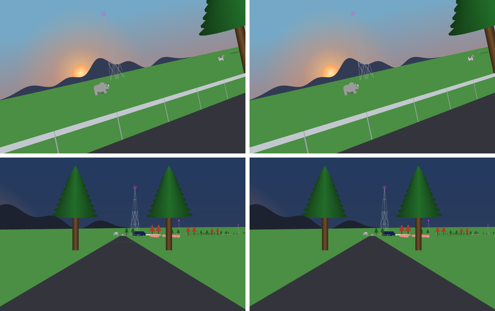
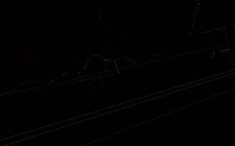
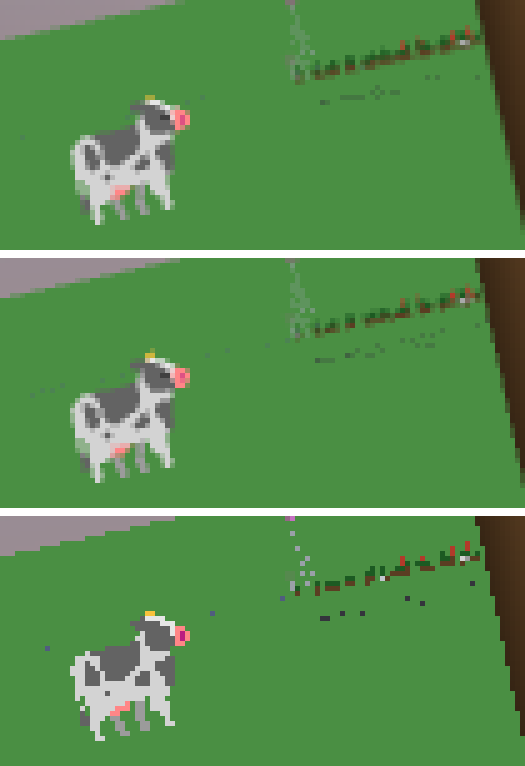
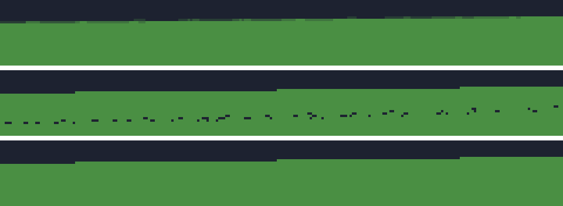

# Safari on Odin and WebGL: first spike

*2026-11-06. Odin dev-2026-11a, Roc nightly-2026-11-03-34bd006, roc-apps master 7bd34b3, headless Chromium 1140 on SwiftShader. Sources are in `~/showell_repos/odin-wasm-trial/`, branch `webgl-safari`, no remote.*

## Verdict

**The path is real.** Safari's unchanged Roc runs on an Odin host in the browser and draws through WebGL2, a whole frame in one draw call. Nothing fundamental blocked it.

With MSAA on, the picture matches the 2D canvas at 43 to 47 dB across six ride steps, and the differences are almost all on edges. By eye they are the same ride.

**The speed question is still open.** This box has software GL only, and software GL is slower here than the CPU canvas: about 220 to 320 ms a frame against about 20 ms. That says nothing about a real GPU. The first thing to do is open the page on a machine with one:

http://143.244.172.148:9210/odin_safari/

## What was built

| Piece | File | Lines |
|---|---|---|
| Roc's runtime symbols, the model, the exports | `host/roc_abi.odin` | 144 |
| Frame reader, as Odin structs laid over wasm memory | `host/frame.odin` | 154 |
| Shapes into one vertex stream | `host/painter.odin` | 419 |
| Shaders and WebGL2 calls | `host/gl.odin` | 205 |
| Test hash for the reader | `host/digest.odin` | 98 |

No Safari Roc changed. Outside Odin, one line changed: the export list in the platform header, in a throwaway worktree, because the page needs `paintFrame` and friends. That worktree is gone. roc-apps itself was not edited.

The painter does everything `shapes_canvas.js` does:

- A convex polygon is a fan. A concave one is ear-clipped, ported from `Shapes.triangulate`.
- A disc is a polygon sized to its radius on screen, clipped to its `Within` rectangle in scene space, so the clip rolls with the camera and costs no draw call.
- All five gradients are shaded per pixel in the fragment shader, from a small float texture of brushes. Each vertex carries its scene point, because a canvas gradient lives in the same space as the shape.
- `Blend(Add)` starts a new run, which is the only thing that adds a draw call.
- `Image` cells are flat quads in paint order, so hard edges need no texture.

Text needed no work, because a frame has no text. `Font` already draws letters as polygons, and they came out right in Breakout and the Workshop.

The page keeps the same keys and pace. Its keyboard and pointer code diffs clean against `canvas_app_runner.js`, and the clock is the same code. The page has no speaker, which Safari doesn't need: it has no tones.

## The frame reader

Reading `List(Shape)` in place works. A shape is 208 bytes, and the reader is a set of Odin structs with size and offset asserts checked at compile time. A frame costs nothing to decode: the painter walks it where Roc left it.

**The reader is proved against the generated one.** `frameDigest` hashes every field the Odin reader sees, and the bench hashes what the generated `roc_glue.js` reader answers. They agreed on all 119 frames sampled across 12,000 steps, 233,048 shapes in all, and on every frame checked in Breakout and the Workshop. To show that this check can fail, I planted one swapped field once, and it disagreed (3195040991 against 3998923035). The plant is gone.

**The reader touches no refcount.** It only looks, and nothing it reads outlives the next `computeFrame`. Roc still drops the old frame through `roc_release`, so Roc's layout knowledge stays with Roc.

**Copied by hand, and able to break silently if Roc changes:**

- The list header: `bytes`, `length`, `capacity_or_alloc_ptr`.
- The refcount is the word before the data, and 0 means static.
- A data pointer's low two bits on wasm32 may be a tag, so they are masked off before the incref. The earlier hosts skipped this. A model pointer has no tag today, so it made no difference there.
- The incref is a plain add where Roc's is atomic, which is safe only because this wasm is single-threaded.
- The size prefix on each block, for `roc_dealloc`.
- All of `frame.odin`: field order, tag numbers, and the tag's place after the payload. The compile-time asserts pin sizes, not meanings; the digest pins those.

Memory stayed reasonable. Pages went from 135 at the start to 181 by step 400 in a short run, and to 191 by step 11,900 in the long one. That is not a formal leak test.

## How close the pictures are

Same wasm, same frame, both painters, compared at 960 by 600.

| Step | PSNR with MSAA | PSNR with no AA | Pixels off by more than 8, MSAA | By more than 32, MSAA |
|---|---|---|---|---|
| 1 | 44.4 dB | 36.5 dB | 0.63% | 0.09% |
| 1500 | 45.1 dB | 37.3 dB | 0.65% | 0.10% |
| 3000 | 43.5 dB | 38.4 dB | 0.62% | 0.24% |
| 4500 | 47.3 dB | 39.8 dB | 0.41% | 0.05% |
| 5700 | 46.9 dB | 37.9 dB | 0.54% | 0.04% |
| 7500 | 45.2 dB | 37.2 dB | 0.43% | 0.11% |

MSAA here is 4 samples. WebGL asks for it by default, and on a real GPU it should cost little. That part is a guess.

Away from edges, the two agree closely. The mean difference there is about 0.1 out of 255 at steps 3000 and 5700, so the gradients are right. At most 0.04% of the frame is off by more than 8 there.

The difference image at step 3000, brightened four times, shows only outlines:

**Where they differ:**

1. **Edges.** Canvas computes exact coverage and MSAA has four samples. This is most of the difference.

2. **Seams in the canvas.** Where two anti-aliased polygons meet, the canvas lets the background show through as a hairline. GL with MSAA has no seam. At step 5700 this is the largest disagreement away from edges, and GL is the better picture. Canvas on top, GL below:

   

3. **Tiny far-off shapes.** Detail under a pixel wide gets four samples instead of exact coverage. With MSAA the far fence and tower look a little different. With no AA they break up. Canvas, MSAA, then no AA:

   

**One real defect turned up and is fixed.** My first port walked the ear clip exactly as `Shapes.triangulate` does, and dark specks appeared in the grass: the mountain behind showing through pinholes in the hill, 80 of them in the 240-pixel strip I counted. Its triangulation was exact, with area matching to 13 digits. The cause was geometry. On a 683-point ridge that walk fans from one corner into triangles 1000 pixels long and hundredths of a pixel wide, and SwiftShader dropped samples in them. Skipping a corner after each ear stops the fan, and the specks went to zero. Canvas, then no AA before and after:

I don't know whether a real GPU would show those pinholes. The sliver triangles were bad geometry either way.

**Blend and Image.** Safari sends neither, so I also built Breakout and the Workshop on this host, with no changes. Breakout's `Blend(Add)` runs took 3 draw calls and reached 41 dB. The Workshop's `Image` reached 44 dB. Neither had any pixels off by more than 8 away from edges.

## Frame time

Medians of 15 rounds on the same frames, in milliseconds, each timed to a forced finish. Roc's own `frame` took 3.5 to 7.6 ms on top of all of these. The box was shared, with a load near 3, and other agents ran Chromium during the session, so treat these as rough.

| Painter | Step 3000 | Step 5700 |
|---|---|---|
| Canvas, CPU raster (`willReadFrequently`) | 21 | 19 |
| Canvas, raster on SwiftShader (Chromium's choice with these flags) | 384 | 639 |
| WebGL, no AA, SwiftShader | 132 | 141 |
| WebGL, MSAA, SwiftShader | 222 | 317 |

Where the WebGL time goes, with MSAA at step 3000:

| Phase | Time |
|---|---|
| Building the vertex stream in Odin | 10.5 ms |
| GL calls, buffer upload included | under 2 ms |
| Waiting for SwiftShader to finish | 211 ms |
| An empty frame's clear and read, for comparison | 1 ms |

| Frame | Shapes | Vertices | Gradients | Concave polygons | Draw calls |
|---|---|---|---|---|---|
| 3000 | 2,486 | 102,243 | 231 | 323 | 1 |
| 5700 | 1,511 | 65,166 | 105 | 209 | 1 |

A real page loop, one step and one paint per animation frame, gave 2.1 to 2.6 fps for WebGL, 1.4 to 2.9 fps for canvas on SwiftShader, and 12 to 17 fps for canvas on the CPU.

The actual page draws 5.5 frames a second here and takes 15 steps a second, because the clock drops time past its catch-up limit, as the canvas runner's does. With painting switched off, the same clock ran at 29.98 steps a second, so the pace is right and software GL is what holds it back.

**Facts:** before rasterizing, the CPU cost of the two painters is about equal, around 10 ms each, so moving the painter into wasm saves no time by itself. Nearly all the WebGL time is rasterizing. **Guess:** on a real GPU that rasterizing nearly vanishes and a frame costs about 15 to 20 ms, mostly Roc and the stream build. Canvas on a real GPU is unmeasured, so I can't say WebGL will beat it.

## Sizes

All with `--opt=speed`, from this same tree.

| | Raw | Gzipped |
|---|---|---|
| Safari wasm, Zig host | 746,056 B | 218,354 B |
| Safari wasm, Odin host, no painter | 738,235 B | 215,136 B |
| Safari wasm, Odin host and painter | 761,505 B | 223,180 B |
| Page JS today: `roc_glue.js`, `shapes_canvas.js`, runner | 29,381 B | 9,550 B |
| Page JS here: `odin.js`, `runner.js` | about 79 KB | about 16 KB |

The reader, painter and digest add 23,270 bytes of wasm. I compiled the shaders directly instead of calling `CreateProgramFromStrings`, to avoid its `core:fmt`, and the small growth fits that, though I didn't inspect the module. `odin.js` is 72,772 bytes and carries much more than this page uses, so it could likely shrink.

A rebuild takes about 1.5 s for Odin and 20 s for Roc.

## What wasn't tested

- Any real GPU, and any browser but this Chromium.
- Key R, the pointer, and touch. Space, the right arrow and J were driven on the live page. The pointer code is the canvas runner's, but nothing clicked here.
- Self-crossing polygons. No sampled frame ran out of ears, but an ear clip can't reproduce the nonzero rule for a polygon that crosses itself, and a translucent one would blend twice where triangles overlap. Nothing in these apps seems to do this, and I checked samples, not every frame.
- A Roc crash. It traps with no message, as the first trial's hosts did.

## What a real engine needs next

1. **A run on a real GPU.** Everything below is worth less until that number exists.
2. **A generated reader.** `frame.odin` is the piece most likely to rot, and it should come from `roc glue` the way `roc_glue.js` does.
3. **A cheaper stream build.** At about 10 ms it would become the largest cost after the GPU takes over rasterizing. I didn't profile it. The mountains and other slow-changing shapes are rebuilt every frame.
4. **Input and clock in Odin, or a decision to keep them in JS.** `odin.js` has the DOM events. Today this page keeps a JS runner, which is why the keys were easy to keep the same.
5. **Audio.** Other apps have tones, and this page is silent. Their speaker pips aren't drawn either.
6. **The anti-aliasing decision.** MSAA is good and nearly free in code. Exact-coverage edges would need more work, and the canvas seams show exact coverage isn't simply better.
7. **Crash messages,** so a Roc crash reaches the page with its text.
8. **The judge as a gate.** `judge.cjs` could fail on a digest mismatch or a PSNR floor, and it runs in a few minutes.

The painter separates well for native. `painter.odin` knows nothing about WebGL, and only the 205 lines of `gl.odin` do, so another backend should mean replacing that one file. That's an inference: I stayed out of sokol and native.

## What to borrow from Rocco

I read Rocco at 6a436bf and roc-odin-glue at 08190ba. I ran none of it: my attempt to run the glue was refused by this session's permission rule against running downloaded code, and I left it there. Both are UPL.

**Worth borrowing now:**

- **roc-odin-glue** is the most useful piece by far, because it generates what I copied by hand: tag unions, offset asserts and refcount helpers. It is 64-bit only. But the compiler's type table carries both widths: `JsGlue.roc` reads `offset32` and `Pointer32` where `OdinGlue.roc` reads `size64` and `Pointer64`. So a wasm32 mode looks like a mechanical change, and it would make a natural first contribution upstream. That is from reading, and it is unproven.
- **`spans.odin`**, for timing named phases, which an engine wants built in where this bench has hand-placed timers. It uses `core:os` and `core:time`, so it needs a small web port.
- **The Bridge idea** (ADR 0009): a driver that replaces input and asks for fixed steps. `judge.cjs` is a crude version of this. Taking the design matters more than the socket code.
- **The bench layout** in `bench/`, which keeps results per machine. A real-GPU number will need that.

**Later, if the need shows up:**

- **The Seam's `prev` and `curr` interpolation.** It would let the ride render faster than it steps. Rocco pairs draws by id, and our shapes have no ids, so this needs a decision in the Roc vocabulary.
- **The baked font and SDF glyphs,** only if polygon text ever costs too much.
- **Clay UI**, if an app needs layout.

**Not useful on this path:** miniaudio (the web has WebAudio), the gamepad backends (`odin.js` covers web gamepads), and `shader_basic.odin`, which is 17,479 lines generated for sokol. The 3D side doesn't apply to a 2D frame.

**Confirmed from the other direction:** Rocco's UI also pushes every rectangle and glyph into one dynamic vertex buffer per frame and draws in runs. That is the shape this spike arrived at, which should make merging easier if that day comes.
