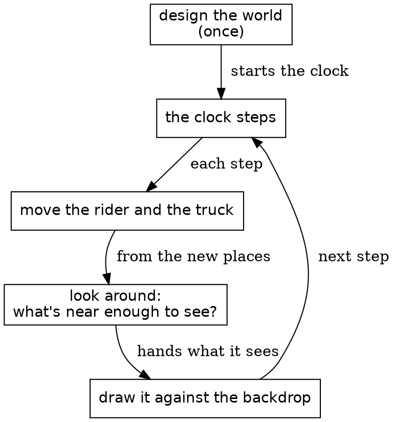
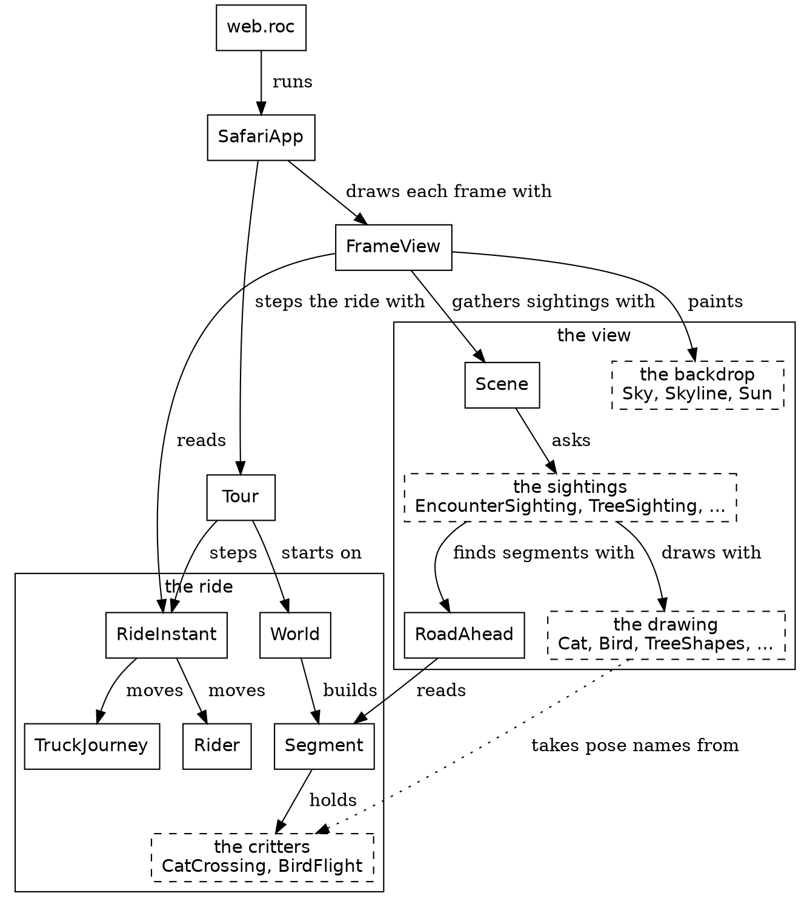
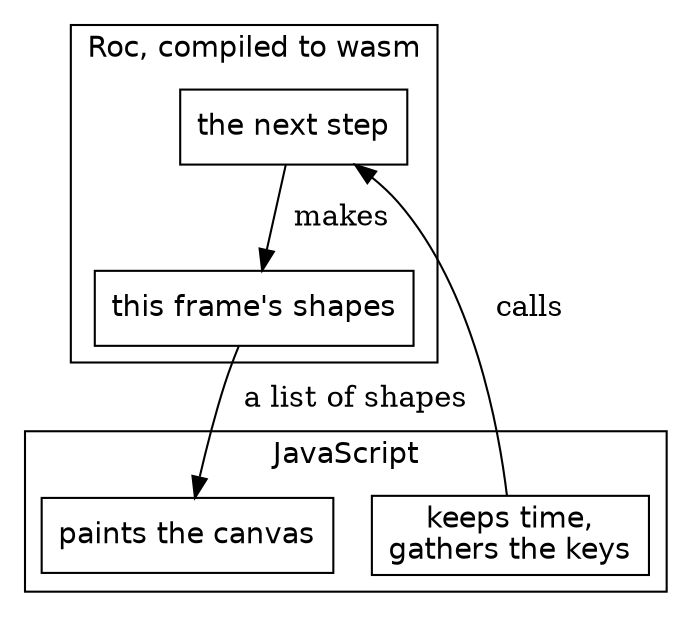
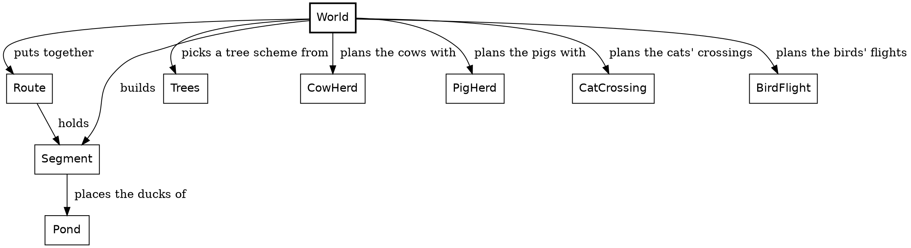

# Proofread: the opening chapters, rewritten

*For Steve's read, 2026-11-10. The Introduction through The world, rewritten largely from scratch and built with the code filled in. The spine now comes first: the four remembered things (as a table), the rider and the world changing each other, and the three sorts. One whole module and The world take the Concepts, Types, Functions shape. The two data tables are unchanged, since their numbers are pinned by expects. Widget blocks show as fences. Comments welcome inline.*

---

# Safari Ride: a tour of a real Roc program

A long walk through one program of about ninety Roc modules: the big picture, the details, and the big picture again.

## Introduction

Safari Ride is a program written in Roc, and it runs in the page below. It takes a moment to load, and then a ride starts by itself.

```widget ride
The ride, running as you read. Click it to give it the keyboard: Space pauses, and the arrows step.
```

A rider on a motorcycle follows a long road through open country. Trees line the road, cows and pigs graze beside it, and a truck stays somewhere up ahead. Radio towers blink on the horizon. A bird takes off as the rider comes near. A cat walks into the lane, freezes, and leaps for the far verge. The sun goes down behind the mountains, and the truck turns on its headlights. After about four minutes the rider stops at the end of the road. The truck doesn't.

Safari Ride has the parts of a game's world: terrain, physics, a camera, things that react to the player, and a day that ends. It has no game mechanics yet. Nothing keeps score, and nobody steers: the rider rides by itself.

A safari is a guided tour, so this is a tour of a tour. We'll start with the whole program, then hold one frame still and look at everything in it, then let it move, and at the end zoom back out. Along the way you'll see how Roc holds up in a program with a lot going on.

We assume you can read a little Roc. If you can't yet, the official tutorial is the place to start. Each chapter points out the Roc ideas it uses, where they first come up.


## The problem

Here's the problem Safari Ride solves. It designs a world once. Then, thirty times a second, it moves what moves, finds everything near enough to see, and draws it.

The problem, as a loop


It works like a flipbook, the little stack of drawings that seems to move when you riffle the pages with your thumb. Each page is drawn whole, from scratch. The code calls a page a frame, and a turn of the loop a step. While the ride plays, there's one step for each frame.

The most interesting box is "look around". On a real safari, a guide scans the land and calls out what's there: a cat by the third tree, a bird on the far side. We'll call each of those a sighting. A sighting is true only for the moment it's made, so Safari Ride throws them all away and makes new ones for every frame.

### Four things are remembered

A flipbook page doesn't remember the page before it, and Safari Ride nearly works that way. Only four things carry over from one step to the next:

| Remembered | What it holds |
|---|---|
| The clock | how many steps the ride has taken |
| The rider | where the motorcycle is, which way it points, how fast it goes and how far it leans, and where the rider is looking |
| The truck | how far along the road it is, how fast it goes, and whether its last step slowed it |
| The encounter plan | when the cat or the bird on the rider's stretch of road starts to move |

Everything else is worked out again for every frame: the color of the sky, where the sun stands, which trees are in view, how the cat is posed. A value that's worked out can't go stale. A value that's remembered has to be carried forward, step by step, so the book keeps asking which is which.

### The rider and the world change each other

The four aren't independent. The rider slows for a cat in the lane. The cat's crossing is planned from how fast the rider is coming. The truck aims to stay a little ahead of wherever the rider has got to. So within one step, order matters: the rider reads the world first, then moves, and then the truck and the encounter plan answer the rider who has just moved. That order is what makes the ride hang together, and the chapter on stepping through the ride shows it in full.

### Three sorts of thing

Everything in the picture is one of three sorts, told apart by what it lacks:

| Sort | Examples | Has | Lacks |
|---|---|---|---|
| Solids | the truck, the radio towers, the guard rails, the road and its ponds | every corner has its own place along, across and above the road | nothing |
| Cards | the cat, the bird, the cows, pigs and other animals by the road, the far trees | a foot on the road, and a width and a height on the screen | depth: they're flat, and always face you |
| Far scenery | the sun, the mountains, the rolling land | a direction and a height above the horizon | distance: they never come nearer |

Each sort is drawn its own way. A solid is placed corner by corner. A card is placed by its foot and stood upright, facing the camera. Far scenery is placed by a direction and a height alone, so it never comes nearer however far the rider goes. The rest of the book keeps to these three.

Next, one piece of that loop in Roc: the clock.

## One whole module

A module in Safari Ride is one file of Roc, and most of them are small. This chapter reads one from top to bottom.

New in this chapter:

- Roc: opaque types, operators as method calls, static dispatch, `expect`
- Modules: `Clock`, `Steps`

A clock is the ride's own time. It counts the steps the ride has taken, from 0 at the start, and thirty frames a second keep it roughly in step with real time. Here's a line that tries to add 7 to one, and doesn't compile:

```roc clock_plus_seven.roc (doesn't compile)
app [main!] { game: "../../game.roc", lib: "../../../lib/main.roc" }

import game.Clock

main! = |_args| {
	later = Clock.start + 7
	echo!(later.to_str())
	Ok({})
}
```

```text roc check on clock_plus_seven.roc
── ✗ type mismatch ─────────────────────────────────── clock_plus_seven.roc:6:24

This number is being used where a non-number type is needed.

later = Clock.start + 7
                      ^

Other code expects this to have the type:

    Steps

── 1 error and 0 warnings ───────────────────────────────── clock_plus_seven.roc
```

In Roc, `a + b` is a call to `a.plus(b)`. `Clock.plus` takes a `Steps`, a count of steps, so a bare 7 doesn't fit, and the error says so. Here's the whole module that refuses that line:

```roc Clock.roc, the whole file
## The ride's clock: which step of the ride this is. It starts at zero and
## moves on by one with every step, so it is always whole. It is kept from one
## step to the next, one of the four things the ride remembers.
import Steps

Clock :: U32.{

	## The clock as a ride starts.
	start : Clock
	start = Clock.(0)

	## The clock at step `number` of a ride.
	at_step : U32 -> Clock
	at_step = |number| Clock.(number)

	## The clock one step on.
	next : Clock -> Clock
	next = |Clock.(n)| Clock.(n + 1)

	## How many steps this clock is past `earlier`. A clock before `earlier` is
	## no count of steps.
	steps_since : Clock, Clock -> Steps
	steps_since = |Clock.(n), Clock.(earlier)|
		if n < earlier {
			crash "Clock.steps_since: this clock comes before the one it counts from"
		} else {
			Steps.of(n - earlier)
		}

	## The clock `length` steps on.
	plus : Clock, Steps -> Clock
	plus = |Clock.(n), length| Clock.(n + length.to_u32())

	## The clock `length` steps back. The ride's first step has none before it.
	minus : Clock, Steps -> Clock
	minus = |Clock.(n), length| {
		back = length.to_u32()
		if back > n {
			crash "Clock.minus: the ride starts at step 0, and nothing comes before it"
		} else {
			Clock.(n - back)
		}
	}

	is_lt : Clock, Clock -> Bool
	is_lt = |Clock.(n), Clock.(other)| n < other

	to_str : Clock -> Str
	to_str = |Clock.(n)| n.to_str()

	is_eq : _
}

expect Clock.at_step(9).steps_since(Clock.at_step(9)) == Steps.zero
expect Clock.at_step(9).steps_since(Clock.at_step(8)) == Steps.one_step
expect Clock.at_step(9).steps_since(Clock.start) == Steps.of(9)
expect Clock.start.next().steps_since(Clock.start) == Steps.one_step
expect Clock.start.plus(Steps.zero) == Clock.start
expect Clock.at_step(9).plus(Steps.of(3)) == Clock.at_step(12)
expect Clock.at_step(9).minus(Steps.zero) == Clock.at_step(9)
expect Clock.at_step(9).minus(Steps.of(3)) == Clock.at_step(6)
expect Clock.at_step(9).minus(Steps.of(9)) == Clock.start
expect Clock.at_step(8) < Clock.at_step(9)
expect !(Clock.at_step(9) < Clock.at_step(9))
expect !(Clock.at_step(10) < Clock.at_step(9))
```

### Get the types right

`Clock :: U32.{ ... }` says what a clock is: underneath, a `U32`. The `::` makes the type opaque. Only this module can see the number inside, so no other module can add 7 to a clock, or pass a count of trees where a clock belongs. `Clock.(n)` makes a clock from a number, and in a parameter list it does the reverse and takes the number out.

A clock and a `Steps` are a pair you'll meet again. A clock is a moment, and a `Steps` is a length of time. A clock plus some steps is a later clock, a clock minus some steps is an earlier one, and `steps_since` gives the steps between two clocks. There's no way to add two clocks, because that sum would mean nothing.

### The functions

The block after the type holds its methods. `is_eq : _` asks Roc to derive equality, so `==` works on clocks. `is_lt` is what `<` calls, the same way `plus` is what `+` calls.

Safari Ride moves the clock on once a step, with `next`:

```roc RideInstant.roc, in next
# ...
clock = instant.clock.next()
# ...
```

`instant.clock.next()` is static dispatch: Roc finds `next` from the type of `instant.clock`, so the call needs no `Clock.` in front.

Below the block, each `expect` is a test, and `roc test` runs them all. A clock is an ordinary value, so a test of one fits on a line. The test of `Clock.at_step(9).plus(Steps.of(3))` starts at step 9 directly, without running the ride for nine steps first.

Most of Safari Ride's small modules look like this one: a comment saying what the thing is, a few imports, one type named after the module, and its tests. That's one module of about ninety. Next, how they fit together.

## The modules

About ninety modules make up Safari Ride. Here's the whole system, simplified. Each arrow points from a module to a module it imports, and its label says what the import is for. A dashed box stands for a family of modules. Roc doesn't allow import cycles, so the arrows never loop back.

The whole system, simplified


New in this chapter:

- Roc: imports that can't form a cycle
- Modules: `SafariApp`, `Tour`, `FrameView`, `Scene`, `EncounterSighting`

### Two halves

The system has two halves, the diagram's two labelled groups. The ride is what happens. `RideInstant` holds the four remembered things and steps them, with `Rider` and `TruckJourney` moving the rider and the truck. `World` builds the route the ride runs on, out of segments, and the segments hold the critters: the cat and the bird.

The view is what the rider sees. `Scene` gathers the sightings, which work out what's visible, and the drawing modules make the shapes. Every arrow between the halves points one way, from the view to the ride: the view reads the ride, and the ride never imports the view. The one dotted arrow is the drawing code taking the pose names, and the cat's height, from the critters' modules.

`FrameView` joins the halves: it reads one instant of the ride and makes the frame. `Tour` steps the ride forward and back. The browser only ever sees `SafariApp`, which hands it a list of shapes for each frame.

### The part that isn't Roc

One tick across the line between JavaScript and Roc


Safari Ride runs in a browser, and that takes a thin layer of JavaScript. The Roc compiles to WebAssembly, wasm for short, which a browser runs. For each frame, the JS keeps time, gathers the keys, and calls into Roc. Roc answers with a list of shapes, and the JS paints them on a canvas. The JS knows nothing of cats, and the Roc knows nothing of canvases. The whole game is on the Roc side of that line, and the same app also runs natively. `canvas_apps/ARCHITECTURE.md` has the details, and the platform chapter comes back to it.

### What's a sighting?

A sighting answers one question about one thing, for one frame: can the rider see it, and how should it look? At step 1,529 of the ride, a cat is frozen in the road. This is what `EncounterSighting` answers about it on that frame:

| Field | Value |
|---|---|
| `right` | 0.38 metres |
| `forward` | 23.63 metres |
| `pose` | `Frozen` |
| `lift` | 0 |

`right` and `forward` are measured from the camera, in metres. That's all a sighting is: where the rider sees something, and how it should look.

Most things in the view come in pairs: a sighting module that finds the thing, and a drawing module that draws it. `EncounterSighting` pairs with `Cat` and `Bird`, `TreeSighting` with `TreeShapes`, `TowerSighting` with `Tower`, and `TruckSighting` with `Truck`.

`EncounterSighting` finds the cats in a few moves. It goes through the segments of road ahead, where a segment is one stretch of road between two bends. It asks `EncounterPoses.cat_poses` where each cat is and how it stands. It works out where that lands in the rider's view, and drops any cat behind the camera or too small to matter. What it hands back is a plain record, with no drawing in it:

```roc Pipeline.roc
## An object in the rider's view, and what kind of object it is, for one
## frame.
Sighted(kind) : { spot : Spot, kind : kind }
```

A sighting decides what's visible, and the drawing code only paints what it's told. `Scene.scene_in_view` gathers every sighting and turns each one into a `Rendered`: a picture, plus its depth. It gets the picture from the object's own drawing module. Then `Scene.scene_renderings` puts the renderings in order, far to near. A sighting is plain data, so it can be checked with numbers, without drawing anything. The Nature types chapter comes back to this.

Here are a few more things from step 1,529, and what their sightings decide. A `forward` below zero is behind the camera.

| What it is | `right` | `forward` | What its sighting decides |
|---|---|---|---|
| The cat, frozen | 0.38 | 23.63 | drawn |
| The nearest tree, a big green one | 3.45 | 21.63 | drawn |
| The nearest tree behind the camera, a gold one | -8.09 | -8.36 | `BehindCamera` |
| The nearest tree the earth's curve hides, a small green one five segments on | -1,433.43 | 446.00 | `BelowHorizon` |
| A big green tree just past it | -1,446.07 | 473.21 | drawn |
| The radio tower past the end of the rider's segment | 20.40 | 355.61 | drawn |
| The truck | 92.19 | 489.15 | drawn |

A small tree can sink below the horizon while a taller one behind it still shows its top. Of the 214 trees on the segments in view, 136 are drawn, 30 are behind the camera, and 48 are below the horizon. None is too small. Those 78 never reach the screen.

Cows, pigs and the other animals by the road are all sighted the same way, by `BillboardSighting`, which decides which of them get drawn. Each threshold for what gets drawn lives in the module that uses it. `Pipeline.smallest_height_on_screen`, 2 pixels, is how short something may look and still be drawn. `TreeShapes.cone_reach` and `TreeShapes.round_trunk_limit` decide how near a tree shows its full detail.

Everything in this chapter happens within one frame, and none of it survives to the next. Only the four remembered things carry over: the clock, the rider, the truck and the encounter plan. Next, we hold one frame still and look at what's in it, starting with the parts that never change.

## The world

Some of Safari Ride never changes. The road, its trees, the cows, the pond and where each cat and bird waits are all built once, before the ride starts, and only read after that. That makes them the easiest part of the program to read, so the tour starts there.

```widget route
The whole route in one picture. The white stretch is segment 7, and the lines under the map read out its record.
```

Each stretch of this map is one record of a list called `World.segment_plans`, and the lines under the map read out the one in white. The marks on the map are the seven segments with a cat or a bird. We drew the map for this page: the ride itself never has one, and it never needs one, because the road has no global coordinates. A place on the road is always measured within one segment.

New in this chapter:

- Roc: small tag unions in place of booleans, `match` that has to cover every tag, `var`, `crash`, void modules, record update, tuples
- Modules: `World`, `Route`, `Segment`, `Trees`, `Pond`

### Get the types right

A segment is one stretch of road, from one bend to the next. It's planned with a record, and the route is a list of them:

```roc World.roc
## One segment of the route as planned: its length and scenery, and what
## lives along it.
SegmentPlan : {
	length : Distance,
	scheme : Trees.Scheme,
	encounter : Segment.PlannedEncounter,
	pigs : World.PigPresence,
	bull : CowHerd.Bull,
}
```

The plan's fields are small tag unions, and they say more than booleans would. `CowHerd.Bull` is just `[WithBull, NoBull]`. A segment written with `bull: NoBull` says what it means, where a `False` in that place would send the reader to look up which field it is.

Here are the route's first six segments as rows. It's the same data `World.bending_plans` declares, shown as a table. Each plan also says how its segment turns into the next.

| Segment | Length | Turn at the end | Trees | Encounter | Herds |
|---|---|---|---|---|---|
| 1 | 500 metres | 50 degrees right | all green | a bird | cows |
| 2 | 320 metres | 70 degrees left | all green | quiet | cows |
| 3 | 400 metres | 20 degrees right | all green | a bird | cows and pigs |
| 4 | 300 metres | 20 degrees right | gold and green | a cat | cows |
| 5 | 300 metres | 70 degrees left | all green | quiet | cows, with a bull |
| 6 | 300 metres | 70 degrees left | all green | a bird | cows, with a bull |

`World` turns that list of plans into the route's segments: their trees, herds, pond and encounter, all worked out once.

The modules around `World`


### The functions

A `match` has to cover every tag of the union it matches on. Leave one out, and it's a compile-time error. Trees stand in pairs along the road, and after a green pair, `accent_conifer` picks which conifer the next pair is, from the segment's tree scheme:

```roc Trees.roc
## The conifer that sets off a scheme's green.
accent_conifer : Trees.Scheme -> Conifer
accent_conifer = |scheme|
	match scheme {
		GoldGreen => Conifer.Gold
		RedGreen => Conifer.Red
		AllGreen => Conifer.SmallGreen
	}
```

Here's where it's called. `$conifer` is a `var`, a name the loop around it gives a new value each time, and the `$` marks it. The function is still pure: nothing outside can see `$conifer` change.

```roc Trees.roc, in roadside_trees
# ...
match $conifer {
	Green => accent_conifer(scheme)
	# ...
```

A segment's place in the route is a `Route.SegmentIndex`, another small opaque type over a `U32`. It can't be confused with a count of trees, because nothing outside `Route` can do arithmetic on it. Looking one up shows `crash`, which isn't error handling: an index that isn't in the route is a bug in Safari Ride, not a case to handle, so the program stops and says so.

```roc Route.roc
## The segment at `index`.
segment_at : Route, Route.SegmentIndex -> Segment
segment_at = |Route.(segments), index|
	segments.get(index.count_before())
		?? crash "Route.segment_at: the route has no segment there"
```

### A piece of the world as a value

A piece of the world can be just a value, with no function to build it. Here's the second whole module, the pond and its ducks:

```roc Pond.roc, the whole file
## The duck pond past a bend, on the outside of the turn: its water, its bank,
## and the ducks on it. A point on the pond is measured along the road past the
## end of the segment, and out from the middle of the road on the outside of
## the bend, in metres.
import Across
import Along
import Billboard
import Distance
import EmojiStills
import Geom
import lib.RgbColor

Pond :: [].{

	## One outline of the pond on the road: its corners, and the color inside.
	PondOutline : { corners : List(Geom.RoadPoint), color : RgbColor }

	## The pond's outlines on the road around `bend`, the bend that ends a
	## segment, in the order they are painted: its bank, then its water over
	## the bank's inner edge.
	pond_outlines : Geom.Bend -> List(Pond.PondOutline)
	pond_outlines = |bend| {
		on_road = |outline| outline.map(|point| segment_point(point, bend))
		[
			{ corners: on_road(bank_points), color: bank_color },
			{ corners: on_road(water_points), color: water_color },
		]
	}

	## The ducks, placed at `bend`, the bend that ends a segment.
	placed_ducks : Geom.Bend -> List(Geom.Placed(Billboard))
	placed_ducks = |bend|
		ducks.map(
			|pond_duck| {
				road_point: segment_point(pond_duck.at, bend),
				lift: Distance.zero,
				kind: Billboard.adult_billboard(duck, facing_at(pond_duck.facing, bend)),
			},
		)
}

## Which way a duck laid out as facing `facing` faces at `bend`. The ducks are
## laid out for a pond on the road's left, at a right turn; at a left turn the
## pond is mirrored to the right, and so is every duck.
facing_at : Billboard.Facing, Geom.Bend -> Billboard.Facing
facing_at = |facing, bend|
	match (Geom.outer_side(bend.turn), facing) {
		(LeftSide, _) => facing
		(RightSide, FacesLeft) => FacesRight
		(RightSide, FacesRight) => FacesLeft
	}

## A point on the pond, `past_end` along the road past the segment's end and
## `out_from_middle` from the middle of the road, on the outside of the bend.
PondPoint : { past_end : Distance, out_from_middle : Distance }

## The water's shore on the bend's side, from where it comes nearest the road
## round to the far shore.
near_shore_points : List(PondPoint)
near_shore_points = [
	{ past_end: Distance.metres(16.0), out_from_middle: Distance.metres(3.0) },
	{ past_end: Distance.metres(3.0), out_from_middle: Distance.metres(4.0) },
	{ past_end: Distance.metres(3.0), out_from_middle: Distance.metres(30.0) },
	{ past_end: Distance.metres(14.0), out_from_middle: Distance.metres(33.0) },
]

## The water's shore farthest along the road, where the bank meets it, running
## on from the near shore.
far_shore : {
	first : PondPoint,
	middle : PondPoint,
	last : PondPoint,
}
far_shore = {
	first: { past_end: Distance.metres(28.0), out_from_middle: Distance.metres(28.0) },
	middle: { past_end: Distance.metres(32.0), out_from_middle: Distance.metres(17.0) },
	last: { past_end: Distance.metres(29.0), out_from_middle: Distance.metres(7.0) },
}

water_points : List(PondPoint)
water_points = near_shore_points.concat([far_shore.first, far_shore.middle, far_shore.last])

water_color : RgbColor
water_color = RgbColor.of(0x2F7E8C)

## The bank's edge away from the water, running the way the far shore runs.
bank_outer_points : List(PondPoint)
bank_outer_points = [
	{ past_end: Distance.metres(29.0), out_from_middle: Distance.metres(28.0) },
	{ past_end: Distance.metres(33.0), out_from_middle: Distance.metres(17.0) },
	{ past_end: Distance.metres(30.0), out_from_middle: Distance.metres(7.0) },
]

## How far back from the far shore the bank's inner edge runs, under the
## water. Two polygons that share an edge show a seam where the browser
## antialiases both, so the bank lies under the water's edge instead, and the
## water hides the overlap. A distance along the road shrinks fast on screen,
## so the overlap is generous; it only has to keep the inner edge inside the
## water.
bank_under_water : Distance
bank_under_water = Distance.metres(10.0)

## How far the bank's two inner end corners are pulled in toward the road.
## Left in line with the far shore's ends, each end of the bank would leave the
## water exactly at the water's corner, beside the shore at a narrow angle, and
## the browser's antialiasing would leave a seam of grass between them. Pulled
## in, each end edge crosses the shore beside the corner at an angle.
bank_end_pull_in : Distance
bank_end_pull_in = Distance.metres(2.0)

## The bank's inner edge: the far shore from its last point back to its first,
## moved back under the water, with its two ends pulled in toward the road.
bank_inner_points : List(PondPoint)
bank_inner_points = {
	under_water = |point| { ..point, past_end: point.past_end.minus(bank_under_water) }
	pulled_in = |point| { ..point, out_from_middle: point.out_from_middle.minus(bank_end_pull_in) }
	[
		pulled_in(under_water(far_shore.last)),
		under_water(far_shore.middle),
		pulled_in(under_water(far_shore.first)),
	]
}

## The bank: its inner edge under the water, then its outer edge.
bank_points : List(PondPoint)
bank_points = bank_inner_points.concat(bank_outer_points)

bank_color : RgbColor
bank_color = RgbColor.of(0xC2B280)

## Where `point` lies on the road around `bend`, the bend that ends a segment.
## This is the one place a pond point becomes a road point.
segment_point : PondPoint, Geom.Bend -> Geom.RoadPoint
segment_point = |point, bend| {
	along: Along.at(bend.segment_length).plus(point.past_end),
	across: match Geom.outer_side(bend.turn) {
		LeftSide => Across.left_of_middle(point.out_from_middle)
		RightSide => Across.right_of_middle(point.out_from_middle)
	},
}

## The duck's still, and how tall a duck stands.
duck : Billboard.Species
duck = { emoji: EmojiStills.duck, adult_height: Distance.metres(0.9) }

## A duck on the pond, where it floats and which way it faces.
PondDuck : { at : PondPoint, facing : Billboard.Facing }

ducks : List(PondDuck)
ducks = [
	{
		at: { past_end: Distance.metres(11.0), out_from_middle: Distance.metres(10.0) },
		facing: FacesRight,
	},
	{
		at: { past_end: Distance.metres(17.0), out_from_middle: Distance.metres(18.0) },
		facing: FacesLeft,
	},
	{
		at: { past_end: Distance.metres(21.0), out_from_middle: Distance.metres(11.0) },
		facing: FacesRight,
	},
	{
		at: { past_end: Distance.metres(6.0), out_from_middle: Distance.metres(6.0) },
		facing: FacesRight,
	},
	{
		at: { past_end: Distance.metres(7.0), out_from_middle: Distance.metres(14.0) },
		facing: FacesLeft,
	},
	{
		at: { past_end: Distance.metres(8.0), out_from_middle: Distance.metres(22.0) },
		facing: FacesRight,
	},
]

## Whether `point` lies inside the water's outline: a line from it, out along
## the road, crosses the outline an odd number of times.
is_inside_water : PondPoint -> Bool
is_inside_water = |point| {
	x = point.past_end.to_metres()
	y = point.out_from_middle.to_metres()
	corners = water_points.map(
		|corner| { x: corner.past_end.to_metres(), y: corner.out_from_middle.to_metres() },
	)
	next_corners = corners.drop_first(1).concat(corners.take_first(1))
	edges = corners.map2(next_corners, |from, to| { from, to })
	is_crossed = |{ from, to }| {
		is_spanned = (from.y > y) != (to.y > y)
		crossing_x = from.x + (y - from.y) / (to.y - from.y) * (to.x - from.x)
		is_spanned and x < crossing_x
	}
	edges.keep_if(is_crossed).len() % 2 == 1
}

expect ducks.all(|pond_duck| is_inside_water(pond_duck.at))

# The bank's inner edge lies under the water, where the water hides it. Moved
# back as far as the near shore, it would show.
expect bank_inner_points.all(is_inside_water)

# A point just inside each edge of the water is in it, and one just past is not.
expect
	[
		({ past_end: Distance.metres(3.1), out_from_middle: Distance.metres(10.0) }, True),
		({ past_end: Distance.metres(2.9), out_from_middle: Distance.metres(10.0) }, False),
		({ past_end: Distance.metres(31.9), out_from_middle: Distance.metres(17.0) }, True),
		({ past_end: Distance.metres(32.1), out_from_middle: Distance.metres(17.0) }, False),
		({ past_end: Distance.metres(10.0), out_from_middle: Distance.metres(3.9) }, True),
		({ past_end: Distance.metres(10.0), out_from_middle: Distance.metres(3.3) }, False),
	].all(|(at, inside)| is_inside_water(at) == inside)

expect
	ducks.map(|pond_duck| pond_duck.facing == FacesRight)
		== [True, False, True, True, False, True]
```

`Pond :: [].{ ... }` makes `Pond` a type with no values: `[]` is a tag union with no tags, so nothing can ever be a `Pond`. The type is only a home for the definitions in its block. A module like this is a void module. This one names three record types and places six ducks.

Its block holds one record type and two functions: the pond's outlines, and its ducks placed at a bend. Only what's in the block can be used from other modules, and everything below the block is private to `Pond`. `bank_inner_points`, below the block, uses a record update: `{ ..point, past_end: ... }` is a copy of `point` with a new `past_end`, and `point` itself doesn't change. The ducks are read in `Segment.BendLife`, whose `DuckPond` case calls `Pond.placed_ducks`.

A value that never changes can be checked once, whole. `Pond` keeps one function for its tests, `is_inside_water`, below its block, and it says whether a point lies inside the water. The first `expect` under it runs it over all six ducks, so one line covers the whole pond. A later `expect` checks a list of pairs. Each pair in parentheses is a tuple, a fixed group of values whose types needn't match, and `all` checks every pair.

Nothing in this chapter moves, and nothing in the next few chapters does either: we're looking at one page of the flipbook. First, what a page is made of.

