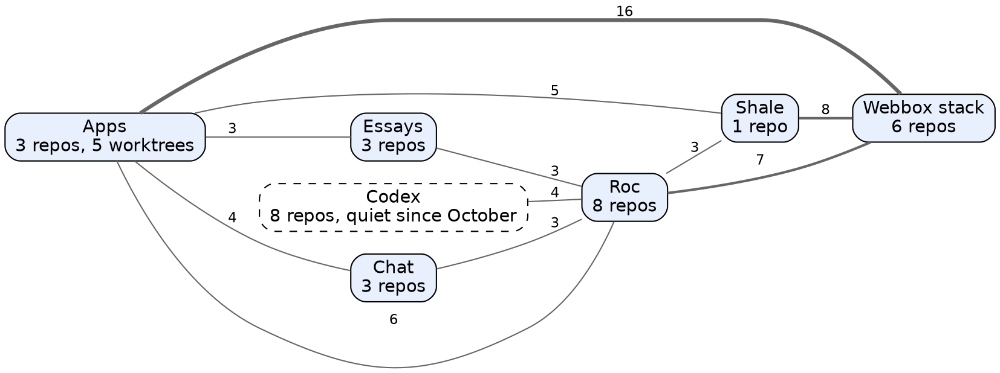

# The repos on this box, mapped

*2026-11-14. A survey of the 37 repos and worktrees in `~/showell_repos`, from their git state and what their READMEs say about each other. Made with a new recipe, `cookbook/map_repos.shale`, in about two seconds.*

## How the families connect

I grouped the repos into seven families. The grouping is mine; the lines aren't. A line's number counts how many times one family's READMEs name a repo in the other, in either direction. Worktrees are left out, because each repeats its main repo's README. Only lines of three or more are drawn.

- **Shale:** `shale`.
- **Webbox stack:** the Zig web library and what it runs on. `zig-webbox`, `metal-vmm`, `zig-metal-unikernel`, `zig-coverage-sdk`, `observatory` and `patched-zig-compiler`.
- **Apps:** what webbox serves. `angry-gopher`, `dog-park` and `cobble-webbox`, with five worktrees: four of the first two, and Cobblestone's `cobblestone-pin`, a worktree of NewRepository.
- **Chat:** `roc-chat`, `chat-client` and `chat-markdown`.
- **Roc:** the compiler checkout `roc`, and `roc-apps`, `roc-markdown`, `roc-webbox`, `roc-ray`, `odin-wasm-trial`, `rocflight` and `gopher-gold`.
- **Essays:** `essay-repl-server`, `essay-surface` and `claude-collab`.
- **Codex:** the transpilers and their tests. `codex-zig-ladder` (its README says DEPRECATED), `codex-zig-transpiler`, `codex-wasm-transpiler`, `rust-codex-compiler`, `safari-codex`, `cobblestone-curated-tests`, `cobblestone-qemu` and `NewRepository`.

## What the map says

- **The webbox stack is the hub.** The apps lean on it hardest (16 links), and Shale and Roc both meet it there. That fits angry-gopher's history: Shale was born inside zig-webbox.
- **Shale touches every active family but one, by its READMEs.** The exception is chat: one link. The essay surface names Shale; essay-repl-server, which predates it, doesn't.
- **Codex stands apart.** Its only links are to Roc and to the Cobblestone app, and nothing in it has moved since October 19.
- **Fourteen repos took a commit today,** and eleven of those end on the naming sweep.

## Every repo, by family

"Clean" means nothing uncommitted and level with its upstream, as of the last fetch.

| Repo | Last commit | Days ago | Commits, 30 days | State | Last commit's subject |
|---|---|---|---|---|---|
| **Shale** | | | | | |
| `shale` | 2026-11-14 | 0 | 528 | clean | cookbook: map_repos, a map of the repos in a folder… |
| **Webbox stack** | | | | | |
| `metal-vmm` | 2026-11-14 | 0 | 609 | clean | *today's naming sweep* |
| `zig-metal-unikernel` | 2026-11-14 | 0 | 159 | clean | *today's naming sweep* |
| `zig-webbox` | 2026-11-14 | 0 | 237 | clean | *today's naming sweep* |
| `patched-zig-compiler` | 2026-10-26 | 19 | 7 | clean | zig-version: 0.17.0+patched.2 |
| `observatory` | 2026-10-20 | 25 | 12 | clean | Zig 0.17: minimum_zig_version 0.17.0, and the docs'… |
| `zig-coverage-sdk` | 2026-10-20 | 25 | 14 | clean | linecov: a row counts only when its line exists… |
| **Apps** | | | | | |
| `angry-gopher` | 2026-11-14 | 0 | 135 | clean | *today's naming sweep* |
| `angry-gopher-chat` | 2026-11-14 | 0 | 276 | worktree of angry-gopher, `box/roc-cleanup` | *today's naming sweep* |
| `dog-park` | 2026-11-14 | 0 | 195 | clean | *today's naming sweep* |
| `dog-park-page` | 2026-11-14 | 0 | 136 | worktree of dog-park, `box/level-page`; no upstream | *today's naming sweep* |
| `dog-park-srv` | 2026-11-14 | 0 | 133 | worktree of dog-park, `box/level-server` | *today's naming sweep* |
| `cobble-webbox` | 2026-10-27 | 18 | 45 | clean | The town's redirect names an http.Target… |
| `cobblestone-pin` | 2026-10-25 | 20 | 34 | worktree of NewRepository, `webbox` | GameAccounts: British's hash made once offline… |
| `dog-park-nn-roc` | 2026-10-19 | 26 | 104 | worktree of dog-park, `box/neighbours-in-roc` | WIP, red in release: Roc keeps the critter grid… |
| **Chat** | | | | | |
| `roc-chat` | 2026-11-14 | 0 | 221 | clean | *today's naming sweep* |
| `chat-client` | 2026-10-31 | 14 | 15 | clean | A reference is the page's own only when its whole place is… |
| `chat-markdown` | 2026-10-31 | 14 | 12 | clean | markdown: a channel's reference, MSG_channel.topic_n… |
| **Roc** | | | | | |
| `roc-apps` | 2026-11-14 | 0 | 1000+ | clean | *today's naming sweep* |
| `roc-markdown` | 2026-11-14 | 0 | 102 | clean | *today's naming sweep* |
| `roc-webbox` | 2026-11-08 | 6 | 285 | clean | Roc pin: nightly-2026-10-30 to nightly-2026-11-03 |
| `odin-wasm-trial` | 2026-11-06 | 8 | 7 | on `rocco-glue`; no upstream | rocco-glue: README says how to build with the patched glue |
| `roc-ray` | 2026-11-01 | 13 | 80 | clean | Merge pull request #271, release-0.12 |
| `gopher-gold` | 2026-10-30 | 15 | 3 | no upstream | gold.answers.jsonl: re-frozen at roc-markdown 5cc78bd… |
| `rocflight` | 2026-09-24 | 51 | 0 | on `module-imports` | A nested nominal's methods see the enclosing block's members |
| `roc` | 2026-09-16 | 59 | 0 | on `reloc-order-pr`; 6,042 behind upstream | Test that a reverse-laid-out constant record links on wasm32 |
| **Essays** | | | | | |
| `essay-repl-server` | 2026-11-14 | 0 | 602 | clean | shale-cookbook-catalog: the cookbook by the job… |
| `essay-surface` | 2026-11-14 | 0 | 66 | no upstream | Journal: Session 10 begins, the .note format in real use… |
| `claude-collab` | 2026-06-30 | 137 | 0 | clean | server: /steve/ serves static image assets… |
| **Codex** | | | | | |
| `codex-zig-transpiler` | 2026-10-19 | 26 | 1 | clean | U70: the ring's place is read from the checkout… |
| `codex-wasm-transpiler` | 2026-10-04 | 41 | 0 | clean | generated/ repinned at U66: both roads agree… |
| `codex-zig-ladder` | 2026-10-04 | 41 | 0 | 3 untracked; 6 behind upstream | U66.log: canvas apps onto U66 |
| `rust-codex-compiler` | 2026-10-04 | 41 | 0 | clean | rocemit: to/from-real-approx are the identity… |
| `safari-codex` | 2026-10-04 | 41 | 0 | clean | U66: quires.tsv checkout moves to cobblestone-u66rel |
| `cobblestone-curated-tests` | 2026-09-25 | 50 | 0 | clean | Re-freeze .upstream.ir at U62: two roc units… |
| `cobblestone-qemu` | 2026-09-25 | 50 | 0 | clean | ZigPlugRing: drop the paragraph that still described… |
| `NewRepository` | 2026-09-08 | 67 | 0 | on `binding-lookup-duplicate-key` | compiler-backlog COMPILER-55… |

## Worth knowing

- **Four repos have no upstream:** `essay-surface`, `odin-wasm-trial`, `gopher-gold`, and the `dog-park-page` worktree. You asked for dog-park-page to stay local. The other three have never been pushed anywhere, so each lives only on this box.
- **`codex-zig-ladder` is six commits behind its origin.** They're the U70 to U72 logs, from October 19 to 28, made in another checkout. Its three untracked files are `.zig-cache/`, `main.roc` and `r2`.
- **`lanes/` holds 11 worktrees and 7 symbolic links.** The worktrees are `shale-book`, `shale-roc-types-1107`, five Roc fix branches in roc-apps from November 7 to 13, two in the Roc compiler, and one each of roc-webbox and roc-chat. Only the two Shale lanes have an upstream. `cd ~/showell_repos && shale cookbook:map_repos.shale in=lanes` maps them.
- **Two bits of cruft, removed:** an empty folder, `ray-exp`, and a Python cache in `cobblestone-qemu`, which had been its only uncommitted change.
- **What "names" means:** a README names a repo when the repo's folder name appears in it as a whole word. So the map counts mentions, not build dependencies. A README that says `roc check` counts as naming the compiler checkout `roc`, and that's roughly right.

## The recipe

`cookbook/map_repos.shale` is in the shale repo (d3b1c95), indexed in the cookbook's README:

- **The table:** `cd ~/showell_repos && shale cookbook:map_repos.shale`
- **A folder of worktrees:** add `in=lanes`.
- **The raw link graph** (157 edges, a hairball): `dot=1`. **Rows as JSON:** `json=1`.

Writing it found three things about Shale worth knowing:

- **A run starts at most 64 programs.** Three git calls a repo for 37 repos is 111, so the recipe maps them in parts of 20, each a child run of itself.
- **A symbolic link stops the run,** even from `exists`. `walk` with `depth = 1` tells a link (`other`) from a folder without touching it.
- **A worktree's `.git` names its git folder by an absolute path,** which the store refuses. The recipe reads the main repo's folder name out of that path instead.
