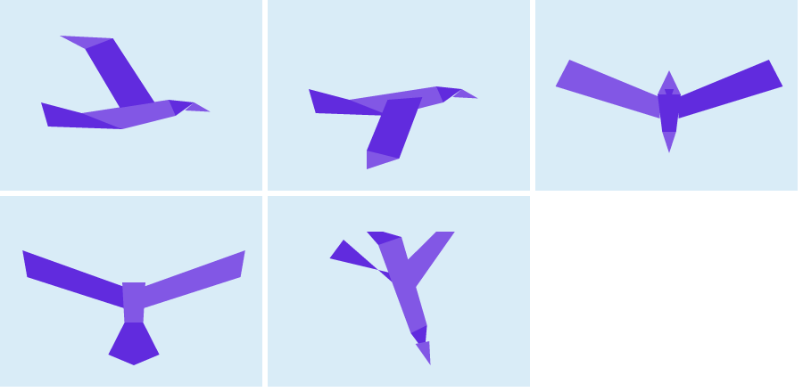

# Roc bird stills, first draft

*2026-11-05. Five flight drawings for safari's Roc bird, drawn from `canvas_apps/safari/BirdStills.roc` itself, for Steve to react to before any flight code exists.*

Top row, left to right: `wings_up`, `wings_down` and `toward_us`. Bottom row: `away_from_us` and `diving`.

They use the logo's two purples and its faceted style, and the same unit frame as the other stills, so `Critter.draw_still` can draw them unchanged. The side views face +x, and `Mirrored` gives the other direction, so one pair covers both ways across the road. `diving` is the weakest of the five, and looks a bit like a letter Y.

## How the flight would work

This follows the cat's technique. `Cat.roc` works out where the cat is from how far ahead it is and how fast the rider comes, with no stored state, so stepping back and replaying a ride just work. A bird would do the same:

- It sits on its tree, as it does now, until the rider comes within some distance.
- It takes off and flies to another tree. Its progress along the way is a pure function of the rider's gap and speed, like the cat's crossing.
- The still comes from the direction of flight relative to the rider: mostly across the road gives the two side views, alternating as a wing beat; mostly away gives `away_from_us`; mostly toward gives `toward_us`.
- Near the end it drops onto the new tree as `diving`, then it perches.
