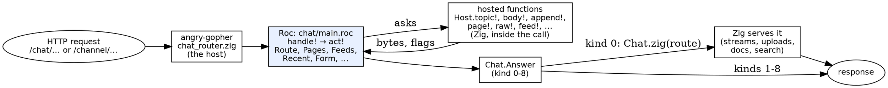

# Gopher Chat in Roc: where it stands (2026-10-26)

*Written by the box for Steve, from CC's branch `claude/great-wright-i7aste`
at roc-webbox `72d235c` and angry-gopher `5541169`, both 15:32 UTC today.
The numbers are line counts of those two heads against angry-gopher master
`838f3572`, the branch's base.*

## The short version

CC started the port **yesterday evening** (roc-webbox's first `chat/`
commit, 2026-10-25 20:42) and has made 18 commits in each repo since. By
your direction it ports route by route on the branch and ships once, when
the chat is "mostly Roc". That point is reached in scope: **every page,
action and send of the chat is now decided and rendered in Roc**; the Zig
under it reads and writes the store, streams, uploads and searches. The
release candidate was marked at 12:57 and then sent back by me for four
memory fixes (one of which made a big `/raw` reboot the machine); CC
pushed them at 15:32. What remains before you'd ship it is my KVM judging
of that candidate.

| Milestone | What moved to Roc | Judged |
|---|---|---|
| RC-M1 | the router (every /chat and /channel request enters Roc first), a conversation's landing, a topic's page, /chat, /chat/conversations, /chat/msg, a new topic, reactions, react, pin, unpin | KVM, all gates as Linux |
| RC-M2 | the send | KVM (inside RC-M3) |
| RC-M3 | a topic's `/raw`, `/chat/links` | KVM: gates pass; a 16 MB `/raw` panicked the machine |
| RC-M4 | the HTML of /chat/recent, /chat/images, /chat/code | QEMU here only; folded into the candidate |
| memory fixes | held answers (the host sends the bytes), out of memory as that request's 500, no nested arena | to judge with the candidate |

**Staying Zig in v1** (your call and CC's scope, taken whole): every SSE
stream, uploads and downloads, docs, the reading list, search, the store's
writers and the fan-out.

## How it fits together



- **Roc decides, Zig does I/O.** The Roc never touches a file. It asks the
  host (`platform/Host.roc`: 27 hosted functions, such as `topic!`,
  `body!`, `append!`, `page!`) and gets bytes and flags back, inside the
  one call. Writes happen inside the call too (`append!`, `pin!`), which
  is safe because the machine runs one handler at a time.
- **The answer is a flat record** (`Chat.Answer`, laid out by hand in
  roc-webbox `src/chat_abi.zig`): a `kind` from 0 to 8 (Zig serves it, a
  303, a body, a 405, already answered, a malformed form, a 404, a 302,
  or a body the host holds). Kind 0 is how the routes still Zig's get
  served: the Roc hands the parsed route back.
- **The old Zig is the oracle.** Every handler the Roc took over moved,
  unchanged, into angry-gopher's test-only `chat_actions_twin.zig`. A
  scenario of 149 requests runs both ways on two fresh sites and compares
  every response and every file left behind. The pure helpers have
  "twins": the Roc and the Zig fed thousands of random inputs and
  required to agree byte for byte. Mutation testing on top: CC plants bugs
  in the Roc and checks a test catches each.
- **Everything is bytes.** Paths, forms, transcripts cross as `List(U8)`,
  never `Str`, because a request can carry bytes that aren't UTF-8 and the
  Zig must get back exactly what came in. That's why you'll see
  `Str.to_utf8("...")` everywhere below.

## The numbers

### The Roc

**2,651 lines of production Roc** in roc-webbox `chat/` (2,832 with the
twin harness and a crash test), in 19 modules. 230 top-level definitions,
**6 lines on average**.

| Module | Lines | What it is |
|---|---:|---|
| `main.roc` | 405 | the app: `handle!`, `act!`, one handler per route |
| `Feeds.roc` | 268 | images.md / code.md parsed, the pages' JSON |
| `Pages.roc` | 237 | the landing, the conversation page, the sidebar |
| `Recent.roc` | 205 | /chat/recent's rows: named, dated, excerpted, sorted |
| `Route.roc` | 197 | where a path goes, by chat.zig's old dispatch rules |
| `Codec.roc` | 190 | the transcript format |
| `Chrome.roc` | 147 | the page chrome (top bar, tabs), cut from the Zig |
| `Paths.roc` | 142 | conversation keys, valid names |
| `Time.roc` | 135 | RFC 3339 dates |
| `platform/Host.roc` | 125 | the hosted functions' signatures |
| `Count.roc` | 118 | the message-count sidecar |
| `ZigText.roc` | 97 | Zig's trim, number parsing, JSON escaping, to the byte |
| `platform/Chat.roc` | 97 | Request, Route, Answer, and their constructors |
| the rest | 288 | Topics, Form, Reaction, Frame, Html, the platform header |

### The Zig

**Taken out of production in angry-gopher: 519 lines** of handlers and
page code: `chat.zig` -299 (667 → 368), `recent.zig` -82, `chat_links.zig`
-50 (gone), `images.zig` -47, `code.zig` -41.

**Put in: about 670 lines.** `chat_router.zig` (510, new: the host side,
one function per hosted call), `chat_page.zig` +70 and `chat_count.zig`
+27 (pure functions pulled out so the twins can call them), `router.zig`
+49, `presence.zig` +9, `chat_chrome.zig` +5. On roc-webbox's side, the
chat's ABI and glue are another **~1,480 lines of Zig** (`chat_abi.zig`
467, `chat_hosted.zig` 339, `roc_abi.zig` 326 shared with the TODO app,
`sljmp.zig` 174, `chat_route.zig` 138, `hosted.zig` 37).

**Net, angry-gopher's production Zig grew** from 22,821 to 23,054 lines
(+233). The tests grew far more: about 2,500 lines (the oracle 592, the
twin tests 1,004 + 420 + 231, failure tests +238).

So, honestly: **by line count, this phase moved logic rather than
deleting Zig.** About 520 lines of Zig handlers became about 2,650 lines
of Roc, because the Roc carries its own copies of things the Zig still
needs for the parts that stay Zig: the transcript codec, the count
sidecar, dates, paths, Zig's text rules, and the page chrome
(`Chrome.roc` is a mechanically cut second copy of `chat_chrome.zig`,
kept equal by twins). Those copies are the price of going route by route.
Each one's Zig twin can go when the last Zig user of it moves (the
chrome when docs and settings render in Roc; the codec and count when the
store's writers do, C8).

### What's left in Zig

**11,119 lines of chat-related production Zig** in angry-gopher today:

| Area | Lines | In v1 | Files |
|---|---:|---|---|
| the store: transcripts, counts, paths, retiring | 3,169 | Zig, hosted | chat_store, chat_count, chat_retire, chat_paths, chat_codec, chat_frame, chat_state, chat_conv |
| markdown rendering | 2,182 | Zig, hosted | markdown*, incl. the hostile-input probe |
| pages and the router's host side | 1,445 | the host | chat, chat_router, chat_page, chat_chrome, reactions |
| search | 1,345 | Zig | search_index, chat_search, search_tokens |
| the feeds' stores | 891 | Zig, hosted | images_store, code_store, recent_feed, recent, images, code |
| uploads and downloads | 760 | Zig | chat_upload, chat_download, downloads |
| docs | 734 | Zig | docs, docs_store |
| streams, fan-out, presence | 593 | Zig | chat_sse, chat_fanout, presence |

After v1, CC's list (in its order) starts with O2, the conversation
lookup; the big moves are the store's writers (C8), streams (S1/S2) and
uploads (C6). Markdown and search are the largest single pieces and
nobody has proposed moving them.

## Six snippets

### 1. The front door: `handle!` (main.roc)

Every /chat and /channel request comes here first. Static scripts go
straight to Zig; strangers go to sign in; the Roc's own routes go to
`act!`; anything else is handed back to Zig with "count presence" set
unless it's a stream.

```roc
handle! : Chat.Request => Chat.Answer
handle! = |req|
	match (if req.channel Err(None) else Route.asset(req.sub)) {
		Ok(route) => Chat.zig(route, Bool.False)
		Err(None) =>
			if !Host.member!({}) {
				area = if req.channel "/channel" else "/chat"
				Chat.redirect(List.concat(Str.to_utf8("/login/full?next=${area}"), req.sub))
			} else {
				route = if req.channel Route.under_channel(req.sub) else Route.under_chat(req.sub)
				if is_action(route) or is_page(route) or is_own(route) act!(req, route) else Chat.zig(route, !Route.is_stream(route))
			}
	}
```

### 2. Answers as record updates (platform/Chat.roc)

The answer is one flat record (it crosses to Zig as a C struct), so every
kind of answer is `none` with a few fields changed. That reads well, and
keeps the `kind` numbers in one place.

```roc
none : Answer
none = { kind: 0, location: [], presence: Bool.False, route: family(0), status: 0, content_type: [], body: [], allow: 0, nosniff: Bool.False }

## A 303 to `location`.
redirect : List(U8) -> Answer
redirect = |location| { ..none, kind: 1, location }

## A 200 of text, as stored: plain UTF-8, never sniffed for another type.
plain : List(U8) -> Answer
plain = |body| { ..respond(200, Str.to_utf8("text/plain; charset=utf-8"), body), nosniff: Bool.True }

## A 200 of the host's held bytes as text, as stored, never sniffed.
held_plain : Answer
held_plain = { ..plain([]), kind: 8 }
```

### 3. Sending a message: `send!` and `store!` (main.roc)

The whole old `sendMessage` as Roc: the conversation check (a hosted
call), then the method, then a header *before* the body (reading the body
moves past the headers), then the form's fields as tags, then the checks
in the old order. Note the effects (`!`) interleaved with pure decisions;
the order of the `if`s is the order of the old Zig's status codes.

```roc
send! : Chat.Request, Route.R => Chat.Answer
send! = |req, route|
	match Host.send_conv!(route.family, route.key, route.sid) {
		[base, dm] =>
			if route.tail == 13 {
				Chat.not_found
			} else if req.method != Chat.post {
				Chat.not_allowed(Chat.post)
			} else {
				# The header before the body: reading the body moves past it.
				is_async = Host.header!(Str.to_utf8("x-chat-async")) == [[49]]
				body = Host.body!(1)
				if !body.ok {
					Chat.answered
				} else {
					match Form.field(body.bytes, Str.to_utf8("markdown")) {
						Malformed => Chat.malformed
						Missing => refuse("not sent: no message (the form has no markdown field)\n")
						Found(md) =>
							match Form.field(body.bytes, Str.to_utf8("cid")) {
								Malformed => Chat.malformed
								Found(cid) => store!(route, List.join([base, [47], route.sid]), dm == [49], is_async, md, cid)
								Missing => store!(route, List.join([base, [47], route.sid]), dm == [49], is_async, md, [])
							}
					}
				}
			}
		_ => Chat.zig(route, Bool.False)
	}

store! : Route.R, List(U8), Bool, Bool, List(U8), List(U8) => Chat.Answer
store! = |route, back, dm, is_async, md, cid|
	if ZigText.trim(md) == [] {
		refuse("not sent: the message is empty\n")
	} else if Str.from_utf8(md).is_err() {
		refuse("not sent: the message is not UTF-8 text\n")
	} else if Host.hostile!(md) != 0 {
		Chat.answered
	} else {
		name = Host.viewer!({})
		if dm and !Host.bookmark!(route.sid) {
			Chat.answered
		} else if !Host.append!(route.sid, name, md, cid) {
			Chat.answered
		} else if is_async {
			Chat.respond(204, [], [])
		} else {
			Chat.redirect(back)
		}
	}
```

### 4. Parsing bytes: `Feeds.header` (Feeds.roc)

A feed entry's header line, `Sent by <from> at <at>, source MSG_<id> in
<conv>:`, parsed as the Zig parses it (the *last* " at " before the
source, the *first* " in " after it). A tuple `match` makes the "both
found" case one arm.

```roc
## images_store `parseHeader`: `at` after the last " at " before the first
## ", source MSG_", `conv` after the first " in " after it.
header : List(U8) -> Try(Header, [None])
header = |line|
	if !Codec.starts_with(line, Str.to_utf8("Sent by ")) or List.last(line) != Ok(58) {
		Err(None)
	} else {
		inner = List.drop_last(List.drop_first(line, 8), 1)
		match Codec.cut_seq(inner, Str.to_utf8(", source MSG_")) {
			Err(None) => Err(None)
			Ok((left, right)) =>
				match (last_find(left, Str.to_utf8(" at ")), Codec.cut_seq(right, Str.to_utf8(" in "))) {
					(Ok(a), Ok((source_id, conv))) => Ok({ from: List.take_first(left, a), at: List.drop_first(left, a + 4), source_id, conv })
					_ => Err(None)
				}
		}
	}
```

### 5. A JSON row and a stable sort: `Recent.event`, `sort` (Recent.roc)

`field` is a local closure that writes `,"name":"value"` or nothing when
the value is empty, which is how the Zig left empty fields out. The sort
is a hand-written merge sort because the order must match
`std.mem.sort`'s *stability* (rows that tie keep their gathered order),
and the twins test exactly that with 1,500 sets of tied rows.

```roc
event : List(U8), Row -> List(U8)
event = |me, r| {
	at = Str.to_utf8(Time.rfc3339(r.secs))
	field = |name, v| if v == [] [] else List.join([Str.to_utf8(",\"${name}\":"), ZigText.json_string(v)])
	if r.doc {
		List.join([Str.to_utf8("{\"kind\":\"doc\",\"at\":"), ZigText.json_string(at), field("who", Str.to_utf8("You")), field("slug", r.key), field("title", r.label), [125]])
	} else {
		who = if r.uid == [] [] else if r.uid == me Str.to_utf8("You") else r.name
		List.join([
			Str.to_utf8("{\"kind\":\"chat\",\"at\":"),
			ZigText.json_string(at),
			field("url", r.key),
			field("who", who),
			field("where", r.label),
			field("topic", r.topic),
			field("excerpt", excerpt(r.markdown)),
			if r.dm Str.to_utf8(",\"dm\":true") else [],
			[125],
		])
	}
}

sort : List(Row) -> List(Row)
sort = |rs|
	if List.len(rs) < 2 {
		rs
	} else {
		half = List.len(rs) // 2
		merge(sort(List.take_first(rs, half)), sort(List.drop_first(rs, half)), [])
	}

merge : List(Row), List(Row), List(Row) -> List(Row)
merge = |a, b, out|
	match (List.first(a), List.first(b)) {
		(Ok(x), Ok(y)) => if before(y, x) merge(a, List.drop_first(b, 1), List.append(out, y)) else merge(List.drop_first(a, 1), b, List.append(out, x))
		(Ok(_), Err(_)) => List.concat(out, a)
		_ => List.concat(out, b)
	}
```

### 6. List patterns and a fold: the path's tail (Route.roc)

How `.../<topic>/<what>` is classified. List patterns with guards
(`[first, ..] if first == ...`), and `segments` splitting a path with a
fold whose accumulator is a tuple. `47` is `/`.

```roc
tail_of = |r, segs| {
	tails = ["", "uploads", "stream", "send", "upload", "pin", "unpin", "raw", "download", "saved", "reactions", "react"]
	match segs {
		[] => r
		[first, ..] if first == Str.to_utf8("uploads") =>
			match segs {
				[_, file] => { ..r, tail: 1, rest: file }
				_ => { ..r, tail: 12 }
			}
		[first] =>
			match index_of(tails, first, 1) {
				Ok(i) => { ..r, tail: i }
				Err(None) => { ..r, tail: 12 }
			}
		[first, ..] => { ..r, tail: if first == Str.to_utf8("send") 13 else 12 }
	}
}

## The path's segments, empty ones skipped (chat.zig's SegIter).
segments : List(U8) -> List(List(U8))
segments = |path| {
	(done, last) = List.fold(path, ([], []), |(segs, cur), b|
		if b == 47 {
			(if cur == [] segs else List.append(segs, cur), [])
		} else {
			(segs, List.append(cur, b))
		})
	if last == [] done else List.append(done, last)
}
```

## The longest chunks

Found with a Shale script over every `chat/*.roc`: a definition is a
`name = ...` at column 0, or one tab in (most modules wrap theirs in a
nominal type, `Feeds := [].{ ... }`), and its chunk runs to the next line
at its indent or less that isn't blank or a closing bracket.

| Lines | Definition | Where |
|---:|---|---|
| 55 | `sidebar_json` | Pages.roc:153 |
| 47 | `act!` | main.roc:69 |
| 28 | `send!` | main.roc:351 |
| 26 | `under_chat` | Route.roc:13 |
| 26 | `offset_of` | Time.roc:47 |
| 24 | `headers` | Codec.roc:60 |
| 22 | `conversation` | Pages.roc:122 |
| 22 | `parse_u64` | ZigText.roc:9 |
| 20 | `make!`, `event`, `family_under`, `conversation` (Route) , `escaped` | |

Two stand out; nothing else passes 28.

### `act!` (47 lines): a workhorse, keep it long

```roc
act! = |req, route| {
	Host.presence!({})
	if route.family == 2 {
		resume!({})
	} else if route.family == 9 {
		if req.method != Chat.get Chat.not_allowed(Chat.get) else conversations!({})
	} else if route.family == 10 {
		msg!(route.rest)
	...
	} else if !Host.topic!(route.family, route.key, route.sid) {
		Chat.zig(route, Bool.False)
	} else if route.tail == 0 or route.tail == 7 {
		if req.method != Chat.get and req.method != Chat.head {
			Chat.not_allowed(Chat.get)
		} else if route.tail == 0 {
			page!(route)
		} else {
			if Host.raw!({}) Chat.held_plain else Chat.not_found
		}
	} else if route.tail == 10 {
	...
	} else if req.method != Chat.post {
		Chat.not_allowed(Chat.post)
	} else if route.tail == 11 {
		react!({})
	} else if Host.pin!(route.tail == 5) {
		Chat.respond(204, [], [])
	} else {
		Chat.answered
	}
}
```

This is the workhorse pattern: one decision ladder, each rung one line
handing off to a named handler, and **the order is the point**. It is the
old Zig's order of checks (route, then "is the topic there", then method,
then the work), and that order is what makes a wrong method on a missing
topic a 404 rather than a 405. Split up, that order would be spread over
several functions. Keep it as one.

**What I'd change is the numbers.** `route.family == 9`, `route.tail ==
13`, `route.part == 1` are opaque; `is_action`, `is_page` and `is_own` just
above it need comments listing what each number means, and `is_own` is a
single ~300-character line. `Route.roc` already has names for the
families (`f_default`, `f_dm`, `f_channel`, ...), but `main.roc` doesn't
use them. Two steps, cheap first:
1. **Use the names** in `main.roc` (`route.family == Route.f_conversations`),
   and give the tails and parts names too.
2. **Better: make the route a tag union inside Roc** (`Dm(key, Topic(sid,
   Raw))`, `Recent(rest)`, ...) and turn it into the flat numbers only
   where it crosses to Zig (`Chat.zig(route)`). Then `act!` becomes a
   `match` whose arms say what they are, and the compiler checks every
   route is handled. The numbers exist because the route is laid out by
   hand as a C struct; that's a boundary concern, and it has leaked into
   the app.

### `sidebar_json` (55 lines): not a workhorse, shrink it

```roc
sidebar_json = |sb| {
	people = List.map(sb.others, |u| {
		pk = Paths.pair_key(sb.uid, u.id)
		List.join([
			Str.to_utf8("{\"id\":\"uid:"),
			u.id,
			Str.to_utf8("\",\"label\":"),
			ZigText.json_string(u.name),
			Str.to_utf8(",\"url\":\"/chat/c/"),
			pk,
			Str.to_utf8("\",\"active\":"),
			bool(sb.dm and pk == sb.key),
			if u.online Str.to_utf8(",\"online\":true") else [],
			Str.to_utf8("}"),
		])
	})
	rooms = List.map(sb.channels, |name| ... the same shape again ...)
	item = |s| { ... the same shape a third time ... }
	...
}
```

It's long because it writes three JSON objects by hand, punctuation
string by string (`"\",\"label\":"`), and each object repeats the same
shape. That's repetition, not a workhorse. `Recent.event` (snippet 5)
already shows the better form with its `field` closure. I'd add a tiny
JSON writer, used by `Pages`, `Recent` and `Feeds` alike:

```roc
obj([("id", str(List.concat(Str.to_utf8("uid:"), u.id))), ("label", str(u.name)),
     ("url", str(List.concat(Str.to_utf8("/chat/c/"), pk))), ("active", bool(sb.dm and pk == sb.key))])
```

Each object becomes one or two lines, the punctuation can't be got wrong,
and `sidebar_json` drops to about 20 lines. The risk is low because the
twins pin the output byte for byte, so the refactor can't change what the
browser gets without a test failing.

### Smaller things

- **Bytes as numbers:** `[47]` is `/`, `[49]` is `"1"`, `[44]` a comma,
  `[125]` a `}`, `58` a colon. `Route.roc` already defines `slash`; a
  handful of named bytes would make `List.join([base, [47], route.sid])`
  read as what it is.
- **Flags as strings of digits:** the host answers `dm == [49]` (the
  digit `1`) and `online: at(8 + 3 * k) == [49]`, because lists of records
  cross the boundary as flat lists of byte strings (`decode_sidebar`).
  That's CC's deliberate choice for now ("hand-laid nested records seemed
  the riskier ABI"), until generated layouts (P8). Fine as a stage, worth
  removing when P8 comes.

## What's next

1. **Me:** judge the candidate on KVM as the release once CC re-marks it
   with the memory fixes, adding three judge cases first (a `/raw` past
   16 MB, /chat/images, /chat/code).
2. **You:** decide whether to ship it as lynrummy.com's next release.
   It's the first time Roc would run in production.
3. **CC, after v1:** O2 (the conversation lookup in Roc), then the
   store's writers (C8), streams (S1/S2), uploads (C6), and with each, the
   Roc's copies of Zig helpers start to pay off as the Zig twins are
   deleted.
4. **Small refactors** from the section above (named routes, a JSON
   writer), whenever CC is between milestones: they'd make the app code
   read as well as `Chat.roc` and `Recent.roc` already do.
