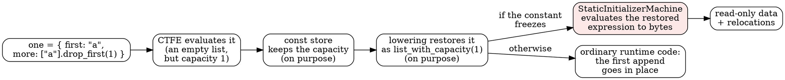

# How Roc freezes constants, and what #12748 fixed

Anton merged [roc-lang/roc#12748](https://github.com/roc-lang/roc/pull/12748) on 2026-11-03, with one extra commit from his bot: a compiler-level unit test that reaches the bug without running the CLI. He also [asked](https://github.com/roc-lang/roc/pull/12748#issuecomment-6580311118) us to open a Zulip discussion about the PR's last section, which questions whether compiler invariants should stay checked in release builds. This note gives the background and ends with a draft of that Zulip post.

## The C picture you already have

In C, `static const char *greeting = "hi";` puts the bytes `hi\0` in `.rodata` (read-only data), and the linker patches the pointer to them in with a relocation. The loader maps `.rodata` read-only. Reading it is free, and writing through the pointer is undefined behaviour, which on Linux usually means a SIGSEGV.

Roc does the same thing for top-level constants. The new compiler evaluates them while compiling (compile-time function evaluation, or CTFE) and, when it can, freezes the result into read-only data symbols, with relocations for the pointers inside it. `src/static_data.zig` describes itself as "Target-layout readonly data symbols for internal constants and provided data."

## What Roc adds on top: refcounts and in-place updates

A Roc `List`, `Str` or `Box` is a small struct (for a list: pointer, length, capacity) pointing to a heap block. The word just before the data in that block is a **refcount**. That word drives one of Roc's main performance tricks. When a list's refcount says it's **unique**, `append`, `prepend`, `set` and the rest change it in place instead of copying it, and they use spare **capacity** to do it without reallocating.

Frozen data needs that word too, so it uses a special value: `REFCOUNT_STATIC_DATA = 0` (`src/builtins/utils.zig`). Incref and decref leave it alone, it's never freed, and `isUnique` says no. Any "mutation" of a frozen list therefore copies it first, and the read-only page is never written. That's the whole safety argument: static data is immortal and never unique, so nothing writes through it.

## How a constant gets frozen



Each of the first three steps did the right thing on its own:

1. **CTFE** ran `["a"].drop_first(1)`, which gives an empty list that still holds the one slot it started with. (Why it keeps that slot is explained below.)
2. **The const store** keeps an empty list's capacity deliberately.
3. **Lowering** turns the stored value back into an expression the backend can compile. For an empty list with capacity n, that's the low-level op `list_with_capacity(n)`, so that if the value is built at runtime, the first append can go in place.

### Why doesn't `drop_first` just set the capacity to zero?

It's a fair question, and the answer is that Roc lists never shrink on their own. `drop_first` is `List.sublist(list, { start: n, len: len })`, and when the range is empty, `listSublist` (`src/builtins/list.zig`) does this:

- **If the list is unique**, it releases the elements, sets the length to 0, and returns *the same allocation*. Capacity stays at 1.
- **If the list is shared**, it decrements the refcount and returns a fresh `RocList.empty()`, with capacity 0.

The literal `["a"]` is unique, so it takes the first branch. This is the same policy as Rust's `Vec::truncate` or `clear`, or keeping a C buffer instead of calling `realloc` to shrink it. Shrinking would cost a reallocation and a copy, while keeping the capacity makes the next append free. Code that drains a list and refills it, which is common, never touches the allocator. If you do want the memory back, you ask for it with `List.release_excess_capacity`.

So at runtime, capacity 1 is the right answer. It only becomes pointless once the value is frozen, because frozen data is never unique and nothing can ever append to it in place. That's where the fix discards it, and only there.

The fourth step is the one that broke. When the constant is eligible for static data, its restored expression goes to `StaticInitializerMachine`, a small evaluator that turns construction code into bytes and relocations. It's meant to see only construction, and the only low-level op it accepted was `box_box` (making a `Box`). `list_with_capacity` wasn't on its list. A record holding a `Str` is what makes the constant freeze through this path, which is why our chat app's `Topic` record triggered it.

## Why it was a segfault and not an error message

The machine handled the unexpected op the standard way:

```zig
if (op != .box_box) {
    staticDataInvariant("non-construction low-level operation reached static initializer materialization");
}
```

and `base.invariant` is:

```zig
pub inline fn invariant(comptime fmt: []const u8, args: anytype) noreturn {
    if (std.debug.runtime_safety) std.debug.panic(fmt, args);
    unreachable;
}
```

That's deliberate. `design.md` says every stage handles a violated invariant as "debug build: debug-only assertion / release build: unreachable", and that "No stage adds release-build runtime checks for compiler invariants."

So a debug compiler panicked with a clear message, while a release compiler (the nightly everyone uses) treated the branch as impossible. In Zig, `unreachable` in an optimized build is like `__builtin_unreachable()` in C: the optimizer may assume the condition never holds and drop the check. The compiler carried on as though the op were `box_box` and wrote a frozen list whose pointer landed in the read-only image. At runtime, `prepend` wrote through it, and strace showed SEGV_ACCERR, which means a write to a page mapped without write permission. We didn't trace exactly how the optimized code produced those bytes. Once undefined behaviour is reached, any output is possible, and that's the point of the Zulip question.

Only the dev backend (`--opt=dev`) crashed. The interpreter and the LLVM backends passed the same file, so it took a test run to find.

## The fix

It's one branch in `evalLowLevel`, plus a layout check that Anton's bot added:

```zig
if (op == .list_with_capacity) {
    if (target.tag != .list and target.tag != .list_of_zst) staticDataInvariant("...non-list target layout");
    return self.storedListValue(target_layout, 0, null);
}
```

Static data is never written in place, so the capacity buys nothing there, and the list freezes as the plain empty list: a null pointer, length 0, capacity 0. That's exactly what the machine already did for a stored `.empty` node elsewhere. The const store and lowering keep the capacity, because it still pays off for every constant that isn't frozen.

## Siblings

As you told Anton on the PR, we hunted for relatives: eight candidate sites, each tried on the nightly and on a debug build of the fix. These included other low-level ops, projections, Boxy literals, erased callables, deeper nesting, `Dict`/`Set.with_capacity`, provided data exports, and `roc build` of an app. Everything that crashed was this same bug in a different shape (a tuple, a tag payload, a nominal record, a recursive nominal), and those shapes went into the PR's regression test. Two routes stay untried: wasm, and provided data exports through a real host.

## The Zulip post (draft)

*Suggested topic: "compiler invariants in release builds"*

> Anton asked me to start a discussion from the end of [#12748](https://github.com/roc-lang/roc/pull/12748), which Claude found and fixed for me. The bug was a compile-time constant (a record holding an empty list with spare capacity) that reached `StaticInitializerMachine.evalLowLevel` with an op it didn't expect. A debug compiler panics there with a clear message ("non-construction low-level operation reached static initializer materialization"). The release compiler doesn't, because `base.invariant` is `unreachable` in optimized builds, as `design.md` specifies. So the nightly quietly emitted a list pointing into read-only memory, and the user's `roc test` died with a SIGSEGV that looked like a bug in their own program. The invariant policy is sound in general: no runtime checks in hot paths, no fallbacks, no silent repair. But on cold paths like the static initializer, which run once per constant at compile time, keeping the check would cost essentially nothing. It would also turn a mysterious segfault into "compiler bug: <the invariant>, please report", which is the most useful bug report we could get from users of the nightlies. That wouldn't be a fallback or a repair. It's still a crash, just a loud one with a message. So the question is whether it's worth having a second kind of invariant that stays checked in release builds, for compile-time paths where performance doesn't matter, or perhaps shipping the nightlies with safety on. Or is there a reason the unreachable matters even there that I'm missing?
