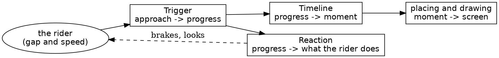

# An Animation type for safari's critters

*2026-11-05. A design proposal for Steve, for the cat's crossing and the bird's flight, with the rider's reaction kept apart. Nothing here is built yet.*

## What the two have in common

Today the cat and the bird are two separate pieces of code that do the same four jobs.

| Job | The cat | The bird |
|---|---|---|
| How far through it is | `Cat.crossing_progress`, from the rider's gap and speed | `BirdFlight.flight_progress`, from the gap alone |
| What it looks like then | `leap_pose`, `stride_angle`, stage thresholds in `state` | `pose_at`, `wing_beat_at` |
| Where it is then | `entering`, `escaping`, `airborne` | `flying`, `sitting_on` |
| Being seen | `CatPlan`, `CatDraw` | `BirdPlan`, `RocBird` |

Your description is already most of the design: **a series of stills and locations, and rules about the critter's relative location to the rider.** That sentence splits into two parts that know nothing of each other: the *timeline* (stills and locations, as a function of progress) and the *trigger* (progress, as a function of where the rider is).

The cat's fifth job, braking the rider, is the one you want kept apart. Here's what it does today:

- `Throttle.cat_gate` asks `Cat.is_in_danger` and, if so, won't let the rider accelerate.
- `RideFocal` asks `Cat.focus`, which draws the rider's eye.

Both read the same `Approach`, a gap and a speed, and neither needs to know about stills or locations. So the code is already close to orthogonal. It's just not named that way.

## The proposal: four layers



The dashed arrow is the only loop, and it's the one that exists today. The animation never reads a reaction, and a reaction never reads a still or a location. Both read `progress`.

### Trigger: when it plays

```roc
Approach : { gap : F64, speed : Speed }

Trigger : [
    ## Plays while the rider covers this stretch: the bird's rule.
    OverGap({ starts_at : F64, ends_at : F64 }),
    ## Plays over this many steps, ending this far short: the cat's rule.
    OverSteps({ steps : F64, buffer : F64 }),
]

progress : Trigger, Approach -> F64
```

The two rules differ on purpose. A cat has to finish crossing before you reach it, however fast you come, so its timing depends on your speed. A bird just reacts to how close you are.

### Timeline: the stills and the locations

A timeline is data: a list of phases, each with a share of the whole, what it looks like, and where it goes.

```roc
Timeline(pose) : List(Phase(pose))

Phase(pose) : {
    share : F64,
    looks : Looks(pose),
    moves : Path,
}

Looks(pose) : [
    Holds(pose),
    Cycles({ poses : List(pose), count : F64 }),
]

Path : [
    StaysAt(Spot),
    Line({ from : Spot, to : Spot, ease : Ease }),
    Arc({ from : Spot, to : Spot, ease : Ease, rise : F64 }),
]

Spot : { along : F64, across : F64, lift : F64 }

Moment(pose) : { pose : pose, spot : Spot }

moment : Timeline(pose), F64 -> Moment(pose)
```

`pose` is a type parameter, so `Cat.Pose` and `BirdFlight.Pose` stay closed tag unions with no shared list of everything a critter can look like. The bird's flight becomes a short, readable value:

```roc
flight : Scenery.Tree, Scenery.Tree -> Timeline(BirdFlight.Pose)
flight = |from, to| [
    {
        share: 0.12,
        looks: Cycles({ poses: [Side(WingsUp), Side(WingsDown)], count: 1.0 }),
        moves: Arc(...),
    },
    ...
]
```

I prefer data to functions here, for three reasons:
- A timeline can be printed, compared and checked in a spec.
- A reader sees the whole animation in one place, as a score.
- Tuning feel means changing a number, as the bird's knobs do now.

### Placing and drawing

`CatPlan` and `BirdPlan` both do the same thing: find it, place it in the rider's view, cull it, and give the depth sort a key. A shared `AnimationPlan` could own that, handed each critter's height and stills. `stills : pose -> List(Stills.StillPoly)` already exists for the bird as `BirdStills.pose_polys`.

### Reaction: what the rider does, beside the animation

```roc
Reaction : [
    Ignores,
    HoldsThrottle,
    DrawsTheEye({ peak : F64, ramp_down : F64 }),
]
```

A critter on the road is `{ trigger, timeline, reactions }`, and the bird's `reactions` is `[]`. `Throttle` and `RideFocal` ask "what reactions apply at this progress?" and never ask whether the thing is a cat. That removes `Throttle.cat_gate`'s knowledge of cats, and it's what makes a chasing rider a new tag rather than a new code path.

## What a chase would need

You said the rider might chase the bird in v2. This design gets most of the way there, and it's worth being exact about where it stops.

- **Speeding up is one tag.** `Chases` as a reaction lets the throttle gate raise the acceleration where `HoldsThrottle` limits it.
- **The bird fleeing comes free.** Its progress is a function of your gap, so the faster you come, the faster it flies. A bird that stays just ahead of you is what the trigger already gives.
- **Steering is the real work.** Today only the road decides the rider's line. Steering toward a bird is a new input to `Rider`, which no gate supports yet.
- **A bird that keeps going is a chain.** A second flight from the landing tree is a second animation, triggered when you near that tree. That works inside a segment. Crossing a segment boundary isn't possible yet, because a critter belongs to one segment.

So I wouldn't build any of that now. The `Reaction` tag is the only generalization worth making early, because it's cheap and it also tidies up the cat. Everything else would be a guess at v2.

## Risks

- **The cat has to come out byte for byte.** The proof frames have no cat mid-crossing, the same gap the bird had. Before starting, add a frame with a frozen cat and one mid-leap to `proof.expected`.
- **Float rounding.** The cat's arithmetic has particular forms, such as `three_quarter_power`. `Ease` needs a tag for it, and it has to round the same way.
- **The feedback loop already exists.** Braking lowers the speed, which changes the cat's progress, which changes the braking. It settles today, and this design doesn't alter it, but it's why `OverSteps` has to stay the cat's rule.

## How I'd build it

1. Hold cat frames in the gate.
2. Add `Animation.roc` with the trigger and timeline, and move the bird onto it. It's the simpler of the two, and it's new.
3. Move the cat onto it, frame hashes unchanged.
4. Add `Reaction`, and take cats out of `Throttle` and `RideFocal`.
5. Merge `CatPlan` and `BirdPlan` into one, if they've turned out the same by then.
