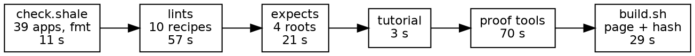

# Safari's gates: where the time goes

*2026-11-05. Every number here was measured tonight on the box with nothing else running, unless it says "estimate".*

## The short version

- **Today, one full pass costs about 3 minutes.** The gate itself is 2.5 minutes, plus 40 seconds for the repo check and the page build.
- **An edit could be checked in about 5 seconds,** or 10 with a rendered frame. That's what I'd run 90% of the time.
- **Most of the wall time we've felt isn't the gates.** The box has 2 cores. The same gate took 5.3 minutes with three agents running, and 2.5 on a quiet box.
- **Debug builds are the right default.** The proof tools already use them. The page's wasm doesn't, and switching it takes the build from 21 seconds to 1 to 5, with an identical drawn hash.
- **Warm caches are safe at this pin, as far as I can test.** Every build starts from an empty cache, which is a workaround for a crash on the 09-22 nightly. We're on 11-03 now.

## The stages today

| Stage | Today | What it catches | Skip while iterating? |
|---|---|---|---|
| `roc check web.roc` | 1.1 s warm, 4.9 s cold | Type errors, warnings | Never: it's the cheapest thing we have |
| `roc test`, one root | 2.2 s warm, 5.5 s cold | Logic; 1,471 of the 1,476 expects | Never |
| Lints, changed files | about 1.3 s for one file | Style and naming in what you touched | Never, once it exists |
| One frame: build and render | 2 s + 2 to 3 s | An arithmetic slip that no expect covers | When no drawn or moving code changed |
| `part=tutorial` | 3.3 s | A quoted function renamed or gone | Unless you renamed something |
| `part=expects`, 4 roots | 21 s (6 s warm) | The rest of the expects, plus the count | Yes, until merge |
| All lints | 57 s | Cross-file findings, and the held counts | Yes, until merge |
| Proof: `StepBack` | 3 s + 7 s | Stepping backward through the ride | Yes, unless `Tour` changed |
| Proof: `ShapesFrame`, 9 depths | 5.5 s + 28 s | The two ways of painting a frame agreeing | Yes, unless the painter changed |
| Proof: `RasterFrame`, 9 depths | 5 s + 21 s | Every scene we hold exactly | Yes, until merge; one frame stands in |
| `check.shale`, 39 apps | 11 s | Breakage in other apps and in `lib` | Yes, unless `lib` changed |
| `build.sh safari` | 29 s (21 s of it is the wasm) | The page itself, the runner, the drawn hash | Yes, until merge |

The catch column is my judgment, informed by what failed today: a tutorial quoting a renamed function, a stacking lint, a hash-preserving float change. I don't have failure counts per stage. Recording them would be a useful thing for the gate to start doing.

## Debug against release

| Build | Dev | Speed |
|---|---|---|
| `ShapesFrame`, cold build | 5 s | 31 s |
| Running it at depth 9000 | 6.2 s | 0.37 s |
| Page wasm, cold build | 4.5 s (1 s warm) | 21 s |
| Page wasm size | 962 KB | 746 KB |
| Drawn hash | 3671023915 | 3671023915 |

A release binary runs 17 times faster, which looks tempting for the proof tools. It doesn't pay: three release builds cost more than all the dev runs put together, and every edit would pay for it again.

So dev everywhere, and `--opt=speed` only at publish. What I haven't measured is how the dev wasm feels in a real browser. The page check took about the same time on both, but that check spends its time in the stand-in canvas, so it doesn't answer this. That's another reason publish stays on speed.

## Are warm caches safe?

The fresh-cache rule exists because the 09-22 nightly could crash on a reused cache. To test it at our pin, I planted a real fault in a throwaway worktree: `Clock.next` stepping by two, in a module nearly everything depends on.

| With a warm cache | `roc test` | Hash at depth 3000 |
|---|---|---|
| As committed | 1,382 pass | `2e3d39d1` |
| Fault planted | Fails | `618b9bd2` |
| Fault removed | 1,382 pass | `2e3d39d1` |

Each step took about as long as a clean run, 1.8 seconds for the test and 2 for the build. So an edit doesn't cost much more than no edit, even in a hub module, and I saw no sign of stale results. That's one plant, not a proof, so I'd keep cold caches at publish, where they cost little and buy a clean answer.

## The proposal: three speeds

| Tier | When | Runs | Time |
|---|---|---|---|
| **Fast** | Every edit | check, one test root, lints on changed files; stops at the first failure | About 5 s |
| **Fast with a frame** | Anything drawn or moving | Fast, plus a build and one frame against its held hash | About 10 s |
| **Merge** | Before a push | Everything in safari, warm caches, all failures reported | About 2 min now, about 1 min with the work below (estimate) |
| **Publish** | Before the site moves | Merge, plus `check.shale`, cold caches, release wasm, every widget page | About 3 to 4 min (estimate) |

Agents would run only the fast tiers, and one merge gate would run at a time. On 2 cores that matters more than any other change here.

## Work that gets us there

In order of payoff:

1. **Warm caches in the gate.** Expects go from 21 to 6 seconds, proof builds from 14 to about 5.
2. **Dev wasm in `build.sh`,** with a `release` switch for publish. Saves about 20 seconds per page.
3. **One test root for the fast tier.** `gates/CrossModuleExpects.roc` reaches nearly everything for 0.4 seconds more than `web.roc`. It may also let the merge gate drop a root.
4. **Lint only changed files, as you suggested.** See the next section.
5. **One parse for all the lints.** Ten recipes each read all 95 files, and each takes 4 to 8 seconds. Even `stack`, the simplest, takes 3.9, so parsing looks like most of the cost. Sharing it could take 57 seconds down to about 15 (estimate).
6. **One pass through the ride for the proof tools.** Each tool replays from step 0 for each of 9 depths, 31,000 steps where 9,000 would do. A single pass through both tools would take about 49 seconds of running down to about 27 (estimate).

## Lints: one file or many

Most recipes mix the two kinds, so the split has to be per check, not per recipe.

| Judges one file | Needs the whole tree |
|---|---|
| `stack`, `parens`, `nest_depth`, `vocabulary` | `boundaries` (it counts callers) |
| `plain_names` | `families`, including `twin_name` |
| `name_types`: `name_type`, `no_value` | `name_types`: `bare_beside_unit` |
| `errors`: `optional_tag`, `set_fallback`, `placeholder` | `errors`: `error_alias` (looks aliases up across files) |
| `name_hunt`, nearly all | `name_hunt`: `preposition_split` |

I read the recipes' headers for this, so treat the borderline ones as a first pass. Each recipe could declare the scope of each check, and the fast tier would run only the one-file checks on files changed since the last green.

**One wrinkle:** a count held above zero, like `vocabulary` at 173, can't be judged from one file. Those would report what's in the changed files without failing, until the renames bring them to zero. A rule that's zero is the simple case, and that's where nearly all of them end up.

## Shale: making slowness visible

The pointer check took safari's build from 35 seconds to over 3 minutes today, and it passed. An agent reported success, and I only noticed because my own limit ran out. Shale prints the time on every run, but nothing acts on it.

- **A time budget per stage.** A gate states how long each stage should take, and going well over it is a failure, reported like any other.
- **Judge CPU time, not wall time.** This is the key to making budgets usable. On a busy box wall time doubles, which would make budgets flaky, but a child's CPU time barely moves. `run` could return `cpu_ms` next to `ms`.
- **Compare with last time.** Shale keeps recent times per stage and prints the change: `build.sh safari: 192 s, was 35 s (5.5x)`. That line alone would have caught today's slowdown without anyone setting a budget.
- **Shorter time limits.** Gates give their steps 10 minutes or more. A limit of a few times the usual cost makes a hang fail in seconds.
- **List the top few.** The footer names the single slowest program. The top three, with their share of the run, shows where to look.
- **Tell agents plainly.** `SHALE-AGENTS.md` gets a rule, and every brief repeats it: a loop over about 10 seconds is a finding to explain by phase, never a wait. A run over budget isn't done.

## What I'd like from you

1. **Do the tiers look right?** Especially whether fast should include the frame by default. At 10 seconds it might be worth having every time.
2. **Should warm caches go in the merge gate,** with cold only at publish? I'd say yes.
3. **Should time budgets fail the gate, or only report?** I'd make them fail, based on CPU time, in line with "fail, never warn".
