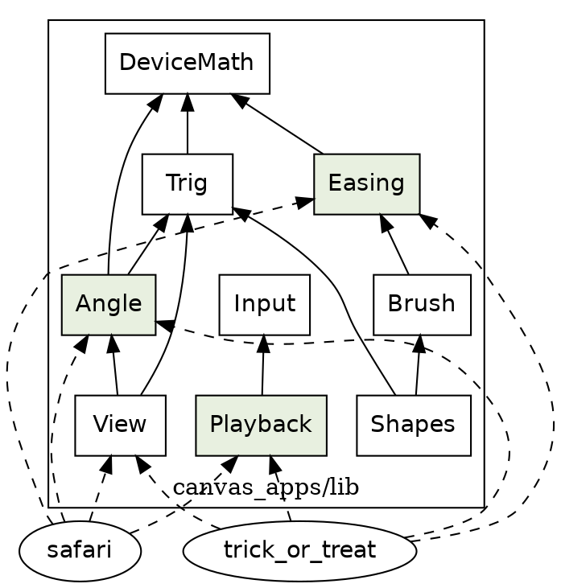

# What in safari could go into a shared game library

*A survey of roc-apps' Roc code for reusable components, dated 2026-11-05. Everything here comes from reading the code; nothing was built, run or changed.*

## The verdict

There isn't a new library here yet. There's already one, `canvas_apps/lib/`, and it has room for three or four more things. About 210 of safari's 9,900 non-spec lines have a real second user in another app today. The first thing to move is `Easing`, once the animation branch has merged.

The suspicion about physics half held:

- **`Angle` holds up.** `lib/View.roc` carries a bare-float bearing that `Angle.Bearing` fits exactly.
- **`Speed` and `Acceleration` don't.** No other app has anything shaped like them. They are scalars in metres a step, and the arcade games use F32 vectors in pixels a second.
- **Projection generalizes better than physics, and in the opposite direction.** `lib/View.roc` is already safari's camera with its constants as parameters, and trick_or_treat already uses it. Safari is the one that hasn't moved. So the most valuable step isn't moving code out of safari; it's making safari a user of what's already in `lib/`.
- **One thing that isn't physics at all has two users:** the pause-and-scrub keys, written twice, in `SafariApp` and `TrickOrTreatApp`.

Critters generalize worst. Almost everything drawn in safari speaks `Paint.DrawCmd`, the Codex wire format, so none of it can leave until that does.

By "second user" I mean a second app. A cat and a bird inside safari prove a noun for safari, but not for a library.

## Physics and units

Here's why `Speed` and `Acceleration` fail the test. This is how each app measures motion:

| App | Speed is measured in | Float | Time | Shape |
|---|---|---|---|---|
| safari | metres a step | F64 | fixed step, 30 fps | a scalar along the road |
| trick_or_treat | metres a frame, one constant (`Walk.back_speed`) | F64 | a tick, 60 fps; distance is worked out as an area, not stepped | a scalar |
| particles | pixels a second | F64 | fixed `dt` of 1/60 | `vx`, `vy` fields |
| pong, breakout | pixels a second | F32 | `dt` from the runner | `Math.Vec2` |
| camera | pixels a second | F32 | `dt` from the runner | one number per axis |
| snake | cells a step | F32 timer | a step every 0.115 s | a grid |

Moving `Speed` to any arcade game would need a different unit, a different time base, a vector and a float width that changes pong's arithmetic. That's a new type with the old name, not a second user. The arcade games' physics, collision included, is already in `lib/Math.roc`, with two users. `Speed` is also unfinished: time and distance are still plain F64 in it, and they're the next units on the list.

| Module | What it does | Generic? | To move it | Second user | Rating |
|---|---|---|---|---|---|
| `Angle` | `Bearing`, `Turn`, `Lean`, with the arithmetic allowed between them | Truly generic. Imports only `lib.DeviceMath` and `lib.Trig`. `Lean.steer` takes its rate as a parameter | About 50 import lines, take it out of `game.roc`, and add an `AngleSpec`, because it has none of its own. The rider context in the header stays, as you said it should | `View.heading` (`lib/View.roc`) and `Walk.heading`: five lines. `View`'s heading is already a bearing, growing to the right from the forward axis | Move after a small change |
| `Speed` | Metres a step, and the sums with `Acceleration` | Clean, but safari's units | Would import cleanly; it just has no taker | None. `Walk.back_speed` is the nearest, one constant | Leave in safari |
| `Acceleration` | Metres a step per step | As `Speed` | As `Speed` | None | Leave in safari |
| `Bike` | One step of the motorcycle | Safari's. Takes `Pose.RiderState`, which holds a `World.SegmentIndex` | A rewrite | None | Leave in safari |
| `VehicleLimits` | Top speed, and a table of speed by turn size | Tuning data | Nothing to move | None | Leave in safari |
| `Arc`, `LeanSearch` | Predicting a coasting arc; bisecting for a lean | Safari's. `Arc` reads `Scenery.lane_width` and still has its emitter shape | A rewrite | None | Leave in safari |
| `Throttle`, `Rider`, `Truck` | The ride's decisions | Safari's. `Throttle` imports `Cat` | Nothing to move | None | Leave in safari |
| `Num_` | `round_real`, `floor_real`, `mod_real`, `exp_real` | Generic in purpose, but in Codex's shape | Polish it first, and read the pin's builtins first (CLAUDE.md section 12); some of it may go instead of moving | None. No other app imports it | Leave in safari |

## Geometry and projection

By reading, `Camera.project` is `View.flat`, operation for operation, with `eye` at 1.2 and `height` at 600. `Geom.SpacePoint` and `View.At` are plain aliases with the same three fields, so the compiler already treats them as one type. `Geom.clip_near` is `View.clipped` with two differences: the near plane is 0.4 against 0.35, and it keeps a point on the plane with `>=` where `View` uses `>`. `View`'s own header says it's safari's arithmetic with the constants made parameters.

| Module | What it does | Generic? | To move it | Second user | Rating |
|---|---|---|---|---|---|
| `Camera` | Puts a rider-space point on the screen | The arithmetic is generic; `eye_h` and `Screen.horizon_y` are safari's | Nothing moves. `project` calls `View.flat` and the duplicate sum goes. `Camera.View` wants a new name, so it doesn't read against `lib.View` | trick_or_treat is `View`'s first user, and safari becomes its second | Move after a small change |
| `Geom.clip_near` | Cuts a polygon at the near plane | Generic | `View.near` becomes a parameter, so `View.clipped` can serve both, and the `>=` difference gets settled by a proof frame | As above | Move after a small change |
| The rest of `Geom` | Road points, bends, `line_crossing`, `ground_drop` | Road geometry, and `ground_radius` is safari's. `line_crossing` is generic but only `Joint` calls it | Would need `Geom` split in two | None | Leave in safari |
| `Lens` | 70° focal length, widened by lean and attention | Safari's | Nothing to move | None | Leave in safari |
| `Screen` | 960 by 600, and the horizon | Safari's constants, by definition | Nothing to move | None | Leave in safari |
| `CanvasRoll`, `ViewYaw`, `RideFocal` | The rider's camera behaviour | Safari's. All read `Pose.RiderState` | Nothing to move | None | Leave in safari |

`trick_or_treat/Panels.roc` deserves a mention here too. Its header calls it the obvious thing to promote the day a second app places anything in metres. Safari does, but it paints through `Paint`, not `Shapes`, so it can't use `Panels`. It stays where it is until that changes.

## Animation and critters

| Module | What it does | Generic? | To move it | Second user | Rating |
|---|---|---|---|---|---|
| `Easing` | `clamp01`, `lerp`, `smoothstep` | Truly generic. No imports on master, and `lib.DeviceMath` on the branch | One import line per user, and it has a spec. Wait for the branch, which edits this file | `Walk.smooth` is the same expression word for word. `Brush.clamp01` is the same function, and safari already calls both copies | Move now, once the branch merges |
| `Animation` (branch) | Stages, and two-track timelines | Half generic. `Timeline`, `Track`, `Stretch`, `Cut`, `Looks` and `Stage` know nothing of riders; `Approach`, `over_gap` and `over_steps` do, and they're why it imports `Speed` | Split along that line, and rename `Spot`'s road words | None yet. `Walk` is the likely one, but its curves are single numbers rather than poses and paths, and its child's pace fits no `Ease` tag. Only the bird has landed, and the cat is in progress | Leave in safari; ask again after the cat lands |
| `Cat`, `BirdFlight` | Each critter's score and rules | Safari's. Both are defined by the rider's gap and `Scenery` trees | Nothing to move | None | Leave in safari |
| `Stills` | A picture as polygons in a unit frame | The idea is generic. The types are a tracing format: `color : I64`, gradient `kind : I64` | Rewrite on `Brush.Fill`, and convert every table | None. trick_or_treat builds its figures in code | Leave in safari |
| `EmojiStills`, `CatStills`, `BirdStills` | Traced pictures | Art, so portable in spirit | Needs `Stills` first | None | Leave in safari |
| `Critter`, `CatDraw`, `RocBird` | Stills on screen | Sounds generic; all three emit `Paint.DrawCmd` | Blocked by `Paint` | None | Leave in safari |
| `Gaze` | Where the rider looks | Safari's. Imports `Pigs` and `World` | Nothing to move | None | Leave in safari |

Your earlier decision against a shared `AnimationPlan` still looks right for the same reasons, and it means there's no plan layer to promote.

## Rendering and painting

| Module | What it does | Generic? | To move it | Second user | Rating |
|---|---|---|---|---|---|
| `DepthSort.sort_by`, `is_farther` | A stable far-to-near merge sort with a tie's slack | Generic. `Subject` beside it lists safari's things, and that part stays | Split `Subject` and `DepthKey` from the sort | None. trick_or_treat paints in a fixed order, by hand, and doesn't need a sort | Leave in safari |
| `Paint`, `Blit`, `SafariBrush` | The Codex draw command, its last pass, and reading a brush out of one | Safari's, and the blocker for everything below | See "What must not move" | None | Leave in safari |
| `SafariShapes` | A frame as `lib.Shapes` | Safari's, as its header says | Nothing to move | None | Leave in safari |
| `Sky`, `Mountains` | The dusk, the sun, the skyline | Safari's. `Sky.color_between` looks like a small second copy of `Brush.mix`, on a different colour type | Nothing to move | None. `Night` is its own sky | Leave in safari |
| `Tower`, `Tree`, `TruckBody`, `TruckLights`, `TruckShape`, `TruckDraw`, `GuardRail`, `Ground` | Things drawn by the road | Safari's scenery on `Paint`, `Camera` and `Geom` | Blocked by `Paint` | None | Leave in safari |

## World and route

All of these stay. Second users don't exist, because no other app has a road.

| Module | Why it stays |
|---|---|
| `World`, `Scenery` | The route itself, and a hub with 20 importers each. `World` imports `Cat`, `BirdFlight`, `Herd`, `Pigs` and `Trees` |
| `Frame`, `Joint` | The chain of segments is a clean idea, but there's one road |
| `Trees`, `Herd`, `Pigs`, `Pond`, `SafariCritter`, `Billboards` | What stands by the road, and where |
| All `*Plan` modules, `ItemDraw`, `Render`, `Safari` | The frame's assembly, and the most safari-specific code there is |

## The app shell

This category wasn't in the brief, but the code has one.

| Module | What it does | Generic? | To move it | Second user | Rating |
|---|---|---|---|---|---|
| A new `Playback` | Space toggles pause; a held arrow moves 1 paused or 4 running; otherwise a running app steps by 1 | Truly generic | Lift the decision out of `SafariApp.step`, importing only `Input`. R and J differ between the apps and stay in each: safari's R clears the pause and trick_or_treat's doesn't, and J means next segment in one and a second on in the other | Both have it today, written twice | Move after a small change |
| `SafariRide`'s history | Stepping back through kept frames | Generic in idea | Nothing to move | None. trick_or_treat is a function of its tick, so going back is a smaller number | Leave in safari |

`Playback` is only about ten shared lines, so it's cheap but won't change much. It can wait.

## Testing tools

| Module | What it does | Generic? | To move it | Second user | Rating |
|---|---|---|---|---|---|
| `Grade` | Writes a spec's verdict lines | Truly generic | Nothing stops it, but specs for moved modules stay beside it anyway | None. No other app has a spec app; they use `expect` | Leave in safari |
| `Hex`, `PixelColor`, `PixelGrid`, `ScreenRoll`, `ScanlineFill` | Exact pixels from `lib` types | Truly generic. None imports safari | Would be a package of their own, never `lib`, so no game carries them | None yet; see below | Leave in safari |
| `ShapesPixels` | Paints a `lib.Shapes` frame into pixels | Nearly generic. It crashes on what safari doesn't use, such as `Rect` and `Blend` | Fill in the missing shapes | None yet | Leave in safari |
| `SafariFrame`, `BackdropPixels`, `SunPixels`, the proof programs | Safari's own proofs | Safari's | Nothing to move | None | Leave in safari |

The raster set is the most reusable code in safari after `Easing`. It's a test tool with one user only because no other app has a frame proof. If you ever want trick_or_treat held to hashes as safari is, this is what would do it, and that would be its second user.

## What must not move

- **`Paint` is the wall.** 19 modules import it, and it's Codex's format: integer tags, colours as I64, and meanings kept in `SafariBrush` and `Blit`. Every drawn thing depends on it. Moving any of them to a library would put Codex's format in the library. Taking it out of safari would be a large job in its own right, with `ShapesFrame` to prove it, and a separate decision from this one.
- **`Speed` and `Acceleration`,** for the reasons in the table. They read as clean, small and portable, and they are, but no other app has a use for them.
- **`Tower`.** It's the model for how the code should read, but that's a claim about quality, not reuse. A well-polished module isn't thereby a generic one.
- **`Bike`.** It reads like a generic vehicle step, but its state is a position on a route.
- **`Critter`.** The name suggests a generic critter. It's a polygon painter for `Paint`.
- **`DepthSort.Subject`.** It lists safari's things, and adding an app's things to it would be the wrong shape for a library.
- **`Scenery`.** It has 20 importers and feels like shared vocabulary, but it's the route's vocabulary.
- **A module called `Physics`.** Don't use the name. `lib` gives its modules roc-ray's names on purpose, and roc-ray's `Physics` is 3D projective geometric algebra in F32.

Two repos outside roc-apps looked like candidates, and neither is. dog-park's `Walk.roc`, its physics, has no F64 at all and sits on a different Roc pin. rocflight is an interpreter, not a game.

## Dependency shape

Arrows are imports. The pale boxes are the proposed additions, and `Angle` and `Easing` come from safari. The rest of `lib` doesn't change.

I checked each module's imports. Nothing in the diagram depends on safari: `Angle` imports only `DeviceMath` and `Trig`, and `Easing` imports nothing on master and `DeviceMath` on the branch. Every import in `lib/` today is another `lib/` module. There's no cycle, because neither `Angle` nor `Easing` imports anything above them. `Playback` doesn't exist yet, and it needs only `Input`.

If `Animation` moved later, it would drag `Speed` and `Acceleration` with it, unless `Approach` and the two rules stay in safari first.

## What it would look like

Extend `canvas_apps/lib/`; don't start a new package. 82 files name `lib` in their headers already, including all 59 specs, so a module added to it costs each user one import line and no header change. A new package would have to be added to the header of every root that reaches it. This also fits CLAUDE.md section 12: two copies beat a shared package designed for one user.

Categories can't be folders. As I understand it, Roc reaches another folder only as a package, so `lib/` stays flat. The categories can live in a table in `canvas_apps/README.md`, which already lists `lib`'s modules.

`lib` isn't one kind of thing even now. Some of it mirrors roc-ray's names in F32 (`Math`, `Color`, `Keys`, `Random`, `Camera`), some is our own vocabulary (`Shapes`, `Brush`, `View`), and some is Codex's (`Trig`, `DeviceMath`, whose headers still point at safari's README). `Easing` and `Angle` would join the last two groups in F64.

How the gates would cover it:

| Gate | Today | After a move |
|---|---|---|
| Specs | `gates/run.shale` globs `safari/*Spec.roc`. `TrigSpec` already lives there and tests `lib.Trig` | A moved module's spec stays in safari and imports `lib.X`, so the gate doesn't change. That's the precedent, and `Grade` stays with them |
| Proof frames | `proof.expected` holds safari's hashes | A pure move must leave that file untouched, and it's the sharpest check available |
| `game.roc` | Exposes `Angle` and others to `gates/` | `Angle` comes off the list, and `SafariFrame` says `import lib.Angle` |
| Lints | Run with `cwd` at `safari/`, so they never see `lib/` | **A moved module falls out of the lints.** This is the real gap. `lints.shale` needs a second pass over `lib/`, held at whatever its counts are today, before anything moves. I didn't run it, so I don't know those counts |
| `check.shale` | `roc check` and `roc fmt` over every app | Covers `lib` already |
| The other apps | Only `page_check.mjs`, which says a page runs, not that it's right. The README gives `roc test` by hand, and I found no script or workflow that runs the 38 `expect`s in `lib` and the apps | A change in trick_or_treat has no frame gate. A one-time before-and-after comparison of `page_check`'s `SHOT` frames would cover a move, or `same_code.shale` |

Safari's gate is effectively `lib`'s gate. That's fine while `lib` is small, but anyone changing `lib` has to know to run it. I haven't measured whether a bigger `lib` slows the specs' fresh-cache builds; at about 210 lines I'd expect it not to matter.

## A suggested first step

After the animation branch merges, in one commit:

1. Move `Easing.roc` to `lib/`, and add it to `lib/main.roc` and the README's table.
2. Change `import Easing` to `import lib.Easing` in safari, `EasingSpec` included, which stays where it is.
3. In `Walk`, delete `smooth` and call `Easing.smoothstep`.
4. In `Brush`, delete `clamp01` and call `Easing.clamp01`; `SafariBrush` follows.

`proof.expected` must not change, and `Walk` needs the one-time frame comparison. Add the lint pass over `lib/` just before this, as its own commit.

After that, the order I'd take is safari's `Camera` onto `View`, then `Angle` with its new spec, then `Playback` if it still seems worth it. The `Camera` step is the one that pays: it gives the one piece of generic 3D arithmetic a single home. `Camera.project` is on the hot path, so check it with `same_code.shale` or `FrameBench`, because `View.View` is a bigger record to build per point.

While you're in trick_or_treat: `Skeleton`, `Guards` and `Walk` each define their own `tau`, and `Trig.two_pi` is there already, with the same literal.

## Limits of this survey

- The bit-for-bit claims about `Camera`, `View`, `clip_near`, `smooth` and `clamp01` come from reading the expressions. None were executed.
- `Animation` was read on its branch, with `Cat` mid-edit, so its rating is a snapshot.
- I read the small and central modules in full, and the scenery, plans and truck by their headers, signatures and imports.

## Two questions for you

1. Is a second app the right bar for "second user" here, or would you count a second critter in safari as enough to put something in a library? This survey assumes a second app. With the looser bar, `Animation` and `Speed` move up.
2. Is retiring `Paint` something you'd ever want? If it is, `Stills`, `Critter`, `Panels` and the drawn scenery all change rating. If it isn't, critters stay in safari for good.
