# Where safari's module boundaries are wrong

*A review of safari's own module organization, with no library in mind, dated 2026-11-05. It comes from reading roc-apps at 3e94bc0 and building the import graph; no game code was changed and no gate was run.*

## The answer

The structure is healthy at the level that matters most. The ride and the drawing are two separate programs that meet in one place: nothing `Rider` or `Truck` reaches imports `Paint`, `Camera` or `Geom`, and no drawing module sees a `RiderState`. The plan, draw and picture layers exist for every kind of thing by the road. Most of what is wrong is one level down: a few types sit in the wrong place, one fact has several homes, and the names hide a structure that is better than they suggest.

The three things most worth fixing:

1. **`Paint.DrawCmd`, which is much thinner than it looks.** 19 modules import `Paint`, but only `Blit`, `SafariBrush`, `SafariShapes` and the gate's `SafariFrame` read a command's fields. The other modules just pass the alias along. The game already ends up at `Shapes.Shape`, and only `Poly` and `Disc` come out, so the path is to build those directly and delete `DrawCmd`, `Blit` and `SafariBrush`. It's five small steps and one larger one.
2. **The motorcycle sits above the whole route.** `Bike` imports `Pose`, `Pose` imports `World`, and `World` imports the cats, the birds and the herd. So one step of physics depends on 14 modules. This is your `RiderState` question.
3. **What a frame is seen from has no home.** `Frame.RoadView` exists, yet eight records restate its three fields, about ten places rebuild it field by field, `view_w` runs through 69 lines of game code and is always `Screen.width`, and `rider_along` is a second copy of `pose.along`.

**On `RiderState`: your suspicion is right for some of its users, and wrong for the rest.** `Bike`, `Arc`, `LeanSearch`, `CanvasRoll` and `CrossingReaction` shouldn't take it, and `Truck` shouldn't import `Pose` at all. `Rider`, `Gaze`, `Throttle`, `ViewYaw` and `RideFocal` should keep it, because they really are about the rider. The next section has the evidence.

## The answer on `RiderState`

I read your question as: should modules lower in the stack be handed the whole record from above? It depends on what each one reads. Here is every module that takes it, with the fields it reads directly or through what it calls.

| Module | What it reads | Of 9 | What I'd do |
|---|---|---|---|
| `CanvasRoll.rider_roll` | `tilt` | 1 | Take an `Angle.Lean` |
| `CrossingReaction.reaction_to` | `along`, `speed` | 2 | Take those two |
| `Bike.simulate_rider_step` | `along`, `across`, `yaw`, `speed`, `tilt`, `heading` | 6 | Take only these |
| `Arc.project_arc` | `along`, `across`, and through `Bike` the other four | 6 | As `Bike` |
| `LeanSearch` | `across`, `tilt`, and through `Arc` the other four | 6 | As `Bike` |
| `Throttle` | `along`, `speed`, `tilt`, and the rest through `Arc` and `Gaze` | 6 | Keep |
| `ViewYaw` | `along`, `across`, `yaw`, `tilt`, `heading`, `gaze_yaw` | 6 | Keep |
| `RideFocal` | `segment`, `tilt`, `focus`, and `along`, `speed` through `CrossingReaction` | 5 | Keep |
| `Gaze` | `segment`, `along`, `across`, `yaw`, `speed`, `gaze_yaw`, `focus` | 7 | Keep |
| `Rider` | all of them | 9 | Keep |

`Truck` imports `Pose` for one thing, the constant `Pose.v_base`, which belongs in `VehicleLimits` beside `v_max`. `Truck` already imports that.

The fault isn't the record as such. `Bike` is the building block, and `RiderState` is a type built around it. Your style guide already has the rule: "A building block never imports a type built from it." `Bike`'s step never touches `segment`, `gaze_yaw` or `focus`, but because the record holds a `World.SegmentIndex`, `Bike` reaches `Cat`, `Animation`, `BirdFlight`, `Herd`, `Pigs` and `Trees`. `Arc` and `LeanSearch` inherit that.

Taking fields everywhere would be wrong in the other direction. `Gaze`'s functions read a few fields each, and giving each one its own slice would restate the record a dozen times. `Gaze`, `Throttle` and `Rider` are the rider's decisions, so what travels together there is the rider. The same goes for `ViewYaw` and `RideFocal`, the two places the camera reads the rider.

The drawing side already does this right, which is reassuring. `Safari.ride_frame` picks out `segment`, `along` and `speed` for `Render`, and `Cat` takes a small `Animation.Approach` rather than a rider. Neither imports `Pose`.

**The fix is cheaper than I expected.** Open records work at the pin. I checked a toy module with `roc check` in a scratch folder, and it passes with the extra field kept; asking for a field that isn't there fails, so the check isn't blind.

```roc
Motion(others) : {
	along : F64,
	across : F64,
	yaw : Angle.Turn,
	speed : Speed,
	tilt : Angle.Lean,
	heading : Angle.Bearing,
	..others
}

simulate_rider_step : Bike.Motion(others), { lean_step : Angle.Lean, accel : Acceleration } -> Bike.Motion(others)
```

The body of `simulate_rider_step` doesn't change, because `{ ..s, ... }` already keeps what it doesn't name. `with_tilt` moves from `Pose` to `Bike`, and `Arc.ArcProgress` takes the same type parameter. `RiderState` stays flat, no field read changes, and the specs keep passing it as they do now.

| | Today | After |
|---|---|---|
| `Pose` importers | 12 | 6: `Rider`, `Gaze`, `Throttle`, `RideFocal`, `ViewYaw`, `Safari` |
| What `Bike` reaches | 14 modules | 3: `Acceleration`, `Angle`, `Speed` |
| What `Arc` reaches | 15 | 5 |
| What `LeanSearch` reaches | 16 | 6 |
| What `CanvasRoll` reaches | 14 | 1 |

(Safari's modules only; `lib` isn't counted.)

Two cautions. Nothing in roc-apps uses an open record yet, so this is a new idiom and wants a rule in `roc-style.md`. And I only checked the toy; I haven't compiled `Bike` itself this way, or run one on wasm. The fallback is to nest, `RiderState : { segment, bike : Bike.Motion, gaze_yaw, focus }`, which gives the same dependency result. That means about 57 lines of game code and 12 specs, and it reads worse (`state.bike.along`).

Sure of the direction, high. Size: small, a few files, no arithmetic touched, so the frame hashes must not move.

## The layers as they are

Grey arrows are the normal direction between layers. Red arrows go the wrong way. The dashed one isn't an import: it's `DepthSort` naming things that live above it.

```dot
digraph layers {
  rankdir=BT;
  compound=true;
  newrank=true;
  node [shape=box, fontname="Helvetica", fontsize=10];
  edge [color="#999999"];

  subgraph cluster_units {
    label="units and constants";
    Angle; Speed; Acceleration; Easing; Screen; Scenery; DepthSort;
  }
  subgraph cluster_rules {
    label="what happens by the road";
    Animation; Cat; BirdFlight; Trees; Herd; Pigs; Pond;
  }
  subgraph cluster_route {
    label="the route";
    World; Frame; Joint;
  }
  subgraph cluster_ride {
    label="the ride";
    Bike; Arc; LeanSearch; Pose; Gaze; Throttle; CrossingReaction; Rider; Truck;
  }
  subgraph cluster_camera {
    label="the camera";
    Geom; Camera; Lens; CanvasRoll; ViewYaw; RideFocal;
  }
  subgraph cluster_find {
    label="what is in view";
    Billboards; TreePlan; TowerPlan; CatPlan; BirdPlan; TruckPlan; RailPlan; Render;
  }
  subgraph cluster_draw {
    label="drawing";
    Paint; Blit; SafariBrush; Tower; GuardRail; RocBird; TruckShape; Sky; Mountains; ItemDraw;
  }
  subgraph cluster_top {
    label="the app";
    Safari; SafariRide; SafariShapes; SafariApp;
  }

  Cat -> Angle [ltail=cluster_rules, lhead=cluster_units];
  World -> Cat [ltail=cluster_route, lhead=cluster_rules];
  Pose -> World [ltail=cluster_ride, lhead=cluster_route];
  Render -> Frame [ltail=cluster_find, lhead=cluster_route];
  ItemDraw -> Render [ltail=cluster_draw, lhead=cluster_find];
  Safari -> ItemDraw [ltail=cluster_top, lhead=cluster_draw];
  Safari -> Rider [ltail=cluster_top, lhead=cluster_ride];

  edge [color="#c62828", penwidth=1.6];
  Bike -> Pose;
  Arc -> Pose;
  LeanSearch -> Pose;
  CrossingReaction -> Pose;
  CanvasRoll -> Pose;
  Truck -> Pose [label="v_base"];
  Paint -> Camera [label="ScreenPt"];
  Sky -> Camera [label="a type"];
  BirdPlan -> RocBird [label="PlacedBird"];
  RailPlan -> GuardRail;
  TowerPlan -> Tower [label="beacon offset"];
  Pond -> Billboards [label="Facing"];
  ItemDraw -> Mountains [label="headlights"];
  DepthSort -> TreePlan [style=dashed, label="Subject"];
}
```



There are no cycles, and Roc wouldn't allow one. `Pose` exists because `RiderState` can't live in `Rider` while `Gaze` and `Throttle` sit under `Rider`, and that's a fair reason, though it's a poor name. Apart from that I found no awkward move made to dodge a cycle.

## 1. `Paint`

What's there, by the tag each thing uses:

| Tag | Made by | Called from | Meaning |
|---|---|---|---|
| 0 | `push_poly` | `CatDraw`, `Critter`, `Ground`, `GuardRail`, `Mountains`, `Tower`, `Tree`, `TruckShape` | A flat polygon |
| 1 | `push_round_poly` | `Tree`, twice | A polygon `Blit` must turn into tag 2 or 0 |
| 2 | `Blit` alone | | A polygon with a span shade |
| 3 | `push_beacon` | `Tower`, once | A disc |
| 4 | `push_grad_poly` | `TruckLights`, twice | A polygon with a radial gradient |
| 5 | `push_linear_grad_poly` | `Critter`, once | A polygon with a linear gradient |
| 6 | `push_radial_grad_poly` | `Critter`, once | A polygon with an elliptical gradient, despite the name |

The meaning of `color`, `color2`, `strength` and `geom` changes with the tag. `color` is 0xRRGGBB for tags 0 to 3 and 0xAARRGGBB for 4 to 6. `geom` is a list read by position. `SafariBrush.geom` answers 0.0 for a missing number, and `of_command`'s last arm paints anything it doesn't recognize as flat. "Is this a beacon?" is asked twice, in `SafariShapes.of_command` and `SafariFrame.paint_command`.

`Blit`'s disc check does nothing today. `Tower` already drops a beacon with `brightness < 0.02` or `radius < 0.5`, the same two numbers as `Blit.min_disc_alpha` and `min_disc_radius`.

**What depends on it.** Four readers, about eleven specs, and 62 signature lines that only name the alias. That's why the survey's "wall" is thinner than 19 importers suggests. Those signatures need no change until the very end.

**What I'd replace it with.** Nothing new. `SafariShapes.of_command` already says what each command is: a `Shapes.Shape`, `Poly` with a `Brush.Fill` or `Disc`. That's a closed union with named fields, and it's what the page and the proof painter both consume. So `Paint` keeps its job, a small set of builders that take safari's screen points and colours, but each returns shapes, and it holds the rules that now live in `Blit` and `SafariBrush`. This uses `lib`, it doesn't extend it, and `SafariShapes` already does the same.

I considered a union of safari's own, `[Solid, ShadedAcross, Beacon, ...]`. It reads nicely, but it would have one consumer, a `match` turning it into shapes, so it would be a record built only to be taken apart again. The one thing it buys is specs that say `Solid`.

**The path.** `Blit.expand_cmd` works one command at a time and keeps the order, so its rules can move to the builders without changing paint order.

| Step | What changes | Gate |
|---|---|---|
| 0 | One-time check, no code: count which tags, and which `Blit` branches, appear in the seven proof frames. If a tag never appears, add a frame first. The bull is the only still with gradients, so tags 5 and 6 need a bull in view, and I don't know that any proof frame has one | |
| 1 | Move `Camera.ScreenPt` to `Screen.Point`. `Paint` stops importing `Camera`, and its reach falls from 4 modules to 1 | Hashes unchanged |
| 2 | `SafariFrame` paints through `SafariShapes.of_command` and `ShapesPixels`, and `paint_command` goes. `ShapesFrame` then compares uncut shapes with cut ones, so it still judges `Shapes.cut` | Hashes unchanged, 0 differing |
| 3 | Delete `Blit`'s disc check, and move its radial check into `push_grad_poly` | Hashes unchanged; `BlitSpec` shrinks |
| 4 | `push_round_poly` does the span shading itself, and tag 1 goes. `blit_expand` is now the identity; delete it from `SafariRide.commands` and `FrameBench`, then delete `Blit` | Hashes unchanged; `TreeSpec` and `PaintSpec` expected files change, and each change gets read |
| 5 | The larger one. `Paint.DrawCmd : Shapes.Shape`; each builder makes its `Poly` or `Disc`, with `SafariBrush`'s arithmetic moved in unchanged. `tag`, `color2`, `strength` and `geom` go, as do `SafariBrush` and `of_command`. The 62 signatures still compile | Hashes unchanged; about eleven specs change. The `commands N` in the `ShapesFrame` lines may fall, if a skipped gradient now never becomes a command; that's a fair change, but it should be explained |
| 6 | Mechanical: replace the alias with `Shapes.Shape` in the 62 lines. Modules that only pass frames along import `lib.Shapes` rather than `Paint`. Take `Blit` and `SafariBrush` off `game.roc` | Hashes unchanged |

`Paint`, `Blit` and `SafariBrush` are 528 lines now. I'd expect under 200 after, though I haven't drafted it. The rule through all of this is that `proof.expected`'s `RasterFrame` hashes never move; a step that moves one has changed the arithmetic. Keep colours as `I64` at the builders during this. Colours are a separate job (see "Smaller things").

Sure of the direction, high. Size: steps 0 to 4 are small each, step 5 is about 300 lines of game code and the specs, step 6 is mechanical.

## 2. The viewpoint

`GroundPlan.View` has the right shape: `{ road : Frame.RoadView, cam_focal, view_w }`. Most of the plan layer doesn't.

- **The record restated.** `TreePlan.View`, `TowerPlan.View`, `CatPlan.View`, `BirdPlan.View`, `TruckPlan.View`, `CritterPlan.Scene`, `TruckShape.Road` and `Render.Viewpoint` each spell out `world`, `chain` and `pose`.
- **Built only to be taken apart.** `{ world: view.world, chain: view.chain, pose: view.pose }` appears about ten times, in `CatPlan` twice, `CritterPlan` twice, and `TreePlan`, `TowerPlan`, `TruckPlan`, `TruckShape` once each. `BirdPlan` gave up and wrote `road_of`. `Render.collect` takes the record apart and hands the pieces out, and `ItemDraw.draw_truck` takes `road` apart to feed `TruckShape.Road`.
- **`view_w` isn't a parameter.** It's in 69 lines across 15 modules and 11 spec lines, and every value is `Screen.width` or 960.0. `Camera.project` takes the width as an argument and reads `Screen.horizon_y` directly. Your guide says it: "A parameter every caller passes the same value is no parameter." `Camera.View` shrinks to `cam_focal`, and `Sky` can drop `Camera`.
- **`rider_along` is `pose.along`.** `Safari.ride_frame` fills both from `s.along`. `CatPlan.View`, `BirdPlan.View`, `TruckPlan.View`, `Render.Viewpoint` and `Frame.gap_to_segment` all carry it. One spec depends on the two differing: `CatPlanSpec` line 68 sweeps `rider_along` with the pose held still. It would need to move the pose too.
- **`rider_segment` is the chain's first entry.** `Render.Viewpoint` carries both. `CritterPlan`, `GroundPlan`, `RailPlan` and `TowerPlan` each match on `rider_segment.previous()` to find the segment behind. A `Frame.segment_behind(road)` would be that one home.
- **`GroundPlan.draw` works the chain out again**, though `Safari.ride_frame` has just done it. It should take the `RoadView`.

What I'd do: every plan's `View` becomes `{ road : Frame.RoadView, cam_focal, ... }`, and `view_w`, `rider_along` and `rider_segment` go. None of this changes arithmetic, including `view_w`, which is the same constant.

Sure, high. Size: medium, mechanical, about 15 game modules and the plan specs. `view_w` and the rest can land as separate commits.

## 3. `DepthSort` and its index table

`DepthSort.Subject` lists safari's things as `Tree(U32)`, `Tower(U32)` and so on, each an index into a list held in `Render.Scene`. That's the Codex shape of a table and an index. It costs three things:

- A low module knows the things above it, and seven plan modules import `DepthSort` to write a `depth_keys` function. `CritterPlan`'s is called `cow_items`.
- `ItemDraw.thing_at` crashes if an index is bad.
- `ItemDraw.draw_truck` crashes on `NoTruck`, because the depth order and the truck are two facts that have to agree.

`sort_by` is already generic, and `TruckBody` uses it that way. So the subject can carry the thing itself: `Tree(TreePlan.TreeItem)`, and so on, in a union that lives in `Render`, with `Render.collect` making the keys. The seven `depth_keys` go, and both crashes become impossible. `DepthSort` ends up knowing nothing of safari. Keeping the same join order keeps ties the same, so hashes shouldn't move. Check `FrameBench`, since the sort now moves bigger values. `ItemDraw.draw_tree` still needs `scene.trees` to count nearer trees, so the list stays.

Sure, high on the design, medium on the cost. Size: medium; `Render`, `ItemDraw`, seven plans and their specs.

## 4. Two meanings of `across`

Trees, pigs, cows, cats, birds and the rider measure `across` from the middle of the road. `Geom.RoadPoint`, `Frame`, `Joint`, `GroundPlan`, `RailPlan`, `TruckPlan` and `Pond` measure it from the left edge. Same field name, same type. The boundary is crossed by hand, with `Scenery.lane_width / 2.0` written 20 times and `lane_half_width` passed around in 13 lines. `Geom.Pose.half_width` is the same thing as a field, and `Geom.Bend.lane_width` carries the width itself. A missed conversion compiles and moves a tree by two metres. I found no bug of this kind today.

`Cat.crossing` and `SafariCritter.corner_critters` are handed `lane_half_width`, while `Pigs`, `Trees` and `Herd` read `Scenery.lane_width` themselves. The value never varies.

What I'd do: give the conversion one home, such as `Frame.rider_point_at_middle` or a `Road.from_left_edge`, and drop `half_width`, `Bend.lane_width` and the injected parameters. Don't change the origin itself: `across + 2.0 - (pose.across + 2.0)` and `across - pose.across` aren't the same float, so a real single origin would move pixels.

This ties to `Scenery`. It has 20 importers, and 10 of them want only `lane_width`, which isn't scenery. A small `Road` module with the width and half-width would take those, and `Scenery` would keep the roadside's types.

Sure, high. Size: medium.

## 5. Names

The layers are more regular than the names let on:

| Thing | Its rules | Placed by | Found in view by | Drawn by | Picture |
|---|---|---|---|---|---|
| Cat | `Cat` | `Cat`, `World` | `CatPlan` | `CatDraw` | `CatStills` |
| Bird | `BirdFlight` | `BirdFlight` | `BirdPlan` | `RocBird` | `BirdStills` |
| Tree | | `Trees` | `TreePlan` | `Tree` | |
| Animal | | `Herd`, `Pigs`, `SafariCritter`, `Pond` | `CritterPlan`, `Billboards` | `Critter` | `EmojiStills` |
| Mast | | `TowerPlan` | `TowerPlan` | `Tower` | |
| Rail | | `RailPlan` | `RailPlan` | `GuardRail` | |
| Truck | `Truck` | | `TruckPlan` | `TruckDraw`, `TruckBody`, `TruckLights` | |
| Ground | | | `GroundPlan` paints, unlike every other plan | `Ground` | |

The words that mean more than one thing cost the most:

| Word | Means | I'd do |
|---|---|---|
| Pose | The module of `RiderState`; `Geom.Pose` and `Frame.Pose`, where the camera stands; `Cat.Pose` and `BirdFlight.Pose`, how a critter looks | Leave it to the critters. `Pose` becomes `RiderState`, `Geom.Pose` something like `Viewpoint`, and `Frame.Pose`, an alias with no job, goes |
| Frame | The module of the road chain; a picture everywhere else (`SafariFrame`, `SafariApp.frame`) | `Frame` becomes `RoadChain` or similar |
| Render | Gathers things; renders nothing. `ItemDraw` does that | `RoadsideScene` and `RoadsideDraw`, perhaps |
| Scene | `Render.Scene`, `CritterPlan.Scene`, `SafariFrame.Scene` | Goes mostly with section 2 |
| Critter | A module that paints stills, `Scenery.Critter`, `SafariCritter` | `Critter` becomes `StillDraw`; `SafariCritter` becomes `CornerAnimals` |
| `Safari*` | Five modules where the prefix says nothing | See below |

The app's top is the one place where the names hide two jobs. `Safari` holds the ride's state and step, and also the frame's assembly, so anything that wants a ride reaches 64 modules, though the ride itself needs about 25. `SafariRide` holds the history and queries the frame. The result is `m.ride.ride.rider`. I'd split `Safari` into `Ride` (state and step, no drawing) and `RideFrame` (`ride_frame`, `ride_sun`), and call `SafariRide` `RideHistory`. Sure, medium. Size: small for the split.

Renames touch everything, so do them last, and only for modules that survive sections 1 to 4.

## Smaller things

| Where | The smell | What I'd do | Sure | Size |
|---|---|---|---|---|
| `SafariRide` | Imports `RideFocal`, `ViewYaw`, `Frame`, `Lens` and uses none. `LeanSearch` and `Throttle` import `lib.Trig` and don't use it. The compiler seems not to warn on these | Delete | High | Tiny |
| `Cat.pose_index` | Only specs call it, and its comment is false: `CatStills` matches on the pose | Delete; specs print the tag's name | High | Small |
| `Scenery.Critter.codepoint` | Animals are emoji numbers, written in `Herd`, `Pigs`, `Pond`, `SafariCritter` and `EmojiStills`, and `emoji_polys_for`'s `_ => []` silently draws nothing for a wrong one | A closed `Animal` union | High | Small |
| `Scenery.Critter.face_right` | A `Bool` here, `Billboards.Facing` there, converted in `CritterPlan`. `Pond` imports `Billboards` just for that type | One `Facing`, in `Scenery` | High | Small |
| `World.nearest_tree_ahead` | The cat's placement rule sits in `World`, where the bird's sits in `BirdFlight.crossing_among` | `Cat.crossing_among(trees)` | High | Small |
| `ItemDraw` | Holds the trees' rules: `round_trunk_limit`, `crown_shade`, `nearer_tree_count`. Those are most of why `SceneLimits` exists | Decide trunk, crown and shade in `TreePlan`, on `TreeItem` | Medium | Small |
| `ItemDraw.draw_truck` | Works out headlights from `Mountains`, while brake lights arrive from above | Decide both in `Safari.ride_frame`; `ItemDraw` drops `Mountains` | High | Tiny |
| `BirdPlan`, `RailPlan`, `TowerPlan` | A plan imports its drawer: `RocBird.PlacedBird`, `GuardRail.RailPoly`, `Tower.beacon_offset_for`. `CatPlan` and `TreePlan` have this the right way round | Item type to the plan, as they do; `GuardRail`'s quad building to `RailPlan` | Medium | Small |
| `CatDraw` | Its own `Anchor`, `screen_point` and `polygon` beside `Critter.draw_still`, with a different limit, 256 points against 512. `RocBird` shares `Critter`'s | Use `draw_still`, with `lift` added to `feet`. The order of the float sum changes, so the hashes must decide | Medium | Small |
| `Gaze.pig_gaze_brake` | Braking decisions in the module about looking, with `pig_gaze_speed` and `pig_gaze_settle_dist` | Move to `Throttle`; `Gaze` drops `Acceleration` | Medium | Small |
| `Bike.max_lean` | Limits nothing: nothing clamps a lean to it. Only `RideFocal` reads it, to scale the lens. It's why `RideFocal` imports `Bike` | Rename and move to `RideFocal` | High | Tiny |
| `Billboards` | Its `min_critter_px` is `SceneLimits.min_scenery_px`, also 2.0, but measured with `Lens.focal` rather than `cam_focal` | Share the constant; the focal difference is your call, as it changes which animals show | Medium | Tiny |
| Colours | `Blit` (`red_of`, `pack_rgb`), `Sky` (`Rgb`, `pack`), `Mountains.channel`, `Brush.chan`. `Mountains.land` and `SafariShapes.grass_color` are the same green, in two homes | One colour module, once `Paint` is done | Medium | Medium |
| `README.md` | Says the gate runs frames at 0, 3000, 5025 and 9000. `proof.expected` has seven: 0, 100, 1570, 1586, 3000, 5700, 9000 | Fix the line | High | Tiny |

## Codex shape that's left

Beyond `Paint`, `DepthSort`, `pose_index` and the codepoints above:

- **`Arc.ArcOutcome`** is the clearest emitted layer. `forward` and `crossed` are read only by `ArcSpec`, and `crossed` makes `has_crossed` and `start_side` exist. `frames` holds the sentinel `no_frames` of 1e9 for "not at all". `LeanSearch` reads `end_across` only on `ShoulderNone`, and `Throttle` reads `frames` only otherwise, so the honest type is `[StaysOn({ end_across }), LeavesLeft({ frames }), LeavesRight({ frames })]`. Sure, high. Small, but `Arc` is hot and `ArcSpec` changes.
- **Dead `eq_` functions:** `Arc.eq_Shoulder`, `Scenery.eq_Scheme`, `Scenery.eq_Creature`, with nothing calling them. That's most of `Scenery`'s length.
- **`Stills.StillGrad`** serves one animal, the bull, and has 15 fields, with `kind` 1 meaning linear and anything else radial, half the fields unused either way, and `grad` a `List` standing in for an option. A union, by scripted rewrite of the tables. It's easier after `Paint`.
- **`VehicleLimits.turn_speed`** is a chain of float bit comparisons with a fallback, keyed on degrees. The route only has six turn sizes, so a small table or a turn union would read better. Low priority.
- **Eight game modules** still carry the "originally emitted" header: `Arc`, `Num_`, `Paint`, `Safari`, `SceneLimits`, `Scenery`, `Throttle`, `VehicleLimits`. `SafariRide`, `SafariBrush` and `SafariShapes` describe themselves by Codex too. Those three headers go with the sections above.

## What's well placed

- `Angle`, `Speed`, `Acceleration`, `Easing`: leaves, and they do one thing.
- `Animation`: its two ideas stay apart, and `Cat` and `BirdFlight` read as scores. The dependency runs from critter to `Animation`, never back.
- `CrossingReaction`: the one place that matches on crossings for the rider, as it says. It only needs the narrower input.
- `Cat` and `BirdFlight` know nothing of the rider beyond a gap and a speed.
- `World.SegmentIndex` and `Frame.ChainPosition`: indices that earned their nominal types. I'd leave the chain as indices; it isn't the same smell as `DepthSort`.
- Passing `world` as an argument, though `World.segments` is a constant. It looks like needless injection, but about 20 specs build their own road from `World.route_segment`, so it earns its keep.
- `World` importing `Cat` and the rest: the route composes them, so that's the right direction. `Pose` importing `World` is fine once `Bike` no longer sits under it.
- `Geom`: two topics, road points and the rider's view, but they're used together and it's 177 lines. I'd leave it.
- The truck's four draw modules, `Tower`, `Tree`, the stills importing `Cat` and `BirdFlight` for their pose types, and all of `gates/`, with `ScanlineFill` the best of it.

## The order I'd take

1. The tiny rows above, in one or two commits, plus `v_base`, `CanvasRoll` and `CrossingReaction`.
2. `Bike.Motion`, with its style rule, once you've said yes to open records.
3. `Paint`, steps 0 to 6.
4. The viewpoint, then `DepthSort`, then `across`.
5. Names last.

Every step except the `CatDraw` change and the `Billboards` focal question should leave `RasterFrame`'s hashes alone.

## Limits of this review

- Nothing here was compiled against safari. The one experiment was the toy open record, with `roc check`, in a scratch folder.
- The field tables come from reading. Sizes are estimates. Import reach counts safari's modules, from a script over the `import` lines.
- I read the rider, route, plan and paint modules in full, and `Tower`, `Tree`, `Mountains`, `TruckBody`, `TruckLights` and the stills by header, signatures and grep.
- "Only specs use this" comes from text search. Methods reached by dot call hide from it, so I checked each one named here by hand.

## Two questions for you

1. Are you happy for open records to become a roc-apps idiom? It's what makes the `Bike` fix cheap, and it needs a rule in `roc-style.md`. If not, the fix is the nested record.
2. Are you happy for safari's drawing modules to speak `lib.Shapes` directly, in place of `Paint.DrawCmd`? That's the core of the `Paint` plan. If you want a union of safari's own, the steps stay the same, but one more layer stays with them.
