*Sixth draft for Steve's review, 2026-11-05: the whole tour through the proof, the platform and an appendix of patterns, quoting current master. A rough first pass on the later chapters, and `[check: ...]` notes mark what the second pass must confirm.*

# Safari Ride: a tour of a real Roc program

*[The live ride goes here, running as you read.]*

This is Safari Ride. A rider cycles down a long road through open country, past trees, cows and pigs, with a truck somewhere ahead. Radio masts blink in the distance. A bird takes off as the rider comes near. A cat walks into the lane, freezes, and leaps for the far verge. The sun goes down behind the mountains, and the truck turns on its headlights.

Safari Ride has the important parts of a game's world: terrain, physics, a camera, things that react to the player, and a day that ends. It doesn't have game mechanics yet. Nothing keeps score.

A safari is a guided tour, so this is a tour of a tour. It starts with the big picture, zooms in on a few parts of the program, and zooms back out at the end. Safari Ride is about eighty modules of Roc, which is enough to show how Roc holds up in a program with a lot going on. The tour assumes you can already read Roc. Each chapter points out a few Roc ideas as they come up, and the useful ones come up more than once.

## The problem

The problem is simple to state. Design a world once. Then, each time the clock ticks, move what moves, find everything near enough to see, and draw it against the backdrop.

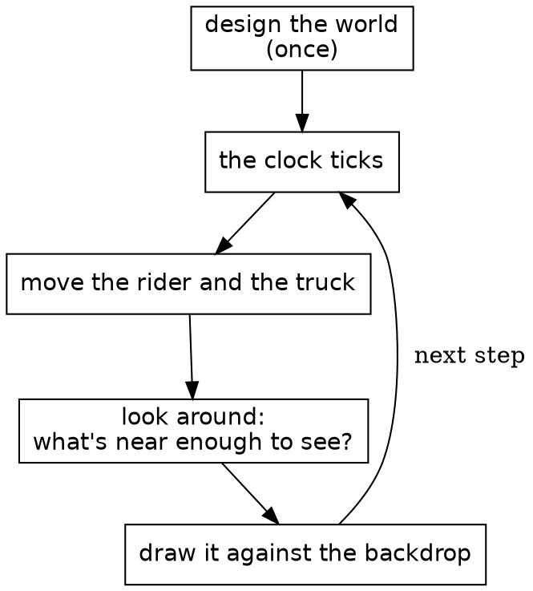

It works like a flipbook, the little stack of drawings that seems to move when you riffle the pages with your thumb. Each page is drawn whole. Safari Ride draws a page about thirty times a second.

The middle box is the heart of it. On a real safari, a guide scans the land and calls out what's there: a cat by the third tree, a bird on the far side. Each of those is a sighting, true for that instant and gone the next. Safari Ride takes its sightings the same way, fresh on every page.

## One whole module

Before the map, here's a whole module, so you know what the boxes on it look like up close. This is the clock from the second box above, all of it.

```roc
## The ride's clock: which step of the ride this is. It starts at zero and
## moves on by one with every step, so it is always whole.
import Steps

Clock :: U32.{

	## The clock as a ride starts.
	start : Clock
	start = Clock.(0)

	## The clock at step `number` of a ride.
	at_step : U32 -> Clock
	at_step = |number| Clock.(number)

	## The clock one step on.
	next : Clock -> Clock
	next = |Clock.(n)| Clock.(n + 1)

	## How many steps this clock is past `earlier`.
	minus : Clock, Clock -> Steps
	minus = |Clock.(n), Clock.(earlier)| Steps.of(n - earlier)

	to_f64 : Clock -> F64
	to_f64 = |Clock.(n)| n.to_f64()

	to_str : Clock -> Str
	to_str = |Clock.(n)| n.to_str()

	is_eq : _
}

expect Clock.start.to_f64() == 0.0
expect Clock.start.next().to_f64() == 1.0
expect Clock.start.next().next().to_f64() == 2.0
expect Clock.at_step(5699).next().to_f64() == 5700.0
expect Clock.at_step(0) == Clock.start
expect Clock.start.next() == Clock.at_step(1)
expect !(Clock.start == Clock.at_step(1))
expect !(Clock.at_step(7).next() == Clock.at_step(7))
expect Clock.at_step(9).minus(Clock.at_step(9)).to_f64() == 0.0
expect Clock.at_step(9).minus(Clock.at_step(8)).to_f64() == 1.0
expect Clock.at_step(9).minus(Clock.start).to_f64() == 9.0
expect Clock.start.next().minus(Clock.start).to_f64() == 1.0
expect Clock.start.to_str() == "0"
expect Clock.at_step(5700).to_str() == "5700"
```

Most of Safari Ride's small modules have this shape: a comment saying what the thing is, its imports, and one type named after the module. `Clock :: U32.{ ... }` is an opaque type: a `U32` underneath, with its methods in the block after it. `Clock.(n)` wraps a number, and in a parameter list it unwraps one, and only this module can do either. Nothing else can add 7 to a clock or pass a tree count as one. `is_eq : _` asks Roc to derive equality. Below the type, each `expect` is a check that `roc test` runs.

It's called like this, once a step:

```roc
# ...
clock: instant.clock.next(),
# ...
```

`instant.clock.next()` is static dispatch: `next` comes from the type of `instant.clock`, so the call needs no import.

## The modules

Here's the whole system, simplified. An arrow points from a module to one it imports, so a module is composed of what it points at. Dashed boxes each stand for a family of modules. Roc doesn't allow import cycles, so nothing here can point back up.


There are two halves. The ride is `Rider`, `Truck` and `World`, with `World` composing the route from its scenery and critters. It knows nothing of drawing. The view is everything that turns the ride into a picture: the sightings find what's in sight, and the drawing paints it. The dotted arrow is the view reading the ride, and no arrow goes the other way. `RideInstant` sits over both, holding one instant of the ride and stepping to the next, and the browser only sees `SafariApp`, which hands it a list of shapes each frame.

### The part that isn't Roc

Safari Ride runs in a browser, and that takes a thin layer of JavaScript. The Roc compiles to wasm. Each tick, the JS keeps the clock, gathers the keys, and calls into Roc. Roc answers with a list of shapes, and the JS paints them on a canvas. The JS knows nothing of cats, and the Roc knows nothing of canvases. The whole game is on the Roc side of that line, and the same app also runs natively. `canvas_apps/ARCHITECTURE.md` has the details, and the platform chapter comes back to it.

### What's a sighting?

Most things in the view come in pairs, and the names say which half is which: `CatSighting` and `CatDraw`, `TreeSighting` and `Tree`, `TowerSighting` and `Tower`, `TruckSighting` and `TruckDraw`.

A sighting answers one question each frame: which of these can the rider see right now, and how should each one look? `CatSighting` goes through the segments ahead, asks `Cat` where it is, works out where that lands in the rider's view, and drops any cat behind the camera or too small to matter. What it hands back is a plain record with no drawing in it:

```roc
## A cat to draw: where it stands in the rider's view, its height, its
## pose, and how high its leap has raised it.
CatItem : {
	right : F64,
	forward : F64,
	height : Distance,
	pose : Cat.Pose,
	lift : F64,
}
```

`Render` gathers every sighting's items, a depth sort puts them in order, and `ItemDraw` hands each one to the module that paints it. Because a sighting's answer is plain data, it can be checked with numbers, without drawing anything. The rule is simple: a sighting decides, and drawing paints.

## All that's stored

A record is the plainest shape in Roc, and it's nearly all this needs. `RideInstant := { ... }.{ ... }` makes the module's own type out of one. That's a nominal type, which can carry a block of definitions, and unlike an opaque type it leaves its fields readable.

```roc
## One instant of the ride, and all that is kept from one step to the next: the
## rider and the truck, each moved once a step from where it was, and the
## clock, which counts the steps. Everything else that changes is worked out
## from these three.
RideInstant := {
	rider : Pose.RiderState,
	truck : Truck.TruckState,
	clock : Clock,
}.{
# ...
```

Those three fields are the whole of what Safari Ride keeps from one step to the next. The cat has no state, and neither does the bird, the sun or the beacons. Each frame works them all out again from the rider, the truck and the clock.

That gives three kinds of moving thing, and the tour is organized around them:

| Kind | Things | How it works |
|---|---|---|
| Stepped | The rider, the truck | Stored in `RideInstant`, and moved once a step from where it was |
| Rider-driven | The cat, the bird | Worked out from how the rider is approaching, with nothing stored |
| Clock-driven | The sun, the sky, the beacons, the headlights | Worked out from the clock, with nothing stored |

Trees and cows are a fourth kind, the easiest of all: they never change.

Purity makes some things free. `Tour`, the whole journey, is little more than a list of past instants, so stepping back only needs an older one. The cat follows along, since it was never anywhere but where the rider's position puts it, and the sun rises again.

The game itself has no effectful functions at all. It has no `!` names, no `=>` arrows, no `?` and no `where`. Effects live in the platform.

## What never changes

Trees, cows, the pond and the road are built once and only read after that.

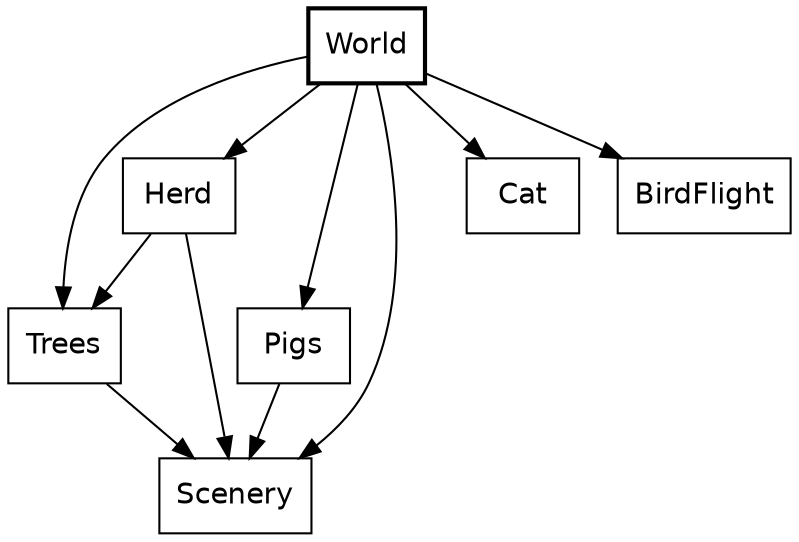

A piece of the world can be just a value. Here's the second whole module, and it's charming in a way code rarely is. `Pond` is a void module, a type with no values whose block holds definitions, and it has two record aliases and six ducks.

```roc
## The duck pond past the corner at a segment's end: its water, its bank, and
## the ducks on it. A point on the pond is measured from that corner, along
## the road and across it, in metres.
import Across
import Along
import Billboards
import Distance

Pond :: [].{
	PondPt : { along : Along, across : Across }
	Duck : { at : Pond.PondPt, facing : Billboards.Facing }

	water_outline : List(Pond.PondPt)
	water_outline = [
		{ along: Along.metres(3.0), across: Across.metres(-2.0) },
		{ along: Along.metres(3.0), across: Across.metres(-28.0) },
		{ along: Along.metres(14.0), across: Across.metres(-31.0) },
		{ along: Along.metres(28.0), across: Across.metres(-26.0) },
		{ along: Along.metres(32.0), across: Across.metres(-15.0) },
		{ along: Along.metres(29.0), across: Across.metres(-5.0) },
		{ along: Along.metres(16.0), across: Across.metres(-1.0) },
	]

	water_color : I64
	water_color = 3112588

	bank : List(Pond.PondPt)
	bank = [
		{ along: Along.metres(29.0), across: Across.metres(-5.0) },
		{ along: Along.metres(32.0), across: Across.metres(-15.0) },
		{ along: Along.metres(28.0), across: Across.metres(-26.0) },
		{ along: Along.metres(29.0), across: Across.metres(-26.0) },
		{ along: Along.metres(33.0), across: Across.metres(-15.0) },
		{ along: Along.metres(30.0), across: Across.metres(-5.0) },
	]

	bank_color : I64
	bank_color = 12759680

	duck_codepoint : I64
	duck_codepoint = 129414

	duck_height : Distance
	duck_height = Distance.metres(0.9)

	ducks : List(Pond.Duck)
	ducks = [
		{ at: { along: Along.metres(11.0), across: Across.metres(-8.0) }, facing: FacesRight },
		{ at: { along: Along.metres(17.0), across: Across.metres(-16.0) }, facing: FacesLeft },
		{ at: { along: Along.metres(21.0), across: Across.metres(-9.0) }, facing: FacesRight },
		{ at: { along: Along.metres(6.0), across: Across.metres(-4.0) }, facing: FacesRight },
		{ at: { along: Along.metres(7.0), across: Across.metres(-12.0) }, facing: FacesLeft },
		{ at: { along: Along.metres(8.0), across: Across.metres(-20.0) }, facing: FacesRight },
	]
}
```

There are no functions here at all. The ducks are read where the critters are sighted:

```roc
# ...
if Scenery.is_pond(segment.exit_creature) {
	Pond.ducks.map(
	# ...
```

`World` turns a route, a plain list of records, into segments of road. A plan for a segment shows how much tag unions can do with no declaration. `[WithBull, NoBull]` is written right in the field's type, and it says more than a boolean would at every place a segment is written down.

```roc
## One segment of the route as planned: its length and scenery, its turn
## into the next (right is positive), what lives along it, and
## the creature at its end.
SegmentPlan : {
	length : Distance,
	scheme : Scenery.Scheme,
	turn : Angle.Turn,
	crossing : [CatCrosses, BirdCrosses, QuietRoad],
	pigs : Pigs.PigPresence,
	bull : [WithBull, NoBull],
	ending : [Continues, Terminates],
	creature : Scenery.Creature,
}
```

A `match` on a closed union has to cover it: leaving out a tag is a compile-time error.

```roc
## The conifer that sets off a scheme's green.
accent : Scenery.Scheme -> Trees.Conifer
accent = |scheme|
	match scheme {
		YellowGreen => Gold
		RedGreen => Red
		AllGreen => Green
	}
```

Here's where it's called, picking the colour for a pair of small trees:

```roc
# ...
conifer =
	match size {
		Big => Green
		Small => Trees.accent(scheme)
		# ...
```

`SegmentIndex` is another small opaque type, a `U32` for a segment's place in the route. A place in the route can't be confused with a count of trees, because nothing outside can do arithmetic on it. `crash` appears here too. It isn't for error handling: an index that isn't in the world is a bug in Safari Ride, not a case to handle.

```roc
# ...
## The segment of `world` at this index.
segment_in : World.SegmentIndex, List(World.Segment) -> World.Segment
segment_in = |index, world|
	world.get(index.count_before())
		?? crash "World.SegmentIndex.segment_in: the world has no segment there"
		# ...
```

## The sky

The sky is the simplest thing that moves, because it depends on one number.

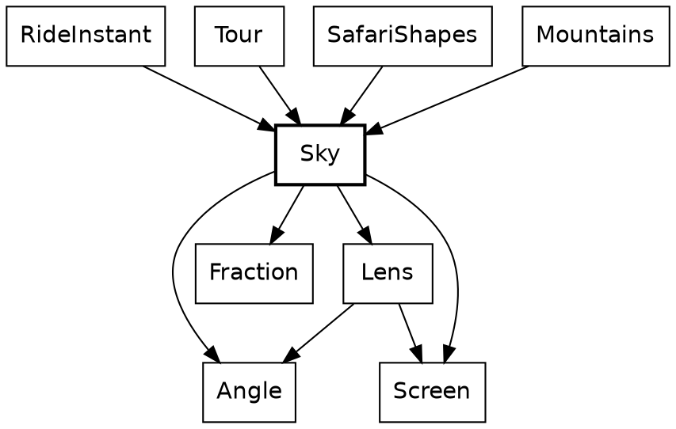

`Sky` sits near the bottom of the system. Leaving out small math helpers, it imports only the angle and fraction types and the lens and screen geometry, and it knows nothing of the rider, the road or the drawing. Those above it each ask for a colour or a sun at a given clock.

*[The sky widget goes here: drag the clock and watch the sun set.]*

### A function of the clock

Every function in this chapter has a `->` arrow, not `=>`. In Roc that's a promise the compiler holds: no effects, so the same clock always gives the same sky. If a function has no `=>` and no `$` in sight, there's nothing behind it to think about.

```roc
## How high the sun stands above the horizon at `clock`, in pixels at
## rest; below it once negative.
sun_height_px : Clock -> F64
sun_height_px = |clock| (sun_start_px - (sun_drop_px_per_step * clock.to_f64()))
```

The sun's height is a straight line. It starts at 244 pixels, reaches the horizon around step 3,980, and has fully set around step 4,730. `to_f64` is the clock's one door to a float, and this is the only place that uses it.

Dusk calls it. Dusk is a curve and then a line, which means two cases. `Sky` keeps the two halves below its block. Anything outside `Sky :: [].{ ... }` is private to the module, so a helper stays a helper without any keyword.

```roc
## How far toward dusk the sky is at `clock`, from 0 (day) to 1 (dusk).
dusk_at : Clock -> Fraction
dusk_at = |clock| {
	height = sun_height_px(clock)
	if (height >= sun_fully_set_px) dusk_while_up(height) else dusk_after_set(height)
}
```

```roc
## How far toward dusk the sky is while the sun, `height` pixels up, is
## still above the line where it has fully set.
dusk_while_up : F64 -> Fraction
dusk_while_up = |height| {
	whole_fall = (Sky.sun_start_px - Sky.sun_fully_set_px)
	set_so_far = Fraction.of(((Sky.sun_start_px - height) / whole_fall))
	Sky.dusk_at_set.times(set_so_far).times(set_so_far)
}
```

```roc
## How far toward dusk the sky is once the sun has fully set, darkening on
## to full dusk as it sinks a further radius.
dusk_after_set : F64 -> Fraction
dusk_after_set = |height| {
	sunk_past_set = ((Sky.sun_fully_set_px - height) / Sky.sun_radius_px)
	Fraction.clamp(
		(Sky.dusk_at_set.to_f64() + (sunk_past_set * Sky.dusk_at_set.complement().to_f64())),
	)
}
```

And here's the walk up the stack: each frame, `RideInstant` hands the answer to the mountains, whose rock and snow go dark with it.

```roc
# ...
Mountains.draw({
	heading: ViewYaw.heading_for(s),
	dusk: Sky.dusk_at(instant.clock),
	cam_focal: view.cam_focal,
}),
# ...
```

`Fraction` is a third small opaque type, a ratio from 0 to 1, and only its own block can build one, so a `Fraction` is always in range. It has two ways in. `Fraction.of` takes a ratio that can only be in range and crashes on anything else, because that would be a bug in the sum. `Fraction.clamp` takes a ratio that can rightly fall outside, as a sun sunk far below the horizon does, and holds it at the nearest end.

The horizon's warmth is a third shape, a tent centred on the instant the sun touches the horizon. Three curves come off one number, and they're plain functions rather than anything more general. Nothing else in the game needs them.

```roc
## How warm the horizon is at `clock`: most while the sun touches it, none
## once the sun is `warmth_falloff_px` above or below.
sunset_warmth : Clock -> Fraction
sunset_warmth = |clock| Fraction.clamp(
	(1.0 - (DeviceMath.real_abs(sun_height_px(clock)) / warmth_falloff_px)),
)
```

### Angles that can't be mixed up

The sun is the one thing here that also depends on where the rider is looking. Two tags say the two answers, so there's no `null` and no off-screen sentinel value. A caller has to handle `OutOfView`, because `match` must cover every tag.

```roc
## The sun in a frame: in view at its place, or out of view, too far to
## the side of where the rider faces.
SunPos : [InView(Sky.SunPlace), OutOfView]
```

Opaque types do the most work in this next function. `Angle.Bearing` is a direction in the world and `Angle.Turn` is a change of direction. Both are floats underneath, but only the `Angle` module can build or open one. The function also takes one record argument, destructured in its parameter list, so callers name every field.

```roc
## The sun in a frame, for a rider facing `heading`.
sun_pos : {
	heading : Angle.Bearing,
	clock : Clock,
	cam_focal : F64,
} -> Sky.SunPos
sun_pos = |
	{
		heading,
		clock,
		cam_focal,
	},
| {
	turn_from_view = sun_bearing.turn_from(heading)
	if turn_from_view.abs() >= visible_turn_limit {
		OutOfView
	} else {
		InView(
			sun_place({
				turn_from_view,
				clock,
				cam_focal,
			}),
		)
	}
}
```

Its caller is short enough to read whole:

```roc
sun : List(World.Segment), RideInstant -> Sky.SunPos
sun = |w, instant| (
	{
		cf = RideFocal.ride_focal(w, instant.rider)
		Sky.sun_pos({
			heading: ViewYaw.heading_for(instant.rider),
			clock: instant.clock,
			cam_focal: cf,
		})
	}
)
```

`turn_from_view.abs() >= visible_turn_limit` compares two `Turn`s. The code never touches radians until `sun_place` has to do trigonometry. Passing a `Turn` where a `Bearing` is wanted is a compile-time error:

```roc
app [main!] {
	game: "../../game.roc",
	lib: "../../../lib/main.roc",
}

import game.Angle

main! = |_args| {
	north = Angle.Bearing.radians(0.0)
	quarter = Angle.Turn.radians(1.5)
	echo!(north.turn_from(quarter).to_radians().to_str())
	Ok({})
}
```

```
── ✗ type mismatch ─────────────────────────────────── turn_as_bearing.roc:11:24

The first argument being passed to this function has the wrong type.

echo!(north.turn_from(quarter).to_radians().to_str())
                      ^^^^^^^

This argument has the type:

    Angle.Turn

But turn_from needs the first argument to be:

    Angle.Bearing

── 1 error and 0 warnings ────────────────────────────────── turn_as_bearing.roc
```

## The cat

The cat is the best scene in Safari Ride. It walks out, freezes in the lane as the rider bears down on it, and leaps clear at the last possible instant.

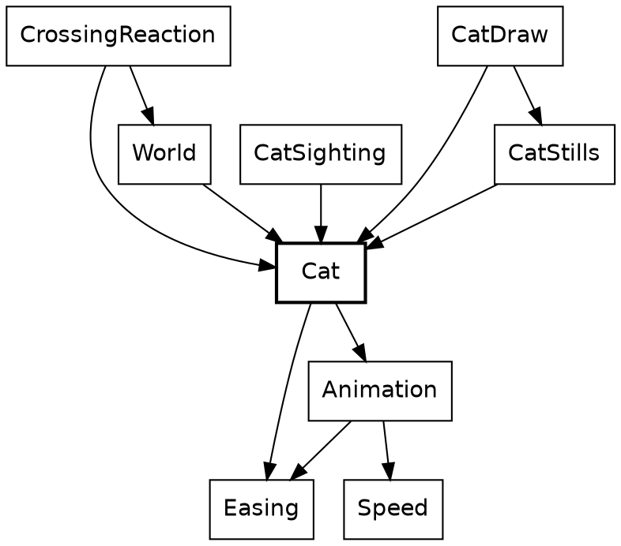

`Cat` says what a cat does, and `Animation` holds what a cat shares with a bird. Everything that uses a cat imports it, and `Cat` imports none of them: it doesn't know it's drawn, sighted or reacted to.

*[The cat widget goes here: drag the rider's gap and watch the crossing play.]*

The slider isn't scrubbing a video. Every position of it is a call to this function. The arrow is `->` again, so the type already says there's no hidden cat being updated somewhere. Method syntax chains the two halves of the job: `.instant(...)` is defined on the `Timeline` that `crossing_timeline` returns.

```roc
## The cat as the rider comes on it.
instant_at : Cat.Crossing, Animation.Approach -> Animation.Instant(Cat.Pose)
instant_at = |cat, approach| crossing_timeline(cat).instant(crossing_stage(approach))
```

A crossing and an approach go in, and the cat at that instant comes out. The same crossing at the same approach gives the same cat, a thousand frames apart. `crossing_stage` decides how far along things are, and `crossing_timeline` decides what that looks like. They know nothing of each other.

`CatSighting` calls it, adding the distance to the segment to get the gap:

```roc
# ...
gap = Frame.gap_to_segment(view.road, position)
instant = Cat.instant_at(crossing, { gap: gap.plus(crossing.along.from_start()), speed })
# ...
```

### When it plays

`Approach` is a plain record alias. Neither of its fields is a plain number, though. Like `Clock` and `Angle`, `Distance` and `Speed` are opaque types.

```roc
## How the rider comes on a thing: the gap from the rider ahead to it, and
## the rider's speed.
Approach : { gap : Distance, speed : Speed }
```

`Speed.(s)` in a parameter list is how its module opens one. Outside this module, nothing can, so a distance can't be passed as a speed. An animation's beats are an opaque type too, `Beats`: fractional, and tied to no clock, so a place in an animation can't be passed as a step of the ride.

```roc
## How far this speed covers in `length`, at a beat a step.
distance_in : Speed, Beats -> Distance
distance_in = |Speed.(s), length| Distance.metres(s * length.to_f64())
```

`Speed` also defines `is_lte`, which is what lets `speed <= standstill` work in the next snippet with an ordinary operator.

The rule lives in `Animation`. Its first argument is destructured in place, and so is the `Approach` after it, so the body reads in plain names. Here's where `distance_in` gets called, on the second line:

```roc
## An animation `length` long, played at a beat a step at the rider's
## speed, that ends with the rider `buffer` short, however fast the rider
## comes. It is playing from the moment the rider is that far away,
## and a rider standing still inside that stretch holds it at its start.
over_beats : { length : Beats, buffer : Distance }, Animation.Approach -> Animation.Stage
over_beats = |{ length, buffer }, { gap, speed }| {
	gap_left = gap.minus(buffer)
	stretch = speed.distance_in(length)
	if gap_left <= Distance.zero {
		Past(gap_left.opposite())
	} else if gap_left > stretch {
		Waiting
	} else if speed <= standstill {
		Playing(Fraction.zero)
	} else {
		Playing(Fraction.clamp(1.0 - gap_left.ratio_to(stretch)))
	}
}
```

And the cat calls the rule with its own numbers:

```roc
## Where the crossing has got to. A cat has to finish before the rider
## reaches it however fast the rider comes, so it plays over beats.
crossing_stage : Animation.Approach -> Animation.Stage
crossing_stage = |approach|
	Animation.over_beats({ length: crossing_beats, buffer: road_buffer }, approach)
```

The cat plays over beats rather than over a stretch of road because it has to finish before the rider reaches it, however fast the rider comes. A faster rider makes it start earlier. The bird uses `over_gap`, because a bird simply reacts to how close the rider is. Each critter picks the rule that suits it.

The answer is a tag union where two of the tags carry a payload. `Waiting` and `Past` aren't progress of 0 and 1, because a critter can rest somewhere no part of its animation reaches. If `Waiting` were just 0, a perched bird would show the first frame of its flight.

```roc
## Where an animation has got to: not begun, playing and this far through,
## or over, with the rider this far beyond its end.
Stage : [
	Waiting,
	Playing(Fraction),
	Past(Distance),
]
```

### What it looks like

A timeline is data, so the cat's whole performance reads in one place, like a score. Tags with payloads do almost everything here: `Through` and `Before` say where a stretch ends, and `Holds` and `Alternates` say how the cat looks.

```roc
# ...
looks: {
	stretches: [
		{
			until: Through(enters_road_beats),
			plays: Alternates({
				up: Stride,
				down: Rest,
				count: strides_in(enters_road_beats),
				over: enters_road_beats,
			}),
		},
		{ until: Through(escape_at), plays: Holds(Frozen) },
		{ until: Through(escape_at.plus(coil_ends_beats)), plays: Holds(Coil) },
		{ until: Through(escape_at.plus(flight_ends_beats)), plays: Holds(Flight) },
		{ until: Through(escape_at.plus(land_ends_beats)), plays: Holds(Land) },
	],
	finally: Holds(Collapse),
	# ...
```

There are two tracks because a cat's looks and its movement change at different instants. Its body moves just ahead of its path, so the `looks` track above cuts at 0.8, 2.8 and 3.8 beats into the escape, while the `path` track below cuts at 1 and 3. One list of phases tying them together wouldn't fit the cat or the bird.

```roc
# ...
path: {
	stretches: [
		{
			until: Through(enters_road_beats),
			plays: Line({
				from: start,
				to: middle,
				ease: Steady,
			}),
		},
		{
			until: Before(escape_at.plus(leaves_ground_beats)),
			plays: StaysAt(middle),
		},
		{
			until: Before(escape_at.plus(touches_down_beats)),
			plays: Arc({
				line: {
					from: middle,
					to: end,
					ease: ThreeQuarterPower,
				},
				rise: leap_height,
			}),
		},
	],
	finally: StaysAt(end),
	# ...
```

`Timeline` is nominal, the middle ground: unlike an alias it can carry methods, and unlike an opaque type anyone can build one, which is right for data that needs no guarding. `Timeline(pose)` takes a type parameter, which is how a cat and a bird share it. A cat's pose is a closed tag union, and nothing outside `Cat` needs to know its tags. Because it's closed, a `match` on it that misses a pose is a compile-time error.

```roc
## How the cat holds itself: walking, it is at rest or mid-stride; then
## frozen; then its leap, from the coil through flight and landing to the
## collapse after.
Pose : [Rest, Stride, Frozen, Coil, Flight, Land, Collapse]
```

A cut has to say which side of it its own beat falls on, and two tags say that better than a boolean would. `crossing_timeline`'s comment says why it matters: those leap beats sum to a float just under the beat they stand for.

```roc
## Where a stretch ends, in beats from the timeline's start: the cut's own
## beat belongs to the stretch that ends `Through` it, and to the next one
## after a stretch that ends `Before` it.
Cut : [Through(Beats), Before(Beats)]
```

Finding the stretch that's playing shows one more Roc idea. `var $from` is a local variable that a `for` loop reassigns, inside a pure function. Roc allows that because nothing outside can see it: `playing_at` still has a `->` arrow, and the `$` marks what changes. An early `return` ends the loop.

```roc
## What a track plays at `beat`, of a timeline `length` long.
playing_at : Animation.Track(kind), { beat : Beats, length : Beats } -> StretchPlaying(kind)
playing_at = |track, { beat, length }| {
	var $from = Beats.zero
	for stretch in track.stretches {
		to =
			match stretch.until {
				Through(cut) | Before(cut) => cut
			}
		if is_short_of(beat, stretch.until) {
			return {
				plays: stretch.plays,
				from: $from,
				to,
			}
		}
		$from = to
	}
	{
		plays: track.finally,
		from: $from,
		to: length,
	}
}
```

### What it does to the rider

So far the cat hasn't touched the rider. That's a separate question, answered in one place.

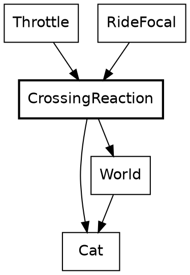

`Throttle` and `RideFocal` know nothing of cats. They ask `CrossingReaction`, which is the only part of the rider's code that does.

`..others` in the argument's type makes it an open record: this function needs `along` and `speed`, and accepts any record that has them, so it doesn't depend on `Pose.RiderState`. `speed` here is the opaque `Speed` again, and `match` on `segment.crossing` has to name every tag.

```roc
## The reaction to `segment`'s crossing of a rider on that segment.
reaction_to : World.Segment,
{
	along : Along,
	speed : Speed,
	..others,
} -> CrossingReaction.Reaction
reaction_to = |segment, rider|
	match segment.crossing {
		CatCrosses(crossing) => {
			approach = { gap: crossing.along.distance_from(rider.along), speed: rider.speed }
			{
				throttle: if (Cat.is_in_danger(approach)) NoAcceleration else MayAccelerate,
				eye_pull: Cat.focus(approach),
			}
		}
		BirdFlies(_) | QuietRoad => { throttle: MayAccelerate, eye_pull: Attention.none }
	}
```

A cat in the lane stops the rider opening the throttle, without braking, and widens the view as it pulls the rider's eye. Two tags, `MayAccelerate` and `NoAcceleration`, stand where a boolean might have gone. Its caller is one line, and that line's caller is the lens:

```roc
## How strongly the crossing on the rider's segment holds their attention.
crossing_attention : List(World.Segment), Pose.RiderState -> Attention
crossing_attention = |world, rider|
	CrossingReaction.reaction_to(rider.segment.segment_in(world), rider).eye_pull
```

```roc
## The camera's focal length for where the rider is and how they ride.
ride_focal : List(World.Segment), Pose.RiderState -> F64
ride_focal = |world, rider| {
	lean_frac = Fraction.clamp(
		(DeviceMath.real_abs(rider.tilt.to_radians()) / Bike.max_lean.to_radians()),
	)
	attention = crossing_attention(world, rider).max(Gaze.gaze_focus(rider.focus))
	Lens.cam_focal({ lean_frac, attention })
}
```

This is the only loop in the design. The rider's speed decides where the cat has got to, and the cat holds the rider's speed down. It settles, and it's also why `over_beats` has to stay the cat's rule. A bird asks nothing of the rider, so it falls through to the same answer as an empty road.

Each stretch of road has exactly one `crossing`: `CatCrosses`, `BirdFlies` or `QuietRoad`. A cat and a bird in the same place can't be written down.

### Getting it on screen

The last step is finding the cat in the rider's view.

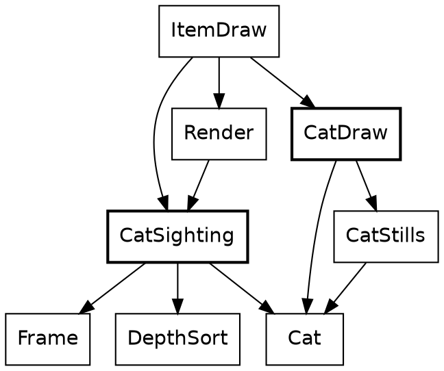

`CatSighting` and `CatDraw` never import each other. `ItemDraw` is what carries a sighting's answer to the drawing.

`CatSighting` places the cat and decides whether it's big enough to draw. An empty list or a list of one is how it says "maybe", because the caller flattens them with `join_map`.

```roc
## The cat crossing the segment at `position` in the chain, as far through its
## crossing as the rider's approach has brought it, if it is in view: one
## item, or none.
cat_in_view : Frame.Viewpoint,
{
	position : Frame.ChainPosition,
	crossing : Cat.Crossing,
	speed : Speed,
} -> List(CatSighting.CatItem)
cat_in_view = |
	view,
	{
		position,
		crossing,
		speed,
	},
| {
	gap = Frame.gap_to_segment(view.road, position)
	instant = Cat.instant_at(crossing, { gap: gap.plus(crossing.along.from_start()), speed })
	seen = Frame.rider_point_ahead(
		view.road,
		{
			position: position,
			along: crossing.along.plus(instant.spot.along.from_start()),
			across: Scenery.from_left_edge(instant.spot.across),
		},
	)
	height_px = (crossing.height.to_metres() / seen.forward) * view.cam_focal
	if seen.forward <= Geom.near_plane {
		[]
	} else if height_px < SceneLimits.min_scenery_px {
		[]
	} else {
		[
			{
				right: seen.right,
				forward: seen.forward,
				height: crossing.height,
				pose: instant.pose,
				lift: instant.spot.lift,
			},
		]
	}
}
```

Notice what isn't in this chapter: a cat in `RideInstant`, an update loop, or a flag saying the cat has already crossed. Roc doesn't force that, but pure functions make the stateless version the easy one to write, and every `->` shows it stayed that way.

## The beacons and the headlights

The cat walked out of its place in the order. Two clock-driven things were left behind when it did, and both are brief.

### A blink

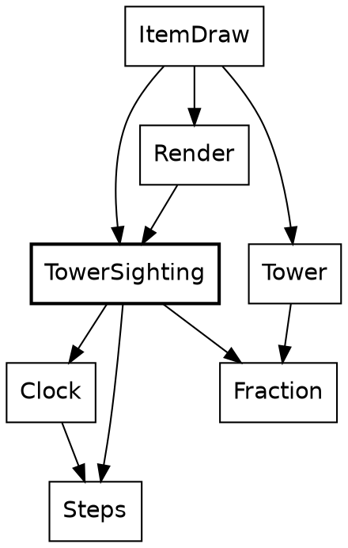

A beacon is the only thing in Safari Ride that repeats on the clock, so it's the first thing that needs to ask how far into a cycle it is. That question isn't about an instant of the ride. It's about a length of time, and Safari Ride keeps those two apart.

*[The beacon widget goes here: drag the clock and watch the masts blink out of step.]*

`Clock` says which step it is. `Steps` says how long something lasts. Both are opaque `U32`s, and `Clock.minus` turns two clocks into `Steps`, the same way two `Angle.Bearing`s make an `Angle.Turn`. Adding two clocks means nothing, so `Clock` has no `plus`, and no code can. Call this *places and distances*: one opaque type for where something is, a second for how far apart two of them are, and only the sums that make sense.

Here, `wrapped_to` is `Steps`'s one way to reach `%`. The result is a `Fraction` built with `of`, because `(1 - cos) / 2` can only be in range:

```roc
## How bright a beacon is `phase` steps into its blink.
beacon_brightness : Steps -> Fraction
beacon_brightness = |phase| {
	wrapped = phase.wrapped_to(beacon_period).to_f64()
	angle = (((2.0 * Trig.pi) * wrapped) / beacon_period.to_f64())
	Fraction.of(((1.0 - Trig.r_cos(angle)) / 2.0))
}
```

Each mast starts somewhere else in the cycle, so the masts along a road don't blink together. This function is one line of method calls, and every call in it is on a `Steps`:

```roc
## How far into its blink the mast with key `n` is when the ride's clock
## is 0.
beacon_offset_for : U32 -> Steps
beacon_offset_for = |n| beacon_stagger.times(n).wrapped_to(beacon_period)
```

The sighting calls both, adding the two `Steps`. `view.clock.minus(Clock.start)` is how a place becomes a distance, and it says which distance: the one from the start of the ride.

```roc
# ...
if center.forward <= Geom.near_plane {
	[]
} else {
	[
		{
			place,
			along,
			across,
			yaw,
			forward: center.forward,
			beacon_brightness: TowerSighting.beacon_brightness(
				view.clock.minus(Clock.start).plus(TowerSighting.beacon_offset_for(beacon_key)),
				# ...
```

Its caller gives each mast its key, the segment's index. Records with named fields stand in for what would otherwise be five arguments in a row, and `InChain(position)` is a tag carrying a payload, saying where the segment lies from the rider:

```roc
# ...
end_tower = tower_if_ahead(
	view,
	{
		place: InChain(position),
		along: Along.at(segment.length.plus(tower_beyond)),
		across: Scenery.from_left_edge(Across.right_of_middle(tower_right)),
		yaw: tower_yaw,
		beacon_key: index.to_u32(),
	},
)
end_tower.concat(mid_tower(view, position))
# ...
```

A mast halfway along a segment takes the key plus 60. That's a small piece of number theory hiding in a constant: 60 staggers of 37 steps come to 2,220, which is 18 periods of 120 and 60 left over, so the mid-mast blinks exactly opposite the end mast.

Notice where the clock stops. `TowerItem.beacon_brightness` is a `Fraction`, and neither `Tower` nor `ItemDraw` imports `Clock`. A sighting decides, and drawing paints. A beacon's blink is decided in the same place as whether the mast is in view at all.

There's no blink abstraction. `Animation.Alternates` also follows a wave, and the resemblance ends there: it picks a pose, and this picks a brightness. Nothing else in the game blinks.

The clock counts steps, not seconds, so pausing the ride freezes the beacons, and stepping back runs them backwards.

### One switch

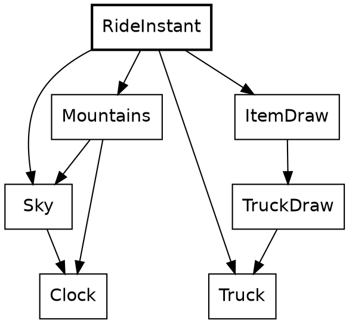

The truck's headlights come on once the sun has gone behind the mountains, at step 4,039 of a ride that lasts 7,040. `Mountains` knows the skyline and already imports `Sky`, so the question is asked there. The argument is an opaque `Clock`, and the answer is a plain `Bool`, which is about to be turned into something better:

```roc
## Whether the sun, at `clock`, has sunk behind the skyline.
is_sun_behind_mountains : Clock -> Bool
is_sun_behind_mountains = |clock| {
	sun_top_px = (Sky.sun_height_px(clock) + Sky.sun_radius_px)
	sun_top_px < horizon_crest_px(Sky.sun_bearing)
}
```

`Truck.Lights` is a record of two tag unions, written in place. `[On, Off]` needs no declaration, and two independent lamps aren't one state with four values, so they're two fields:

```roc
## Which of the truck's lights are on.
Lights : { headlights : [On, Off], brake_lights : [On, Off] }
```

`RideInstant` puts it together. It has to be up here. `Truck` is in the ride half of the system and `Mountains` is in the view, and no arrow goes from the first to the second. `RideInstant` imports both.

```roc
## Which of the truck's lights are on: its headlights once the sun is behind
## the mountains, and its brake lights as its last step left them.
truck_lights : RideInstant -> Truck.Lights
truck_lights = |instant| {
	headlights: if (Mountains.is_sun_behind_mountains(instant.clock)) On else Off,
	brake_lights: instant.truck.brake_lights,
}
```

Lamps are to the truck what a pose is to a cat. The sighting carries them, and the drawing does what they say, with each `match` covering both tags:

```roc
# ...
beams =
	match lights.headlights {
		On => TruckLights.headlight_beams(truck)
		Off => []
	}
brake_lights =
	match lights.brake_lights {
		On => TruckLights.brake_lights(truck)
		Off => []
	}
[
	beams,
	TruckBody.draw(truck),
	brake_lights,
].join()
# ...
```

That's the clock-driven things. Each is a function with a `Clock` in its arguments, and nothing about them outlives the frame.

## The bird

The bird is Roc's logo, sitting on a treetop. As the rider comes near it takes off, flies across the road and ahead, and drops onto a tree on the far side. It's a rider-driven thing like the cat, and it cost much less, which is the point of this chapter.

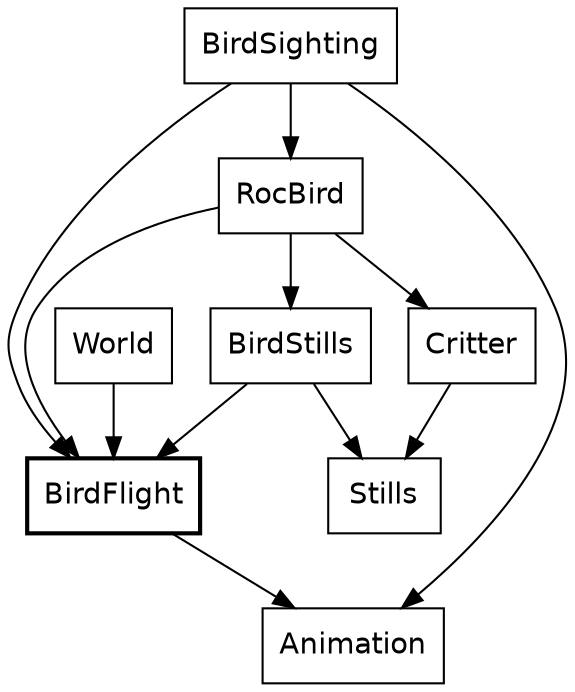

The family has the cat's shape. `BirdFlight` says what a bird does and imports nothing that draws it. `BirdSighting` finds it, `RocBird` draws it, and `BirdStills` holds its pictures. `Animation` is underneath, and most of what the bird does is ask `Animation` for something.

The only sum in `BirdFlight` is a tree's place plus the shortest hop. The rest is constants, tags and one timeline.

*[The bird widget goes here: drag the rider's gap and watch the bird fly.]*

### Two rules

A rule turns where the rider is into a `Stage`. The cat's rule was `over_beats`, and the bird's is `over_gap`. The first argument of each is destructured in place, and both answer the same tag union. `over_gap` has a shorter job, so here it is first. `Fraction.clamp` is the right door because a rider far off gives a ratio well outside 0 to 1, and `<=` works on a `Fraction` because `Fraction` defines `is_lte`:

```roc
## An animation that plays while the rider closes from a gap of `starts_at`
## to `ends_at`, however fast. It is playing only strictly between the two,
## so a critter is at rest at both ends.
over_gap : { starts_at : Distance, ends_at : Distance }, Distance -> Animation.Stage
over_gap = |{ starts_at, ends_at }, gap| {
	progress = Fraction.clamp(starts_at.minus(gap).ratio_to(starts_at.minus(ends_at)))
	if progress <= Fraction.zero {
		Waiting
	} else if progress >= Fraction.whole {
		Past(ends_at.minus(gap))
	} else {
		Playing(progress)
	}
}
```

The bird calls it with two constants, and passes no speed, since this rule doesn't take one:

```roc
## Where the bird's flight has got to, with the rider `gap` from the tree it
## left.
flight_stage : Distance -> Animation.Stage
flight_stage = |gap| Animation.over_gap({ starts_at: takeoff_gap, ends_at: landing_gap }, gap)
```

Beside it, again, is the cat's rule. Its second argument is the whole `Approach`:

```roc
## An animation `length` long, played at a beat a step at the rider's
## speed, that ends with the rider `buffer` short, however fast the rider
## comes. It is playing from the moment the rider is that far away,
## and a rider standing still inside that stretch holds it at its start.
over_beats : { length : Beats, buffer : Distance }, Animation.Approach -> Animation.Stage
over_beats = |{ length, buffer }, { gap, speed }| {
	gap_left = gap.minus(buffer)
	stretch = speed.distance_in(length)
	if gap_left <= Distance.zero {
		Past(gap_left.opposite())
	} else if gap_left > stretch {
		Waiting
	} else if speed <= standstill {
		Playing(Fraction.zero)
	} else {
		Playing(Fraction.clamp(1.0 - gap_left.ratio_to(stretch)))
	}
}
```

The two say different things about the same road:

| | `over_gap` | `over_beats` |
|---|---|---|
| It reads | The gap | The gap and the speed |
| It starts | 60 metres off, always | Earlier for a faster rider |
| It ends | 15 metres off, always | `buffer` metres short, always |
| It's for | Something that reacts to how close the rider is | Something that has to finish in time |
| A stopped rider | Leaves the bird hanging where the gap puts it | Holds the cat at the start of its crossing |

The extra case in `over_beats` is there because its ratio divides by a stretch that a stopped rider makes zero. `over_gap` divides only by constants, so it has no such case. That hanging bird is real: nothing in `over_gap` knows a bird can't hover. The rider never drops below 1.1 metres a step inside a bird's 45 metres on this route, so it doesn't come up.

Now the one-liners, side by side. A bird's and a cat's `instant_at` have the same shape:

```roc
## The bird with the rider `gap` from the tree it left.
instant_at : BirdFlight.Flight, Distance -> Animation.Instant(BirdFlight.Pose)
instant_at = |flight, gap| flight_timeline(flight).instant(flight_stage(gap))
```

```roc
## The cat as the rider comes on it.
instant_at : Cat.Crossing, Animation.Approach -> Animation.Instant(Cat.Pose)
instant_at = |cat, approach| crossing_timeline(cat).instant(crossing_stage(approach))
```

Each is a rule's `Stage` handed to a timeline's `instant`. Neither half knows which other half it's been paired with. Call this *rule and score*: one function says how far along things are, and one piece of data says what that looks like. It's composable in the plain sense, because a third critter can take either rule with a timeline of its own, and a new rule would work with both timelines already written.

### A score one beat long

`BirdFlight` sets the length of a flight to one beat, so that a cut on the timeline is simply a share of the flight:

```roc
## A flight's timeline is one beat long, so a cut on it is a share of the
## flight.
flight_beats : Beats
flight_beats = Beats.of(1.0)
```

The bird needs one small helper. It sits below the block, so it's private, and it builds an `Alternates` from two poses. `Animation.Looks(BirdFlight.Pose)` is `Looks(pose)` with the type parameter filled in, which is how the cat's timeline type came to fit a bird:

```roc
## A bird that shows `up` and `down` in turn, as its wings beat through the
## flight.
wings_beating : { up : BirdFlight.Pose, down : BirdFlight.Pose } -> Animation.Looks(BirdFlight.Pose)
wings_beating = |{ up, down }|
	Alternates({
		up,
		down,
		count: BirdFlight.wing_flaps,
		over: BirdFlight.flight_beats,
	})
```

Then the score. `Animation.Timeline.( ... )` wraps a record in the nominal type, and `Side(WingsUp)` is a tag whose payload is another tag. `flight_beats.portion(takeoff_share)` is a method on the opaque `Beats`, and `landing_share.complement()` is one on the opaque `Fraction`. It reads almost like configuration, and most of it is:

```roc
# ...
length: flight_beats,
before: sitting_on(from),
after: sitting_on(to),
looks: {
	stretches: [
		{
			until: Before(flight_beats.portion(takeoff_share)),
			plays: wings_beating({ up: Side(WingsUp), down: Side(WingsDown) }),
		},
		{
			until: Through(flight_beats.portion(landing_share.complement())),
			plays: wings_beating({ up: Away(WingsUp), down: Away(WingsDown) }),
		},
	],
	finally: Holds(Diving),
	# ...
```

Wings beat all the way through the first two stretches. `count` runs from the start of the timeline, so the wing beat carries on across the cut from side-on to from-behind without restarting.

The path track shows why a `Track` has `finally`. A flight is one unbroken curve, so it has no cuts at all:

```roc
# ...
path: {
	stretches: [],
	finally: Arc({
		line: {
			from: tree_top(from),
			to: tree_top(to),
			ease: Smooth,
		},
		rise: flight_arc.to_metres(),
		# ...
```

That `Arc` is a tag, and has nothing to do with the `Arc` module that comes later. `path_spot` is where it's played. `{ ..on_line, lift: ... }` is record update: the spot on the straight line, with one field replaced. The curve is `4t(1 - t)`, a parabola that's 0 at both ends and 1 at the middle, so `rise` means what its comment says. This is the polite end of the math chapter.

```roc
## The spot `fraction` of the way through a stretch of `path`.
path_spot : Animation.Path, Fraction -> Animation.Spot
path_spot = |path, fraction|
	match path {
		StaysAt(spot) => spot
		Line(line) => line_spot(line, fraction)
		Arc({ line, rise }) => {
			on_line = line_spot(line, fraction)
			through = fraction.to_f64()
			{ ..on_line, lift: on_line.lift + rise * 4.0 * through * (1.0 - through) }
		}
	}
```

The stills are data too. Nested tags get checked all the way down, so a `match` that forgets `Away(WingsDown)` is a compile-time error. The function reads as a table, and there's nothing else in it:

```roc
## The drawing for a pose.
pose_polys : BirdFlight.Pose -> List(Stills.StillPoly)
pose_polys = |pose|
	match pose {
		Perched => perched
		Side(WingsUp) => side_wings_up
		Side(WingsDown) => side_wings_down
		Away(WingsUp) => away_wings_up
		Away(WingsDown) => away_wings_down
		Diving => diving
	}
```

`RocBird.draw` hands that to `Critter.draw_still`, which is what a cow uses, and a bird's feet go through the same `Camera.project` as a tree's top. That's the drawing.

### Finding a tree

Where a bird flies is decided once, when the world is built. `route_from` shows the plain end of Roc's list functions. `keep_if` takes a closure, and `is_far_enough` is one, closing over `from`. `first()` answers a `Try`, which is one of the few that Safari Ride opens by hand. A route is a tag union with two tags: a bird with no tree to fly to `Sits`, which beats a flight of length zero.

```roc
## The route of a bird on the tree at `from`: to the first tree on the
## other side of the road far enough along, or none, and it sits.
route_from : List(Scenery.Tree), Scenery.Tree -> BirdFlight.Route
route_from = |trees, from| {
	is_far_enough = |tree| tree.along >= from.along.plus(shortest_hop)
	far_side = trees.keep_if(|tree| tree.across > Across.middle and is_far_enough(tree))
	match far_side.first() {
		Ok(to) => Flies({ from, to })
		Err(ListWasEmpty) => Sits(from)
	}
}
```

The caller's return type is written in place, a tag union that exists for this one function and fits straight into the `crossing` field of a segment:

```roc
## The bird of a segment with `trees`, if one has a tree to start on.
crossing_among : List(Scenery.Tree) -> [BirdFlies(BirdFlight.Route), QuietRoad]
crossing_among = |trees|
	match fifth_left_tree(trees) {
		Found(tree) => BirdFlies(route_from(trees, tree))
		NoTree => QuietRoad
	}
```

And that's called from a `match` in the middle of a record, which is a reminder that `match` is an expression. The plan's plain `BirdCrosses` tag comes in, and `BirdFlies(route)` goes out:

```roc
# ...
crossing: match plan.crossing {
	CatCrosses => CatCrosses(
		Cat.crossing({
			lane_half_width: Scenery.lane_half_width,
			tree_offset: Trees.tree_road_offset,
			tree_along: nearest_tree_ahead(trees, Cat.cat_along),
		}),
	)
	BirdCrosses => BirdFlight.crossing_among(trees)
	QuietRoad => QuietRoad
	# ...
```

Each frame, a sighting reads the route back. `|` in a pattern covers two tags with one branch. The crossing is matched in full, so a third kind of crossing would stop here until someone says what a bird sighting should do about it:

```roc
## The bird of the segment at `position` in the chain, if that segment has one
## and it is in view: one item, or none.
segment_bird : Frame.Viewpoint, Frame.ChainPosition -> List(RocBird.PlacedBird)
segment_bird = |view, position|
	match position.index_in(view.road.chain).segment_in(view.road.world).crossing {
		BirdFlies(route) => {
			gap_to_segment = Frame.gap_to_segment(view.road, position)
			gap_to_tree = gap_to_segment.plus(BirdFlight.start_along(route).from_start())
			instant = BirdFlight.route_instant_at(route, gap_to_tree)
			bird_in_view(view, { position, instant })
		}
		CatCrosses(_) | QuietRoad => []
	}
```

Nothing in this chapter is new machinery, and that's what it shows. Above their `expect`s, the four bird modules come to about 450 lines, a quarter of them coordinates for the stills, and `Animation` has nothing in it about birds.

## The stepped things

Everything so far can be asked about any instant, cold. Hand `Cat.instant_at` a gap and it answers. The rider and the truck can't do that. Where each of them is depends on where it was, so their state has to be kept, and it's the only state there is. This chapter is about the two fields of `RideInstant` that aren't a clock.

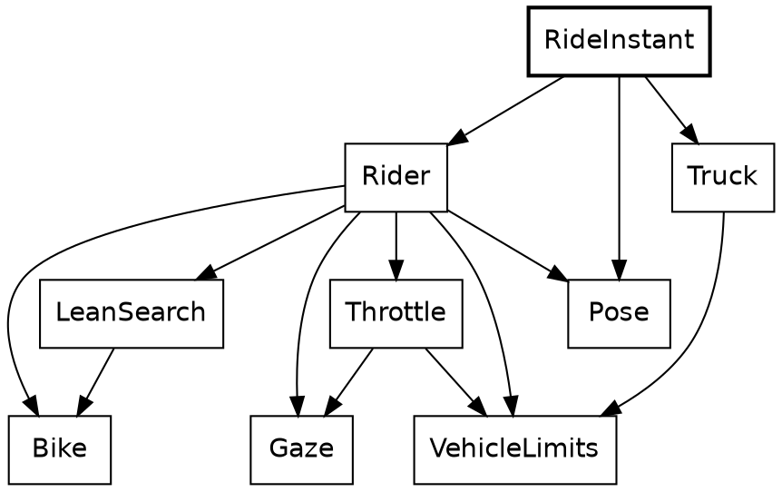

Here's the step again, this time whole. Its body is a block: names, then a record, which is the value of the block. The rider moves first, and the truck reads where the rider has just got to, so the order of those lines is a rule of the game, and `dist` is what carries it.

```roc
step : List(World.Segment), RideInstant -> RideInstant
step = |w, instant| (
	{
		nx = Rider.advance(instant.rider, w)
		dist = World.distance_along_route(w, { index: nx.segment, along: nx.along })
		{
			rider: nx,
			truck: Truck.advance(
				instant.truck,
				{
					rider_distance: dist,
					world: w,
					route_length: World.route_length(w),
				},
			),
			clock: instant.clock.next(),
		}
	}
)
```

`Clock.next`, `Rider.advance` and `Truck.advance` all have the same shape: a value goes in, and the next value comes out. Call that *the step function*. There's no mutable rider being nudged. There's a rider, and another rider one step on, and the old one is still a perfectly good value, which `Tour` keeps in a list.

Stepping has a price, and it's worth stating against the cat:

- A cat can be asked about any gap. A truck at step 4,000 has to be played there, or written down by hand.
- A wrong critter rule is wrong in the frames it touches. A wrong step moves the rider for the rest of the ride.
- `RideInstant.step` has an order, and frames don't.

*[The step widget goes here: pause the ride, step back and forward, and watch the three stored fields change.]*

### The rider

A plain record alias holds the rider, and `RideInstant` stores one. Count the opaque types: `SegmentIndex`, `Along`, `Across`, `Turn`, `Speed`, `Lean`, `Bearing` and `Fraction`. Nothing in it is a bare float. Four fields of this one record are angles, of three different types, and passing one type where another is wanted is a compile-time error.

```roc
## The rider at one step. `along` and `across` place the bike on its
## segment, and `yaw` is its turn from the segment's axis; `heading` is
## its bearing in the world. `tilt` is the bike's lean, `gaze_yaw` the
## rider's look away from the way the bike points, and `focus` how
## closely the rider is watching something.
RiderState : {
	segment : World.SegmentIndex,
	along : Along,
	across : Across,
	yaw : Angle.Turn,
	speed : Speed,
	tilt : Angle.Lean,
	heading : Angle.Bearing,
	gaze_yaw : Angle.Turn,
	focus : Fraction,
}
```

The step is four things in order, which is close to how it reads. Static dispatch finds `segment_in` on the `SegmentIndex`. The `match` on `seg.ending` has two tags, and `Continues(_)` ignores its payload:

```roc
advance : Pose.RiderState, List(World.Segment) -> Pose.RiderState
advance = |state, segs| (
	{
		seg = state.segment.segment_in(segs)
		dec = decide(state, seg)
		moved = Bike.simulate_rider_step(state, { lean_step: dec.tilt_step, accel: dec.accel })
		resolved =
			match seg.ending {
				Continues(_) => resolve_cross(moved, segs)
				Terminates => finish_clamp(moved, seg)
			}
		Gaze.next_rider_gaze(resolved, segs)
	}
)
```

A decision is a record of two opaque values. There's something to notice in the last line of this next function. `Throttle` is asked about a bike that doesn't exist yet: the rider as it would be with the new lean, which `Bike.with_tilt` makes by building a new record. The real rider isn't touched, because nothing can touch it.

```roc
## The lean toward the best line, and the throttle for the bike once
## it leans so.
decide : Pose.RiderState, World.Segment -> Rider.Decision
decide = |state, seg| {
	tilt_step = LeanSearch.best_tilt_correction(state).minus(state.tilt)
	{
		tilt_step,
		accel: Throttle.get_forward_accel_decel(
			Bike.with_tilt(state, state.tilt.plus(tilt_step)),
			seg,
		),
	}
}
```

That idea gets larger soon. A small version of it decides what happens at the end of a segment. `resolve_cross` works out the rider on the next segment and keeps that only if it lands inside the lane. The rejected rider simply stops being referred to, and nothing has to be undone:

```roc
resolve_cross : Pose.RiderState, List(World.Segment) -> Pose.RiderState
resolve_cross = |moved, segs| (
	{
		on_next = rider_state_for_next_segment(moved, segs)
		(
			if on_next.across.distance_from_middle() < Scenery.lane_half_width {
				on_next
			} else {
				moved
			}
		)
	}
)
```

Record update does most of the writing in this module. Its plainest use is stopping dead, where `..s` keeps everything but the two fields named:

```roc
stopped_at : Pose.RiderState, Along -> Pose.RiderState
stopped_at = |s, at| {
	..s,
	along: at,
	speed: Speed.at_rest,
}
```

### The bike

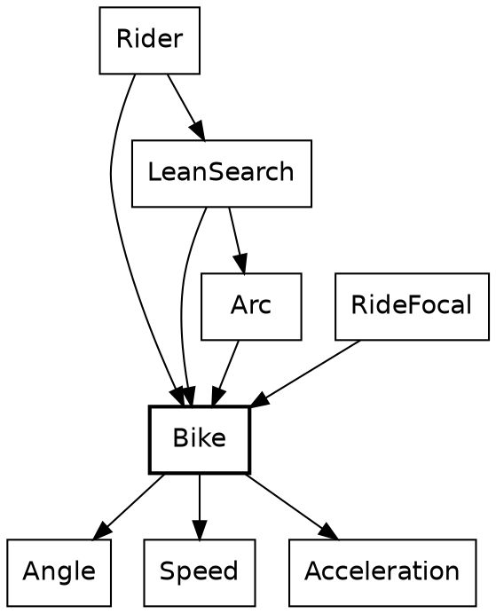

`Bike` is under 60 lines above its `expect`s, and it's the physics. Its type is the first one in the tour that names the rest of a record. `..others` makes `Motion` open: it's any record with these six fields and whatever else, with `others` standing for the whatever else.

```roc
## What a physics step reads and writes. It is open so that a caller's
## larger record passes through a step with its other fields kept.
Motion(others) : {
	along : Along,
	across : Across,
	yaw : Angle.Turn,
	speed : Speed,
	tilt : Angle.Lean,
	heading : Angle.Bearing,
	..others,
}
```

A structural type like this has to be named when it appears twice. Here it appears in the argument and in the result, and that's the promise: what goes in comes out with the same other fields. A `Pose.RiderState` goes in, with its `segment`, `gaze_yaw` and `focus`, and a `Pose.RiderState` comes out, though `Bike` has never heard of a gaze. Compare `CrossingReaction.reaction_to`, whose open record is only read, and which hands nothing back.

Call this *a narrow view of a wide record*. A module says exactly which fields it cares about, and the compiler takes care of the rest, with no base class and no copying fields across by hand. The smallest example in the program is a function with one job:

```roc
with_tilt : Bike.Motion(others), Angle.Lean -> Bike.Motion(others)
with_tilt = |s, tilt| { ..s, tilt }
```

`{ ..s, tilt }` is record update with a shorthand: the field and the local have the same name. `Rider.decide` called it above. Here's the step, which `Rider.advance` called:

```roc
## The bike one step on, after leaning by `lean_step` and speeding up by
## `accel`.
simulate_rider_step : Bike.Motion(others),
{
	lean_step : Angle.Lean,
	accel : Acceleration,
} -> Bike.Motion(others)
simulate_rider_step = |s, { lean_step, accel }| {
	tilt = s.tilt.plus(lean_step)
	speed = s.speed.accelerated_by(accel)
	step_length = speed.step_length()
	turn = tilt.steer(yaw_per_tilt)
	mid = s.yaw.plus(turn.times(0.5)).to_radians()
	{
		..s,
		along: s.along.plus(step_length.times(Trig.r_cos(mid))),
		across: s.across.plus(step_length.times(Trig.r_sin(mid))),
		yaw: s.yaw.plus(turn),
		speed,
		tilt,
		heading: s.heading.plus(turn),
	}
}
```

Reading down, the types do their share of explaining. A `Lean` can't be added to anything but a `Lean`, and it only reaches direction through `tilt.steer(yaw_per_tilt)`, which is the single door from roll to yaw. The bike then moves along the middle of the step's turn, which is what `s.yaw.plus(turn.times(0.5))` means. `speed.step_length()` is a `Distance`, and `Along.plus` takes one, so the move itself is places and distances. `to_radians()` appears at the last line that can do without it: `r_cos` wants a float.

### The throttle

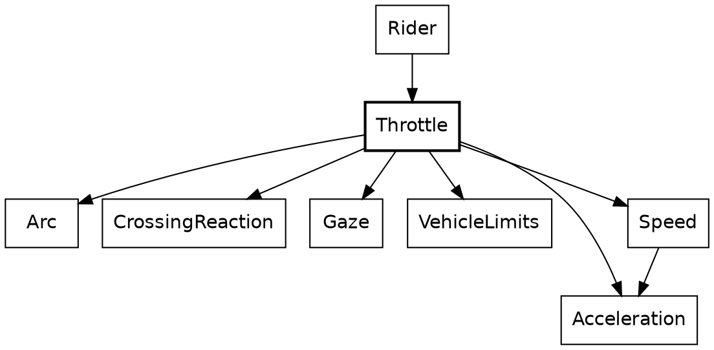

The rider has several reasons to slow down, and they don't know about each other. A turn is coming. A cat is in the lane. There's a pig to look at. The road is about to run out. `Throttle` writes them as a line of gates. An `Acceleration` goes in, a gate lets it through or lowers it, and the next gate gets what's left:

```roc
# ...
a2 = crossing_gate(state, { road_segment: seg, offered_accel: a1 })
a3 = pig_gate(state, { road_segment: seg, offered_accel: a2 })
a4 = shoulder_brake(state, a3)
# ...
```

Call this *the gate chain*. Each gate has the same shape and can be read alone, and adding a reason is one more line. It reads like a list of rules because that's what it is.

Each gate compares two opaque `Acceleration`s with an ordinary `<`, which works because `Acceleration` defines `is_lt`. `crossing_gate` shows two more things about patterns. A guard, `if a > Acceleration.steady`, adds a condition to a branch, and `|` joins two tags in one. When the guard fails, `NoAcceleration` falls through to the last branch. This is where `CrossingReaction`'s tag from the cat chapter lands: the cat stops the rider opening the throttle, and a rider already braking stays braking.

```roc
## The acceleration `a`, or none while the segment's crossing says the rider
## may not accelerate. It stops the rider speeding up, and never brakes.
crossing_gate : Pose.RiderState,
{
	road_segment : World.Segment,
	offered_accel : Acceleration,
} -> Acceleration
crossing_gate = |state, { road_segment: seg, offered_accel: a }|
	match CrossingReaction.reaction_to(seg, state).throttle {
		NoAcceleration if a > Acceleration.steady => Acceleration.steady
		NoAcceleration | MayAccelerate => a
	}
```

`Speed` and `Acceleration` are places and distances again: two speeds make an acceleration, and an acceleration moves a speed. The sum behind braking for a turn is the first line of a physics textbook, `v² = u² + 2as`, solved for `a`. This function is a good example of how far opaque types reach into a parameter list. `target: Speed.(t)` opens the field's `Speed` where it's destructured:

```roc
## The steady acceleration that brings this speed to `target` within this
## distance.
acceleration_to : Speed, { target : Speed, within : Distance } -> Acceleration
acceleration_to = |Speed.(s), { target: Speed.(t), within }|
	Acceleration.metres_a_step_each_step((t * t - s * s) / (2.0 * within.to_metres()))
```

The first gate calls it, for the distance left to the point where the rider commits to the turn. Three modules use that one line of physics: this one, `Gaze` to slow for a pig, and `Truck`.

```roc
# ...
corner_a = (
	if d <= VehicleLimits.least_braking_distance {
		Acceleration.steady
	} else {
		state.speed.acceleration_to({ target: v_end, within: d })
		# ...
```

After the gates, `clamp_v` holds the speed between rest and the limit, and the function's last move is a small piece of bookkeeping. The chain works in accelerations and the limits are speeds, so the answer is taken back with `.change_from(state.speed)`, the other half of the same pair of types.

The rest of `Throttle` is plainer than this section makes it sound. A good deal of it is still in the shape its emitter left, with brackets round whole bodies. [check: which of these `if (x) a else b` and `( ... )` forms survive the emitter cleanup, then trim the snippets or this sentence.]

### The truck

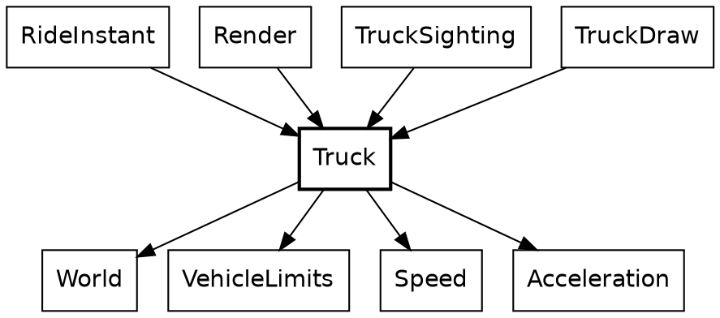

The truck is what the rider chases. It starts 500 metres ahead and keeps to a schedule that brings it to within 100 at the route's end. Its state is three fields:

```roc
## How far along the route the truck is, how fast it is going, and whether
## its brake lights are on.
TruckState : {
	route_position : Distance,
	speed : Speed,
	brake_lights : [On, Off],
}
```

The schedule is a straight line, and a pure function of the rider's progress, destructured from a record so the call site has to name both `Distance`s:

```roc
## Where the truck should be along the route, when the rider is
## `rider_distance` along it.
scheduled_position : { rider_distance : Distance, route_length : Distance } -> Distance
scheduled_position = |{ rider_distance, route_length }| {
	fraction_left = 1.0 - rider_distance.ratio_to(route_length)
	rider_distance.plus(finish_lead).plus(start_lead.minus(finish_lead).times(fraction_left))
}
```

Its one caller is the truck's step function, the same shape as the rider's. `NextTurn` is a tag union with a payload on one side, so the only way to read a `distance` is to be inside the branch where there is one:

```roc
# ...
schedule = scheduled_position({ rider_distance, route_length })
match next_turn(world, truck.route_position) {
	TurnAhead(turn) =>
		if turn.distance <= brake_distance {
			advance_braking(truck, turn)
		} else {
			advance_on_schedule(truck, schedule)
		}
	NoTurnAhead => advance_on_schedule(truck, schedule)
	# ...
```

And that's called from `RideInstant.step`, above, with the rider's distance as the only thing the truck knows of the rider. Nothing in `Rider` imports `Truck`, and nothing in `Truck` imports `Rider`. The chase is one record literal in `RideInstant`.

Finding the next turn shows a list pattern. `[]` is the end of the route, and `[segment, .. as later_segments]` takes the first segment and names the rest. Recursion walks the list, carrying where the current segment starts. Only `Truck` and `Paint` use a list pattern. Elsewhere the same walk is a `fold`.

```roc
# ...
match segments {
	[] => NoTurnAhead
	[segment, .. as later_segments] => {
		segment_end = segment_start.plus(segment.length)
		if route_position < segment_end {
			match segment.ending {
				Continues(_) =>
					TurnAhead({
						distance: segment_end.minus(route_position),
						turn_speed: VehicleLimits.turn_speed(segment.exit_turn.abs()),
					})
				Terminates => NoTurnAhead
			}
		} else {
			next_turn_on(later_segments, { route_position, segment_start: segment_end })
			# ...
```

It's called through a smaller function, which supplies the 0 so nobody else has to:

```roc
## The next turn of `world` past `route_position`.
next_turn : List(World.Segment), Distance -> Truck.NextTurn
next_turn = |world, route_position|
	next_turn_on(
		world,
		{
			route_position,
			segment_start: Distance.zero,
		},
	)
```

Then the two ways to take a step. Both sit below the block, private, and both are arithmetic on `Speed` by name. `target_speed.max(...)` keeps braking from undershooting, and `speed < truck.speed` is the whole of what turns on the brake lights. They're on while the truck is slowing down, and they go off when it's settled at the speed for the turn, even with the turn still ahead.

```roc
## The truck a frame on, slowing for `turn`, so that it reaches the turn at a
## cautious speed.
advance_braking : Truck.TruckState, Truck.ComingTurn -> Truck.TruckState
advance_braking = |truck, turn| {
	target_speed = turn.turn_speed.times(Truck.turn_caution)
	acceleration =
		if turn.distance > VehicleLimits.least_braking_distance {
			truck.speed.acceleration_to({ target: target_speed, within: turn.distance })
		} else {
			Acceleration.steady
		}
	speed = target_speed.max(truck.speed.accelerated_by(acceleration))
	{
		route_position: truck.route_position.plus(speed.step_length()),
		speed,
		brake_lights: if (speed < truck.speed) On else Off,
	}
}
```

```roc
## The truck a frame on with no turn close: it speeds up while it is short of
## `schedule`, and otherwise holds its speed.
advance_on_schedule : Truck.TruckState, Distance -> Truck.TruckState
advance_on_schedule = |truck, schedule| {
	speed =
		if truck.route_position < schedule {
			Truck.top_speed.min(truck.speed.accelerated_by(Truck.chase_acceleration))
		} else {
			truck.speed
		}
	{
		route_position: truck.route_position.plus(speed.step_length()),
		speed,
		brake_lights: Off,
	}
}
```

`brake_lights` is state because it's a fact about the last step. Headlights aren't, and they stay out of `TruckState`. That's the three kinds of moving thing in one vehicle: the place and speed are stepped, the headlights are clock-driven, and the tyres don't change.

The truck has no `Animation`, and it's worth saying why. A timeline has a known length and can answer for any point along it. The truck has neither. Its next step depends on its last, and its route depends on the rider. `TruckSighting`'s `lead` is the same quantity as an `Approach`'s `gap`, and it has a different name because it's being chased.

The rider's lean has been passed over twice now, with `LeanSearch` doing something the last few sections kept pointing at. That needs the math.

## The math layer

A lot of Safari Ride is math and physics, and this is the chapter that goes through the floor of the tour and looks at what's holding it up. Most of it is geometry a reader could do on paper. It's here because this kind of code suits a compiled functional language unusually well, for a short list of reasons that each get a section:

- A formula is an expression, and a function with no effects is the same thing with a name.
- Units can be types, for no runtime cost. [check: confirm a `::` wrapper around `F64` costs nothing at runtime, in the dev and wasm builds.]
- A coordinate system can be a record, so the fields say which one a point is in.
- Physics that's a pure function can be run for pretend, which is the best thing in this chapter.
- It's compiled, so running it for pretend hundreds of times per frame is affordable.

### The workhorses

Safari Ride has 79 modules, not counting `web.roc`, `main.roc` and `game.roc`. The import graph is lopsided in a good way. Counting who imports what, leaving out the gates, a handful stand out, and the lines here are the ones above each module's `expect`s:

| Module | Imported by | Lines | What it is |
|---|---|---|---|
| `Distance` | 37 | 63 | A length in metres |
| `Along` | 29 | 57 | A place along a segment |
| `Across` | 27 | 79 | A place across the road |
| `Angle` | 21 | 176 | Three opaque types for rotation |
| `Scenery` | 19 | 124 | The record types of what stands by the road, and the lane's width |
| `Fraction` | 17 | 92 | A ratio from 0 to 1 |
| `Geom` | 17 | 185 | Road points, rider points, and how to turn one into the other |
| `World` | 17 | 411 | The route |
| `Frame` | 16 | 188 | Where the road lies from where the rider is |

After those nine the count drops to 12, for `Screen`, 11 for `Speed` and 10 for `DepthSort`. Most modules are imported by one, two or three others. `lib`'s `Shapes`, `Trig` and `DeviceMath` are imported about as widely, and they're shared with the other canvas apps.

These are the workhorses, and there being so few says something about the program. Everything else is a small module that takes one of these and adds a single idea. Five of the nine are nothing but numbers with rules, and the top three are under 80 lines each. Composable is the right word for this, and it isn't a slogan: a cat, a mast and a truck are all found on the road through `Frame`, and all reach the screen through `Camera`.

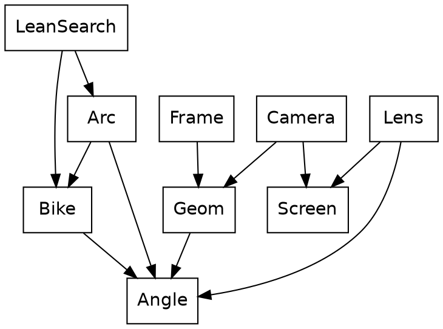

Two families share `Angle` and don't otherwise meet: `Geom`, `Frame`, `Camera` and `Lens` say how the world looks from the bike, and `Bike`, `Arc` and `LeanSearch` say where it's going.

### Numbers with units

Fifteen small opaque types run through Safari Ride, and the tour has met most of them one at a time. Set side by side, they're a system:

| Type | Under it | What it measures |
|---|---|---|
| `Clock` | `U32` | A place in the ride |
| `Steps` | `U32` | A length of time |
| `Beats` | `F64` | A place in an animation, or a length of one |
| `Angle.Bearing` | `F64` | A place on the compass |
| `Angle.Turn` | `F64` | The angle between two bearings |
| `Angle.Lean` | `F64` | Roll, which only reaches direction through a rate |
| `Distance` | `F64` | A length in metres |
| `Along` | `F64` | A place along a segment |
| `Across` | `F64` | A place across the road |
| `Speed` | `F64` | Metres a step |
| `Acceleration` | `F64` | Metres a step, each step |
| `Fraction` | `F64` | A ratio from 0 to 1 |
| `Attention` | `F64` | How strongly something holds the eye, from 0 up |
| `World.SegmentIndex` | `U32` | A place in the route |
| `Frame.ChainPosition` | `U32` | A place in the view ahead |

This is the opaque type doing the job of a unit. The block after each type is a small statement of dimensional analysis. `Speed.distance_in` takes `Beats` and gives a `Distance`. `Along.plus` takes a `Distance`, and two `Along`s give one back. `Lean.steer` takes a rate and gives a `Turn`. There's no `Bearing.plus(Bearing)`, because that sum has no meaning, and the omission is a feature with a compiler behind it.

The bug these prevent is the most common one in this kind of code: a correct formula with the wrong number in it. Most physics bugs type-check in a language where everything's a float.

The price is a long list of short methods, and a certain amount of `.to_radians()`. The headers of the float ones all say the same thing: "Each operation does the plain float arithmetic its name says." That sentence is there for a reason that belongs to the proving chapter.

The units stop at the road. A `RiderPoint`'s `right` and `forward` are plain `F64`s, and so is everything in pixels. That's where the formulas live, and a formula wants floats: `.to_metres()` is the door out, used at the top of a function that's about to do trigonometry. `Along` can't be passed as `Across`, which rules out the classic swap in a function with both.

### One record per space

A point in Safari Ride is in one of four spaces, and the record's fields say which. The points are plain records. They don't need to be opaque, since a record's type is its fields, and a `RoadPoint`'s fields are opaque already.

```roc
## A point on one segment of the road.
RoadPoint : { along : Along, across : Across }
```

```roc
## A point on the ground in the rider's view.
RiderPoint : { right : F64, forward : F64 }
```

```roc
## A point in the rider's view, at a height above the level of the rider.
SpacePoint : {
	right : F64,
	forward : F64,
	height : F64,
}
```

```roc
## A point on the screen, in pixels from its top left corner.
Point : { x : F64, y : F64 }
```

Passing a `RoadPoint` where a `RiderPoint` is wanted is a compile-time error, and the message names the fields. [check: a `fails/` program would prove this, and show the message.] Structural records give *one record per space* for nothing: `along` and `across` are on the road, `right` and `forward` are from the rider, and `x` and `y` are pixels. Reading any function, the field names say where it is.

Going from the road to the rider is a translation and a rotation, and this is the function where the opaque places give way to floats. `distance_from` makes the translation, and the rotation is written the way it would be on paper:

```roc
## A point on the current segment, as the camera at `pose` sees it.
to_rider_point : Geom.RoadPoint, Geom.Pose -> Geom.RiderPoint
to_rider_point = |{ along, across }, pose| {
	ahead = along.distance_from(pose.along).to_metres()
	aside = across.distance_from(pose.across.plus(pose.half_width)).to_metres()
	cos_yaw = Trig.r_cos(pose.yaw.to_radians())
	sin_yaw = Trig.r_sin(pose.yaw.to_radians())
	{
		forward: ahead * cos_yaw + aside * sin_yaw,
		right: (0.0 - ahead) * sin_yaw + aside * cos_yaw,
	}
}
```

From there to the screen is a pinhole camera, which is similar triangles. Dividing by `forward` is all of perspective. Nearly everything on screen passes through this function, and it's two lines:

```roc
## Where a point in front of the camera lands on the screen, through a
## lens of focal length `cam_focal` in pixels.
project : Geom.SpacePoint, F64 -> Screen.Point
project = |p, cam_focal| {
	x: (Screen.center_x + ((p.right / p.forward) * cam_focal)),
	y: (Screen.horizon_y - (((p.height - eye_h) / p.forward) * cam_focal)),
}
```

`RocBird.draw` calls it with a record built on the spot for the bird's feet:

```roc
# ...
feet = Camera.project(
	{
		right: bird.right,
		forward: bird.forward,
		height: bird.lift.to_metres(),
	},
	cam_focal,
	# ...
```

The focal length comes from a lens. `focal` is a value computed from other values, with no function in sight, and `field_of_view` is a `Turn`, so taking half of it needs no comment about radians. [check: whether a value like this inside a `.{ }` block is evaluated at compile time, as top-level values are.]

```roc
## The focal length at rest, in pixels.
focal : F64
focal = ((Screen.width / 2.0) / Trig.r_tan(field_of_view.times(0.5).to_radians()))
```

The view widens as the rider leans. One `Fraction` goes in, and a focal length comes out. `RideFocal.ride_focal` from the cat chapter calls this through `cam_focal`, taking the wider of what the lean and the rider's attention ask for:

```roc
## The focal length for a lean, from 0 (upright) to 1 (the deepest lean).
focal_for_lean : Fraction -> F64
focal_for_lean = |lean_frac| {
	lean = lean_frac.to_f64()
	(focal * (1.0 - (((1.0 - min_focal_factor) * lean) * lean)))
}
```

```roc
## The focal length the camera uses: the shorter of the two, which
## gives the wider view.
cam_focal : { lean_frac : Fraction, attention : Attention } -> F64
cam_focal = |{ lean_frac, attention }| {
	for_lean = focal_for_lean(lean_frac)
	for_gaze = focal_for_gaze(attention)
	if (for_lean < for_gaze) for_lean else for_gaze
}
```

### Round the bends

The road has no map. A point on it is measured within one segment, `along` and `across`, and nothing in the game holds a world coordinate for it. Each segment knows only its length and the turn at its end. `World.route` is nineteen records like this one, and it reads like configuration: a list of plain values, with the tags declared by `SegmentPlan` and an opaque `Distance` and `Turn` built from their units. It's checked like any other Roc, so a misspelled tag is a compile-time error.

```roc
# ...
length: Distance.metres(1200.0),
scheme: RedGreen,
turn: Angle.Turn.degrees(80.0),
crossing: QuietRoad,
pigs: NoPigs,
bull: WithBull,
ending: Continues,
creature: Rhino,
# ...
```

So to see something three segments ahead, a point has to be carried back round each bend between it and the rider, one at a time. That's one rotation per bend, and `fold_rev` is the shape of it. The accumulator is a `RoadPoint`, it starts on the far segment, and each step moves it onto the segment before. `before_in` gives the segments between, and the closure is the only thing the loop does. The last line does the one translation and rotation from above:

```roc
# ...
on_rider_segment = position.before_in(road.chain).fold_rev(
	{ along, across },
	|index, point| Geom.in_segment_before(point, bend_out_of(index.segment_in(road.world))),
)
Geom.to_rider_point(on_rider_segment, road.pose)
# ...
```

The rotation itself is plain, with two cases, because a right-hand bend pivots on the far side of the lane:

```roc
## A point on the segment after `bend`, measured on the segment before it.
in_segment_before : Geom.RoadPoint, Geom.Bend -> Geom.RoadPoint
in_segment_before = |point, bend| {
	along = point.along.to_metres()
	across = point.across.to_metres()
	length = bend.segment_length.to_metres()
	width = bend.lane_width.to_metres()
	turn_size = bend.turn.abs().to_radians()
	cos_turn = Trig.r_cos(turn_size)
	sin_turn = Trig.r_sin(turn_size)
	if bend.turn.is_right() {
		turned_along = along * cos_turn - across * sin_turn + width * sin_turn + length
		turned_across = across * cos_turn + along * sin_turn + width * (1.0 - cos_turn)
		{ along: Along.metres(turned_along), across: Across.metres(turned_across) }
	} else {
		{
			along: Along.metres(along * cos_turn + across * sin_turn + length),
			across: Across.metres(across * cos_turn - along * sin_turn),
		}
	}
}
```

This is what lets `CatSighting`, `BirdSighting`, `TowerSighting`, `TreeSighting` and the rest not care where a segment is. They name a position in the chain and a point on that segment, and they get back a `RiderPoint`. That's a workhorse doing its job, and it's why `Frame` has sixteen importers.

The ground also curves away. That's one line, the small-angle formula for the drop of a sphere, with a record destructured in the parameter list and `right` and `forward` squared where they stand. [check: `Geom.ground_radius` is 100,000 and `Tower.earth_radius` is 20,000; say why there are two, or fix it.]

```roc
## How far the ground has curved away below level at `point`.
ground_drop : Geom.RiderPoint -> F64
ground_drop = |{ right, forward }| (right * right + forward * forward) / (2.0 * ground_radius)
```

### Cutting a polygon

Anything that crosses the camera's plane has to be cut, or dividing by `forward` flips it across the screen. The textbook algorithm walks a polygon's edges, keeping corners in view and adding a new corner wherever an edge crosses the plane. In Roc, that's a pairing and a `fold`. `map2` zips each corner with the next one, which is the list rotated by one, and `fold` builds the new polygon. `List.with_capacity` is the one line about performance, and `clip_edge_onto` is passed by name:

```roc
## The polygon cut to what lies at or past the near plane.
clip_near : List(Geom.SpacePoint) -> List(Geom.SpacePoint)
clip_near = |polygon| {
	next_corners = polygon.drop_first(1).concat(polygon.take_first(1))
	edges = polygon.map2(next_corners, |from, to| { from, to })
	edges.fold(List.with_capacity(2 * polygon.len()), clip_edge_onto)
}
```

A fold's step is a plain function of the list so far and one edge:

```roc
## `clipped` with what one edge of a polygon adds to it: the edge's first
## corner if that is in view, then the point where the edge crosses the near
## plane if it does.
clip_edge_onto : List(Geom.SpacePoint),
{
	from : Geom.SpacePoint,
	to : Geom.SpacePoint,
} -> List(Geom.SpacePoint)
clip_edge_onto = |clipped, { from, to }| {
	is_from_in_view = from.forward >= Geom.near_plane
	is_to_in_view = to.forward >= Geom.near_plane
	with_corner = if (is_from_in_view) clipped.append(from) else clipped
	if is_from_in_view == is_to_in_view {
		with_corner
	} else {
		with_corner.append(near_plane_crossing({ from, to }))
	}
}
```

`Ground`, `GuardRail` and `TruckShape` call it the same way. `patch.corners.map(...)` makes the `SpacePoint`s, and what comes back is a shorter or longer list of the same type:

```roc
# ...
in_front = Geom.clip_near(patch.corners.map(Ground.ground_point))
if in_front.len() < 3 {
	[]
} else {
	Paint.push_poly(patch.color, Camera.project_all(in_front, cam_focal))
	# ...
```

### Rehearsal

The rider has no steering wheel. Nothing tells it where to go. Each step, it has to choose a lean, and it does that by working out what would happen.

*[The rehearsal widget goes here: pause, and draw the coasting arcs the search tried on this step.]*

`Arc` answers one question. If the rider stopped changing anything now, and coasted, what would happen? It takes the rider, and it runs the physics. The call is the same `Bike.simulate_rider_step` that moves the real rider, with no lean change and steady speed. That's the whole trick, and it's why `Bike` has to be a function and not a method that writes to a bike.

```roc
# ...
sim_step(
	course,
	{
		has_crossed: crossed,
		frame_count: i,
		coasting_rider: Bike.simulate_rider_step(
			phys,
			{ lean_step: Angle.upright, accel: Acceleration.steady },
			# ...
```

`Arc.ArcProgress(others)` carries a `Bike.Motion(others)`: a narrow view of a wide record again, so `Arc` can take the whole rider without knowing what's in it. `sim_from` and its partner `sim_step` call each other until the arc reaches the shoulder, makes 25 metres of progress, or runs for 2,000 steps. The answer is a record saying which of those happened:

```roc
ArcOutcome : {
	shoulder : Arc.Shoulder,
	forward : Distance,
	crossed : Bool,
	end_across : Across,
	frames : Steps,
}
```

`project_arc` sets it going, with the road's edges as bounds:

```roc
project_arc : Bike.Motion(others) -> Arc.ArcOutcome
project_arc = |state| (
	{
		inset_hw = Scenery.lane_half_width.minus(straighten_margin)
		right_bound = Across.right_of_middle(inset_hw).max(state.across)
		left_bound = Across.left_of_middle(inset_hw).min(state.across)
		sim_from(
			{
				left_bound,
				right_bound,
				start_side: Trig.r_sign(state.across.to_metres()),
				start_along: state.along,
			},
			{
				has_crossed: False,
				frame_count: Steps.zero,
				coasting_rider: state,
			},
		)
	}
)
```

`LeanSearch` asks `Arc` that question at a dozen different leans. The rider wants the arc to end somewhere near the middle of the lane, and more lean to the right moves the end of an arc to the right, so this is a bisection. It's a recursive function with its whole state in one record argument, `low` and `high` closing in on each other. `Bike.with_tilt(state, mid)` is a rider who doesn't exist, handed to `Arc`, who gets a future that didn't happen:

```roc
# ...
mid = low.halfway_to(high)
if at >= lean_search_iters {
	mid
} else if want_more_right(Arc.project_arc(Bike.with_tilt(state, mid)), target) {
	search_lean_from(
		state,
		{
			target,
			low: mid,
			# ...
```

The decision about which way to go is a `match` on what the rehearsal found. Running off the left means more right, running off the right means less, and staying on the road compares the end of the arc with the target:

```roc
want_more_right : Arc.ArcOutcome, Across -> Bool
want_more_right = |sim, target| (
	match sim.shoulder {
		ShoulderLeft => True
		ShoulderRight => False
		ShoulderNone => (sim.end_across < target)
	}
)
```

Its caller gives the search its bounds, at most a degree either side of the current lean. That's what stops the bike flicking from one lean to another:

```roc
## The lean for the next step: within the most one step can change it.
best_tilt_correction : Bike.Motion(others) -> Angle.Lean
best_tilt_correction = |state|
	search_lean_from(
		state,
		{
			target: lean_target(state.across),
			low: state.tilt.minus(max_tilt_correction),
			high: state.tilt.plus(max_tilt_correction),
			at: 0,
		},
	)
```

And `Rider.decide` calls that, on its first line. The walk up the stack ends there.

Call this *rehearsal*: run the real rules on a pretend copy, read the result, and throw it away. The numbers are worth stating. Twelve arcs for the lean and one more in `Throttle`, which uses `Arc` to ask whether the road is about to run out. Over the whole ride, an arc averages about 44 simulated steps. So each real step of the ride runs about 570 steps of bike physics that never happen, and the 7,040 steps of the ride come to about four million. With no drawing, on the dev backend, the whole ride takes about three seconds: under half a millisecond a step, against a budget of 33. [check: the 44 is `forward / speed` from one arc per step, measured at 9aa3814, not a counter inside `sim_from`; the three seconds is one native run, and the page runs wasm.]

In a language with mutable objects, this function has a problem to solve before it starts. It needs to copy the rider, or save it and restore it, and it needs to be sure the copy really is one, all the way down. It needs to know that the physics doesn't quietly update something global, like a scoreboard or a random number generator. Here, those worries have nowhere to live. `Bike.simulate_rider_step` has a `->`, so it can't reach anything but its arguments. The old rider is intact because every rider is. Being wrong about a future costs nothing, and `LeanSearch` is 105 lines.

The last gate of the throttle is the same idea with one rehearsal in it. It runs the arc, and brakes only if the arc leaves the road:

```roc
## The acceleration `a`, unless the arc ahead leaves the road; then the
## brake for the shoulder it reaches. One of the gates `get_forward_accel_decel`
## passes the acceleration through in turn.
shoulder_brake : Pose.RiderState, Acceleration -> Acceleration
shoulder_brake = |state, a| (
	{
		sim = Arc.project_arc(state)
		(
			if has_stayed_on_road(sim) {
				a
			} else {
				shoulder_brake_at(state, { arc_outcome: sim, offered_accel: a })
			}
		)
	}
)
```

A note on where this could improve: `ArcOutcome` has a `frames` field holding `Arc.no_frames`, a billion, for an arc that doesn't leave the road. That's a sentinel, in a program that's been pointing at tag unions as the alternative to sentinels for several chapters. [check: a tag on `shoulder` carrying the `Steps` would remove it; drop this paragraph if that lands.]

### Arithmetic all the way down

The floor of this layer is lower than it needs to be. `lib/DeviceMath.roc` computes `sin`, `cos`, `sqrt` and `atan` in Roc, with no call to a math library. `Num_` does the same for `exp`, which is a Taylor series after a range reduction. It's nothing but names and multiplications, and it's the kind of code that looks exactly as it does in a textbook:

```roc
exp_poly : F64 -> F64
exp_poly = |r| (
	{
		t1 = r
		t2 = ((t1 * r) / 2.0)
		t3 = ((t2 * r) / 3.0)
		t4 = ((t3 * r) / 4.0)
		t5 = ((t4 * r) / 5.0)
		t6 = ((t5 * r) / 6.0)
		t7 = ((t6 * r) / 7.0)
		t8 = ((t7 * r) / 8.0)
		t9 = ((t8 * r) / 9.0)
		t10 = ((t9 * r) / 10.0)
		t11 = ((t10 * r) / 11.0)
		t12 = ((t11 * r) / 12.0)
		1.0 + t1 + t2 + t3 + t4 + t5 + t6 + t7 + t8 + t9 + t10 + t11 + t12
	}
)
```

```roc
exp_real : F64 -> F64
exp_real = |x| (
	{
		k = F64.to_i64_wrap(round_real((x / ln2)))
		(exp_poly((x - (I64.to_f64(k) * ln2))) * pow2_int(k))
	}
)
```

`Throttle.shoulder_brake_at` is the caller, so a rehearsed arc's length decays into a braking force through this. [check: why these are hand-written rather than builtins. They came with the Codex port, and the reason is probably that the same bits come out on every target. Ask Steve before saying so.]

Top to bottom, then: a rider chooses a lean by simulating physics, and the physics is plain arithmetic on opaque numbers, from the frame down to the polynomial. There's no effect anywhere in that sentence, and that's the reason for the next chapter.

## Proving it

There are no animals in this chapter. It's about what happens to a program of this size when something has to change, which is the question a reader who cares whether Roc scales should ask.

The answer rests on one fact, which the tour has been repeating since the first table. Three fields decide a frame, and a frame is a value. So a frame can be compared, exactly, with the same frame from an hour ago.

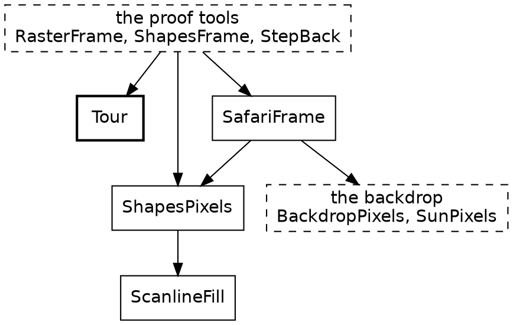

Everything here lives in `gates/`, and the game never runs any of it. The gate programs reach the game through `game.roc`, a package whose only job is to list the modules they read. [check: the builder's includes can't reach `gates/`, `lib/` or `web.roc`, which is why these chapters describe those and don't quote them. Decide whether the builder should.]

*[The proof widget goes here: ride to a step, ride there again, and see the same shapes both times.]*

### A fixture is a value

Getting a test to step 1,570 of a game normally takes some doing. Here it takes a loop. `Tour.initial` is a value, and `Tour.advance` is a step function, the one at the very top, wrapped around `RideInstant.next`. The `if` chain is the only management a history needs, and its comment says why half of the list goes at once:

```roc
advance : Tour -> Tour
advance = |tour| {
	finished = Rider.is_finished(tour.instant.rider, tour.world)
	# Dropping one instant per step would copy the whole list every step, so
	# half of it goes at once and the copy falls on one step in a thousand.
	# The list is therefore between half a cap and a cap deep, never empty,
	# and always the most recent instants.
	past_instants =
		if finished {
			[]
		} else if tour.past_instants.len() < past_instants_cap {
			tour.past_instants.append(tour.instant)
		} else {
			tour.past_instants.drop_first(past_instants_cap // 2).append(tour.instant)
		}
	{
		world: tour.world,
		instant: RideInstant.next(tour.world, tour.instant),
		past_instants,
	}
}
```

There's nothing to mock, because nothing was injected. No clock has to be faked, because the clock is a field. There's no browser to start, no window to open and no delay to wait out, and two runs can't disagree. A step of the ride takes nothing from outside it.

`RideInstant.next` is one `if`, and it's worth seeing because it puts the end of the ride in one place. A ride that's finished starts again, so `Tour` needs no notion of game over:

```roc
next : List(World.Segment), RideInstant -> RideInstant
next = |w, instant| (
	if Rider.is_finished(instant.rider, w) {
		initial
	} else {
		step(w, instant)
	}
)
```

### The frame hash

`RasterFrame` rides to a step, paints the frame into 576,000 exact pixels, and prints an FNV-1a hash of them. The painter is `SafariFrame`, in pure Roc, and its `ShapesPixels` is the twin of `shapes_canvas.js`. The gate holds each hash to a line of `gates/proof.expected`, exactly. No tolerance. One different pixel in one frame fails it.

A frame is only evidence for what's in it, so the steps aren't arbitrary:

| Step | What the frame shows |
|---|---|
| 0 | The start of the ride |
| 100 | A bird in flight |
| 1,570 | A cat frozen in the lane |
| 1,586 | The same cat in mid-leap |
| 3,000 | The ride under way |
| 3,742 | A distant truck, its glow too small to draw |
| 5,700 | The truck at dusk, lights on |
| 6,520 | The truck braking in plain view |
| 9,000 | Past the end, on the second lap |

The ride lasts 7,040 steps, so the clock at step 9,000 reads 1,959. [check: what 3,000 and 9,000 are there for; the gate's header doesn't say.]

The list grows by a rule: if a thing can be wrong without any listed frame changing, the gate is blind to it. A brake light wired to `Off` would pass every hash until 6,520 was added. A green hash means nothing for what no frame shows.

Exact hashes have a consequence that reaches into the code. Float addition isn't associative, so a sum's order is part of its meaning here. `World.route_length` says so in its doc comment, and it's one of the few places in Safari Ride where the direction of a fold is a decision:

```roc
## The segments' length, end to end. It is summed from the last segment to
## the first: a float sum's rounding depends on its order, and another
## order can move a pixel.
route_length : List(World.Segment) -> Distance
route_length = |world| world.fold_rev(Distance.zero, |segment, sum| segment.length.plus(sum))
```

That's also what the sentence in the headers of `Speed`, `Beats`, `Fraction`, `Angle` and the rest is for. "Each operation does the plain float arithmetic its name says, so code moved onto this type computes exactly what it did before." An opaque type adds names and takes nothing away. A retyping that adds `Speed` to a module changes the types throughout, and if it leaves the arithmetic alone, every hash stays where it is. If a hash moves, the retyping changed the program, and the gate says so.

This is how the code in this tour got its shape. About fifty modules were renamed, retyped and reorganized, many of them in parallel, and each merge had to leave the frames alone. Roc's types caught what they catch, the hashes caught the rest, and the picture didn't change. [check: the number, and whether "many" should say how many at once.] A language with no hidden state doesn't make a refactor safe by itself. It makes it possible to write a test strict enough to be trusted.

The limit, stated flatly: the hash proves `ShapesPixels`'s pixels, and the page's pixels come from the browser's canvas, with anti-aliasing. What the two share is the list of shapes. `web/page_check.mjs` runs each built page against a stand-in canvas, and past that the JS has only its own checks.

### Two more proofs

`ShapesFrame` paints each frame twice: once with its polygons whole, as the browser gets them, and once cut into triangles, as the native runner gets them. It counts the pixels that differ, and the gate requires zero of 576,000, at every step in the table.

`StepBack` checks that one step back goes back exactly one step, at depths either side of the history's cap. It's in the gate because the answer was once no, and its header says how: the list stopped recording when full, so a step back from frame 3,000 landed on 2,047. Holding the first 2,048 instants was a perfectly consistent thing for a list to do. The test works by asking `Tour.back` and comparing clocks, and since `Tour.back` is this small, there isn't much else to ask:

```roc
back : Tour -> Tour
back = |tour| {
	match tour.past_instants.last() {
		Ok(prev) => {
			world: tour.world,
			instant: prev,
			past_instants: tour.past_instants.drop_last(1),
		}
		Err(_) => tour
	}
}
```

### `expect`

Below the frames, the proving is plain. An `expect` sits at the top level of a module, under the code it checks, and `roc test` runs it. There are over a thousand, and they're Safari Ride's only other tests. The tour has already shown fourteen of them, in the whole of `Clock`. A pure function needs nothing else: literal arguments, literal answer. Each `expect` asserts one thing, and they cover both sides. `Clock`'s check that a clock equals itself one step on is false, so it's written with `!`. `Num_.round_real` has a run of its boundaries, from `-0.5000000000000001` up through `0.49999999999999994`, on both sides of each. [check: those two numbers are quoted by hand, since an `expect` has no name for an include to find. It wants an include form of its own.]

A test's data can sit beside it as a plain definition. `Bike` doesn't import `Pose`, and `Motion` is open, so its fixture is a record that has the six fields and makes up the rest. `segment` and `focus` are bare numbers here, because `Bike` carries them through and never looks. A narrow view of a wide record pays off twice: the test needs nothing the module doesn't.

```roc
## A rider well along a segment, leaning a little to the right.
riding = {
	segment: 3,
	along: Along.metres(120.5),
	across: Across.metres(2.25),
	yaw: Angle.Turn.radians(0.375),
	speed: Speed.metres_a_step(0.8),
	tilt: Angle.Lean.radians(0.125),
	heading: Angle.Bearing.radians(4.5),
	gaze_yaw: Angle.Turn.radians(0.625),
	focus: 0.25,
}
```

It's called like any other value, and the steps that follow are named, so three `expect`s can read them:

```roc
first_step = Bike.simulate_rider_step(
	riding,
	{
		lean_step: Angle.Lean.radians(0.05),
		accel: Acceleration.metres_a_step_each_step(0.01),
	},
)
```

The gate makes `expect` honest in one further way. The source is the count: every line that starts `expect`, in a module any root reaches, has to print `PASS` exactly once. An `expect` that nothing compiles fails, and so does one that's indented out of reach. One more consequence: an `expect` can only name what its module imports, so a check sits where its test data can be seen, and a module doesn't take on an import for a test's sake. `Arc`'s projections are checked in `Throttle`, which can see a `Speed`, and `LeanSearch`'s search in `Rider`, which can see a `Pose`.

Even a truck can be checked this way, though it can't be asked about step 4,000 cold. A `TruckState` is a record, so a test writes one down and calls `Truck.advance` once.

### Crashes that help

Every `Fraction.of` in the game is an assertion, and the gate runs a lot of them. A ratio outside 0 to 1 stops the program, with a sentence saying the sum behind it is wrong. `Try` is the right answer when a value can honestly be absent. This isn't that case. A wrong ratio is a bug, and the sooner it's a crash the better:

```roc
## A ratio that can only be in range, as a fraction.
of : F64 -> Fraction
of = |ratio|
	match from_ratio(ratio) {
		Ok(fraction) => fraction
		Err(OutOfRange) => crash "Fraction.of: this ratio is outside 0 to 1, so the sum behind it is wrong"
	}
```

Here's one of the many places it's used, with `smoothstep` trusting its own algebra. A proof run rides through it thousands of times, so if the algebra were wrong, the gate would be first to know.

```roc
## A fraction that starts and ends gently: `t` itself at 0, a half and 1,
## and slower than `t` near either end.
smoothstep : Fraction -> Fraction
smoothstep = |fraction| {
	t = fraction.to_f64()
	Fraction.of(t * t * (3.0 - 2.0 * t))
}
```

The same holds for the code's other `crash`es, including two dozen `?? crash`es on lookups that can't miss. Each one states a belief about the program, and every gate run tests it.

### The page itself

This tutorial is built from the code. Every fenced snippet here came through Roc's own parser, by name, and the failing program in the sky chapter is run through the compiler, which is quoted. The gate builds the page. So renaming a function quoted here fails the gate until the prose catches up, and the compiler message under `turn_as_bearing` is the compiler's.

Lints round it out: shale's Roc lints run first, with each count held exactly, and every count is at zero. A name that's vague or a boolean parameter that should be a tag fails before a single hash is computed.

## The platform

The rest of the program is what puts this on a screen, and Safari Ride has very little to say about that, on purpose. The tour touched this early on. Here it is with the code.

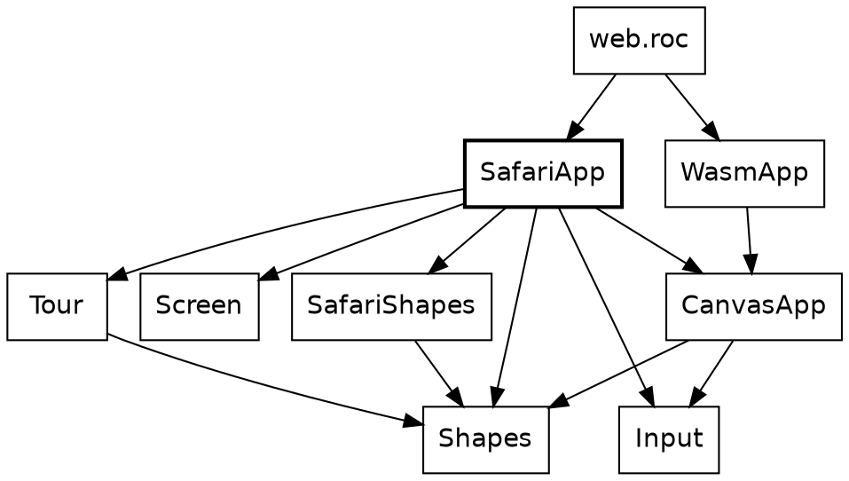

`WasmApp`, `CanvasApp`, `Input` and `Shapes` are in `lib/`, and they're the same for every canvas app.

### An app is a value

An app here is a record, handed to a runner. `CanvasApp(model)` has a type parameter for whatever the app keeps. Safari Ride's model is its `Tour` and a pause flag, and the app reads like configuration, because almost all of it is:

```roc
canvas_app : CanvasApp.CanvasApp(SafariApp.Model)
canvas_app = {
	size: { width: Screen.width, height: Screen.height },
	# **THIRTY, BY EYE.** The drive's motion is written per tick, and
	# thirty is the speed it is meant to look like.
	fps: 30,
	init: { tour: Tour.initial, paused: Bool.False },
	advance: CanvasApp.untimed_advance(step),
	frame: |m| frame(m.tour),
	sounds: |_m| 0,
	tones: [],
	title: "Safari",
}
```

`CanvasApp.untimed_advance(step)` takes a function and answers a function, the same one with a seconds argument to ignore. Safari Ride counts steps, and this is the place that says so: a runner offers the seconds, and they go nowhere.

`web.roc` is thirteen lines, most of them its header. Its body is `program = WasmApp.program(SafariApp.canvas_app)`, and that's the whole connection between the game and the web.

### Keys

Input comes as a value too. `Input.Snapshot` says which keys are down and which were just struck, so a test could write one down, and `key_pressed(KeyR)` takes a tag. Everything the keys do is a function from `Tour` to `Tour`, so moving four steps or one, forward or back, is one helper with a function in a record field. `var` and `while` are back, in a function that's still pure. `$tour` and `$i` can't be seen from outside.

```roc
## The tour after `step_once` has moved it `step_count` times.
repeat : Tour,
{
	step_count : I64,
	step_once : Tour -> Tour,
} -> Tour
repeat = |tour, { step_count: n, step_once: move }| {
	var $tour = tour
	var $i = 0
	while $i < n {
		$tour = move($tour)
		$i = $i + 1
	}
	$tour
}
```

`Tour.advance` and `Tour.back` are plain values to pass here:

```roc
# ...
if input.key_down(KeyRight) {
	repeat(
		m.tour,
		{
			step_count: if paused {
				1
			} else {
				4
			},
			step_once: Tour.advance,
			# ...
```

Stepping back through the ride is a keypress because `Tour.back` is a list lookup, and nothing else in the game knows it happens.

### A frame is a list

The answer to all of this is a `List(Shapes.Shape)`. A shape is a tag: `Poly`, `Disc`, `Rect` and a few more, each with its fill. Two of them aren't shapes. `Blend` and `View` are marks in the list that change how what comes after them is painted, because a frame is a list, and a mark is the cheapest way to say that.

The rider's lean is one of those marks. The whole picture banks into a turn, backdrop included, so `SafariApp.frame` builds a camera out of nested tags and puts it at the front. The rest is `Tour` answering questions, each a one-liner:

```roc
# ...
centre = { x: Screen.width / 2.0, y: Screen.height / 2.0 }
lean = View(
	World({
		target: centre,
		offset: centre,
		rotation: 0.0 - Tour.roll(tour).to_radians() * degrees,
		zoom: 1.0,
	}),
)
SafariShapes.frame(
	Tour.shapes(tour),
	{
		sky_top_color: Tour.sky_top(tour),
		sky_horizon_color: Tour.sky_horizon(tour),
		sun_position: Tour.sun(tour),
	},
).prepend(lean)
# ...
```

### Where the effects went

Early on, the tour said the game has no effectful functions. It's fair to ask where they went, and the answer is that they never got as far as Roc. The wasm platform asks for a record of functions over a boxed model:

`init`, `advance`, `frame`, `release`, `sounds`, `width`, `height` and `fps`, with the tones' `tone_count`, `tone_freq` and `tone_ms`. Every one has a thin arrow, `->`. The host in `web/platform/host.zig` keeps the box, and all that crosses is numbers and a list of shapes. Wasm's edge has no records, so the input is flattened into seven numbers, and `Input.of` rebuilds it. `roc glue` generates `roc_glue.js`, which knows the layout of a frame in wasm memory, from `Frame.roc`, so that file is never edited. [check: `web/platform/main.roc`'s and `WasmApp`'s comments say eight functions, and there are eleven.]

Each tick goes like this. `canvas_app_runner.js` paces the clock and gathers the keys. It calls `advance`, then `frame`, in Roc. It reads the shapes back through the generated glue, and `shapes_canvas.js` paints them on a canvas. The host keeps the list until the next frame, then hands it back so that Roc can drop it. That's `release`, a function whose body is `{}`: Roc knows the layout of what it's dropping, and the host shouldn't have to.

The JS is about 490 lines for every canvas app there is. It knows nothing of cats. The only `!` names near Safari Ride are the `main!` and `echo!` of the gate programs, which are ordinary command-line apps, and the proof tools need them to print a hash.

The same modules are compiled three ways, which is about the strongest statement of the line between the game and the platform that a program can make. The page builds them to wasm. The gates build them natively. And `main.roc` hands the same `SafariApp.canvas_app` to `native/CanvasAppRunner.roc` on roc-ray. That third one is the spike that proved the idea and it isn't kept current, as the README says, so the page is the maintained side. The first two run on every gate.

## Zooming back out

*[This chapter ties the tour together once the stepped things, the proof and the platform are written. It returns to the flipbook and the first diagram: the clock ticks, and everything composes from three stored fields.]*

## Appendix: the patterns

The tour named these in passing. They're patterns in the loose sense: shapes that kept turning up, and that Roc makes easy to write and hard to break.

| Name | What it is | Where to see it |
|---|---|---|
| Worked out, not stored | Keep the few things that must persist, and derive the rest each frame | `RideInstant`, `Cat`, `Sky` |
| A sighting decides, drawing paints | A pure function answers with plain data, and something else draws it | `CatSighting`, `TowerSighting` |
| Places and distances | One opaque type for where, a second for how far apart, and only the sums that make sense | `Clock` and `Steps`, `Bearing` and `Turn`, `Along` and `Distance`, `Speed` and `Acceleration` |
| Rule and score | One function says how far along, and one piece of data says what that looks like | `over_gap` and `flight_timeline` |
| The step function | A value goes in, and the next value comes out | `Rider.advance`, `Truck.advance`, `Tour.advance` |
| A narrow view of a wide record | An open record names the fields it uses and carries the rest through | `Bike.Motion(others)` |
| The gate chain | One value passes through independent rules, each of which can only lower it | `Throttle.get_forward_accel_decel` |
| One record per space | Field names say which coordinate system a point is in | `RoadPoint`, `RiderPoint`, `SpacePoint`, `Screen.Point` |
| Rehearsal | Run the real rules on a pretend copy, read the result, and throw it away | `Arc`, `LeanSearch`, `Rider.resolve_cross` |

Code that reads like configuration deserves a line of its own, because the tour kept stopping to admire it: `Pond`, `World.route`, the timelines, and `SafariApp.canvas_app`. None of them is a config format. They're ordinary Roc values, so the compiler checks them, and a tag that's misspelled is a compile-time error.

## Credits

Safari Ride was designed by Steve Howell. Claude wrote most of the code and this tutorial under his direction.
