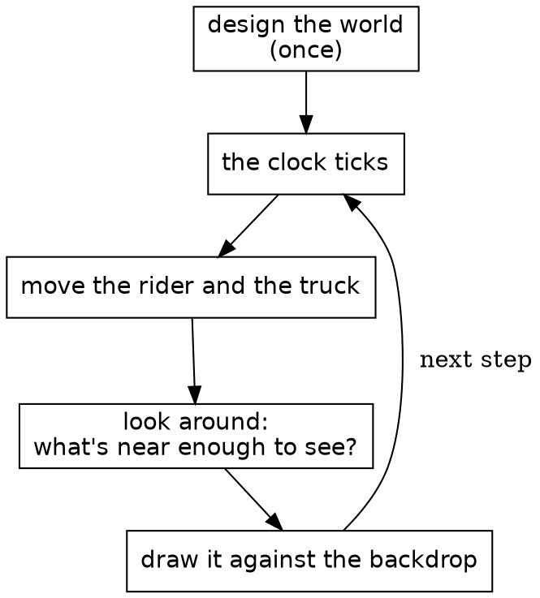
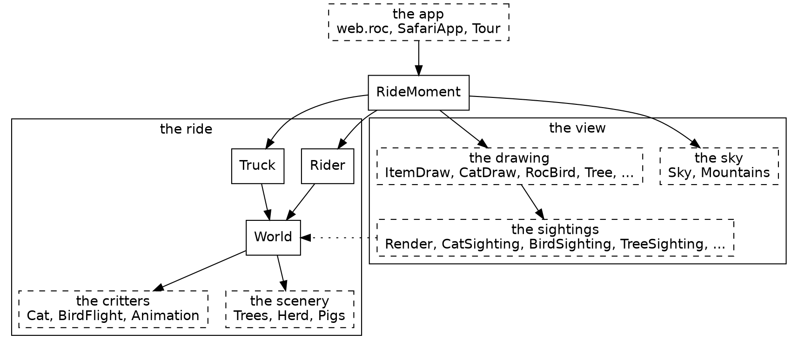
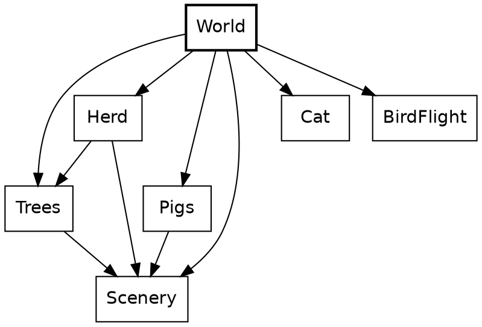
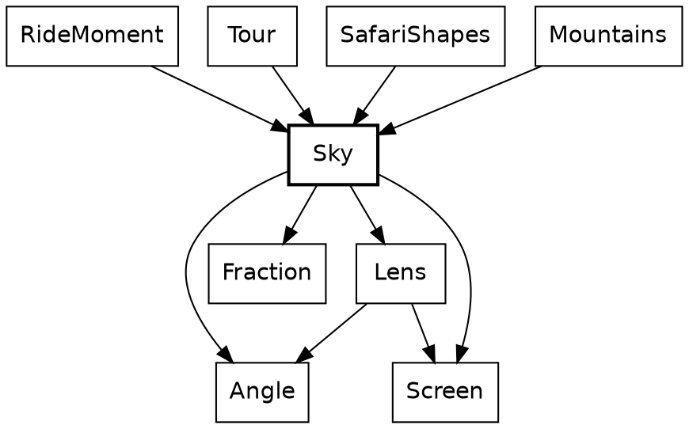
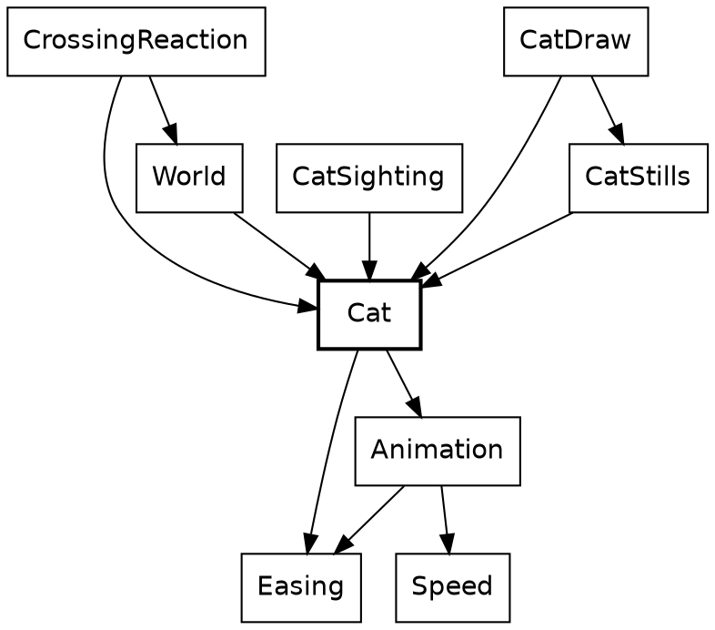
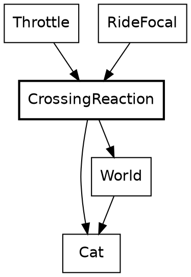
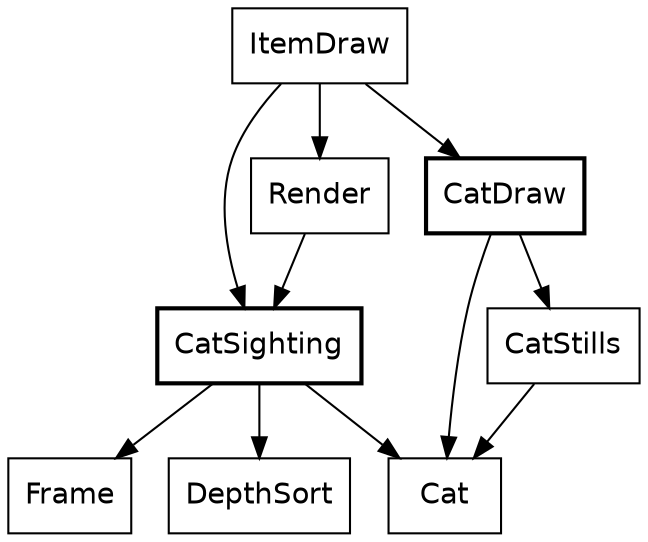

*Fourth draft for Steve's review, 2026-11-05: whole modules, call sites, and the zoom-in, zoom-out framing. The prose says instant; the code's `RideMoment` and `moment_at` become `RideInstant` and `instant_at` in a change already running. The bracketed notes are where the live ride, the widgets and the closing chapter go.*

# Safari Ride: a tour of a real Roc program

*[The live ride goes here, running as you read.]*

This is Safari Ride. A rider cycles down a long road through open country, past trees, cows and pigs, with a truck somewhere ahead. Radio masts blink in the distance. A bird takes off as the rider comes near. A cat walks into the lane, freezes, and leaps for the far verge. The sun goes down behind the mountains, and the truck turns on its headlights.

Safari Ride has the important parts of a game's world: terrain, physics, a camera, things that react to the player, and a day that ends. It doesn't have game mechanics yet. Nothing keeps score.

A safari is a guided tour, so this is a tour of a tour. It starts with the big picture, zooms in on a few parts of the program, and zooms back out at the end. Safari Ride is about seventy modules of Roc, which is enough to show how Roc holds up in a program with a lot going on. The tour assumes you can already read Roc. Each chapter points out a few Roc ideas as they come up, and the useful ones come up more than once.

## The problem

The problem is simple to state. Design a world once. Then, each time the clock ticks, move what moves, find everything near enough to see, and draw it against the backdrop.



It works like a flipbook, the little stack of drawings that seems to move when you riffle the pages with your thumb. Each page is drawn whole. Safari Ride draws a page about thirty times a second.

The middle box is the heart of it. On a real safari, a guide scans the land and calls out what's there: a cat by the third tree, a bird on the far side. Each of those is a sighting, true for that instant and gone the next. Safari Ride takes its sightings the same way, fresh on every page.

## One whole module

Before the map, here's a whole module, so you know what the boxes on it look like up close. This is the clock from the second box above, all thirty lines of it.

```roc
## The ride's clock: which step of the ride this is. It starts at zero and
## moves on by one with every step, so it is always whole.
import Steps

Clock :: U32.{

	## The clock as a ride starts.
	start : Clock
	start = Clock.(0)

	## The clock at step `number` of a ride.
	at_step : U32 -> Clock
	at_step = |number| Clock.(number)

	## The clock one step on.
	next : Clock -> Clock
	next = |Clock.(n)| Clock.(n + 1)

	## How many steps this clock is past `earlier`.
	minus : Clock, Clock -> Steps
	minus = |Clock.(n), Clock.(earlier)| Steps.of(n - earlier)

	to_f64 : Clock -> F64
	to_f64 = |Clock.(n)| n.to_f64()

	to_str : Clock -> Str
	to_str = |Clock.(n)| n.to_str()

	is_eq : _
}
```

Most of Safari Ride's small modules have this shape: a comment saying what the thing is, its imports, and one type named after the module. `Clock :: U32.{ ... }` is an opaque type: a `U32` underneath, with its methods in the block after it. `Clock.(n)` wraps a number, and in a parameter list it unwraps one, and only this module can do either. Nothing else can add 7 to a clock or pass a tree count as one. `is_eq : _` asks Roc to derive equality.

It's called like this, once a step:

```roc
# ...
clock: moment.clock.next(),
# ...
```

`moment.clock.next()` is static dispatch: `next` comes from the type of `moment.clock`, so the call needs no import.

## The modules

Here's the whole system, simplified. An arrow points from a module to one it imports, so a module is composed of what it points at. Dashed boxes each stand for a family of modules. Roc doesn't allow import cycles, so nothing here can point back up.



There are two halves. The ride is `Rider`, `Truck` and `World`, with `World` composing the route from its scenery and critters. It knows nothing of drawing. The view is everything that turns the ride into a picture: the sightings find what's in sight, and the drawing paints it. The dotted arrow is the view reading the ride, and no arrow goes the other way. `RideMoment` sits over both, holding one instant of the ride and stepping to the next, and the browser only sees `SafariApp`, which hands it a list of shapes each frame.

### What's a sighting?

Most things in the view come in pairs, and the names say which half is which: `CatSighting` and `CatDraw`, `TreeSighting` and `Tree`, `TowerSighting` and `Tower`, `TruckSighting` and `TruckDraw`.

A sighting answers one question each frame: which of these can the rider see right now, and how should each one look? `CatSighting` goes through the segments ahead, asks `Cat` where it is, works out where that lands in the rider's view, and drops any cat behind the camera or too small to matter. What it hands back is a plain record with no drawing in it:

```roc
## A cat to draw: where it stands in the rider's view, its height, its
## pose, and how high its leap has raised it.
CatItem : {
	right : F64,
	forward : F64,
	height : F64,
	pose : Cat.Pose,
	lift : F64,
}
```

`Render` gathers every sighting's items, a depth sort puts them in order, and `ItemDraw` hands each one to the module that paints it. Because a sighting's answer is plain data, it can be checked with numbers, without drawing anything. The rule is simple: a sighting decides, and drawing paints.

## All that's stored

A record is the plainest shape in Roc, and it's nearly all this needs. `RideMoment := { ... }.{ ... }` makes the module's own type out of one. That's a nominal type, which can carry a block of definitions, and unlike an opaque type it leaves its fields readable.

```roc
## One moment of the ride, and all that is kept from one step to the next: the
## rider and the truck, each moved once a step from where it was, and the
## clock, which counts the steps. Everything else that changes is worked out
## from these three.
RideMoment := {
	rider : Pose.RiderState,
	truck : Truck.TruckState,
	clock : Clock,
}.{
# ...
```

Those three fields are the whole of what Safari Ride keeps from one step to the next. The cat has no state, and neither does the bird, the sun or the beacons. Each frame works them all out again from the rider, the truck and the clock.

That gives three kinds of moving thing, and the tour is organized around them:

| Kind | Things | How it works |
|---|---|---|
| Stepped | The rider, the truck | Stored in `RideMoment`, and moved once a step from where it was |
| Rider-driven | The cat, the bird | Worked out from how the rider is approaching, with nothing stored |
| Clock-driven | The sun, the sky, the beacons, the headlights | Worked out from the clock, with nothing stored |

Trees and cows are a fourth kind, the easiest of all: they never change.

Purity makes some things free. `Tour`, the whole journey, is little more than a list of past instants, so stepping back only needs an older one. The cat follows along, since it was never anywhere but where the rider's position puts it, and the sun rises again.

The game itself has no effectful functions at all. It has no `!` names, no `=>` arrows, no `?` and no `where`. Effects live in the platform.

## What never changes

Trees, cows, the pond and the road are built once and only read after that.



A piece of the world can be just a value. Here's the second whole module, and it's charming in a way code rarely is. `Pond` is a void module, a type with no values whose block holds definitions, and it has two record aliases and six ducks.

```roc
## The duck pond past the corner at a segment's end: its water, its bank, and
## the ducks on it. A point on the pond is measured from that corner, along
## the road and across it, in metres.
import Billboards

Pond :: [].{
	PondPt : { along : F64, across : F64 }
	Duck : { at : Pond.PondPt, facing : Billboards.Facing }

	water_outline : List(Pond.PondPt)
	water_outline = [
		{ along: 3.0, across: (-2.0) },
		{ along: 3.0, across: (-28.0) },
		{ along: 14.0, across: (-31.0) },
		{ along: 28.0, across: (-26.0) },
		{ along: 32.0, across: (-15.0) },
		{ along: 29.0, across: (-5.0) },
		{ along: 16.0, across: (-1.0) },
	]

	water_color : I64
	water_color = 3112588

	bank : List(Pond.PondPt)
	bank = [
		{ along: 29.0, across: (-5.0) },
		{ along: 32.0, across: (-15.0) },
		{ along: 28.0, across: (-26.0) },
		{ along: 29.0, across: (-26.0) },
		{ along: 33.0, across: (-15.0) },
		{ along: 30.0, across: (-5.0) },
	]

	bank_color : I64
	bank_color = 12759680

	duck_codepoint : I64
	duck_codepoint = 129414

	duck_height : F64
	duck_height = 0.9

	ducks : List(Pond.Duck)
	ducks = [
		{ at: { along: 11.0, across: (-8.0) }, facing: FacesRight },
		{ at: { along: 17.0, across: (-16.0) }, facing: FacesLeft },
		{ at: { along: 21.0, across: (-9.0) }, facing: FacesRight },
		{ at: { along: 6.0, across: (-4.0) }, facing: FacesRight },
		{ at: { along: 7.0, across: (-12.0) }, facing: FacesLeft },
		{ at: { along: 8.0, across: (-20.0) }, facing: FacesRight },
	]
}
```

There are no functions here at all. The ducks are read where the critters are sighted:

```roc
# ...
if Scenery.is_pond(segment.exit_creature) {
	Pond.ducks.map(
	# ...
```

`World` turns a route, a plain list of records, into segments of road. A plan for a segment shows how much tag unions can do with no declaration. `[WithBull, NoBull]` is written right in the field's type, and it says more than a boolean would at every place a segment is written down.

```roc
## One segment of the route as planned: its length and scenery, its turn
## into the next (right is positive), what lives along it, and
## the creature at its end.
SegmentPlan : {
	length : F64,
	scheme : Scenery.Scheme,
	turn : Angle.Turn,
	crossing : [CatCrosses, BirdCrosses, QuietRoad],
	pigs : Pigs.PigPresence,
	bull : [WithBull, NoBull],
	ending : [Continues, Terminates],
	creature : Scenery.Creature,
}
```

A `match` on a closed union has to cover it: leaving out a tag is a compile-time error.

```roc
## The conifer that sets off a scheme's green.
accent : Scenery.Scheme -> Trees.Conifer
accent = |scheme|
	match scheme {
		YellowGreen => Gold
		RedGreen => Red
		AllGreen => Green
	}
```

Here's where it's called, picking the colour for a pair of small trees:

```roc
# ...
conifer =
	match size {
		Big => Green
		Small => Trees.accent(scheme)
		# ...
```

`SegmentIndex` is another small opaque type, a `U32` for a segment's place in the route. A place in the route can't be confused with a count of trees, because nothing outside can do arithmetic on it. `crash` appears here too. It isn't for error handling: an index that isn't in the world is a bug in Safari Ride, not a case to handle.

```roc
# ...
## The segment of `world` at this index.
segment_in : World.SegmentIndex, List(World.Segment) -> World.Segment
segment_in = |index, world|
	world.get(index.count_before())
		?? crash "World.SegmentIndex.segment_in: the world has no segment there"
		# ...
```

## The sky

The sky is the simplest thing that moves, because it depends on one number.



`Sky` sits near the bottom of the system. Leaving out small math helpers, it imports only the angle and fraction types and the lens and screen geometry, and it knows nothing of the rider, the road or the drawing. Those above it each ask for a colour or a sun at a given clock.

*[The sky widget goes here: drag the clock and watch the sun set.]*

### A function of the clock

Every function in this chapter has a `->` arrow, not `=>`. In Roc that's a promise the compiler holds: no effects, so the same clock always gives the same sky. If a function has no `=>` and no `$` in sight, there's nothing behind it to think about.

```roc
## How high the sun stands above the horizon at `clock`, in pixels at
## rest; below it once negative.
sun_height_px : Clock -> F64
sun_height_px = |clock| (sun_start_px - (sun_drop_px_per_step * clock.to_f64()))
```

The sun's height is a straight line. It starts at 244 pixels, reaches the horizon around step 3,980, and has fully set around step 4,730. `to_f64` is the clock's one door to a float, and this is the only place that uses it.

Dusk calls it. Dusk is a curve and then a line, which means two cases. `Sky` keeps the two halves below its block. Anything outside `Sky :: [].{ ... }` is private to the module, so a helper stays a helper without any keyword.

```roc
## How far toward dusk the sky is at `clock`, from 0 (day) to 1 (dusk).
dusk_at : Clock -> Fraction
dusk_at = |clock| {
	height = sun_height_px(clock)
	if (height >= sun_fully_set_px) dusk_while_up(height) else dusk_after_set(height)
}
```

```roc
## How far toward dusk the sky is while the sun, `height` pixels up, is
## still above the line where it has fully set.
dusk_while_up : F64 -> Fraction
dusk_while_up = |height| {
	whole_fall = (Sky.sun_start_px - Sky.sun_fully_set_px)
	set_so_far = Fraction.of(((Sky.sun_start_px - height) / whole_fall))
	Sky.dusk_at_set.times(set_so_far).times(set_so_far)
}
```

```roc
## How far toward dusk the sky is once the sun has fully set, darkening on
## to full dusk as it sinks a further radius.
dusk_after_set : F64 -> Fraction
dusk_after_set = |height| {
	sunk_past_set = ((Sky.sun_fully_set_px - height) / Sky.sun_radius_px)
	Fraction.clamp(
		(Sky.dusk_at_set.to_f64() + (sunk_past_set * Sky.dusk_at_set.complement().to_f64())),
	)
}
```

And here's the walk up the stack: each frame, `RideMoment` hands the answer to the mountains, whose rock and snow go dark with it.

```roc
# ...
Mountains.draw({
	heading: ViewYaw.heading_for(s),
	dusk: Sky.dusk_at(moment.clock),
	cam_focal: view.cam_focal,
}),
# ...
```

`Fraction` is a third small opaque type, a ratio from 0 to 1, and only its own block can build one, so a `Fraction` is always in range. It has two ways in. `Fraction.of` takes a ratio that can only be in range and crashes on anything else, because that would be a bug in the sum. `Fraction.clamp` takes a ratio that can rightly fall outside, as a sun sunk far below the horizon does, and holds it at the nearest end.

The horizon's warmth is a third shape, a tent centred on the instant the sun touches the horizon. Three curves come off one number, and they're plain functions rather than anything more general. Nothing else in the game needs them.

```roc
## How warm the horizon is at `clock`: most while the sun touches it, none
## once the sun is `warmth_falloff_px` above or below.
sunset_warmth : Clock -> Fraction
sunset_warmth = |clock| Fraction.clamp(
	(1.0 - (DeviceMath.real_abs(sun_height_px(clock)) / warmth_falloff_px)),
)
```

### Angles that can't be mixed up

The sun is the one thing here that also depends on where the rider is looking. Two tags say the two answers, so there's no `null` and no off-screen sentinel value. A caller has to handle `OutOfView`, because `match` must cover every tag.

```roc
## The sun in a frame: in view at its place, or out of view, too far to
## the side of where the rider faces.
SunPos : [InView(Sky.SunPlace), OutOfView]
```

Opaque types do the most work in this next function. `Angle.Bearing` is a direction in the world and `Angle.Turn` is a change of direction. Both are floats underneath, but only the `Angle` module can build or open one. The function also takes one record argument, destructured in its parameter list, so callers name every field.

```roc
## The sun in a frame, for a rider facing `heading`.
sun_pos : {
	heading : Angle.Bearing,
	clock : Clock,
	cam_focal : F64,
} -> Sky.SunPos
sun_pos = |
	{
		heading,
		clock,
		cam_focal,
	},
| {
	turn_from_view = sun_bearing.turn_from(heading)
	if turn_from_view.abs() >= visible_turn_limit {
		OutOfView
	} else {
		InView(
			sun_place({
				turn_from_view,
				clock,
				cam_focal,
			}),
		)
	}
}
```

Its caller is short enough to read whole:

```roc
sun : List(World.Segment), RideMoment -> Sky.SunPos
sun = |w, moment| (
	{
		cf = RideFocal.ride_focal(w, moment.rider)
		Sky.sun_pos({
			heading: ViewYaw.heading_for(moment.rider),
			clock: moment.clock,
			cam_focal: cf,
		})
	}
)
```

`turn_from_view.abs() >= visible_turn_limit` compares two `Turn`s. The code never touches radians until `sun_place` has to do trigonometry. Passing a `Turn` where a `Bearing` is wanted is a compile-time error:

```roc
app [main!] {
	game: "../../game.roc",
	lib: "../../../lib/main.roc",
}

import game.Angle

main! = |_args| {
	north = Angle.Bearing.radians(0.0)
	quarter = Angle.Turn.radians(1.5)
	echo!(north.turn_from(quarter).to_radians().to_str())
	Ok({})
}
```

```
── ✗ type mismatch ─────────────────────────────────── turn_as_bearing.roc:11:24

The first argument being passed to this function has the wrong type.

echo!(north.turn_from(quarter).to_radians().to_str())
                      ^^^^^^^

This argument has the type:

    Angle.Turn

But turn_from needs the first argument to be:

    Angle.Bearing

── 1 error and 0 warnings ────────────────────────────────── turn_as_bearing.roc
```

## The cat

The cat is the best scene in Safari Ride. It walks out, freezes in the lane as the rider bears down on it, and leaps clear at the last possible instant.



`Cat` says what a cat does, and `Animation` holds what a cat shares with a bird. Everything that uses a cat imports it, and `Cat` imports none of them: it doesn't know it's drawn, sighted or reacted to.

*[The cat widget goes here: drag the rider's gap and watch the crossing play.]*

The slider isn't scrubbing a video. Every position of it is a call to this function. The arrow is `->` again, so the type already says there's no hidden cat being updated somewhere. Method syntax chains the two halves of the job: `.moment(...)` is defined on the `Timeline` that `crossing_timeline` returns.

```roc
## The cat as the rider comes on it.
moment_at : Cat.Crossing, Animation.Approach -> Animation.Moment(Cat.Pose)
moment_at = |cat, approach| crossing_timeline(cat).moment(crossing_stage(approach))
```

A crossing and an approach go in, and the cat at that instant comes out. The same crossing at the same approach gives the same cat, a thousand frames apart. `crossing_stage` decides how far along things are, and `crossing_timeline` decides what that looks like. They know nothing of each other.

`CatSighting` calls it, adding the distance to the segment to get the gap:

```roc
# ...
gap = Frame.gap_to_segment(view.road, position)
moment = Cat.moment_at(crossing, { gap: (gap + crossing.along), speed })
# ...
```

### When it plays

`Approach` is a plain record alias. Its `speed` field isn't a plain number, though. Like `Clock` and `Angle`, `Speed` is an opaque type.

```roc
## How the rider comes on a thing: the gap from the rider ahead to it, in
## metres, and the rider's speed.
Approach : { gap : F64, speed : Speed }
```

`Speed.(s)` in a parameter list is how its module opens one. Outside this module, nothing can, so a distance can't be passed as a speed. An animation's beats are an opaque type too, `Beats`: fractional, and tied to no clock, so a place in an animation can't be passed as a step of the ride.

```roc
## How many metres this speed covers in `length`, at a beat a step.
distance_in : Speed, Beats -> F64
distance_in = |Speed.(s), length| s * length.to_f64()
```

`Speed` also defines `is_lte`, which is what lets `speed <= standstill` work in the next snippet with an ordinary operator.

The rule lives in `Animation`. Its first argument is destructured in place, and so is the `Approach` after it, so the body reads in plain names. Here's where `distance_in` gets called, on the second line:

```roc
## An animation `length` long, played at a beat a step at the rider's
## speed, that ends with the rider `buffer` metres short, however fast the
## rider comes. It is playing from the moment the rider is that far away,
## and a rider standing still inside that stretch holds it at its start.
over_beats : { length : Beats, buffer : F64 }, Animation.Approach -> Animation.Stage
over_beats = |{ length, buffer }, { gap, speed }| {
	gap_left = gap - buffer
	stretch = speed.distance_in(length)
	if gap_left <= 0.0 {
		Past(0.0 - gap_left)
	} else if gap_left > stretch {
		Waiting
	} else if speed <= standstill {
		Playing(Fraction.zero)
	} else {
		Playing(Fraction.clamp(1.0 - gap_left / stretch))
	}
}
```

And the cat calls the rule with its own numbers:

```roc
## Where the crossing has got to. A cat has to finish before the rider
## reaches it however fast the rider comes, so it plays over beats.
crossing_stage : Animation.Approach -> Animation.Stage
crossing_stage = |approach|
	Animation.over_beats({ length: crossing_beats, buffer: road_buffer }, approach)
```

The cat plays over beats rather than over a stretch of road because it has to finish before the rider reaches it, however fast the rider comes. A faster rider makes it start earlier. The bird uses `over_gap`, because a bird simply reacts to how close the rider is. Each critter picks the rule that suits it.

The answer is a tag union where two of the tags carry a payload. `Waiting` and `Past` aren't progress of 0 and 1, because a critter can rest somewhere no part of its animation reaches. If `Waiting` were just 0, a perched bird would show the first frame of its flight.

```roc
## Where an animation has got to: not begun, playing and this far through,
## or over, with the rider this many metres beyond its end.
Stage : [
	Waiting,
	Playing(Fraction),
	Past(F64),
]
```

### What it looks like

A timeline is data, so the cat's whole performance reads in one place, like a score. Tags with payloads do almost everything here: `Through` and `Before` say where a stretch ends, and `Holds` and `Alternates` say how the cat looks.

```roc
# ...
looks: {
	stretches: [
		{
			until: Through(enters_road_beats),
			plays: Alternates({
				up: Stride,
				down: Rest,
				count: strides_in(enters_road_beats),
				over: enters_road_beats,
			}),
		},
		{ until: Through(escape_at), plays: Holds(Frozen) },
		{ until: Through(escape_at.plus(coil_ends_beats)), plays: Holds(Coil) },
		{ until: Through(escape_at.plus(flight_ends_beats)), plays: Holds(Flight) },
		{ until: Through(escape_at.plus(land_ends_beats)), plays: Holds(Land) },
	],
	finally: Holds(Collapse),
	# ...
```

There are two tracks because a cat's looks and its movement change at different instants. Its body moves just ahead of its path, so the `looks` track above cuts at 0.8, 2.8 and 3.8 beats into the escape, while the `path` track below cuts at 1 and 3. One list of phases tying them together wouldn't fit the cat or the bird.

```roc
# ...
path: {
	stretches: [
		{
			until: Through(enters_road_beats),
			plays: Line({
				from: start,
				to: middle,
				ease: Steady,
			}),
		},
		{
			until: Before(escape_at.plus(leaves_ground_beats)),
			plays: StaysAt(middle),
		},
		{
			until: Before(escape_at.plus(touches_down_beats)),
			plays: Arc({
				line: {
					from: middle,
					to: end,
					ease: ThreeQuarterPower,
				},
				rise: leap_height,
			}),
		},
	],
	finally: StaysAt(end),
	# ...
```

`Timeline` is nominal, the middle ground: unlike an alias it can carry methods, and unlike an opaque type anyone can build one, which is right for data that needs no guarding. `Timeline(pose)` takes a type parameter, which is how a cat and a bird share it. A cat's pose is a closed tag union, and nothing outside `Cat` needs to know its tags. Because it's closed, a `match` on it that misses a pose is a compile-time error.

```roc
## How the cat holds itself: walking, it is at rest or mid-stride; then
## frozen; then its leap, from the coil through flight and landing to the
## collapse after.
Pose : [Rest, Stride, Frozen, Coil, Flight, Land, Collapse]
```

A cut has to say which side of it its own beat falls on, and two tags say that better than a boolean would. `crossing_timeline`'s comment says why it matters: those leap beats sum to a float just under the beat they stand for.

```roc
## Where a stretch ends, in beats from the timeline's start: the cut's own
## beat belongs to the stretch that ends `Through` it, and to the next one
## after a stretch that ends `Before` it.
Cut : [Through(Beats), Before(Beats)]
```

Finding the stretch that's playing shows one more Roc idea. `var $from` is a local variable that a `for` loop reassigns, inside a pure function. Roc allows that because nothing outside can see it: `playing_at` still has a `->` arrow, and the `$` marks what changes. An early `return` ends the loop.

```roc
## What a track plays at `beat`, of a timeline `length` long.
playing_at : Animation.Track(kind), { beat : Beats, length : Beats } -> StretchPlaying(kind)
playing_at = |track, { beat, length }| {
	var $from = Beats.zero
	for stretch in track.stretches {
		to =
			match stretch.until {
				Through(cut) | Before(cut) => cut
			}
		if is_short_of(beat, stretch.until) {
			return {
				plays: stretch.plays,
				from: $from,
				to,
			}
		}
		$from = to
	}
	{
		plays: track.finally,
		from: $from,
		to: length,
	}
}
```

### What it does to the rider

So far the cat hasn't touched the rider. That's a separate question, answered in one place.



`Throttle` and `RideFocal` know nothing of cats. They ask `CrossingReaction`, which is the only part of the rider's code that does.

`..others` in the argument's type makes it an open record: this function needs `along` and `speed`, and accepts any record that has them, so it doesn't depend on `Pose.RiderState`. `speed` here is the opaque `Speed` again, and `match` on `segment.crossing` has to name every tag.

```roc
## The reaction to `segment`'s crossing of a rider on that segment.
reaction_to : World.Segment,
{
	along : F64,
	speed : Speed,
	..others,
} -> CrossingReaction.Reaction
reaction_to = |segment, rider|
	match segment.crossing {
		CatCrosses(crossing) => {
			approach = { gap: crossing.along - rider.along, speed: rider.speed }
			{
				throttle: if (Cat.is_in_danger(approach)) NoAcceleration else MayAccelerate,
				eye_pull: Cat.focus(approach),
			}
		}
		BirdFlies(_) | QuietRoad => { throttle: MayAccelerate, eye_pull: Attention.none }
	}
```

A cat in the lane stops the rider opening the throttle, without braking, and widens the view as it pulls the rider's eye. Two tags, `MayAccelerate` and `NoAcceleration`, stand where a boolean might have gone. Its caller is one line, and that line's caller is the lens:

```roc
## How strongly the crossing on the rider's segment holds their attention.
crossing_attention : List(World.Segment), Pose.RiderState -> Attention
crossing_attention = |world, rider|
	CrossingReaction.reaction_to(rider.segment.segment_in(world), rider).eye_pull
```

```roc
## The camera's focal length for where the rider is and how they ride.
ride_focal : List(World.Segment), Pose.RiderState -> F64
ride_focal = |world, rider| {
	lean_frac = Fraction.clamp(
		(DeviceMath.real_abs(rider.tilt.to_radians()) / Bike.max_lean.to_radians()),
	)
	attention = crossing_attention(world, rider).max(Gaze.gaze_focus(rider.focus))
	Lens.cam_focal({ lean_frac, attention })
}
```

This is the only loop in the design. The rider's speed decides where the cat has got to, and the cat holds the rider's speed down. It settles, and it's also why `over_beats` has to stay the cat's rule. A bird asks nothing of the rider, so it falls through to the same answer as an empty road.

Each stretch of road has exactly one `crossing`: `CatCrosses`, `BirdFlies` or `QuietRoad`. A cat and a bird in the same place can't be written down.

### Getting it on screen

The last step is finding the cat in the rider's view.



`CatSighting` and `CatDraw` never import each other. `ItemDraw` is what carries a sighting's answer to the drawing.

`CatSighting` places the cat and decides whether it's big enough to draw. An empty list or a list of one is how it says "maybe", because the caller flattens them with `join_map`.

```roc
## The cat crossing the segment at `position` in the chain, as far through its
## crossing as the rider's approach has brought it, if it is in view: one
## item, or none.
cat_in_view : Frame.Viewpoint,
{
	position : Frame.ChainPosition,
	crossing : Cat.Crossing,
	speed : Speed,
} -> List(CatSighting.CatItem)
cat_in_view = |
	view,
	{
		position,
		crossing,
		speed,
	},
| {
	gap = Frame.gap_to_segment(view.road, position)
	moment = Cat.moment_at(crossing, { gap: (gap + crossing.along), speed })
	seen = Frame.rider_point_ahead(
		view.road,
		{
			position: position,
			along: (crossing.along + moment.spot.along),
			across: (moment.spot.across + (Scenery.lane_width / 2.0)),
		},
	)
	if seen.forward <= Geom.near_plane {
		[]
	} else if ((crossing.height / seen.forward) * view.cam_focal) < SceneLimits.min_scenery_px {
		[]
	} else {
		[
			{
				right: seen.right,
				forward: seen.forward,
				height: crossing.height,
				pose: moment.pose,
				lift: moment.spot.lift,
			},
		]
	}
}
```

Notice what isn't in this chapter: a cat in `RideMoment`, an update loop, or a flag saying the cat has already crossed. Roc doesn't force that, but pure functions make the stateless version the easy one to write, and every `->` shows it stayed that way.

## Zooming back out

*[This chapter ties the tour together once the stepped things, the proof and the platform are written. It returns to the flipbook and the first diagram: the clock ticks, and everything composes from three stored fields.]*

## Credits

Safari Ride was designed by Steve Howell. Claude wrote most of the code and this tutorial under his direction.
