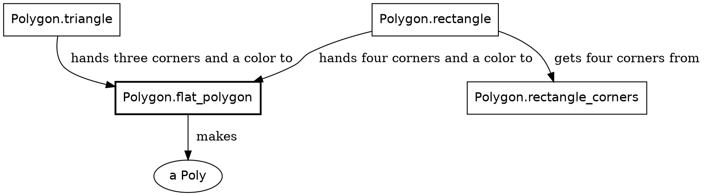

# Proofread: Shapes, one shape at a time

*For Steve's read, 2026-11-10. The triangle now goes all the way to its `Poly`, and only then does the rectangle build on it, reusing `flat_polygon`. The diagram comes after both, as a recap. MISSION.md's C5 now reads "Finish one thing before you start the next."*

---

## Shapes

Thirty times a second, Safari Ride answers one question: what goes on the canvas? The answer is a list of shapes. Roc builds the list, and a painter on the other side, JavaScript on this page, paints it from the first shape to the last. A painter is a bit like a printer: it does exactly what the list says.

That split is the whole drawing model. Roc decides every corner and every color. The painter only follows orders. This chapter builds a list by hand, with one triangle and one rectangle in it. Everything Safari Ride draws later, from a pine tree to the truck, is the same idea with more corners.

New in this chapter:

- Roc: a record taken apart in a parameter list
- Modules: `TwoShapes`, `Shapes`, `Polygon`, `Screen`, `Pixels`, `Picture`

### Get the types right

Three types do the work. One says where, one says what, and one says which shapes belong together.

| Type | What it says |
|---|---|
| `Screen.Point` | Where: a place on the canvas |
| `Shapes.Shape` | What: one item in the frame's list, such as a polygon |
| `Picture` | Which belong together: the shapes that form one full object, in painting order |

The canvas is 960 pixels wide and 600 tall. Its points are measured from the top left corner, and `y` grows downward. A `Screen.Point` is an `x` and a `y`:

```roc Screen.roc
## A point on the screen, in pixels from its top left corner. Either can be
## negative, or past the far edge, for a point off the screen.
Point : { x : Pixels, y : Pixels }
```

Both are `Pixels`, a length on the screen. `Pixels` is opaque, like `Clock`, so the compiler keeps screen lengths and road lengths apart. Underneath it's an `F64`, because a corner can land between two pixels. `Screen.point(x, y)` makes a point from two plain numbers.

A frame is a list of `Shapes.Shape`, and a shape is one of a handful of tags:

```roc lib/Shapes.roc
## One thing in a frame. A later shape in the list paints over an earlier one.
Shape : [
	## A polygon, as x0, y0, x1, y1 and so on. It can be any polygon. A painter
	## that fills only convex ones has `ConvexCut` cut the rest into triangles.
	Poly({ coordinates : List(F64), fill : Brush.Fill }),

	Disc({ x : F64, y : F64, radius : F64, fill : Brush.Fill }),
	Rect({ x : F64, y : F64, width : F64, height : F64, fill : Brush.Fill }),

	## A mark, not a shape: how the shapes after it combine, until the next `Blend`.
	## A painter holds this as a mode, so a mark in the list says it directly.
	## `Shapes.added_light_shapes` writes the pair of marks around a run of shapes.
	Blend(Shapes.Mode),

	## A mark, not a shape: the space the shapes after it are in, until the next
	## `View`. It is a mark for the same reason `Blend` is. `Shapes.shapes_in_space`
	## writes the pair of marks around a run of shapes.
	View(Shapes.Space),

	## `cols` by `rows` pixels stretched over the box without smoothing. It carries
	## the pixels, not a handle, so there is no second copy of them to keep in step.
	Image({ x : F64, y : F64, width : F64, height : F64, cols : U64, rows : U64, pixels : List(Brush.Rgba) }),

	## A line of words in a real typeface. `Font.plotted_shapes` gives a painter that has
	## no typefaces the strokes of the same line.
	Text(Shapes.TextLine),
]
```

Each tag carries its data in parentheses, its payload. A `Poly` is a polygon, and its payload is the coordinates of its corners and its fill. A fill is a `Brush.Fill`. `Flat` is a single color, and the other fills are gradients, running from one color to another across the shape. `Blend` and `View` are marks in the list that change how the shapes after them are painted.

Safari Ride paints nearly everything as polygons. A frame often holds more than 2,000 shapes, and nearly all of them are `Poly`.

### A frame of two shapes

Here is a frame small enough to read whole:

```widget shapes
The list `TwoShapes.shapes`, painted over a plain background, on a smaller canvas than the ride's.
```

And here is the whole module behind it:

```roc shapes_widget/TwoShapes.roc, the whole file
## A frame is a list of shapes, painted first to last. The rectangle comes second
## in the list, so where the two overlap it paints over the triangle.
import game.Polygon
import game.Screen
import lib.RgbColor
import lib.Shapes

TwoShapes :: [].{

	shapes : List(Shapes.Shape)
	shapes = [triangle, rectangle]
}

triangle : Shapes.Shape
triangle = Polygon.triangle(
	{
		first_corner: Screen.point(120.0, 300.0),
		second_corner: Screen.point(360.0, 300.0),
		third_corner: Screen.point(240.0, 60.0),
	},
	RgbColor.of(0x2e8b57),
)

rectangle : Shapes.Shape
rectangle = Polygon.rectangle(
	{ top_left: Screen.point(270.0, 120.0), bottom_right: Screen.point(520.0, 250.0) },
	RgbColor.of(0xe8a33d),
)

expect TwoShapes.shapes.last() == Ok(rectangle)
```

`shapes` is the frame: a list of two values. The order of the list is the order of painting. The rectangle comes second, so where the two overlap, it covers the triangle. The widget puts one more shape at the front of the list, the plain background, so both paint over it.

Colors are whole numbers in hex, the same six digits a web page writes after its `#`. `0x2e8b57` is a sea green, and `0xe8a33d` is an amber.

### A triangle

`triangle` and `rectangle` are each one call into `Polygon`, whose functions make shapes. A maker returns a value that describes a shape, and the painter draws it later.

Let's draw the triangle first. It's three corners and a color:

```roc Polygon.roc
## Makes a triangle of one flat color.
triangle : {
	first_corner : Screen.Point,
	second_corner : Screen.Point,
	third_corner : Screen.Point,
},
RgbColor -> Shapes.Shape
triangle = |{ first_corner, second_corner, third_corner }, color|
	flat_polygon([first_corner, second_corner, third_corner], color)
```

The bars, `|…|`, hold the function's parameters. The first parameter, `{ first_corner, second_corner, third_corner }`, takes the record apart into three names. A caller names all three corners, in any order, and the compiler checks that all three are there.

The triangle puts its corners in a list and hands them to `flat_polygon`:

```roc Polygon.roc
## Makes a polygon of one flat color.
flat_polygon : List(Screen.Point), RgbColor -> Shapes.Shape
flat_polygon = |corners, color|
	Poly({
		coordinates: polygon_coordinates("Polygon.flat_polygon", corners),
		fill: Brush.flat(color),
	})
```

`flat_polygon` makes the `Poly`. `Brush.flat` makes its fill, the color fully opaque. `polygon_coordinates` makes its coordinates, one flat list of numbers, an `x` and then a `y` for each corner. First, it checks that there are at least three corners:

```roc Polygon.roc
## The numbers of a polygon's corners. Fewer than three corners enclose nothing,
## so that crashes, naming the `maker` that was asked.
polygon_coordinates : Str, List(Screen.Point) -> List(F64)
polygon_coordinates = |maker, corners|
	if corners.len() < 3 {
		crash "${maker}: a polygon needs three corners"
	} else {
		flat_coordinates(corners)
	}
```

Two corners enclose nothing, so a call like that is a bug in Safari Ride, and the program stops. `maker` names the function that asked, so the crash points at the bug.

That's a triangle: three corners in, one `Poly` out.

### A rectangle

Next, let's build a rectangle. A rectangle is a polygon of one color too, so it ends in the same `flat_polygon`. All it has to do is find its four corners. It takes two opposite corners and a color:

```roc Polygon.roc
## Makes a rectangle of one flat color. Its sides run along the screen's edges.
rectangle : { top_left : Screen.Point, bottom_right : Screen.Point }, RgbColor -> Shapes.Shape
rectangle = |opposite_corners, color| flat_polygon(rectangle_corners(opposite_corners), color)
```

`rectangle_corners` finds the other two, and lists all four clockwise from the top left:

```roc Polygon.roc
## A rectangle's four corners, clockwise on the screen from its top left.
rectangle_corners : {
	top_left : Screen.Point,
	bottom_right : Screen.Point,
} -> List(Screen.Point)
rectangle_corners = |{ top_left, bottom_right }| [
	top_left,
	{ x: bottom_right.x, y: top_left.y },
	bottom_right,
	{ x: top_left.x, y: bottom_right.y },
]
```

The two makers take different inputs and finish in the same place:

How the two shapes are made


So the triangle and the rectangle reach the painter in the same form: a `Poly` with a `Flat` fill.

### Pictures

One object is often many shapes. A tree is nine: a trunk and eight tiers of foliage. Those nine travel together, from the code that draws the tree to the frame that paints it, as one `Picture`:

```roc Picture.roc
from_shapes : List(Shapes.Shape) -> Picture
to_shapes : Picture -> List(Shapes.Shape)
```

`Picture` is opaque, with a `List(Shapes.Shape)` underneath. Outside its module, a picture is a single thing, passed along whole. Only `Scene`, as it builds the frame's list, opens a picture to take out its shapes.

A frame paints the backdrop, the mountains and the ground first. Then it paints a series of pictures, from the farthest object to the nearest, so that near things cover far ones.

The rest of the book is about choosing those corners, and choosing their order. Every object along the road takes the same few steps on its way to a picture, and those steps come next.

