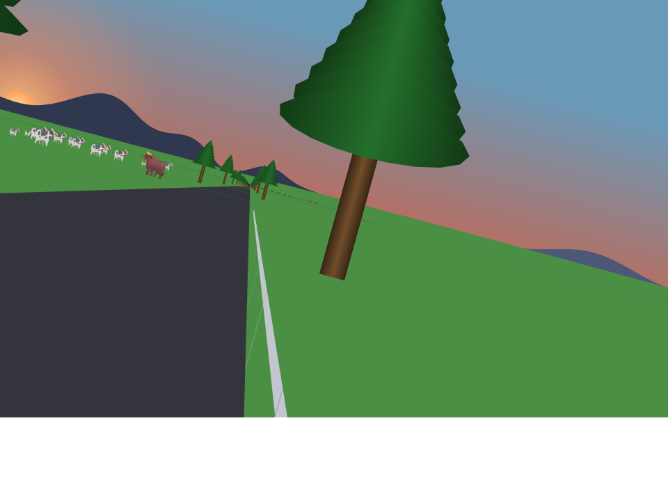
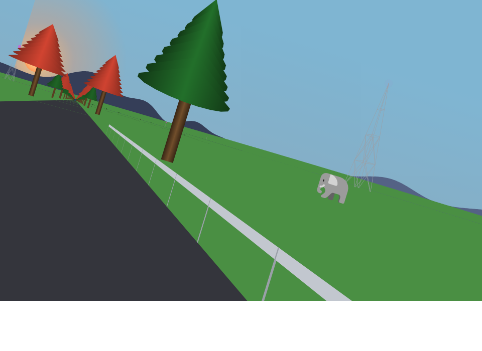
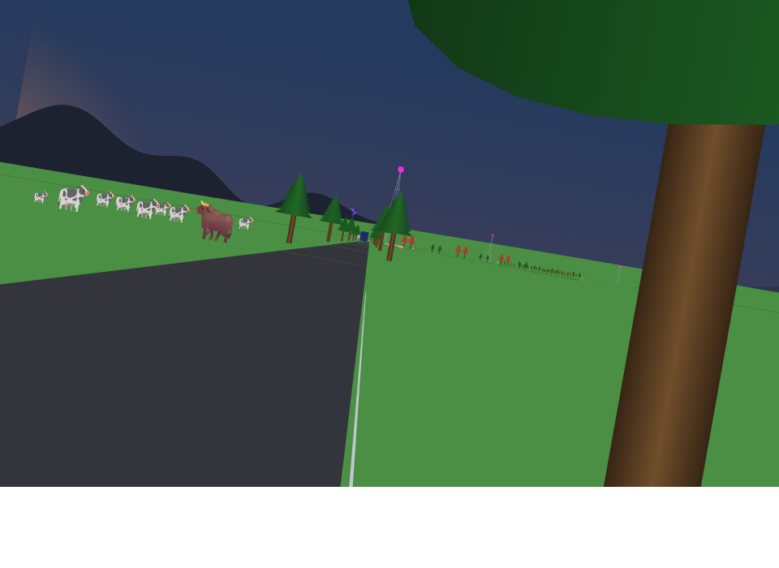

# The sun fix: eye test

*2026-11-07. Branch `sun-order`, not merged yet. Backdrop now paints sky, then the sun, then grass, so the sun needs no clip. `Within` and `Shapes.Clip` are gone from every platform. Each pair below is the real ride, rendered in headless Chromium through the real `shapes_canvas.js`, before the fix and after it.*

Only one proof hash moved, `RasterFrame 3000`, which is rolled with the sun in view. Unrolled frames with the sun up (steps 2700 and 4000) are identical, pixel for pixel.

## Step 3590

The clearest case: the glow used to stop dead on a diagonal at the top left.

## Step 2329

The same diagonal used to cut the glow across the trees on the left.

## Step 5555, at dusk

## What's left in these frames

Two faint lines on the grass remain, and neither is the sun:

- **Dashes far out on the grass** are the road past the horizon. The road-frame lane is adding the horizon cut.
- **A thin dark line along the horizon in rolled frames** is the mountains. Every skyline silhouette closes exactly at y=300, one pixel below the grass's top. In a rolled frame that edge cuts through pixels, so a little of the ranges' rock color shows through the land. A small lane is fixing it.
