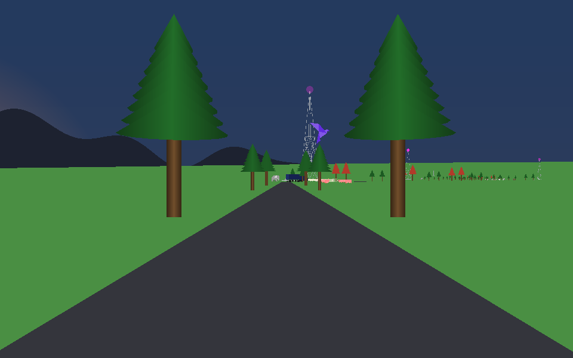
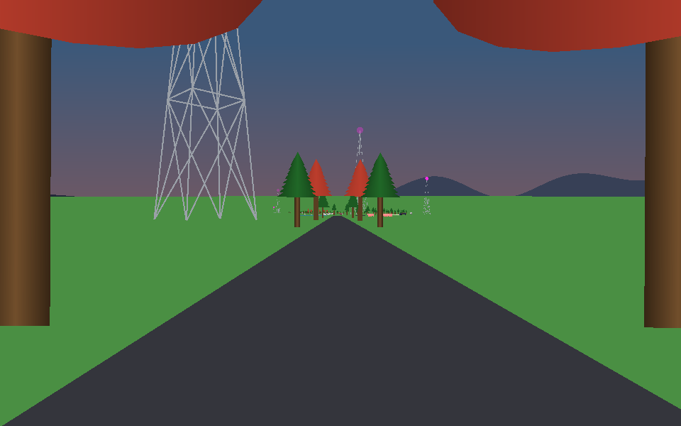

# The sunset rule: eye test

*2026-11-07. Branch `sunset-rule`, not merged yet.*

The sun's rate of fall was `0.41616 * 2 * radius / 625`. Its old TypeScript comment says the rate was nudged 2% faster, then the sun's start height was re-solved so the sunset landed in a window of an older route: tuned to fit, with nothing in the ride behind it. Sky's `dusk_at_set` was a ratio of two unrelated lengths, about 0.594, which would crash for a start height under 46 px.

Now the sun is fully set at a whole step, `Clock.at_step(4735)`, and the rate is the whole fall divided by that. `dusk_at_set` is `Fraction.of(0.6)`, a little over half, so the sky goes on darkening after the sun has gone. The sun's lower edge still touches the horizon at step 3,233.

Pixels moved, nearly all by one color step out of 255. The sun stands 0.04 px higher at step 3000. The agent couldn't tell before from after; neither should you.

## Step 5700

## Step 5100, deep dusk

