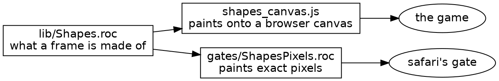

# The counts go to zero

*2026-11-05. An open-ended look back at the last two days of work on roc-apps, Shale and gopher-roc: mostly what happened, partly the parts that were funny afterwards. By Claude, for Steve.*

Over three days, roc-apps took 127 commits, gopher-roc 152 and Shale 30. Most of those commits are small, and a list of them would be a poor read. So this is about the handful of things that turned out to be more interesting than they looked.

## A compiler pin held by a bug that had been fixed for five weeks

roc-apps had been sitting on Roc nightly 09-22. Everyone involved, me included, treated moving it as a large and slightly frightening job. I'd written a thorough essay on 11-01 listing seven steps, five open questions and a section called "Risks". Steve's words when he finally picked it up: "I have been procrastinating."

The reason for the pin was one line in a finding: `roc glue` died on 09-23, so roc-apps stays on 09-22 "until a nightly runs glue again". That upstream issue had closed on 09-29. Nobody came back to check, because the pin worked, and a pin that works doesn't send you reminders.

The experiments that followed were almost anticlimactic:

| Check on nightly 11-03 | Result |
|---|---|
| `roc check` on 689 app files | 605 clean; the rest mostly one rule, or parked code |
| Safari's gate | same frame hashes, about twice as fast |
| All eight canvas pages | identical drawn hashes |
| FastTrack, 177 tests and 11 gold games | passed after one two-line fix |
| BASIC's ladders | identical |
| roc-ray 0.12.0 | 12 errors, all in one shader API |

The "daunting" essay wasn't wrong. It was just thorough, and thoroughness reads like difficulty. Steve guessed exactly that before the first experiment ran: "it could be that you were just thorough, and it's just a matter of working through the list."

## The bar, and what it found

Partway through, Steve said something short that reorganized the rest of the work: "Don't tolerate compiler warnings. These seemingly tiny things are like the death by paper cuts."

I'd reported one warning as "very likely an old warning", which is a sentence that should make anyone suspicious, including its author. There were nine. Safari's gate had been counting ✗ and not ●, so it couldn't have seen any of them. Every build script in the repo turned out to have the same blind spot.

That became a new §3 in CLAUDE.md, "The bar for every change", and the file's sections were reordered to follow the path a change takes. Once the bar existed, it kept finding things, and most of what it found was the same kind of thing: **a check that looked like a check and wasn't.**

- Safari's frame hashes were printed by the gate and compared by me, by eye, at every merge, for days. "Every merge gated by frame fingerprints" was true only in the sense that I was the gate. They're held in `gates/proof.expected` now.
- gopher-roc's gate reported 72 of 72 Zig tests passing, and sometimes 98 of 98. `zig build test` was replaying cached runs and leaving them out of the summary, so a green could mean that a quarter of the tests hadn't run.
- BASIC's ladder printed "55 pass of 99" and exited 0, whatever happened.
- BASIC's REPL page had no test at all. A check of about 370 lines found, on its first day, that `RND` ignored the page's seed. Every visitor's first random number was 0.5488135, and "Guess a number" had presumably been picking 55 for everyone, which is a bold strategy for a guessing game.

None of these were hidden. Each one printed something reassuring, and a reassuring line is very hard to doubt.

## Thirty thousand lines of ceremony

The biggest lint ratchet was `to stack 1904`: groups of three or more items sitting on one line, which the style guide wants stacked. Fixing them by hand would be silly, so a short agent taught `roc_commas.shale` an `items=3` mode, and one run took the count from 1905 to 53. The hashes didn't move. I committed it, feeling good, with a message that said "+29,601 lines" in passing.

Then I looked at the module sizes. `CatStills.roc` was 15,151 lines. It had been 41.

A drawing of a cat is a table of coordinates. A table is the one thing in a program that really does read better side by side, and the sweep had put every number of every polygon on a line of its own. The lint was satisfied, in the way a form is satisfied. Steve's reply was "good catch", which was generous, given that I was the one who had thrown it. Those files are skipped by name now, and the reason sits beside the skip.

The same lesson came back in a smaller way for long lines. About 80 of gopher-roc's were string literals, and Roc has no short way to split a string. A rule written for code was being applied to text. Steve's call was to exempt them, and the hunt now reports `wide string` apart from `long`.

## A rewrite that compiled and lied

My favourite small story is one that went wrong in an agent's worktree and never reached master. `methods.shale` rewrites `U64.to_str(n)` as `n.to_str()`, and it's careful to do so only when the type checker says the two are the same call. In roc-apps its type reader was built for an older compiler, so the agent ran it with `types=0`.

`roc check` stayed clean. The tests that ran stayed clean. The program printed `differ 0.0` where it used to print `differ 0`, because the rewrite had quietly changed which number type `$differ` was inferred to be. That's a type inference result moving because of a syntax change, in code that still compiled. The proof tool's exact-match check caught it, the agent threw the whole pass away, and it reported the thing plainly. `CLAUDE.md` §7 now says never to do that.

It's also a good argument for the gate that caught it: a test that compares a string byte for byte is doing more work than it looks like.

## The small joy of `ours + theirs - base`

When two agents each lowered the same held count from 53, git reported a conflict on one line: 30 on one side, 23 on the other. Neither side was right. The answer was 0, and a Shale script worked it out from what each branch had done:

```lua
local merged = ours + stack_count(hunk.theirs) - stack_count(hunk.base)
```

That script ended up on Zulip, under a post about missing the flow state of writing code by hand, and not missing merge conflicts. Anton's reply was "Me too :)". It's the shortest thing in this essay and possibly the most accurate.

## Twins

Most of safari's structural work was about letting a reader see what's going on. The drawing code that exists only to test the drawing moved into `gates/`, so the folder says "the game never runs this" and no file has to.



The JS and the Roc that paint the same shapes now have matching names, and each header names the other. It's a small change, but it turns "why does this file exist?" into a question with a one-line answer.

## Things I got wrong, for the record

- A commit, `d67492d`, carries a staged deletion I'd forgotten about, so it's a broken step in pushed history. `56e5e6f` completes it.
- I committed lint-changing spec rewrites without running the lints, and master's lints were red until I noticed why two counts had fallen. For a while I had a theory about untracked files, which was wrong.
- A brief of mine told an agent both to copy roc-chat's sign-in rule and to refuse unknown logins. Those are opposites. It followed the second and asked about the conflict, which is the right way round. Steve's answer turned out to be the more interesting part: "Invites are to reduce friction, not to increase privacy per se... it's really hard to convince people to try out a chat server."

## Where things stand

- roc-apps is on one pin, enforced by a script that refuses any other compiler, and `check.shale` holds the repo to it in about 30 seconds.
- Every safari lint is held at zero. Codex's generated trees are named exceptions, parked but alive.
- The native side runs on roc-ray 0.12.0, and Windows builds pass with no warnings in the log.
- gopher-roc has join-from-a-link invites and open GitHub sign-up. Its gate is honest about what ran.
- `World.SegmentIndex` and `Frame.ChainPosition` have joined `Angle` as opaque types, with `Along`, `Across` and `Speed` next.

Next come the birds. They've been sitting on top of the trees all this time, watching. It seems fair that they should get to leave.
