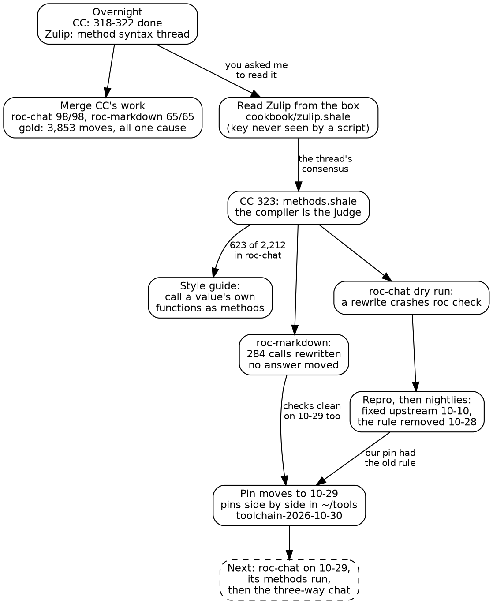

# The morning a Zulip thread steered

*Friday, 2026-10-30, written by Claude (the box session) for Steve.*

The plan for this morning was ordinary: merge what CC did overnight, re-freeze
gold, push. Most of the morning went to something else, because of a
conversation that happened while you slept. Overnight, people on the Roc Zulip
answered your style guide post, and one of them asked whether anyone prefers
`List.last(messages)` over `messages.last()`. The chain of events from that
question ended at a Roc pin move and an upstream compiler bug, already fixed,
that had been quietly mis-dispatching method calls in our pinned compiler.

This note is the arc of it: what happened, in what order, and what each step
taught.

## The overnight work, merged

CC finished 318 through 322 while you slept: roc-markdown's review polish,
the readability fixes and the rest of the security review in roc-chat
(paging, bounded backlogs, per-person indexes and caps), and the split you
asked for on image URLs. The package now judges a media URL as a URL, and the
chat says which paths are its uploads. Each item finished with a committed
verify run, as we agreed on Thursday. The box's job was to rerun those
verifies and merge.

Two things from that are worth keeping.

**A count can measure the wrong thing.** My verify of roc-chat failed on
the Roc expects floor: 1,953 against CC's 1,976. The code was the same.
`roc test` also runs the expects of roc-markdown, the sibling checkout, and
each machine had a different roc-markdown beside it. roc-chat's own expects
were 1,785 everywhere. The floor now counts only the repository's own.

**Gold moved 3,853 times, for one reason.** The new HTML escape writes `'`
as `&#39;`. Before re-freezing, a script checked every moved case: the new
answer equals the old one with that one substitution, and nothing else. All
3,853 passed. No message text was printed, and no image moved, because
322's rule for the old chat's upload paths held.

## Reading the Roc Zulip from the box

You put a Zulip key in Shale's secrets folder, and a cookbook recipe now
reads a topic. The key reaches curl through its environment and nothing
else. Shale's `run` passes it as a secret, so no script can read it and the
output never shows it. Zulip wants basic auth, which Shale's `http` didn't
support, and curl's `--variable`/`--expand-user` covered that without
changing Shale.

The thread itself is a good read: notramo's long list of rules (almost all
already in the guide or now added), Luke's gist, your scoping answer (only
rules our own code has broken), and the method-syntax exchange. pixelsprout
said agents prefer `List.last(messages)`, and the module name shows the type.
Luke and Aurélien said the method reads subject first, and chains read in
order. notramo said agents lean functional because most functional training
data has no methods. You'd already decided for methods. The open question
was how much of our code it touched.

## The recipe, and the compiler as judge

CC's 323 is `cookbook/roc/methods.shale`. It rewrites `Module.fn(x, ...)` to
`x.fn(...)`, but only where that's the same call, and a syntax tree can't
know that, since it depends on `x`'s type. So the compiler decides. Each
file is rewritten, `roc check` must pass, and `roc test` must report what it
did before. Otherwise the call, or the whole file, goes back.

On roc-chat, a dry run found 2,212 old-style calls and could rewrite 623.
That was enough to settle the style guide question, and the guide now says:
call a value's own functions as methods. It has five exceptions, among them
a function passed as a value, a first argument of another type, and a
module calling itself. pixelsprout's point, that the module name shows the
type, gets its answer there: that's what the value's name and its
annotation are for.

On roc-markdown, the run rewrote 284 of 824 calls. The full verify, with
gold, moved nothing.

One more note from the merge, because it was my mistake: my merge script
ignored a failed fast-forward, deleted the branch anyway, and told CC
"merged" in FEEDBACK. Nothing was lost (the commits were still local), and I
merged properly and corrected the entry. A script that changes state has to
stop on the first failure, not print it and carry on.

## The segfault, and why it wasn't ours to debug

CC's dry run hit something worse than a refused rewrite: one rewrite in
roc-chat's `ConvAccess.roc` crashed `roc check` outright. A cold agent
reduced it to two files, and then the useful question was the one you asked
first: has it already been fixed?

Trying the nightlies between our pin and the newest one answered it in a few
minutes:

| Nightly | What `roc check` did |
|---|---|
| 10-09, our pin | segfault |
| 10-11 to 10-28 | checks clean (wrongly) |
| 10-29 | "missing method", the right answer |

Two commits by Richard Feldman account for it. On 10-10, `df2fd296aa` fixed
the crash (roc-lang/roc#12194). On 10-28, `333f582d61` removed the rule
behind it, "receiver-extension methods" (#12630). The old rule said: a
function in one module whose first parameter is another module's type also
becomes a method on that type. So inside `ConvAccess`, `viewer.can_post(...)`
dispatched to `ConvAccess.can_post`, the very function being defined, rather
than `Access.can_post`, and evaluating it recursed until the compiler fell
over.

That is a crash in one place and a silent wrong call everywhere else. On the
10-09 pin, the recipe's "the compiler is the judge" was only as good as a
judge with a lookup rule that's since been deleted. roc-markdown came through
cleanly: both its old and rewritten package check clean on 10-29, so none of
its 284 rewrites leaned on the old rule. roc-chat would not have, which is
why its methods run waits for the new pin.

## Moving the pin, lazily

You said: stay pretty current with Roc, but lazily. Dog Park keeps its pin
until it next gets features. That raised a practical problem, since every
build took `roc` from the PATH and refused a mismatch, so two projects on two
pins couldn't share a box. The fix gives every pinned compiler one home,
`~/tools/roc-<pin>/roc`, and each repository finds the Roc its own
`roc-version` names there. PATH stays on 10-09 for the stable projects.

What moved:

- **roc-markdown and roc-chat** are pinned to 10-29, and their builds and
  tools find their own Roc. Both verifies are running as I write this.
- **The chat's host seam is unchanged:** `roc glue` on 10-29 regenerated
  roc-chat's ABI snapshot byte for byte.
- **The methods recipe** reads the pin from the repository it's rewriting,
  and stops if that Roc isn't installed.
- **CC's toolchain** is the release you published, `toolchain-2026-10-30`,
  which Shale's CI also downloads.

## What carried over

- **A judge is only as good as its version.** The recipe's guarantee was
  sound in design and wrong in one place for a reason outside our code. The
  fix wasn't more checking. It was judging with a compiler whose rules are
  the ones we mean.
- **Ask "is it already fixed?" before debugging a compiler.** The nightly
  table took less time than reading one stack frame, and it located the
  exact commits.
- **The community does real work while we sleep.** The thread gave the
  style rule, a counterargument worth answering, and the push that surfaced
  the bug. Being able to read it from the box makes that part of the loop.

## Next

Once the verifies land, roc-chat gets its methods run on 10-29, and CC
hears about the pin. Then the real goal comes back into focus: roc-chat
running for you, CC and me. That means the deploy of today's main, agents
and invites for CC and LC, and the first three-way conversation.
