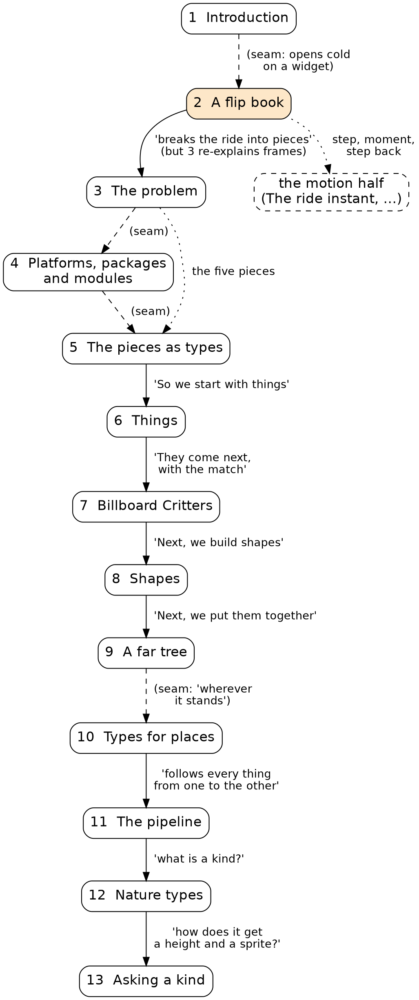

# Thirteen chapters as a flowchart

Each chapter is a node, and each edge is a transition: the last paragraph of one chapter, read against the first paragraph of the next. A solid edge is a real hand-off, where the chapter ends by naming what the next one does, and the next one picks it up. A dashed edge is a seam, where nothing leads from one chapter into the next. A dotted edge carries no reading order: it's a promise that jumps ahead.

## What the picture says at once

The book has two halves already, and they look nothing alike.

**Chapters 5 to 13 are a chain.** Every link but one is a real hand-off. "So we start with things." "They come next, with the `match`." "Next, we build shapes of our own." "Next, we put them together." The last three links are questions: what is a kind, and how does one function get a height and a sprite out of every kind? That's the book at its best. Each chapter ends by making the reader want the next one, and the next one opens by paying for it. The one seam in the chain, from A far tree into Types for places, is soft. The far tree ends on "wherever it stands", which points at places without saying so, and Types for places opens cold. It's a breather chapter, and breathers are allowed to open cold.

**Chapters 1 to 5 are a cluster.** Of the four transitions among them, only one is a hand-off, and that one, from the flip book into The problem, has a cost: The problem opens by explaining frames and steps from scratch, a third time. The other three are seams. The Introduction ends on "two things", and the flip book opens on a widget. The problem ends on a table, and Platforms opens on a definition. Platforms ends on `canvas_app`, and The pieces as types opens on "Types are at the heart of every Roc program."

**The real logical edge in the front runs from The problem to The pieces as types**, skipping Platforms. The pieces as types is a tour of The problem's five pieces. Platforms sits in the middle of that edge with no edge in or out. It's the Cetology chapter, exactly as we said: necessary, honest, and connected to nothing on either side.

**The first true hand-off in the book is at the end of chapter 5.** "So we start with things." Everything before it is the front of the book. That matches your read that the nuts and bolts start in Things, and the flowchart shows it isn't only a matter of content. It's also a matter of motion: the chain starts moving at chapter 5's last line.

## Why the flip book feels out of place

Look at the dotted edge out of chapter 2. It's the longest edge in the picture, and it points off the page.

The flip book is a chapter about time. Its widget steps the ride forward and back. Its code is `next_or_restart`, the step, and `Tour.step_back`, the rewind. Its last word is the four things a moment carries from one step to the next. All of that is motion, and motion is the fourth of The problem's five pieces. Stepping back is the fifth, the person watching.

Then The problem, the very next chapter, says this:

> We hold one frame still and get it right before anything moves … That plan costs something: the first half of the book holds one frame still.

So the book runs the clock in chapter 2, stops it in chapter 3, and keeps it stopped for ten chapters. The flip book is a good chapter for the second half, sitting in the first.

There's harder evidence than that. The old draft's chapter on the ride instant, the one that opens the motion half, starts like this:

> We've held one frame still for a long time. Now it's time to turn the page.

"Turn the page." The old draft reached for the flip book at the hinge, without the image fully drawn. The flip book has a home already, and it's in the middle of the book.

## Moby Dick again

This is where the Melville comparison earns its keep, because it says what chapter 2 should be instead.

In chapter 3 of Moby Dick, Ishmael meets the whale for the first time. It's a painting on the wall of the Spouter-Inn, smoky and hard to make out. It's a still picture, held in front of the reader for a long, puzzled look, and it promises a creature that won't move for another hundred and thirty chapters. The whale itself surfaces in the water at chapter 133.

Our chapter 2 surfaces the whale. It shows the ride moving, stepping and rewinding, the thing the book won't hunt for another ten chapters. The Spouter-Inn painting shows a still picture. That's the role the front of our book wants: **one page, held still, looked at closely, with the motion only promised.**

This also explains why the flip book "feels wrong in place" while it reads well "in isolation". In isolation, it's a chapter with its own image, its own experiment and its own payoff. In place, it's the climax of the motion half, told before the book has frozen time.

## What could go in slot 2

Three shapes, keeping your additive rule and keeping chapters 1, 3 and 4 as they are.

**1. Move the flip book to the hinge, and leave slot 2 empty.** The flip book becomes the opening of the motion half, where the old draft already wanted to "turn the page". The front goes back to three chapters. That's the cheapest option, and it gives the motion half the best opening it has had. It also gives back none of the early Roc that Aurélien asked for, so it answers only half of his note.

**2. Move the flip book to the hinge, and write a new chapter 2 called something like "One page".** It's the painting at the Spouter-Inn: a single frame, held still, examined. The Roc it shows is the picture side of the flip book, never the time side:
- `frame_view_at : Route, RideInstant -> FrameView`, one moment in, one picture out;
- the frame as a value, a list of shapes the platform paints;
- the promise, stated plainly, that the book studies this one page for its first half, and that the second half turns the pages.

Then The problem's sentence about holding one frame still pays off what chapter 2 just promised, instead of contradicting what chapter 2 just did. That's a real hand-off, and it would make the 2-to-3 edge solid. The cost is that The pieces as types also shows a frame held still, step 1,529. Two chapters would show a held frame, and per rule H9 one of them would need a different picture.

**3. Keep the flip book at slot 2, but freeze it.** Cut the step-back experiment and `Tour.step_back`, and keep the flip book image as a metaphor only: "this book studies one page at a time." That's the smallest change, but it removes the best thing in the chapter, the experiment the reader does with their own hands. I'd rather move that experiment to where it can be the payoff than cut it.

## Smaller things the picture shows

- **The front has a triple-told idea.** "Each frame is one picture, and a step moves the world on" appears in the Introduction, again in chapter 2, and a third time in The problem's opening. A chain absorbs repetition, because each telling does a new job. A cluster can't, because the three tellings sit side by side and do the same job.
- **The chain's hand-offs are all promises of the next thing to build.** The cluster's few links are promises of the whole plan. That's Aurélien's "presenting the whole journey upfront", visible as edge labels. The chain says "next, a triangle". The cluster says "here are the five pieces of everything".
- **Platforms is unreachable but load-bearing.** No edge leads in or out, yet The pieces as types quietly depends on it, for `import`, `lib` and the idea of a module. A dotted edge from 4 to 5 would be honest. It's the one chapter whose position nobody would question and whose transitions nobody would defend.
- **The chain's single seam, A far tree into Types for places, is the one place we chose a breather.** It's the only seam we made on purpose, and it reads fine. That's useful calibration: a seam isn't automatically a flaw. A seam in front of a short chapter that says up front what it's for works. A seam in front of a long or reflective chapter costs the reader.

## Where I land

Option 2. The flip book is the best opening the motion half could have, so it moves there, intact, experiment and all. Slot 2 becomes the painting: one page, held still, with `frame_view_at` as its line of Roc, and a promise that The problem then keeps in its first paragraph. The front gains a solid edge, the motion half gains its door, and the whale stays in the water until it's time to hunt.
