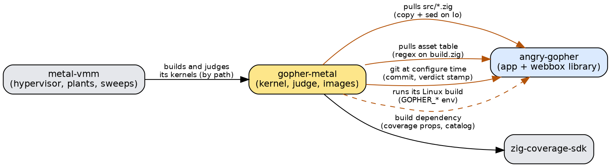
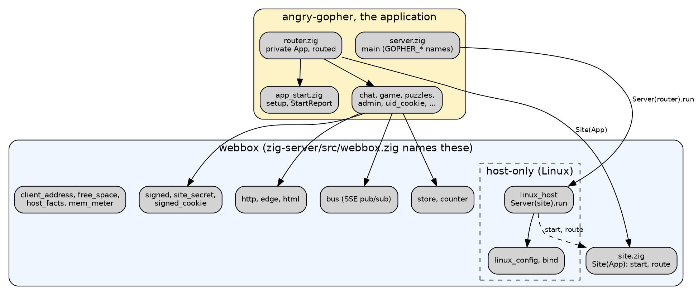
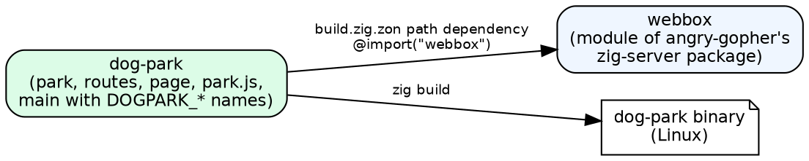
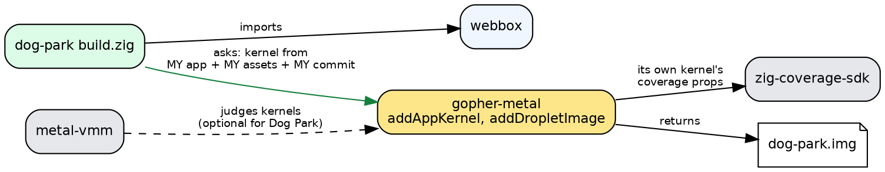
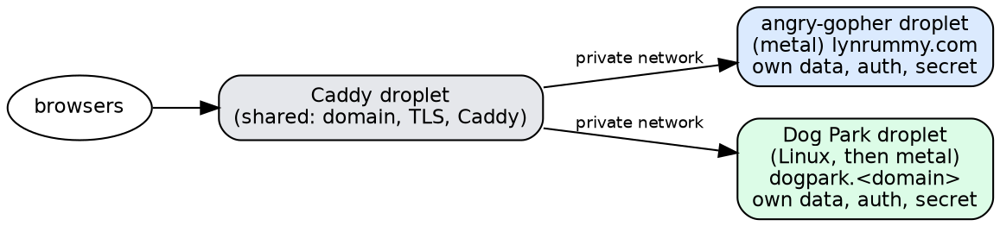

# Three repos, one library: angry-gopher, Dog Park, gopher-metal

*2026-10-11. Where the three meet, today and once Dog Park is built: what
crosses each boundary, in which direction, and by what mechanism. metal-vmm
and the coverage SDK appear only at the edges, which is the point. Companion
to [the platform plan](gopher-as-a-platform.md).*

## The short version

- **Dog Park depends on one thing to run on Linux: the `webbox` library**,
  which lives inside angry-gopher's server. It imports it as a Zig package
  and builds its own binary. Nothing else is involved.
- **Dog Park on bare metal asks gopher-metal for a kernel and an image.** It
  hands over its code and its assets; gopher-metal does not reach into Dog
  Park's tree. That's the reverse of how gopher-metal treats angry-gopher
  today, and it's Phase B.
- **metal-vmm and the coverage SDK never touch Dog Park directly.**
  - The SDK is compiled into gopher-metal's kernel, not into `webbox`. No
    angry-gopher file imports it.
  - metal-vmm judges gopher-metal's kernels, not applications.
  - So Dog Park meets either one only through a kernel gopher-metal built,
    and on Linux it meets neither at all.
- **Deployment is separate; code is shared.** Dog Park has its own droplet,
  data, accounts and session secret. Only the domain, the Caddy droplet and
  Caddy are shared, and all the code that can be shared is.

## Today

Every arrow points out of gopher-metal or metal-vmm: they pull. angry-gopher
knows nothing about either. With one application that was a strong
guarantee: the port is always angry-gopher's HEAD. With two, each pull
would need a second copy, scraper and directory list (the
[injection-or-pull review](gopher-as-a-platform.md)).

## Inside angry-gopher: the library and the application

Phase A's work so far: the platform pulled out of the application, in
place.

Two lints hold the line:
- **The library lint:** every file the library reaches must be one
  `webbox.zig` names.
- **The portability lint:** nothing the library or the route table reaches
  may touch the host, except the named host-only part, which only
  `webbox.zig` may import.

## Dog Park on Linux: the first milestone

What crosses:
- **One module, `webbox`,** through `build.zig.zon`
  (`../angry-gopher/zig-server`).
- **Dog Park's `main` calls `linux_host.Server(site).run`** with its own
  name, its own `DOGPARK_*` variable names, and its own report.

Nothing crosses back: angry-gopher doesn't know Dog Park exists.

## Dog Park on bare metal: Phase B

The direction flips: **Dog Park injects, gopher-metal serves.**
- **The application's module comes in as an argument** to `addAppKernel`,
  where today a shell script copies angry-gopher's files.
- **Its assets come in as a list,** where today a regex scrapes them.
- **Its commit comes in as an option,** where today gopher-metal runs git.

The plan's new idea for the `Io` alias: instead of a sed rewrite, an
injected module (`host_io`) that is `std.Io` on Linux and `metal.io` on
metal. Then code that bypasses the alias fails to compile, rather than
escaping silently.

**Where metal-vmm and the SDK sit:** behind gopher-metal, both of them.
- The SDK's `props.reachable(...)` calls are in gopher-metal's own
  `src/`, compiled into any kernel it builds, Dog Park's included. Dog
  Park's code never calls them, and its build never names the SDK.
- metal-vmm judges kernels. Judging Dog Park's kernel there is a choice
  for later, a trivial checkpoint at most, never a dependency of Dog
  Park's build.

## In production

Separate state, by Steve's rule:
- **Cookies:** each site sets them host-only (no `Domain=`), so a browser
  never sends one site's cookie to the other. Dog Park's cookies get names
  of their own anyway.
- **Trusted proxy:** each droplet trusts Caddy's private address, set by
  its own `*_TRUSTED_PROXY`.

## Every touchpoint, in one table

| Between | What crosses | Direction | Mechanism | When |
|---|---|---|---|---|
| Dog Park → webbox | the library | Dog Park pulls | `build.zig.zon` path dependency | day one |
| Dog Park's main → linux_host | its name, variable names, report | Dog Park injects | `Server(site).run(options)` | day one |
| Dog Park → gopher-metal | its module, assets, commit | Dog Park injects | `addAppKernel` (Phase B) | at metal time |
| gopher-metal → SDK | coverage props in the kernel | gopher-metal pulls | its own `build.zig.zon` | already |
| metal-vmm → gopher-metal | kernels to judge | metal-vmm pulls | path, env-overridable | already; Dog Park optional |
| gopher-metal → angry-gopher | src, assets, git, Linux build | gopher-metal pulls | copy + sed, regex, git, env | today; to be inverted |
| Caddy → both droplets | requests | routed | private network | at deploy |

## Gates for Dog Park: minimal, by wall time

Steve's rule for the start: keep the gates small, and test the logic as Zig
unit tests.
- **Unit tests, plenty:** the quadtree (insert, move, query a rectangle,
  the edges of the world), the lattice placement, the physics (a drag
  clamped to the park, the auto-scroll's arithmetic), the frame's
  local-margin rectangle, and the device cookie through `signed_cookie`.
  Each is a pure function over plain data, so each runs in milliseconds.
- **One smoke check:** start the Linux binary on a side port, ask a page
  and a frame, and stop it. Seconds, not minutes.
- **No metal-vmm, no gopher-metal judge, no coverage catalog** until Dog
  Park runs on metal. Even then, start with the image boot and one request.

The library under it is already covered by angry-gopher's own gates, every
day, without Dog Park paying for them.
