# Three Shale scripts for the Roc chat

These three scripts were written during this cleanup and live in roc-webbox's
`tools/`, on branch `box/roc-cleanup`:
- **the installer** builds Roc's own parser at the pinned commit;
- **the hunt** reads the chat through that parser and finds the constructs
  your Roc style replaces;
- **the quick gate** tells an agent in under a minute whether its edit broke
  anything.

```dot
digraph g {
  rankdir=LR; node [shape=box, fontname="sans-serif", fontsize=11];
  pin [label="roc-version\n(the pinned commit)"];
  install [label="roc_ast/install.shale\nbuilds roc-ast at the pin"];
  ast [label="roc-ast\nparse trees, one node a line"];
  hunt [label="roc_hunt/hunt.shale\n7 hunts, each with plants"];
  agent [label="a cold agent's edit"];
  gate [label="chat_quick_gate.shale\nfmt, check, test, twins: ~50 s"];
  pin -> install -> ast -> hunt;
  hunt -> agent [label="findings"];
  agent -> gate [label="every commit"];
}
```



## 1. `tools/roc_ast/install.shale`: the parser at the pin (30 lines)

The hunts read Roc through roc-lang/roc's own parser, never a regex, so they
see what the compiler sees. The installer's job is to make sure that parser is
the **pinned** one. If the hunts read Roc with a different parser than the
compiler that builds the chat, their findings can't be trusted.

```lua
local version = trim(read("roc-version"))
local parts = split(version, "-")
local short = parts[#parts]
local zon = read("tools/roc_ast/build.zig.zon")
local at = find(zon, "/archive/")
if at == nil then fail("roc-ast: build.zig.zon names no roc archive") end
local commit = sub(zon, at + 9, at + 48)
if not starts_with(commit, short) then
  fail("roc-ast: roc-version pins Roc " .. short .. ", build.zig.zon fetches " .. commit
    .. ": zig fetch --save=roc the pinned commit's archive")
end

local src = home .. "/tools/roc-" .. short
local head = trim(run({"git", "-C", src, "rev-parse", "HEAD"}, {timeout_ms = 30000, whole = 200}).out)
if head ~= commit then
  fail("roc-ast: " .. src .. " is at " .. head .. ", not " .. commit .. ": git -C ~/tools/roc-pr worktree add --detach " .. src .. " " .. commit)
end

local built = run({home .. "/zig-0.16.0/zig", "build", "--fork=" .. src,
                   "--prefix", home .. "/tools/roc-ast"},
                  {timeout_ms = 1800000, tail = 20, cwd = "tools/roc_ast"})
```

**Two checks before it builds:**
- the commit the archive fetches must be the one `roc-version` names;
- the worktree the build forks must be at that commit.

Either mismatch fails with the command that fixes it.

**What I'd change, seeing it again:** it spells out `/home/steve/...` where the
`zig016:` and `tools:` mounts already name those places. Today I learned the
mounts were there all along.

## 2. `tools/roc_hunt/hunt.shale`: seven hunts over the parse trees (383 lines)

`roc-ast` prints one node a line, indented by tabs. The hunt reads that output
**once** and records, for every line, its depth, its file, and the definition
it sits in. Every hunt is then a short function over that table:
- `same_typed_args`
- `magic_numbers`
- `bools`
- `positional_lists`
- `if_chains`
- `long_definitions`
- `fs_bypass`, added this afternoon

Shale has no first-class functions, so `hunt(name, tree)` dispatches by name.

The newest hunt shows the shape best. It enforces the file-system idiom: the
host's file functions are called from `Files.roc` and nowhere else.

```lua
function fs_bypass(tree)
  local found = {}
  local i = 1
  while i < #tree.text do
    if starts_with(head(tree, i), "(e-apply ") and tree.file[i] ~= "chat/Files.roc"
        and not starts_with(tree.file[i], "chat/test/") then
      local callee = between(head(tree, i + 1), "(raw \"", "\")")
      if callee ~= nil and starts_with(callee, "Host.")
          and contains(file_primitives, " " .. sub(callee, 6) .. " ") then
        push(found, where(tree, i) .. ": " .. callee .. " outside Files.roc")
      end
    end
    i = i + 1
  end
  return found
end
```

**A hunt counts only after its plants prove it fires.** Each hunt has a file of
**plants**: `fires_` definitions it must find, and `quiet_` ones it must not.
`self_test=1` fails if any plant misbehaves. `fs_bypass`'s plants:

```roc
fires_read : List(U8) => List(U8)
fires_read = |path| Host.read!(path).bytes

fires_append : List(U8) => Bool
fires_append = |path| if Host.append_line!(path, []) Host.remove!(path) else Bool.False

quiet_files : Paths.ChatPath => [Found(List(U8)), Missing, Failed]
quiet_files = |path| Files.read!(path)

quiet_table : { read! : List(U8) => List(U8) }
quiet_table = { read!: Host.read! }
```

**`quiet_table` is an honest blind spot.** The hunt sees *calls* only. Store
`Host.read!` in a record and call it from there, and the hunt stays silent;
the plant records that limit rather than hiding it. The half of the idiom that
doesn't depend on the hunt is enforced by the compiler instead: `ChatPath` is
opaque (`::`), so outside `Paths.roc` no code can make a path.

**The hunt fixed itself twice today:**
- **Grouping.** `magic_numbers` grouped findings by the *innermost* definition's
  name, and a local called `id` recurs everywhere, so one function's `47` was
  reported under another's line. Findings now belong to the outermost
  definition, or to the type declaration they sit in. A new plant fails on the
  old grouping.
- **Counts.** Before and after the five steps:

| hunt | start of day | now |
|---|---|---|
| magic_numbers | 139 | 45 groups (the rest are honest numbers) |
| if_chains | 15 | 9 (sequences, not cases) |
| bools | 21 | 1 (`JsonText.bool`, which writes JSON) |
| positional_lists | 14 | the seam's are records now |
| same_typed_args | 68 | 56 (about 35 fine as they are) |
| fs_bypass | n/a | 0 |

**What I'd change:** its header still tells you to pass
`--budget steps=200000000`. Since this morning a script states its own budget
in a `-- budget:` line among its opening comments, so that should move there.

## 3. `tools/chat_quick_gate.shale`: the minute that judges every edit (133 lines)

This is the script that turned 45-minute agent steps into 2-12 minute ones. It
checks only what a refactor of the chat's Roc, or the seam it shares with Zig,
can break. It runs the cheapest checks first and stops at the first failure,
printing that part's last 40 lines.

```lua
part("zig fmt --check, roc-webbox", {"zig", "fmt", "--check", "src", "build.zig"})
part("zig fmt --check, angry-gopher", {"zig", "fmt", "--check", gopher .. "/zig-server/src", gopher_build})
part("roc fmt --check, the chat's Roc", roc_fmt_check)
part("roc check chat/main.roc", {"roc", "check", "chat/main.roc"})
part("roc check chat/twin.roc", {"roc", "check", "chat/twin.roc"})
part("roc test chat/main.roc", {"roc", "test", "--no-cache", "chat/main.roc"})
part("roc-webbox zig build test", {"zig", "build", "test", "--summary", "failures"})
part("angry-gopher zig build test", {"zig", "build", "test", "--summary", "failures",
     "--build-file", gopher_build, "--cache-dir", gopher .. "/zig-server/.zig-cache"})
```

Each `part` is timed from `run`'s own `ms`. Shale's `now()` is the time the run
started, which is why the first version printed `0 s` for everything. A part
that runs over 10 minutes counts as stuck, not slow, and fails loudly.

**Its first runs were a list of today's lessons:**
- **The gate had never run.** An agent wrote it and committed it untested, and
  it had four slips: `/` where Shale needs `//`, a missing `opts?`, the
  `real(".")` dot, and the frozen `now()`.
- **A test failure that wasn't the code's.** The edges test failed because it
  read `src/` relative to wherever `zig build` was launched. Fixed in
  angry-gopher.
- **5 minutes 21 seconds per Roc build.** `roc build` defaults to `--opt=speed`,
  meaning LLVM; it was 0.9 s once Debug builds asked for `dev`. That one default
  was most of the morning's slowness.

**Today it reads:** 1 s when nothing changed, about 50 s after an edit. Of
that, 44 s is angry-gopher's tests, which link the chat into the whole server.
The `roc test` part, with 72 tests for `Paths` and `Files`, takes 0.45 s.

**What I'd change:** angry-gopher's 44 s is the next target. A test step that
builds only the twins, with the router's whole-server compile run every few
steps, would bring an edit's gate near 15 s. The critic agent proposed exactly
that this morning. It needs a small `build.zig` change in angry-gopher.

## What they share

All three fail with the command that fixes the problem, not just the problem:
- the installer: `zig fetch --save=roc …`;
- the hunt: a plant that didn't fire, by name;
- the gate: the failing part's last 40 lines.

None of them prints a warning and carries on; each either passes or stops.
