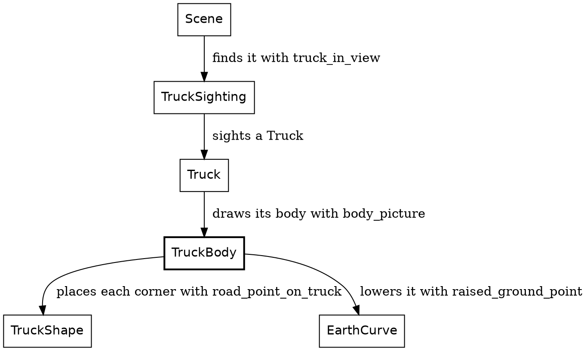
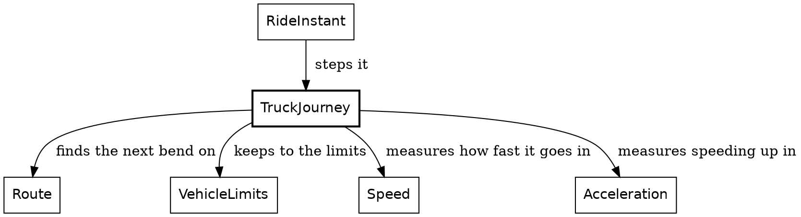

# Proofread 2: the truck chapters, rewritten

*For Steve's read, 2026-11-08. These are the three truck chapters as the book now builds them, after the refactor your first proofread asked for: `TruckProgress`, one module per lamp, placement split from the earth's lowering, `ComingBend` holding the turn angle, `Picture.composite`, and a new section, "Remembered, not worked out". The widget blocks show as fences. Comments welcome inline.*

---

## The truck

All through the ride, the rider follows a truck up the road. How the truck moves comes in the next chapter, and its lights in the one after. This chapter draws it: a plain truck, standing at a place on the road that's already known, and facing along the road.

```widget truck
A truck from behind, from behind and to one side, and from the side.
```

New in this chapter:

- Modules: `TruckSighting`, `TruckShape`, `TruckBody`

The modules that draw the truck


`TruckSighting` finds the truck on the road ahead. What it finds is a `Truck`, the truck with its lights, and with the lights off that's just the body this chapter draws. The truck is drawn however small it stands, because the rider is always looking for it.

### Shape, placement, projection

The truck is a real box, with a back, two sides, a roof, a windshield and a nose. It gets to the screen in three stages:

| Stage | What it does |
|---|---|
| Shape | Says where each corner is in the truck's own frame, measured from the middle of the trailer |
| Placement | Carries one point onto the road at the truck's spot, then lowers it for the earth's curve |
| Projection | Turns one whole face into a polygon on the screen |

Placement works a point at a time, because each corner stands at its own place on the road. Projection works a face at a time, for two reasons. A face that reaches behind the camera is clipped, and clipping can cut corners off a face and add new ones, so it needs the whole outline. And the faces are sorted by depth before they're drawn, and the sort orders faces, not points.

### Get the types right

A point in the truck's own frame is three distances, measured from the middle of the trailer:

```roc TruckShape.roc
## A point on the truck, in the truck's own frame: how far ahead of the
## trailer's center and how far to the right of it, each negative the other
## way, and how high above the road under the truck.
TruckPoint : {
	ahead : Distance,
	rightward : Distance,
	height : Distance,
}
```

A `TruckSetting` is what the truck is drawn from. It's a `Picture.Setting`, the setting every kind of thing beside the road draws from:

```roc Picture.roc
## What a kind of object draws its picture from: where it stands in the
## frame, the camera's focal length, and `context`, which is whatever else
## that kind needs. A kind that needs nothing more takes `{}`.
Setting(context) : {
	spot : Spot,
	focal_length : Pixels,
	context : context,
}
```

```roc TruckShape.roc
## How a truck is drawn: its spot, the camera's lens, and the road and
## vantage its points are seen from.
TruckSetting : Picture.Setting(TruckShape.TruckOnRoad)
```

The truck's context is the road its points are measured on, and the camera's vantage:

```roc TruckShape.roc
## What a truck is drawn from beyond its spot and the camera's lens: the road
## its points are measured on, and the camera's vantage.
TruckOnRoad : { road : RoadAhead.RoadView, vantage : Geom.Vantage }
```

### The functions

Placement is two functions. `TruckShape` moves one point along and across the road from the truck's spot, and lifts it:

```roc TruckShape.roc
## Where a point on the truck stands over the road: carried from the
## truck's frame onto the road at the truck's spot, and raised as far as the
## truck is off the ground.
road_point_on_truck : TruckShape.TruckSetting, TruckShape.TruckPoint -> EarthCurve.PointOverRoad
road_point_on_truck = |truck, { ahead, rightward, height }| {
	center = truck.spot.road_point()
	{
		place: truck.spot.place(),
		road_point: { along: center.along.plus(ahead), across: center.across.plus(rightward) },
		height: truck.spot.lift().plus(height),
	}
}
```

`EarthCurve` finds where that lands in the rider's view, and lowers it by however far the ground has curved away beneath it. The headlights and the brake lights use it too:

```roc EarthCurve.roc
## Where `point` lands in the view of the camera at `vantage` on `road`.
## The ground curves away from the rider, so the point is lowered by how far
## the ground has dropped beneath it.
raised_ground_point : EarthCurve.RoadSight, EarthCurve.PointOverRoad -> RiderView.RaisedPoint
raised_ground_point = |{ road, vantage }, { place, road_point, height }|
	lowered_point(RoadAhead.rider_point_at(road, { vantage, place, road_point }), height)
```

`TruckBody.face` places each corner of a face that way. So a face is just a color and a list of `TruckPoint`s. Here's a side, walked around its outline from the back of the trailer to the nose and back:

```roc TruckBody.roc
## A side of the truck `rightward` of its centre line: up the back of the
## trailer, along its roof and the cab's, down the windshield's edge and the
## nose, back along the cab's floor, and down to the trailer's floor.
side : TruckShape.TruckSetting, Distance -> Polygon.FlatPolygon
side = |truck, rightward| {
	box = TruckShape.truck_box
	face(
		truck,
		{
			color: side_color,
			corners: [
				{ ahead: box.rear, rightward, height: TruckShape.trailer_bottom },
				{ ahead: box.rear, rightward, height: TruckShape.truck_height },
				{ ahead: box.roof_front, rightward, height: TruckShape.truck_height },
				{ ahead: box.nose, rightward, height: TruckShape.hood_height },
				{ ahead: box.nose, rightward, height: TruckShape.cab_bottom },
				{ ahead: box.trailer_front, rightward, height: TruckShape.cab_bottom },
				{ ahead: box.trailer_front, rightward, height: TruckShape.trailer_bottom },
			],
		},
	)
}
```

The back, the roof, the windshield and the nose are each a strip across the truck, so they share `TruckShape.strip_corners`. The tires are circles standing on the road.

Projection comes last. `TruckBody` sorts the faces far to near, so a nearer face drawn later covers a farther one, and then clips and projects each one:

```roc TruckBody.roc
## The truck's body, its farthest faces first. A face is ordered by the
## mean of its corners' distances ahead.
body_picture : TruckShape.TruckSetting -> Picture
body_picture = |truck|
	Picture.from_shapes(
		DepthSort.sort_by(
			faces(truck),
			|face| DepthSort.mean_depth(face.corners.map(|corner| corner.forward)),
		)
			.keep_oks(|face| Polygon.clipped_polygon(face, truck.focal_length)),
	)
```

That's a truck. Next, it moves.

## The truck's motion

The truck is what the rider chases. It starts 500 metres up the road, and for most of the ride the rider closes in on it, but not steadily:

| Step | Rider, along the route | Truck, along the route | Lead |
|---|---|---|---|
| 0 | 0 metres | 500 metres | 500 metres |
| 2,000 | 1,831 metres | 2,274 metres | 443 metres |
| 4,000 | 4,796 metres | 5,051 metres | 255 metres |
| 6,000 | 6,790 metres | 6,931 metres | 141 metres |

The closest the rider gets is 50 metres, at step 6,374. After that the rider slows to stop at the route's end, at step 6,746. The truck doesn't wait. It drives on past the end of the route and vanishes, since nothing is drawn beyond the end. You never catch it. Some riders have complained about the darn truck, and that's the design. At least for now haha.

New in this chapter:

- Modules: `TruckJourney`

### A tease, carried out by physics

The truck's driver is teasing the rider: staying ahead, but letting the rider gain. That's the hand of god, a rule that bends the world on purpose, for the story. Here it's one function, `tease_position`. Given how far the rider has come, it says where the truck would like to be. The lead it aims for shrinks from 500 metres at the start of the route to 100 at the end.

Everything else is plain physics. The truck speeds up while it's short of that mark and holds its speed once it's past it. It slows for the bends, and that's mostly where the rider gains. The tease only ever speeds the truck up, so near the end the rider can get closer than the 100 metres it aims for. The truck can always pull away again, because it outdoes the rider by 10%, in both its acceleration and its top speed.

### Remembered, not worked out

The sun is worked out from the clock. `sun_direction_at` takes a clock, so you can ask about any step and get an answer, without running the ride up to it.

The truck can't be worked out that way, because where it is depends on where the rider has been. So the truck is carried forward. Its step, `truck_progress_at_next_step`, takes a `TruckProgress` and returns the next one. The ride remembers four things from one step to the next, the rider, the truck, the clock and the encounter plan, and the truck is one of them.

That's what makes the order of a step matter. The rider moves first, and then the truck reads where the rider has got to. The rider never reads the truck.

### Get the types right

The truck's state is three fields:

```roc TruckJourney.roc, in TruckProgress
## How far along the route the truck is, how fast it is going, and whether
## its last step slowed it. Nominal, not opaque: other modules read its
## fields.
TruckProgress := {
	route_position : Distance,
	speed : Speed,
	pace : TruckJourney.Pace,
	# ...
```

`route_position` is a `Distance` along the whole route, the same measure as the rider's progress, so the two can be compared directly. `Pace` says whether the truck's last step slowed it down:

```roc TruckJourney.roc
## Whether the truck's last step slowed it.
Pace := [Slowing, NotSlowing].{
	is_eq : _
}
```

A bend ahead of the truck is its own type, and so is the answer to "is there one":

```roc TruckJourney.roc
## A bend ahead of the truck: how far off it is, and how sharply it turns.
ComingBend : { distance : Distance, turn : Angle.Turn }
```

```roc TruckJourney.roc
## The next bend of the route past a point, or none: the route ends first.
NextBend : [BendAhead(ComingBend), NoBendAhead]
```

`BendAhead` carries a `ComingBend`: how far off the bend is, and its turn, an angle. `NoBendAhead` carries nothing: the route ends before another bend, or the truck is already past the end. The only way to read a bend's distance is inside the branch where there is a bend.

### The functions

The modules around `TruckJourney`


`RideInstant` moves the truck once a step. All it hands over is how far along the route the rider has just got to, and the route itself:

```roc RideInstant.roc, in next
# ...
truck = TruckJourney.truck_progress_at_next_step(
	instant.truck,
	{ rider_distance: rider_place.distance_along(route), route },
	# ...
```

That record is the whole of the chase. `TruckJourney` imports none of the rider's modules, and the rider's modules don't import `TruckJourney`. What the two share is `VehicleLimits`, the limits both keep to, which is where the truck's 10% comes from.

The step works out the tease, then looks for the next bend:

```roc TruckJourney.roc
## The truck's progress one step on: where the rider is along the route,
## and the route itself, decide its pace.
truck_progress_at_next_step : TruckJourney.TruckProgress,
{
	rider_distance : Distance,
	route : Route,
} -> TruckJourney.TruckProgress
truck_progress_at_next_step = |progress, { rider_distance, route }| {
	tease = tease_position({ rider_distance, route_length: route.route_length() })
	match next_bend(route, progress.route_position) {
		BendAhead(bend) =>
			if bend.distance <= brake_distance {
				progress_braking_for(progress, bend)
			} else {
				progress_toward_tease(progress, tease)
			}
		NoBendAhead => progress_toward_tease(progress, tease)
	}
}
```

Here's the tease itself. The lead shrinks in step with the rider's progress along the route:

```roc TruckJourney.roc
## The tease: where the truck aims to be along the route when the rider is
## `rider_distance` along it, so that the rider closes in on it over the whole
## route. The lead it aims for shrinks from `tease_start_lead` to
## `tease_finish_lead` in step with the rider's progress. The truck only chases
## this mark, and never slows to keep to it, so the real gap closes unevenly: the
## truck can run past the mark on a straight, and it slows for the bends.
tease_position : { rider_distance : Distance, route_length : Distance } -> Distance
tease_position = |{ rider_distance, route_length }| {
	fraction_left = 1.0 - rider_distance.ratio_to(route_length)
	extra_lead = tease_start_lead.minus(tease_finish_lead).times(fraction_left)
	rider_distance.plus(tease_finish_lead).plus(extra_lead)
}
```

Finding the next bend walks the route's segments with their ends, and takes the first one that ends past the truck:

```roc TruckJourney.roc
## The next bend of `route` past `route_position`.
next_bend : Route, Distance -> NextBend
next_bend = |route, route_position|
	match route.segments_with_ends().find_first(|stretch| route_position < stretch.end) {
		Ok({ segment, end }) =>
			match segment.ending {
				Bends({ turn, .. }) => BendAhead({ distance: end.minus(route_position), turn })
				RouteEnds => NoBendAhead
			}
		Err(NotFound) => NoBendAhead
	}
```

Read its signature out loud: `next_bend : Route, Distance -> NextBend`. The next bend, on a route, past a distance. That's what a signature should do: say what the function is for, before you read its body.

Then the two ways to take a step. Both sit below the module's block, so they're private, and both are arithmetic on `Speed`. Within 60 metres of a bend, the truck brakes so it reaches the bend at its cautious speed. `VehicleLimits.turn_speed` is the speed a turn allows, and the rider's throttle asks it too. The truck's own rule is that limit times its caution, 80%, to leave a margin:

```roc TruckJourney.roc
## How fast the truck takes a bend of `turn`: the speed the bend allows,
## less a margin.
cautious_turn_speed : Angle.Turn -> Speed
cautious_turn_speed = |turn| VehicleLimits.turn_speed(turn).scaled_by(turn_caution)
```

```roc TruckJourney.roc
## The truck's progress one step on, slowing for `bend`, so that it reaches the
## bend at a cautious speed.
progress_braking_for : TruckJourney.TruckProgress, ComingBend -> TruckJourney.TruckProgress
progress_braking_for = |progress, bend| {
	target_speed = TruckJourney.cautious_turn_speed(bend.turn)
	acceleration = VehicleLimits.braking_to(
		progress.speed,
		{ target: target_speed, within: bend.distance },
	)
	# The steady brake may land a little under its target; `VehicleLimits.braking_to`
	# says why. The truck alone keeps to the target here.
	speed = target_speed.max(progress.speed.accelerated_by(acceleration))
	{
		route_position: progress.route_position.plus(speed.step_length()),
		speed,
		pace: if speed < progress.speed {
			Slowing
		} else {
			NotSlowing
		},
	}
}
```

`VehicleLimits.braking_to` works out one steady brake that reaches the target speed at the bend. A steady brake can land a little under the target, so `target_speed.max(...)` holds the truck there. A brake that would take the speed below zero is a bug, and `braking_to` crashes on one. Otherwise, the truck chases:

```roc TruckJourney.roc
## The truck's progress one step on with no bend close: it speeds up while it
## is short of `tease`, and otherwise holds its speed.
progress_toward_tease : TruckJourney.TruckProgress, Distance -> TruckJourney.TruckProgress
progress_toward_tease = |progress, tease| {
	speed =
		if progress.route_position < tease {
			chase_top_speed.min(progress.speed.accelerated_by(chase_acceleration))
		} else {
			progress.speed
		}
	{
		route_position: progress.route_position.plus(speed.step_length()),
		speed,
		pace: NotSlowing,
	}
}
```

That's a truck you can chase. The next chapter lights it.

## The truck's lights

The ride runs from day into night, so the truck's headlights come on near the end. The truck brakes for bends, so its brake lights show whenever you're close to it, even by day. The truck drives exactly the same with its lights on or off.

New in this chapter:

- Modules: `Truck`, `TruckHeadlights`, `TruckBrakeLights`

### One module per lamp

Each kind of lamp gets a module, and each module owns two things: whether its lamp is on, and how the lamp looks.

The headlights work like a light sensor on the lamps themselves: once the sky is dark enough, they're on. The Sky module tells us how dark it is: `Sky.darkness_at` answers a `Fraction`, 0 by day and 1 at full dark. The sensor reads that.

The brake lights come on while the truck is slowing down. That's a fact about the truck's own last step, its `Pace`, so they follow the truck.

### Get the types right

`TruckHeadlights` and `TruckBrakeLights` are each `[On, Off]`. A `Truck` is the truck as the scene draws it this frame, so it holds one field per lamp:

```roc Truck.roc, in Truck
## Which of the truck's lights are on.
Truck := { headlights : TruckHeadlights, brake_lights : TruckBrakeLights }.{
# ...
```

### The functions

Each frame, `FrameView` builds the `Truck`. It hands the sky's darkness to `TruckHeadlights` and the truck's pace to `TruckBrakeLights`:

```roc FrameView.roc, in ride_facts
# ...
headlights: TruckHeadlights.at(Sky.darkness_at(instant.clock)),
brake_lights: TruckBrakeLights.at(instant.truck.pace),
# ...
```

Each lamp's module applies its own rule:

```roc TruckHeadlights.roc
## The headlights under a sky of `darkness`: on once the sky is dark
## enough, like a light sensor on the lamps.
at : Fraction -> TruckHeadlights
at = |darkness|
	if darkness >= headlights_on_darkness {
		On
	} else {
		Off
	}
```

```roc TruckBrakeLights.roc
## The brake lights of a truck going at `pace`: on while its last step
## slowed it.
at : TruckJourney.Pace -> TruckBrakeLights
at = |pace|
	match pace {
		Slowing => On
		NotSlowing => Off
	}
```

The headlights come on at this darkness:

```roc TruckHeadlights.roc
## The headlights come on once the sky is 41.2% dark, about when the sun sinks
## behind the west range. The value was measured once, on this ride;
## gates/expects/RideExpects.roc pins the step.
headlights_on_darkness : Fraction
headlights_on_darkness = Fraction.of(0.412)
```

On this ride, that's step 3,555 of 6,746. Once on, they stay on, because from there the sky only darkens.

Each lamp's `picture` matches both tags, and an `Off` lamp is an empty picture. `TruckHeadlights` paints the beams as wedges that fade from the lamp toward their far end. `TruckBrakeLights` paints two lamps on the back of the trailer, each with a glow around it. Both place their points the way the body does, with `TruckShape.road_point_on_truck` and `EarthCurve.raised_ground_point`.

`Truck` puts the three pictures together. `Picture.composite` makes one picture of several, each painted over the ones before:

```roc Picture.roc
## One picture of several, each painted over the ones before it.
composite : List(Picture) -> Picture
composite = |pictures| Picture.(pictures.join_map(Picture.to_shapes))
```

The beams go first, then the body, then the brake lights:

```roc Truck.roc
## How the truck looks. Every point on it is measured on the road, from where
## its trailer is centered, and seen from the camera's vantage, so those are
## its context.
scenery_picture : Truck, TruckShape.TruckSetting -> Picture
scenery_picture = |truck, setting|
	Picture.composite([
		truck.headlights.picture(setting),
		TruckBody.body_picture(setting),
		truck.brake_lights.picture(setting),
	])
```

`TruckBody` knows nothing of the lights: they're drawn around it.

Step the ride back past step 3,555, and the headlights go off again. Nothing turns them off; they only ever read the sky. The brake lights read the truck's last step, which the ride keeps, so they come back with it.
