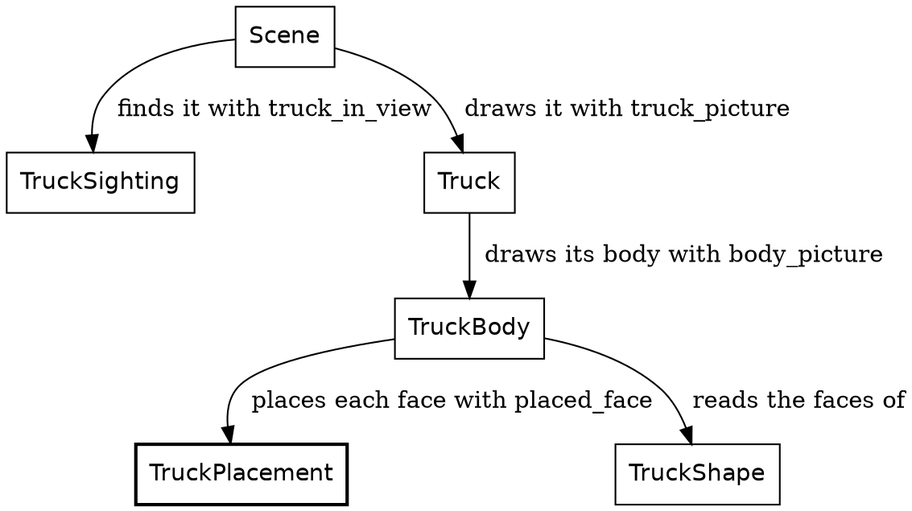
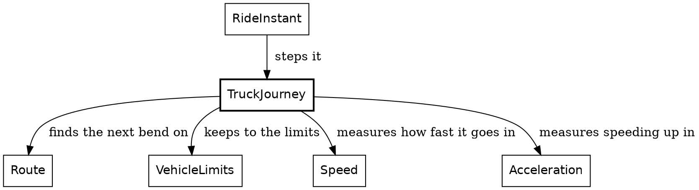

# Proofread 3: the truck chapters, shape first

*For Steve's read, 2026-11-10. The three truck chapters as the book builds them now: the truck's shape first (the blues, the faces as plain values), rigid placement from the sighting's foot, heading and the ground's drop, `Truck.truck_picture` as the one entry point, and the lights one at a time. The motion chapter you've seen; it changed only where the truck's types did. Widget blocks show as fences. Comments welcome inline.*

---

## The truck

All through the ride, the rider follows a truck up the road. How the truck moves comes in the next chapter, and its lights in the one after. This chapter draws it: a plain truck, standing at a place on the road that's already known, and facing along the road.

```widget truck
A truck from behind, from behind and to one side, and from the side.
```

New in this chapter:

- Modules: `TruckShape`, `TruckSighting`, `TruckPlacement`, `TruckBody`, `Truck`

### What the truck looks like

The truck is blue. `truck_blue`, a navy, paints the back of its trailer, its windshield and its nose. Its sides are `side_blue`, a darker navy, and its roof is `roof_blue`, a lighter blue. Its tires are `tire_black`. There's no glass: the windshield is painted the truck's blue.

`TruckShape` says what the truck looks like, and nothing else. It doesn't know where the truck is, or that there's a road. Each part of the truck is a face, a color and its corners:

```roc TruckShape.roc
## A face of the truck: a color and its corners, in the truck's own frame.
TruckFace : { color : RgbColor, corners : List(TruckShape.TruckPoint) }
```

A corner is a point in the truck's own frame, three distances measured from the middle of the trailer:

```roc TruckShape.roc
## A point on the truck, in the truck's own frame: how far ahead of the
## trailer's center and how far to the right of it, each negative the other
## way, and how high above the road under the truck.
TruckPoint : {
	ahead : Distance,
	rightward : Distance,
	height : Distance,
}
```

The sides come first. Each one is a single outline, the trailer and the cab together, walked from the back of the trailer to the nose and back:

```roc TruckShape.roc
## The truck's two sides, left then right. Each side is one outline, the
## trailer and the cab together: up the back of the trailer, along its roof
## and the cab's, down the windshield's edge and the nose, back along the
## cab's floor, and down to the trailer's floor.
sides : List(TruckShape.TruckFace)
sides = {
	box = truck_box
	[box.left, box.right].map(
		|rightward| {
			color: side_blue,
			corners: [
				{ ahead: box.rear, rightward, height: trailer_bottom },
				{ ahead: box.rear, rightward, height: truck_height },
				{ ahead: box.roof_front, rightward, height: truck_height },
				{ ahead: box.nose, rightward, height: hood_height },
				{ ahead: box.nose, rightward, height: cab_bottom },
				{ ahead: box.trailer_front, rightward, height: cab_bottom },
				{ ahead: box.trailer_front, rightward, height: trailer_bottom },
			],
		},
	)
}
```

The trailer's back, the roof, the windshield and the nose are each a strip across the truck. Here's the windshield, sloping down from the cab's roof to its nose:

```roc TruckShape.roc
## The cab's windshield, sloping down from the roof to the nose. It is
## painted the truck's blue: there is no glass.
windshield : TruckShape.TruckFace
windshield = across_truck(
	truck_blue,
	{
		near: { ahead: truck_box.roof_front, height: truck_height },
		far: { ahead: truck_box.nose, height: hood_height },
	},
)
```

The tires are circles standing on the road, one on each side of each axle:

```roc TruckShape.roc
## A tire on each side of each axle, the left side's and then the right's.
## A tire is a circle standing on the road.
tires : List(TruckShape.TruckFace)
tires = {
	box = truck_box
	tire = |{ axle, rightward }| {
		color: tire_black,
		corners: TruckShape.circle_angles(tire_sides).map(
			|angle| {
				ahead: axle.plus(tire_radius.times(angle.cos())),
				rightward,
				height: tire_radius.plus(tire_radius.times(angle.sin())),
			},
		),
	}
	[
		axles.map(|axle| tire({ axle, rightward: box.left })),
		axles.map(|axle| tire({ axle, rightward: box.right })),
	].join()
}
```

And the whole truck is its faces, in one list:

```roc TruckShape.roc
## The whole truck as it is built: its two sides, the trailer's back, its
## roof, the cab's windshield and nose, then its tires.
truck_faces : List(TruckShape.TruckFace)
truck_faces = [
	sides,
	[trailer_back, roof, windshield, nose],
	tires,
].join()
```

### Shape, placement, projection

That shape gets to the screen in three stages:

| Stage | What it does |
|---|---|
| Shape | Says where each corner of each face is in the truck's own frame |
| Placement | Turns one point by the truck's heading, carries it out from the truck's foot, and lowers it by the ground's drop |
| Projection | Turns one whole face into a polygon on the screen |

Placement works a point at a time. Projection works a face at a time, for two reasons. A face that reaches behind the camera is clipped, and clipping can cut corners off a face and add new ones, so it needs the whole outline. And the faces are sorted by depth before they're drawn, and the sort orders faces, not points.

The modules that draw the truck


### Placement: one rigid body

A truck doesn't bend. So it's placed the way any 3D program places a rigid thing: every corner moves together. `TruckSighting` finds the truck on the road ahead, and works out three things once. The truck's spot, which holds its foot in the rider's view and the ground's drop beneath it. Which way it heads against the camera. And which of its lights are on:

```roc Truck.roc
## The truck as the camera sees it in one frame: where its foot stands,
## which way it heads against the camera, and which of its lights are on.
SightedTruck : {
	spot : Spot,
	heading : Angle.Turn,
	lights : Truck,
}
```

The heading is the road's direction at the truck's spot. A segment comes into the rider's view by turns and shifts alone, so the way from the spot to a point one metre further along is the road's way all along the segment:

```roc TruckSighting.roc
## Which way the road runs at `road_point` on the segment at `place`, against
## the camera at `vantage`: zero straight away from it, positive to the
## right. A segment is carried into the rider's view by turns and shifts
## alone, so the way from the point to one a metre further along is the
## road's way all along the segment.
road_heading : RoadAhead.RoadView,
{
	vantage : Geom.Vantage,
	place : SegmentFromRider,
	road_point : Geom.RoadPoint,
} -> Angle.Turn
road_heading = |road, { vantage, place, road_point }| {
	further_along = { ..road_point, along: road_point.along.plus(Distance.metres(1.0)) }
	here = RoadAhead.rider_point_at(road, { vantage, place, road_point })
	there = RoadAhead.rider_point_at(road, { vantage, place, road_point: further_along })
	Angle.Turn.radians(
		F64.atan2({
			x: there.forward.minus(here.forward).to_metres(),
			y: there.right.minus(here.right).to_metres(),
		}),
	)
}
```

What the truck is drawn from is that sighting and the camera's lens:

```roc TruckPlacement.roc
## How a truck is drawn: its spot, which way it heads against the camera,
## and the camera's lens. A heading of zero runs straight away from the
## camera, and a positive one turns to the right.
TruckSetting : {
	spot : Spot,
	heading : Angle.Turn,
	focal_length : Pixels,
}
```

Placement is one function. It turns a point by the heading, carries it out from the foot, and lifts it. The headlights and the brake lights use it too:

```roc TruckPlacement.roc
## Where a point on the truck stands in the rider's view: turned by the
## truck's heading about its foot, carried out from the foot, raised as far
## as the truck is off the ground and lowered by the ground's drop beneath
## the truck's spot.
raised_point : TruckPlacement.TruckStance, TruckShape.TruckPoint -> RiderView.RaisedPoint
raised_point = |{ spot, heading }, { ahead, rightward, height }| {
	foot = spot.foot()
	cos_heading = heading.to_radians().cos()
	sin_heading = heading.to_radians().sin()
	ahead_metres = ahead.to_metres()
	rightward_metres = rightward.to_metres()
	{
		forward: foot.forward().plus(
			Distance.metres(ahead_metres * cos_heading - rightward_metres * sin_heading),
		),
		right: foot.right().plus(
			Distance.metres(ahead_metres * sin_heading + rightward_metres * cos_heading),
		),
		height: spot.lift().plus(height).minus(spot.drop()),
	}
}
```

Every corner is lowered by the same drop, how far the ground has curved away beneath the truck's spot. Across a 12-metre truck the drop changes by a few centimetres at most, far less than a pixel.

### Drawing it

`TruckPlacement.placed_face` places each corner of a face. Then `TruckBody` sorts the faces far to near, so a nearer face drawn later covers a farther one, and clips and projects each one:

```roc TruckBody.roc
## The truck's body, its farthest faces first. A face is ordered by the
## mean of its corners' distances ahead.
body_picture : TruckPlacement.TruckSetting -> Picture
body_picture = |truck| {
	stance = { spot: truck.spot, heading: truck.heading }
	Picture.from_shapes(
		DepthSort.sort_by(
			TruckShape.truck_faces.map(|face| TruckPlacement.placed_face(stance, face)),
			|face| DepthSort.mean_depth(face.corners.map(|corner| corner.forward)),
		)
			.keep_oks(|face| Polygon.clipped_polygon(face, truck.focal_length)),
	)
}
```

One function draws the whole truck from its sighting. The lens goes beside the sighting, as it does for every sighting in the game: a sighting says where a thing is, and the frame's lens draws it.

```roc Truck.roc
## How the truck looks from its sighting, through a lens of
## `focal_length`. The lens is passed beside the sighting, as every
## sighting's is: a sighting says where a thing is, and the frame's lens
## draws it.
truck_picture : Truck.SightedTruck, Pixels -> Picture
truck_picture = |{ spot, heading, lights }, focal_length| {
	setting = { spot, heading, focal_length }
	Picture.composite([
		lights.headlights.picture(setting),
		TruckBody.body_picture(setting),
		lights.brake_lights.picture(setting),
	])
}
```

With the lights off, the beams and the brake lights are empty pictures, and that's just the body. The truck is drawn however small it stands, because the rider is always looking for it.

That's a truck. Next, it moves.

## The truck's motion

The truck is what the rider chases. It starts 500 metres up the road, and for most of the ride the rider closes in on it, but not steadily:

| Step | Rider, along the route | Truck, along the route | Lead |
|---|---|---|---|
| 0 | 0 metres | 500 metres | 500 metres |
| 2,000 | 1,831 metres | 2,274 metres | 443 metres |
| 4,000 | 4,796 metres | 5,051 metres | 255 metres |
| 6,000 | 6,790 metres | 6,931 metres | 141 metres |

The closest the rider gets is 50 metres, at step 6,374. After that the rider slows to stop at the route's end, at step 6,746. The truck doesn't wait. It drives on past the end of the route and vanishes, since nothing is drawn beyond the end. You never catch it. Some riders have complained about the darn truck, and that's the design. At least for now haha.

New in this chapter:

- Modules: `TruckJourney`

### A tease, carried out by physics

The truck's driver is teasing the rider: staying ahead, but letting the rider gain. That's the hand of god, a rule that bends the world on purpose, for the story. Here it's one function, `tease_position`. Given how far the rider has come, it says where the truck would like to be. The lead it aims for shrinks from 500 metres at the start of the route to 100 at the end.

Everything else is plain physics. The truck speeds up while it's short of that mark and holds its speed once it's past it. It slows for the bends, and that's mostly where the rider gains. The tease only ever speeds the truck up, so near the end the rider can get closer than the 100 metres it aims for. The truck can always pull away again, because it outdoes the rider by 10%, in both its acceleration and its top speed.

### Remembered, not worked out

The sun is worked out from the clock. `sun_direction_at` takes a clock, so you can ask about any step and get an answer, without running the ride up to it.

The truck can't be worked out that way, because where it is depends on where the rider has been. So the truck is carried forward. Its step, `truck_progress_at_next_step`, takes a `TruckProgress` and returns the next one. The ride remembers four things from one step to the next, the rider, the truck, the clock and the encounter plan, and the truck is one of them.

That's what makes the order of a step matter. The rider moves first, and then the truck reads where the rider has got to. The rider never reads the truck.

### Get the types right

The truck's state is three fields:

```roc TruckJourney.roc, in TruckProgress
## How far along the route the truck is, how fast it is going, and whether
## its last step slowed it. Nominal, not opaque: other modules read its
## fields.
TruckProgress := {
	route_position : Distance,
	speed : Speed,
	pace : TruckJourney.Pace,
	# ...
```

`route_position` is a `Distance` along the whole route, the same measure as the rider's progress, so the two can be compared directly. `Pace` says whether the truck's last step slowed it down:

```roc TruckJourney.roc
## Whether the truck's last step slowed it.
Pace := [Slowing, NotSlowing].{
	is_eq : _
}
```

A bend ahead of the truck is its own type, and so is the answer to "is there one":

```roc TruckJourney.roc
## A bend ahead of the truck: how far off it is, and how sharply it turns.
ComingBend : { distance : Distance, turn : Angle.Turn }
```

```roc TruckJourney.roc
## The next bend of the route past a point, or none: the route ends first.
NextBend : [BendAhead(ComingBend), NoBendAhead]
```

`BendAhead` carries a `ComingBend`: how far off the bend is, and its turn, an angle. `NoBendAhead` carries nothing: the route ends before another bend, or the truck is already past the end. The only way to read a bend's distance is inside the branch where there is a bend.

### The functions

The modules around `TruckJourney`


`RideInstant` moves the truck once a step. All it hands over is how far along the route the rider has just got to, and the route itself:

```roc RideInstant.roc, in next
# ...
truck = TruckJourney.truck_progress_at_next_step(
	instant.truck,
	{ rider_distance: rider_place.distance_along(route), route },
	# ...
```

That record is the whole of the chase. `TruckJourney` imports none of the rider's modules, and the rider's modules don't import `TruckJourney`. What the two share is `VehicleLimits`, the limits both keep to, which is where the truck's 10% comes from.

The step works out the tease, then looks for the next bend:

```roc TruckJourney.roc
## The truck's progress one step on: where the rider is along the route,
## and the route itself, decide its pace.
truck_progress_at_next_step : TruckJourney.TruckProgress,
{
	rider_distance : Distance,
	route : Route,
} -> TruckJourney.TruckProgress
truck_progress_at_next_step = |progress, { rider_distance, route }| {
	tease = tease_position({ rider_distance, route_length: route.route_length() })
	match next_bend(route, progress.route_position) {
		BendAhead(bend) =>
			if bend.distance <= brake_distance {
				progress_braking_for(progress, bend)
			} else {
				progress_toward_tease(progress, tease)
			}
		NoBendAhead => progress_toward_tease(progress, tease)
	}
}
```

Here's the tease itself. The lead shrinks in step with the rider's progress along the route:

```roc TruckJourney.roc
## The tease: where the truck aims to be along the route when the rider is
## `rider_distance` along it, so that the rider closes in on it over the whole
## route. The lead it aims for shrinks from `tease_start_lead` to
## `tease_finish_lead` in step with the rider's progress. The truck only chases
## this mark, and never slows to keep to it, so the real gap closes unevenly: the
## truck can run past the mark on a straight, and it slows for the bends.
tease_position : { rider_distance : Distance, route_length : Distance } -> Distance
tease_position = |{ rider_distance, route_length }| {
	fraction_left = 1.0 - rider_distance.ratio_to(route_length)
	extra_lead = tease_start_lead.minus(tease_finish_lead).times(fraction_left)
	rider_distance.plus(tease_finish_lead).plus(extra_lead)
}
```

Finding the next bend walks the route's segments with their ends, and takes the first one that ends past the truck:

```roc TruckJourney.roc
## The next bend of `route` past `route_position`.
next_bend : Route, Distance -> NextBend
next_bend = |route, route_position|
	match route.segments_with_ends().find_first(|stretch| route_position < stretch.end) {
		Ok({ segment, end }) =>
			match segment.ending {
				Bends({ turn, .. }) => BendAhead({ distance: end.minus(route_position), turn })
				RouteEnds => NoBendAhead
			}
		Err(NotFound) => NoBendAhead
	}
```

Read its signature out loud: `next_bend : Route, Distance -> NextBend`. The next bend, on a route, past a distance. That's what a signature should do: say what the function is for, before you read its body.

Then the two ways to take a step. Both sit below the module's block, so they're private, and both are arithmetic on `Speed`. Within 60 metres of a bend, the truck brakes so it reaches the bend at its cautious speed. `VehicleLimits.turn_speed` is the speed a turn allows, and the rider's throttle asks it too. The truck's own rule is that limit times its caution, 80%, to leave a margin:

```roc TruckJourney.roc
## How fast the truck takes a bend of `turn`: the speed the bend allows,
## less a margin.
cautious_turn_speed : Angle.Turn -> Speed
cautious_turn_speed = |turn| VehicleLimits.turn_speed(turn).scaled_by(turn_caution)
```

```roc TruckJourney.roc
## The truck's progress one step on, slowing for `bend`, so that it reaches the
## bend at a cautious speed.
progress_braking_for : TruckJourney.TruckProgress, ComingBend -> TruckJourney.TruckProgress
progress_braking_for = |progress, bend| {
	target_speed = TruckJourney.cautious_turn_speed(bend.turn)
	acceleration = VehicleLimits.braking_to(
		progress.speed,
		{ target: target_speed, within: bend.distance },
	)
	# The steady brake may land a little under its target; `VehicleLimits.braking_to`
	# says why. The truck alone keeps to the target here.
	speed = target_speed.max(progress.speed.accelerated_by(acceleration))
	{
		route_position: progress.route_position.plus(speed.step_length()),
		speed,
		pace: if speed < progress.speed {
			Slowing
		} else {
			NotSlowing
		},
	}
}
```

`VehicleLimits.braking_to` works out one steady brake that reaches the target speed at the bend. A steady brake can land a little under the target, so `target_speed.max(...)` holds the truck there. A brake that would take the speed below zero is a bug, and `braking_to` crashes on one. Otherwise, the truck chases:

```roc TruckJourney.roc
## The truck's progress one step on with no bend close: it speeds up while it
## is short of `tease`, and otherwise holds its speed.
progress_toward_tease : TruckJourney.TruckProgress, Distance -> TruckJourney.TruckProgress
progress_toward_tease = |progress, tease| {
	speed =
		if progress.route_position < tease {
			chase_top_speed.min(progress.speed.accelerated_by(chase_acceleration))
		} else {
			progress.speed
		}
	{
		route_position: progress.route_position.plus(speed.step_length()),
		speed,
		pace: NotSlowing,
	}
}
```

That's a truck you can chase. The next chapter lights it.

## The truck's lights

The ride runs from day into night, so the truck's headlights come on near the end. The truck brakes for bends, so its brake lights show whenever you're close to it, even by day. The truck drives exactly the same with its lights on or off.

Each frame, `FrameView` builds both lamps together. It hands the sky's darkness to `TruckHeadlights` and the truck's pace to `TruckBrakeLights`:

```roc FrameView.roc, in ride_facts
# ...
headlights: TruckHeadlights.at(Sky.darkness_at(instant.clock)),
brake_lights: TruckBrakeLights.at(instant.truck.pace),
# ...
```

New in this chapter:

- Modules: `TruckHeadlights`, `TruckBrakeLights`

Each kind of lamp gets a module, and each module owns two things: whether its lamp is on, and how the lamp looks. Both are `[On, Off]`, and a `Truck` holds one field per lamp:

```roc Truck.roc, in Truck
## Which of the truck's lights are on.
Truck := { headlights : TruckHeadlights, brake_lights : TruckBrakeLights }.{
# ...
```

### The headlights

The headlights work like a light sensor on the lamps themselves: once the sky is dark enough, they're on. `Sky.darkness_at` answers a `Fraction`, 0 by day and 1 at full dark, and the sensor reads that:

```roc TruckHeadlights.roc
## The headlights under a sky of `darkness`: on once the sky is dark
## enough, like a light sensor on the lamps.
at : Fraction -> TruckHeadlights
at = |darkness|
	if darkness >= headlights_on_darkness {
		On
	} else {
		Off
	}
```

They come on at this darkness:

```roc TruckHeadlights.roc
## The headlights come on once the sky is 41.2% dark, about when the sun sinks
## behind the west range. The value was measured once, on this ride;
## gates/expects/RideExpects.roc pins the step.
headlights_on_darkness : Fraction
headlights_on_darkness = Fraction.of(0.412)
```

On this ride, that's step 3,555 of 6,746. Once on, they stay on, because from there the sky only darkens.

Their `picture` matches both tags, and an `Off` lamp is an empty picture. When they're on, it paints two beams as wedges that fade from the lamp toward their far end. Their points are placed the way the body's are, with `TruckPlacement.raised_point`:

```roc TruckHeadlights.roc
## How the headlights look: their two beams while they are on, and nothing
## while they are off.
picture : TruckHeadlights, TruckPlacement.TruckSetting -> Picture
picture = |headlights, truck|
	match headlights {
		On => Picture.from_shapes(beam_shapes(truck))
		Off => Picture.from_shapes([])
	}
```

### The brake lights

The brake lights have a twist: they don't read the light at all. They follow the truck's pace, so they're on while its last step slowed it, by day or by night:

```roc TruckBrakeLights.roc
## The brake lights of a truck going at `pace`: on while its last step
## slowed it.
at : TruckJourney.Pace -> TruckBrakeLights
at = |pace|
	match pace {
		Slowing => On
		NotSlowing => Off
	}
```

Their picture works the same way as the headlights': two lamps on the back of the trailer, each with a glow around it, and nothing when they're off:

```roc TruckBrakeLights.roc
## How the brake lights look: the two lamps and their glows while they are
## on, and nothing while they are off.
picture : TruckBrakeLights, TruckPlacement.TruckSetting -> Picture
picture = |brake_lights, truck|
	match brake_lights {
		On => Picture.from_shapes(lamp_pair_shapes(truck))
		Off => Picture.from_shapes([])
	}
```

### All together

`Picture.composite` makes one picture of several, each painted over the ones before:

```roc Picture.roc
## One picture of several, each painted over the ones before it.
composite : List(Picture) -> Picture
composite = |pictures| Picture.(pictures.join_map(Picture.to_shapes))
```

`Truck.truck_picture`, from the chapter that drew the truck, puts the beams first, then the body, then the brake lights:

```roc Truck.roc, in truck_picture
# ...
Picture.composite([
	lights.headlights.picture(setting),
	TruckBody.body_picture(setting),
	lights.brake_lights.picture(setting),
	# ...
```

`TruckBody` knows nothing of the lights: they're drawn around it.

Step the ride back past step 3,555, and the headlights go off again. Nothing turns them off; they only ever read the sky. The brake lights read the truck's last step, which the ride keeps, so they come back with it.

