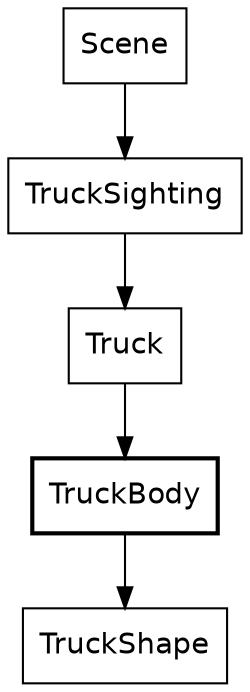
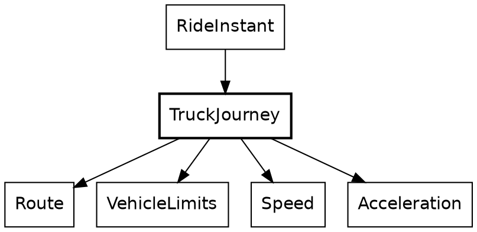

# Proofread: The truck, its motion, and its lights

*For Steve's read, 2026-11-08. Three chapters as the book builds them, code filled in, with today's final names: `Truck` is the truck as drawn, `TruckJourney` its motion. The widget blocks show as fences here; the first is a static picture of a blue truck from three angles. Comments welcome inline.*

---

## The truck

All through the ride, the rider follows a truck up the road. How the truck moves comes in the next chapter, and its lights in the one after. This chapter draws it: a plain truck, standing at a place on the road that's already known, and facing along the road.

```widget truck
A truck from behind, from behind and to one side, and from the side.
```

New in this chapter:

- Modules: `TruckSighting`, `TruckShape`, `TruckBody`

The modules that draw the truck


`TruckSighting` finds the truck on the road ahead. What it finds is a `Truck`, the truck with its lights, and with the lights off that's just the body this chapter draws. The truck is drawn however small it stands, because the rider is always looking for it.

### Three maps

The truck is a real box, with a back, two sides, a roof, a windshield and a nose. Each corner of it goes through three maps on its way to the screen. Its shape is written in the truck's own frame. Its placement carries that frame onto the road at the truck's spot. Its projection is the camera turning the result into a point on the screen.

### Get the types right

A point in the truck's own frame is three distances, measured from the middle of the trailer:

```roc TruckShape.roc
## A point on the truck, in the truck's own frame: how far ahead of the
## trailer's center and how far to the right of it, each negative the other
## way, and how high above the road under the truck.
TruckPoint : {
	ahead : Distance,
	rightward : Distance,
	height : Distance,
}
```

A `TruckSetting` holds what a point is drawn from: the truck's spot on the road, including how far the road under it is lifted, and the camera's vantage.

### The functions

One function does the first two maps. It moves the point along and across the road from the truck's spot, finds where that lands in the rider's view, and lowers it by however far the ground has curved away beneath it:

```roc TruckShape.roc
## Where a point on the truck lands in the rider's view, raised as far as
## the truck is off the ground. The point is carried from the truck's frame
## onto the road at the truck's spot. The ground curves away from the rider,
## so the point is lowered by how far the ground has dropped beneath it.
raised_point_on_truck : TruckShape.TruckSetting, TruckShape.TruckPoint -> RiderView.RaisedPoint
raised_point_on_truck = |truck, { ahead, rightward, height }| {
	place = truck.spot.place()
	center = truck.spot.road_point()
	on_ground = RoadAhead.rider_point_at(
		truck.context.road,
		{
			vantage: truck.context.vantage,
			place,
			road_point: {
				along: center.along.plus(ahead),
				across: center.across.plus(rightward),
			},
		},
	)
	{
		right: on_ground.right,
		forward: on_ground.forward,
		height: truck.spot.lift().plus(height).minus(EarthCurve.ground_drop(on_ground)),
	}
}
```

So a face is just a list of `TruckPoint`s. Here's a side, walked around its outline from the back of the trailer to the nose and back:

```roc TruckBody.roc
## A side of the truck `rightward` of its centre line: up the back of the
## trailer, along its roof and the cab's, down the windshield's edge and the
## nose, back along the cab's floor, and down to the trailer's floor.
side : TruckShape.TruckSetting, Distance -> RiderView.FlatPolygon
side = |truck, rightward| {
	box = TruckShape.truck_box
	face(
		truck,
		{
			color: side_color,
			corners: [
				{ ahead: box.rear, rightward, height: TruckShape.trailer_bottom },
				{ ahead: box.rear, rightward, height: TruckShape.truck_height },
				{ ahead: box.roof_front, rightward, height: TruckShape.truck_height },
				{ ahead: box.nose, rightward, height: TruckShape.hood_height },
				{ ahead: box.nose, rightward, height: TruckShape.cab_bottom },
				{ ahead: box.trailer_front, rightward, height: TruckShape.cab_bottom },
				{ ahead: box.trailer_front, rightward, height: TruckShape.trailer_bottom },
			],
		},
	)
}
```

The back, the roof, the windshield and the nose are each a strip across the truck, so they share `TruckShape.strip_corners`. The tires are circles standing on the road.

The third map happens last. `TruckBody` sorts the faces far to near, so a nearer face drawn later covers a farther one, and then projects each one, clipping whatever is behind the camera:

```roc TruckBody.roc
## The truck's body, its farthest faces first. A face is ordered by the
## mean of its corners' distances ahead.
body_shapes : TruckShape.TruckSetting -> List(Shapes.Shape)
body_shapes = |truck|
	DepthSort.sort_by(
		faces(truck),
		|face| DepthSort.mean_depth(face.corners.map(|corner| corner.forward)),
	)
		.keep_oks(|face| Polygon.clipped_polygon(face, truck.focal_length))
```

That's a truck. Next, it moves.

## The truck's motion

The truck is what the rider chases. It starts 500 metres up the road, and for most of the ride the rider closes in on it, but not steadily:

| Step | Rider, along the route | Truck, along the route | Lead |
|---|---|---|---|
| 0 | 0 metres | 500 metres | 500 metres |
| 2,000 | 1,831 metres | 2,274 metres | 443 metres |
| 4,000 | 4,796 metres | 5,051 metres | 255 metres |
| 6,000 | 6,790 metres | 6,931 metres | 141 metres |

The closest the rider gets is 50 metres, at step 6,374. After that the rider slows to stop at the route's end, at step 6,746. The truck doesn't wait. It drives on past the end of the route and vanishes, since nothing is drawn beyond the end. You never catch it. Some riders have complained about the darn truck, and that's the design. At least for now haha.

New in this chapter:

- Modules: `TruckJourney`

### A tease, carried out by physics

The truck's driver is teasing the rider: staying ahead, but letting the rider gain. That's the hand of god, a rule that bends the world on purpose, for the story. Here it's one function, `tease_position`. Given how far the rider has come, it says where the truck would like to be. The lead it aims for shrinks from 500 metres at the start of the route to 100 at the end.

Everything else is plain physics. The truck speeds up while it's short of that mark and holds its speed once it's past it. It slows for the bends, and that's mostly where the rider gains. The tease only ever speeds the truck up, so near the end the rider can get closer than the 100 metres it aims for. The truck can always pull away again, because it outdoes the rider by 10%, in both its acceleration and its top speed.

### Get the types right

The truck's state is three fields:

```roc TruckJourney.roc, in TruckJourney
## How far along the route the truck is, how fast it is going, and whether
## its last step slowed it. Nominal, not opaque: other modules read its fields.
TruckJourney := {
	route_position : Distance,
	speed : Speed,
	pace : TruckJourney.Pace,
	# ...
```

`route_position` is a `Distance` along the whole route, the same measure as the rider's progress, so the two can be compared directly. `Pace` says whether the truck's last step slowed it down:

```roc TruckJourney.roc
## Whether the truck's last step slowed it.
Pace := [Slowing, NotSlowing].{
	is_eq : _
}
```

A bend ahead of the truck is its own type, and so is the answer to "is there one":

```roc TruckJourney.roc
## A bend ahead of the truck: how far off it is, and how fast it can be
## taken.
ComingBend : { distance : Distance, turn_speed : Speed }
```

```roc TruckJourney.roc
## The next bend of the route past a point, or none: the route ends first.
NextBend : [BendAhead(ComingBend), NoBendAhead]
```

`BendAhead` carries a `ComingBend`, how far off the bend is and how fast it can be taken. `NoBendAhead` carries nothing: the route ends before another bend, or the truck is already past the end. The only way to read a bend's distance is inside the branch where there is a bend.

### The functions

The modules around `TruckJourney`


`RideInstant` moves the truck once a step. All it hands over is how far along the route the rider has just got to, and the route itself:

```roc RideInstant.roc, in next
# ...
truck: TruckJourney.truck_at_next_step(
	instant.truck,
	{ rider_distance: to.distance_along(route), route },
	# ...
```

That record is the whole of the chase. `TruckJourney` imports none of the rider's modules, and the rider's modules don't import `TruckJourney`. What the two share is `VehicleLimits`, the limits both keep to, which is where the truck's 10% comes from.

The step works out the tease, then looks for the next bend:

```roc TruckJourney.roc
## The truck one step on: where the rider is along the route, and the
## route itself, decide its pace.
truck_at_next_step : TruckJourney, { rider_distance : Distance, route : Route } -> TruckJourney
truck_at_next_step = |truck, { rider_distance, route }| {
	tease = tease_position({ rider_distance, route_length: route.route_length() })
	match next_bend(route, truck.route_position) {
		BendAhead(bend) =>
			if bend.distance <= brake_distance {
				braking_truck_at_next_step(truck, bend)
			} else {
				chasing_truck_at_next_step(truck, tease)
			}
		NoBendAhead => chasing_truck_at_next_step(truck, tease)
	}
}
```

Here's the tease itself. The lead shrinks in step with the rider's progress along the route:

```roc TruckJourney.roc
## The tease: where the truck aims to be along the route when the rider is
## `rider_distance` along it, so that the rider closes in on it over the whole
## route. The lead it aims for shrinks from `tease_start_lead` to
## `tease_finish_lead` in step with the rider's progress. The truck only chases
## this mark, and never slows to keep to it, so the real gap closes unevenly: the
## truck can run past the mark on a straight, and it slows for the bends.
tease_position : { rider_distance : Distance, route_length : Distance } -> Distance
tease_position = |{ rider_distance, route_length }| {
	fraction_left = 1.0 - rider_distance.ratio_to(route_length)
	extra_lead = tease_start_lead.minus(tease_finish_lead).times(fraction_left)
	rider_distance.plus(tease_finish_lead).plus(extra_lead)
}
```

Finding the next bend walks the route's segments with their ends, and takes the first one that ends past the truck:

```roc TruckJourney.roc
## The next bend of `route` past `route_position`.
next_bend : Route, Distance -> NextBend
next_bend = |route, route_position|
	match route.segments_with_ends().find_first(|stretch| route_position < stretch.end) {
		Ok({ segment, end }) =>
			match segment.ending {
				Bends({ turn, .. }) =>
					BendAhead({
						distance: end.minus(route_position),
						turn_speed: VehicleLimits.turn_speed(turn),
					})
				RouteEnds => NoBendAhead
			}
		Err(NotFound) => NoBendAhead
	}
```

Then the two ways to take a step. Both sit below the type's block, so they're private, and both are arithmetic on `Speed`. Within 60 metres of a bend, the truck aims to reach it at 80% of the bend's top speed, to leave a margin, and brakes if it's going faster than that:

```roc TruckJourney.roc
## The truck one step on, slowing for `bend`, so that it reaches the bend at a
## cautious speed.
braking_truck_at_next_step : TruckJourney, ComingBend -> TruckJourney
braking_truck_at_next_step = |truck, bend| {
	target_speed = bend.turn_speed.scaled_by(turn_caution)
	acceleration = VehicleLimits.braking_to(
		truck.speed,
		{ target: target_speed, within: bend.distance },
	)
	# The steady brake may land a little under its target; `VehicleLimits.braking_to`
	# says why. The truck alone keeps to the target here.
	speed = target_speed.max(truck.speed.accelerated_by(acceleration))
	{
		route_position: truck.route_position.plus(speed.step_length()),
		speed,
		pace: if speed < truck.speed {
			Slowing
		} else {
			NotSlowing
		},
	}
}
```

`VehicleLimits.braking_to` works out one steady brake that reaches the target speed at the bend. A steady brake can land a little under the target, so `target_speed.max(...)` holds the truck there. A brake that would take the speed below zero is a bug, and `braking_to` crashes on one. Otherwise, the truck chases:

```roc TruckJourney.roc
## The truck one step on with no bend close: it speeds up while it is short of
## `tease`, and otherwise holds its speed.
chasing_truck_at_next_step : TruckJourney, Distance -> TruckJourney
chasing_truck_at_next_step = |truck, tease| {
	speed =
		if truck.route_position < tease {
			chase_top_speed.min(truck.speed.accelerated_by(chase_acceleration))
		} else {
			truck.speed
		}
	{
		route_position: truck.route_position.plus(speed.step_length()),
		speed,
		pace: NotSlowing,
	}
}
```

That's a truck you can chase. The next chapter lights it.

## The truck's lights

The truck drives exactly the same with its lights on or off. The lights are a layer on top: two kinds of lamp, each with its own rule.

New in this chapter:

- Modules: `Truck`, `TruckLights`

### Two lamps, two rules

The headlights come on when it gets dark. They work like a light sensor on the lamps themselves: once the sky is dark enough, they're on. The sky knows how dark it is: `Sky.darkness_at` answers a `Fraction`, 0 by day and 1 at full dark. The sensor reads that.

The brake lights come on while the truck is slowing down. That's a fact about the truck's own last step, its `Pace`, so they follow the truck.

### Get the types right

Each lamp switches on its own, so each gets its own field:

```roc Truck.roc, in Truck
## Which of the truck's lights are on.
Truck := { headlights : Truck.Lamp, brake_lights : Truck.Lamp }.{
# ...
```

### The functions

Each frame, `FrameView` reads the truck's pace and the sky's darkness, and hands both to `Truck`:

```roc FrameView.roc, in ride_facts
# ...
lit_truck: Truck.at(instant.truck.pace, Sky.darkness_at(instant.clock)),
# ...
```

`Truck` applies both rules to what it's handed, in one function:

```roc Truck.roc
## The lights a truck going at `pace` has on under a sky of `darkness`: its
## headlights once the sky is dark enough, like a light sensor on the lamps,
## and its brake lights while its last step slowed it.
at : TruckJourney.Pace, Fraction -> Truck
at = |pace, darkness| {
	headlights: if darkness >= headlights_on_darkness {
		On
	} else {
		Off
	},
	brake_lights: match pace {
		Slowing => On
		NotSlowing => Off
	},
}
```

The headlights come on at this darkness:

```roc Truck.roc
## The headlights come on once the sky is 41.2% dark, about when the sun sinks
## behind the west range. The value was measured once, on this ride;
## gates/expects/RideExpects.roc pins the step.
headlights_on_darkness : Fraction
headlights_on_darkness = Fraction.of(0.412)
```

On this ride, that's step 3,555 of 6,746. Once on, they stay on, because from there the sky only darkens.

The drawing does what the lamps say, with each `match` covering both tags. The beams go first, then the body, then the brake lights, so each paints over the one before:

```roc Truck.roc
## The truck's shapes: the beams under the body, the brake lights over it.
truck_shapes : Truck, TruckShape.TruckSetting -> List(Shapes.Shape)
truck_shapes = |lit_truck, setting| {
	beams =
		match lit_truck.headlights {
			On => TruckLights.headlight_beam_shapes(setting)
			Off => []
		}
	brake_lights =
		match lit_truck.brake_lights {
			On => TruckLights.brake_light_shapes(setting)
			Off => []
		}
	[beams, TruckBody.body_shapes(setting), brake_lights].join()
}
```

`TruckLights` paints the beams as wedges that fade from the lamp toward their far end, and the brake lights, each with a glow around it. `TruckBody` knows nothing of the lights: they're drawn around it.

Step the ride back past step 3,555, and the headlights go off again. Nothing turns them off; they only ever read the sky. The brake lights read the truck's last step, which the ride keeps, so they come back with it.

