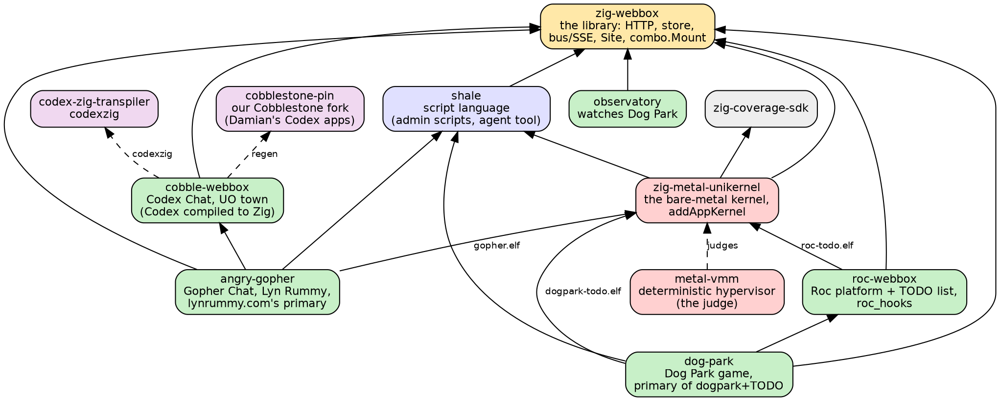
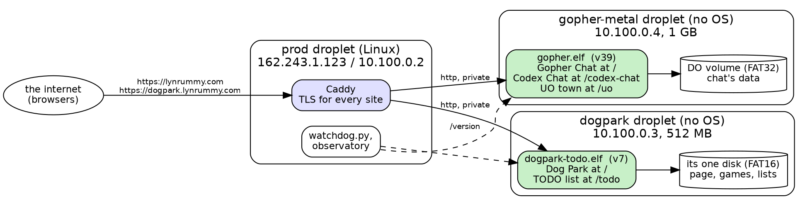
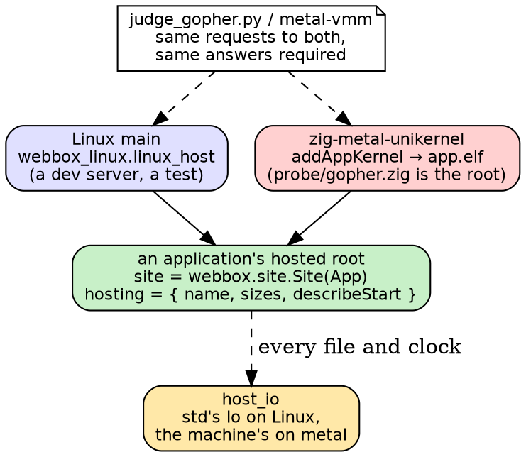
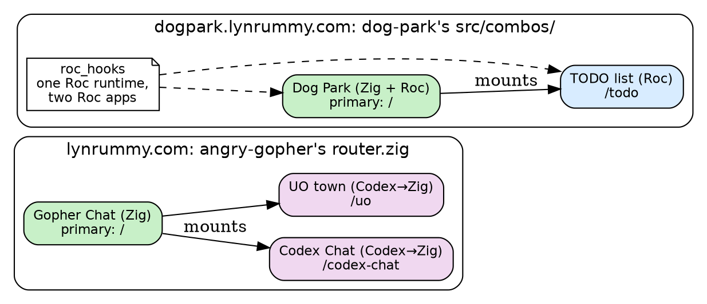
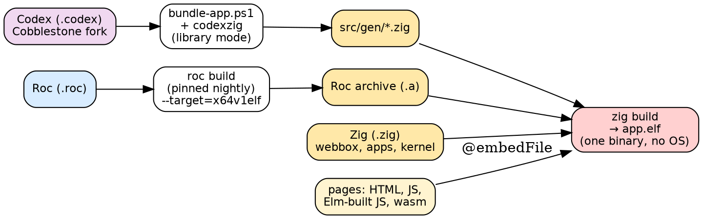
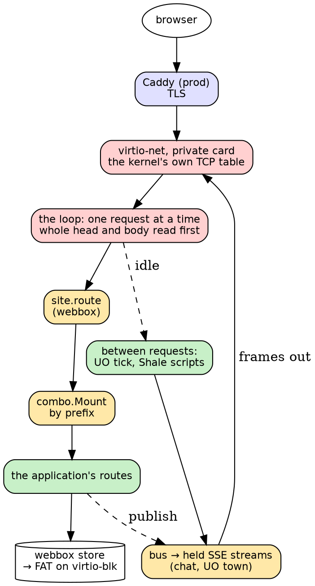

# Webbox: the big picture

Seven pictures for orientation, then the languages. Each picture is
numbered so you can say which ones land. As of 2026-10-25: lynrummy.com
serves v39, dogpark.lynrummy.com serves Dog Park v7.

## 1. The repos, and what depends on what

Solid arrows: "is built from" (a build dependency). Dashed: "is judged
or generated by".

## 2. The two bare-metal deployments

No Linux on either droplet: each boots straight into our kernel. Prod
holds HTTPS and forwards over DigitalOcean's private network.

## 3. One application, two hosts

An application gives its hosts one module, its **hosted root**: `site`
(routes, setup, between, body limits) and `hosting` (its names, its
sizes, its start lines). Linux and the kernel host the same module; the
judge checks they answer alike.

## 4. Combinations: a primary and its mounts

`webbox.combo.Mount(primary, mounts)` makes several applications one
hosted root. The primary keeps `/`; each mount answers under its prefix,
sees itself at `/`, and keeps its files under `<data>/<name>`. A
combination's build lives in its primary's repo.

## 5. From source languages to one kernel

Every language ends up as Zig-linkable code in a single ELF, with the
pages compiled in.

## 6. A request on the metal

One request at a time, in one loop; between requests the applications
get their turn (the UO town's tick, a background Shale script), and
streams are pushed from the bus.

## 7. From a commit to a release

The gates judge metal against Linux, under QEMU and metal-vmm; an image is
built only for code whose verdicts passed; the owner imports and restores;
a release is a tag.

```dot
digraph release {
  rankdir=LR;
  node [shape=box, style="rounded,filled", fontname="Helvetica", fontsize=11, fillcolor="#ffffff"];
  commit [label="commits in the\nsibling repos"];
  checkzig [label="ops/check_zig\n(lints, unit tests)"];
  gates [label="release-check.sh\ngates: tiers 0-3\n(QEMU, metal-vmm,\njudge_gopher)", fillcolor="#ffd0d0"];
  long [label="long tier\n(fault sweeps,\nFAT16 judge)", fillcolor="#ffd0d0"];
  verdicts [label="verdicts\nkeyed to exact code", shape=note];
  image [label="droplet/chat.py or\ndog-park image.mjs\n→ vN.img.gz"];
  owner [label="Steve:\nimport the image,\nrestore the droplet", fillcolor="#e0e0ff"];
  smoke [label="smoke test,\nwatchdog"];
  tag [label="tag vN", fillcolor="#c8f0c8"];
  commit -> checkzig -> gates -> long -> verdicts -> image -> owner -> smoke -> tag;
}
```

## The languages

| language | where we use it | what it brings |
|---|---|---|
| **Zig** | webbox, every host, the kernel, Gopher Chat, Dog Park's server | no runtime or OS needed: the same code runs on Linux and on bare metal; explicit memory; `comptime` builds the combos and the host contract |
| **Roc** | Dog Park's physics, the TODO list, CC's Roc chat (in progress) | immutable values and pure functions; effects only through its platform, so the host decides what it may touch; compiles to native code a Zig host links |
| **Codex** (Cobblestone) | Codex Chat, Damian's UO town (`cobblestone-pin`) | Cobblestone's own language, built to run on bare metal on its own VM; whole-program, with a heap it manages explicitly; we transpile it to Zig (`codexzig`) |
| **JavaScript** | every page: chat, the UO town's map, Dog Park's canvas, the TODO list | runs in every browser with nothing installed; EventSource for live streams |
| **Elm** | Lyn Rummy's client | a typed, pure language for browser UIs; compiles to JavaScript |
| **Shale** | the sites' admin scripts on metal; the agent's tool on the box | Lua-like, every run bounded (steps, reads, output), refuses what it can't undo; one language for a server's own data and for our scripting |
| **Python** | the kernel's judges and image builders | older tooling, being moved to Shale where it can |
| **PowerShell** | Cobblestone's own build (`bundle-app.ps1`, `compile.ps1`) | Damian's toolchain, used as it is |
